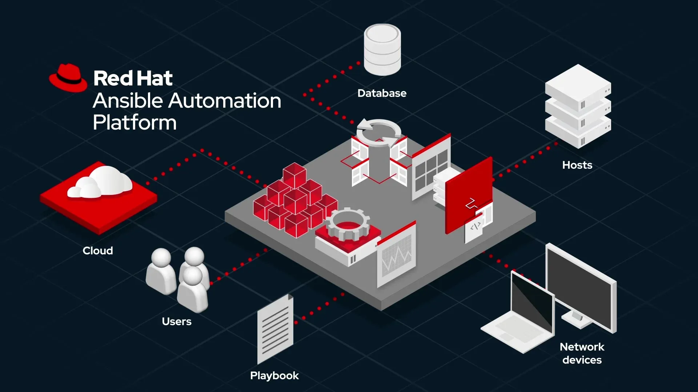
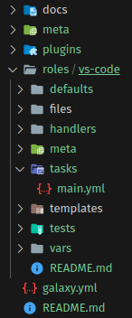
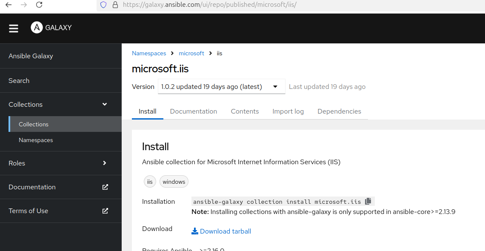
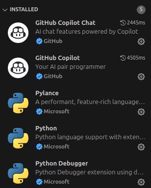
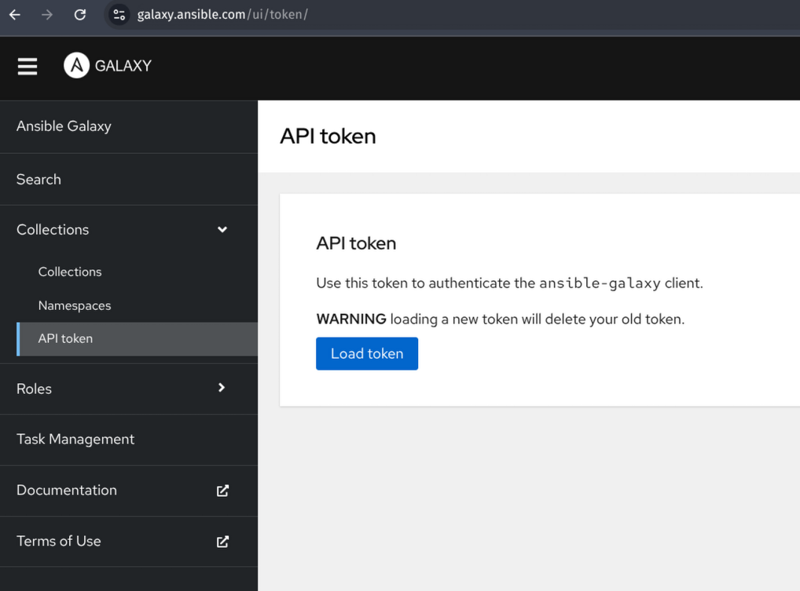

# Personal Linux System and Dotfiles Automation with Ansible Collection


In this article, we'll try to learn how we can manage both our applications and our dotfiles with Ansible for multiple different Linux distributions. Our goal is to create a starting point rather than a full system. We'll build an example with a clear, simple structure that we can extend as we like.





To understand the article and run the examples, you need to know a bit of Ansible. Our goal is not so much to learn Ansible as to build a simple example of how we can use Ansible on our personal systems.

In the article, we'll also see the Collection structure, one of Ansible's features. Basically, our goal is that when we install a Linux distribution from scratch, the applications we use get installed and all our settings get applied. And, if possible, to be able to run it on different distributions as well.


## What Is an Ansible Collection? How Is It Used?

An Ansible Collection is a structure in the Ansible ecosystem that lets us bundle roles, plugins, modules, playbooks and other Ansible content together like a single package and share it. You can actually think of it as "Ansible's packaging and distribution mechanism".

In other words, a collection is a method we use to group our Ansible objects and make them reusable while writing Ansible playbooks.

For example, while managing an infrastructure with Ansible, we may often need to develop similar roles or custom plugins. Instead of sharing these roles and plugins one by one, we can organize them inside a structure called a Collection, version them, and distribute them via Ansible Galaxy (or a private repository). This way, when we want to use them in different projects or on a different machine, we can install everything at once with a single command (for example `ansible-galaxy collection install <namespace>.<collection_name>`).


In the first example we'll do, we'll try to understand exactly what a collection is and how it works. After this section, we'll do a real system setup below.

Now let's get to work. We create a folder, create a file named Vagrantfile inside it, and copy the text below into it.

```ruby
Vagrant.configure("2") do |config|

  config.vm.box = "bento/ubuntu-24.04"
  config.vm.box_version = "202502.21.0"
  config.vm.provider "virtualbox" do |vb|

  vb.gui = true
  vb.memory = "4048"
  end

end
```

Then we open a terminal/powershell in the same directory and bring up our ubuntu machine with the `vagrant up` command.

After the installation finishes, we connect to the machine with the command below. If you like, you can also log in using the interface through Virtualbox. You can enter vagrant as the username and password.

```shell
vagrant ssh
```


Then we install Python3 and Ansible with the commands below.

```shell
sudo apt update && sudo apt upgrade -y && sudo apt install python3 python3-pip -y && sudo apt install python3-venv -y

cd $HOME

python3 -m venv ansible_virtual_env

source ansible_virtual_env/bin/activate

pip install ansible
```
We want to support multiple distributions by creating multiple users.

We could create the file and folder structure manually, but we won't do that. Instead, we'll use an *Ansible Collection*.

An Ansible Collection is a structure in the Ansible ecosystem that lets us bundle roles, plugins, modules, playbooks and other Ansible content together like a single package and share it. You can actually think of it as "Ansible's packaging and distribution mechanism".

For example, while managing an infrastructure with Ansible, we may often need to develop similar roles or custom plugins. Instead of sharing these roles and plugins one by one, we can organize them inside a structure called a Collection, version them, and distribute them via Ansible Galaxy (or a private repository). This way, when we want to use them in different projects or on a different machine, we can install everything at once with a single command (for example ansible-galaxy collection install \<namespace>.<collection_name>).


We'll run all our commands on the virtual machine we created earlier. Of course, you can also run them on your own computer and sync them via git.
We'll run all our commands on the virtual machine we created earlier. Of course, you can also run them on your own computer and sync them via git.

In this command, *my_ansible_dotfiles* is the collection namespace name and *developer_machine* is the collection name.

```shell
ansible-galaxy collection init my_ansible_dotfiles.developer_machine
```
If we look at the *developer_machine* directory;
- The `galaxy.yml` file carries the meta information for our collection. You can change this file with your own information.
- In the roles directory, we'll put the installation and configuration of the applications and services we want to run on our machine
- The `runtime.yml` file in the meta folder is a file created to manage more advanced configurations, such as Ansible version compatibility, old/new plugin and module paths (redirection / deprecation), and defining common module groups.


Now let's start adding our roles. While in the collection directory, we add a role from the terminal. Our first role will be `vs-code`.


```shell
cd developer_machine
ansible-galaxy init roles/vs-code
```

We can see that the `vs-code` role has been added.


The folder structure will be as below.




Later, when using this role in our playbooks, we'll use it by writing the namespace name as below.

```yml
- name: Use a role from the my_ansible_dotfiles.developer_machine collection
  hosts: all
  roles:
    - name: my_ansible_dotfiles.developer_machine.vs-code
```

Now let's start writing our vs-code role. First, let's install vs-code. We go into the `vs-code` folder created in the roles folder and add the code below to the `main.yml` file in tasks.

```yml
---

- name: Install vscode
  become: yes
  apt:
    name: code
    state: present
- name: Install vscode extensions
  ansible.builtin.command:X-Forwarded-For
    cmd: code --force --install-extension {{ item }}
  changed_when: false
  loop:
    - github.copilot
    - github.vscode-github-actions
    - ms-python.python
```

So far we've created a collection and added VS Code and some extensions to this collection. Now let's test what we've done so far on our machine.

For this, we first need to build and install our collection.

While in the collection's root directory, we run the commands below from the terminal.

```bash
ansible-galaxy collection build --force
```

In the end, we'll have a file named `my_ansible_dotfiles-developer_machine-1.0.0.tar.gz`.

As we also mentioned above, creating and installing a collection doesn't mean we've run the code in it. In other words, when we install this collection, we won't have installed these applications. What we'll have is a collection made up of roles, plugins, modules, etc. that we can use in playbooks.

Now let's install it.

```shell
ansible-galaxy collection install my_ansible_dotfiles-developer_machine-1.0.0.tar.gz
```

When we run the command, the collection we created is installed into the `/home/vagrant/.ansible/collections/ansible_collections` directory.

Now we're able to use the roles here. We can write and run a playbook like the one below.

```yaml
- hosts: all
  collections:
    - my_ansible_dotfiles.developer_machine
  roles:
    - vs-code
```

We can copy the code above into a file named `playbook.yml` and run it with the command below.

```shell
ansible-playbook playbook.yml
```

With this command, our vs-code role will run together with the ` github.copilot, github.vscode-github-actions, ms-python.python` VS Code extensions we specified in the role.

Of course, since here we wrote and used the collection on the local system, we packaged and installed it. But if we wanted to use a collection from the Ansible Galaxy page, we'd have to install it as in the example below. For example, in the example below we're installing the Microsoft IIS collection. Collection page : https://galaxy.ansible.com/ui/repo/published/microsoft/iis/

```shell
ansible-galaxy collection install microsoft.iis
```




But let's say we ourselves are writing a collection that uses another collection, and we're going to publish it on Ansible Galaxy as well. So we shouldn't have to tell the developer who will use our collection, "go and also install these collections". For this, there's a file named `galaxy.yml` in the collection structure.


I'm giving a short part of this file below. There's a section here called *dependencies*. We can add our other collection dependencies to this part, as I wrote in the example below.

```yaml
description: My developmnet machine

license:
- GPL-2.0-or-later

license_file: ''

tags: []

dependencies: { other_namespace.some_collection: '>=2.0.0,<3.0.0', community.crypto: '*'}

# The URL of the originating SCM repository
repository: http://example.com/repository

# The URL to any online docs
documentation: http://docs.example.com

# The URL to the homepage of the collection/project
homepage: http://example.com

# The URL to the collection issue tracker
issues: http://example.com/issue/tracker

```

This way, when our collection is installed, its dependencies will be installed too.


Up to here we've tried to understand the subject. Now let's look at how we can develop a system that includes user management and supports multiple machines.

## System and Dotfiles Management


First, let's list what we want to do.

- All roles should be able to be added and removed individually
- All roles should be able to be removed and added all at once
- Any role's additional components (for example VC Code components) should be able to be added and removed for each distribution
- Users should be able to be added to and removed from the system
- User roles should be editable
- User home configurations should be possible
- Different machines should be manageable (for example, machine-specific applications, drivers, etc. should be installable)
- and packages should be installable on multiple machines for different distributions at the same time


So, in the final analysis, when we install a machine from scratch, we should be able to set up users, user-specific settings and the necessary applications on it.

Now let's create a new collection and try to build such a system. It'll be easier for you if you do this work by logging in through the interface directly on the machine we created with Vagrant.

For this, let's create a new collection with the command below.


```bash

# We activate the Python virtual environment we created earlier above

source $HOME/ansible_virtual_env/bin/activate

ansible-galaxy collection init my_namespace.my_machines

```
When we ran the code, the `my_namespace/my_machine` directory was created.

We'll write our project from the outside in. That is, we'll first sketch out what we want and then fill in the details. For this, we'll first write the inventory, then the playbook, and finally fill in our collection.

## Creating the Inventory

Let's create a file named `inventory.yml` in the `my_namespace/my_machine` directory and fill it in as below. As you may remember, our goal is to install the same packages on different distributions.

Right now we only have our localhost machine, and that's an ubuntu machine.

But later we'll also build the structure where we can test via Vagrant and test all the distributions.

```yml
all:
  children:
    ubuntu_hosts:
      hosts:
        ubuntu1:
          ansible_connection: local
          ansible_become_method: sudo
          ansible_become: yes
    arch_hosts:
      hosts:
        arch1:
          ansible_host:
        arch2:
          ansible_host:
    fedora_hosts:
      hosts:
        fedora1:
          ansible_host: 
        fedora2:
          ansible_host:
```

Now let's also add a playbook to the same directory. Let it contain all the roles, the users to be created and the distribution-specific settings.

I created a file named `my_machine_playbook.yml` and copied its content from below.


```yml
---
- name: Setup Ubuntu systems # we had mentioned that we can set up more than one Ubuntu system in our inventory file
  hosts: ubuntu_hosts
  gather_facts: yes
  connection: local
  become_method: sudo
  become: yes  # for sudo privileges
  collections:
    - my_namespace.my_machines # if desired, a different name than the folder structure can also be used. It can be configured via the galaxy.xml file.
    # we're only using our own collection.
  vars:
    target_distribution: Ubuntu
    system_users:
      - username: developer
        shell: /bin/zsh # zsh shell for the developer user
      - username: admin 
        shell: /bin/bash # bash shell for the admin user
    excluded_packages: # Later in the roles we'll install default packages, but if there are any of them we don't want to install, we want to manage that from here.
      - vim
    install_ohmyzsh: true # a setting to determine whether the ohmyzsh theme for zsh will be installed or not.


  pre_tasks:
    - name: Verify target distribution # before the installation starts, we check whether the machine we'll install on is ubuntu or not.
      fail:
        msg: "The machine you are installing on must be Ubuntu" 
      when: ansible_distribution != target_distribution

  roles:  # our goal is to install the roles below.
    - my_namespace.my_machines.base_setup # packages we want to have at minimum on all distributions, creation of users and other settings.
    - my_namespace.my_machines.common_packages # general packages
    - my_namespace.my_machines.zsh # role for installing zsh and managing dotfiles
    - my_namespace.my_machines.vscode # installation and settings of vscode and extensions 

######################## Example Archlinux configuration ##########################
- name: Setup Arch Linux systems
  hosts: arch_hosts
  gather_facts: yes
  connection: local
  become_method: sudo
  become: yes  # for sudo privileges
  collections:
    - my_namespace.my_machines
  vars:
    target_distribution: Archlinux
    system_users:
      - username: developer
        shell: /bin/zsh # zsh shell for the developer user
      - username: admin 
        shell: /bin/bash # bash shell for the admin user
    excluded_packages:
      - vim
    install_ohmyzsh: true

  pre_tasks:
    - name: Verify target distribution
      fail:
        msg: "The machine you are installing on must be Archlinux"
      when: ansible_distribution != target_distribution

  roles:
    - my_namespace.my_machines.base_setup
    - my_namespace.my_machines.common_packages
    - my_namespace.my_machines.zsh
    - my_namespace.my_machines.vscode

######################## Example Fedora configuration ##########################

- name: Setup Fedora systems
  hosts: fedora_hosts
  gather_facts: yes
  connection: local
  become_method: sudo
  become: yes  # for sudo privileges
  collections:
    - my_namespace.my_machines
  vars:
    target_distribution: Fedora
    system_users:
      - username: developer
        shell: /bin/zsh # zsh shell for the developer user
      - username: admin 
        shell: /bin/bash # bash shell for the admin user
    excluded_packages:
      - vim
    install_ohmyzsh: true

  pre_tasks:
    - name: Verify target distribution
      fail:
        msg: "The machine you are installing on must be Fedora"
      when: ansible_distribution != target_distribution

  roles:
    - my_namespace.my_machines.base_setup
    - my_namespace.my_machines.common_packages
    - my_namespace.my_machines.zsh
    - my_namespace.my_machines.vscode
```


Now we can add our roles. We run the commands below while in the my_machine folder.

```bash
ansible-galaxy init roles/base_setup
ansible-galaxy init roles/common_packages
ansible-galaxy init roles/zsh
ansible-galaxy init roles/vscode
```

After these commands, our directory structure will look like the one below.

```
├── docs
├── galaxy.yml
├── inventory.yml
├── meta
├── my_machine_playbook.yml
├── plugins
├── README.md
└── roles
    ├── base_setup
    ├── common_packages
    ├── vscode
    └── zsh
```

If you check any of the roles, you can see that a lot of folders have been added. We won't use all of them. Examining all the folders here isn't our topic anyway, but still, if you don't know what they're for and would like to learn, you can take a look at the two resources below.

- [Ansible Official Playbook Page](https://docs.ansible.com/ansible/latest/playbook_guide/playbooks.html)
- [Ansible Official Roles Page](https://docs.ansible.com/ansible/latest/playbook_guide/playbooks_reuse_roles.html#roles)

## Base_Setup Role Management

Now let's start writing our base_setup role.

First, let's start with the definitions of the system groups and base packages. For this, let's create a file named `ubuntu.yml` in the vars directory under base_setup and make its content as below. The packages below are just an example; you can add and remove whatever you want. But what you need to pay attention to here is that the packages here are very low level. In other words, they're the applications we'll need for the system to work, even if we don't install any applications at all.

The values we define in the Vars folder are used for variables that won't be changed within the role, that is, that we want to stay constant.


```yml
system_groups:
  admin: sudo
  developer: sudo
base_packages:
  - sudo
  - build-essential
  - man-db
  - bash-completion
```

Now we also define a file named `main.yml` in the defaults folder and make its content as below. What we define in this folder can be changed from outside, for example via the playbook. If you remember, in our playbook definition above we had overridden the sistem_users variable. While only the admin user is defined here, above we also added the developer user. Here

```yml
system_users:
  - username: admin
    groups: wheel,sudo
    shell: /bin/bash

excluded_packages: []

base_packages:
  - vim
  - git
  - curl
  - wget
  - htop
```

Now let's write the task that will manage these. We'll also differentiate the tasks by distribution.

We create a file named `ubuntu.yml` in the tasks folder and change its content as below.

```yml

- name: Update apt cache
  apt:
    update_cache: yes
    cache_valid_time: 3600

- name: Install base packages
  apt: # we install the packages defined in base_packages that haven't been excluded in the playbook.
    name: "{{ base_packages | difference(excluded_packages | default([])) }}"
    state: present

- name: Create system users # we loop through the user list defined in sistem_users and create the users. 
  ansible.builtin.user:
    name: "{{ item.username }}"
    groups: "{{ system_groups[item.username] }}"
    shell: "{{ item.shell }}"
    create_home: yes
  loop: "{{ system_users }}"

```

But the `ubuntu.yml` file can't run on its own; for this, we change the content of the `main.yml` file in tasks as below. If the file doesn't exist, we should create it.


```yml
- name: Get system information
  ansible.builtin.setup:
    gather_subset:
      - distribution # we provide the distribution information with the target_distribution variable in the playbook

- name: Include distribution specific variables # we load the distribution variables for the related distribution.
  include_vars: "{{ ansible_distribution | lower }}.yml"


# if desired, tasks can also be added for other work related to this role to be done on all distributions.
```

## Common_Packages Role Management

With this role, we'll install the applications we can install and use right away without needing any configuration. For packages that have dotfiles, like Zsh and Visual Studio Code, and that we need to manage after installation too, we'll write separate roles.

First, to define the packages to be installed, we create a file named `ubuntu.yml` in the vars folder under the common_packages directory and change its content as below.

```yml

common_packages:
  - git
  - vim
  - curl
  - wget
  - htop
  - ffmpeg
  - jq
  - tree
  - unzip
  - zip
  - tmux
  - net-tools

```

Then we add a file named `ubuntu.yml` to the tasks folder and change its content as below.

```yml
- name: Install common packages for Ubuntu # the packages defined as variables are being installed.
  apt:
    name: "{{ common_packages | difference(excluded_packages | default([])) }}"
    state: present
    update_cache: yes
```

Finally, we also add a `main.yml` file.

```yml
- name: Include distribution specific variables # the distribution-specific var file is being loaded
  include_vars: "{{ ansible_distribution | lower }}.yml"

- name: Include distribution specific tasks
  include_tasks: "{{ ansible_distribution | lower }}.yml" # the distribution-specific tasks are being loaded.
```

Now let's test what we've done so far. For this, we first need to build and install our collection.

While in the collection's root directory, we run the commands below from the terminal.

```bash

# First, we activate the virtual environment we created for Ansible
source $HOME/ansible_virtual_env/bin/activate

# then we build
ansible-galaxy collection build --force
```

In the end, we'll have a file named `my_namespace-my_machines-1.0.0.tar.gz`.

As we also mentioned above, creating and installing a collection doesn't mean we've run the code in it. In other words, when we install this collection, we won't have installed these applications. What we'll have is a collection made up of roles, plugins, modules, etc. that we can use in playbooks.

Now let's install it.

```shell
ansible-galaxy collection install my_namespace-my_machines-1.0.0.tar.gz --force
```

When we run the command, the collection we created is installed into the `/home/vagrant/.ansible/collections/ansible_collections/my_namespace/my_machines/` directory.  We go to this directory and run the playbook.

Now we can do the installation using the playbook and inventory files we defined.

```shell
ansible-playbook -i inventory.yml my_machine_playbook.yml  --limit ubuntu_hosts -e "target_distribution=Ubuntu"
```
After the installation finishes, you can, for example, run some of the packages we installed, such as jq, ffmpeg and tree, from the terminal.

Let's also check the users we added.

```shell
cat /etc/passwd

# result
#developer:x:1001:1001::/home/developer:/bin/zsh
#admin:x:1002:1002::/home/admin:/bin/bash
```

We can see that our users have been added too.


## VsCode Role Management


First, we create a file named `ubuntu.yml` in the vars folder in the vscode directory and change its content as below.

For the Linux installation, we follow [this link](https://code.visualstudio.com/docs/setup/linux#_install-vs-code-on-linux) on the official VS Code page.

```yml
vscode_package: code
vscode_repository_key: https://packages.microsoft.com/keys/microsoft.asc
vscode_repository: deb [arch=amd64] https://packages.microsoft.com/repos/vscode stable main
```


Then, so that it can also be changed from outside the role, we create a file named `main.yml` under the defaults folder and change its content as below.

You can find the extension names in the VS Code marketplace. VS Code has a cli for installing and managing extensions. You can check it on the [official website](https://code.visualstudio.com/docs/configure/command-line). We're only doing install and uninstall operations, but it has many more features.

```yml

vscode_extensions_present: # the ones we want to install
  - ms-python.python
  - redhat.ansible
  - github.copilot
  - esbenp.prettier-vscode
  - yzhang.markdown-all-in-one
  - github.vscode-github-actions
vscode_extensions_absent: ## the ones we want to remove if installed
  - hashicorp.terraform
```

We put a file named `ubuntu.yml` under the Tasks folder and change its content as below.

```yml
- name: Add VS Code repository key
  apt_key:
    url: "{{ vscode_repository_key }}"
    state: present

- name: Add VS Code repository
  apt_repository:
    repo: "{{ vscode_repository }}"
    state: present

- name: Install VS Code
  apt:
    name: "{{ vscode_package }}"
    state: present
    update_cache: yes
```

And finally, we add a `main.yml` file under tasks and make its content as below.


```yml
- name: Include distribution specific variables   # the vars for the distribution are being loaded
  include_vars: "{{ ansible_distribution | lower }}.yml"

- name: Include distribution specific tasks       # the task for the distribution is being loaded
  include_tasks: "{{ ansible_distribution | lower }}.yml"

- name: Install VS Code extensions
  become: no  # don't try to run as root
  ansible.builtin.shell: |
    code --no-sandbox --user-data-dir=/home/{{ item.0.username }}/.vscode --install-extension {{ item.1 }}
  register: vscode_ext_install
  changed_when: "'successfully installed' in (vscode_ext_install.stdout | default(''))" # if the shell stdout output says "successfully installed", it means the extension was installed successfully.
  failed_when: 
    - vscode_ext_install.rc is defined   # that is, did the shell command run?
    - vscode_ext_install.rc != 0  # if the shell ran, is the result different from zero? that is, is there an error?
    - "'already installed' not in (vscode_ext_install.stderr | default(''))" # # if "already installed" isn't in the shell error output, then it means there really is an error. 
  with_nested:
    - "{{ system_users }}" # we install it separately for each user
    - "{{ vscode_extensions_present | default([]) }}"
  environment:
    DISPLAY: ":0" # the code --install-extension command may want access to the GUI in the background. We're installing via the shell, so we're giving the command permission to use the GUI. If we don't use this, some extensions may give errors during installation. If we definitely won't use it, that is, if we'll do the installation entirely via the shell, then we can also download the vsix packages and install them with a script. 

- name: Uninstall VS Code extensions
  become: no  # don't try to run as root
  ansible.builtin.shell: |
    code --no-sandbox --user-data-dir=/home/{{ item.0.username }}/.vscode --uninstall-extension {{ item.1 }}
  register: vscode_ext_uninstall
  changed_when: "'successfully uninstalled' in (vscode_ext_uninstall.stdout | default(''))"
  failed_when:
    - vscode_ext_uninstall.rc is defined
    - vscode_ext_uninstall.rc != 0
    - "'is not installed' not in (vscode_ext_uninstall.stderr | default(''))"
  with_nested:
    - "{{ system_users }}"
    - "{{ vscode_extensions_absent | default([]) }}" # the ones whose state is absent are uninstalled.
  environment:
    DISPLAY: ":0"
```


We can test this right away too.

```shell
source $HOME/ansible_virtual_env/bin/activate

# then we build
ansible-galaxy collection build --force

ansible-galaxy collection install my_namespace-my_machines-1.0.0.tar.gz --force

cd /home/vagrant/.ansible/collections/ansible_collections/my_namespace/my_machines/

ansible-playbook -i inventory.yml my_machine_playbook.yml  --limit ubuntu_hosts -e "target_distribution=Ubuntu"

```

After the installation, we'll now be able to run VS Code. When we check the extensions too, we can see that they're installed.




## Zsh Role and Dotfile (Custom Configuration) Management

In the Zsh installation, we'll also add our own configuration file to the system.


Again, let's start with the vars directory first. We create a file named `ubuntu.yml` in the vars folder of the Zsh role and change its content as below.

```yml
zsh_packages:
  - zsh
```
We'll use a Jinja2 template to modify and copy the configuration file we'll use to customize Zsh. For this, we create a file named `zshrc.j2` in the templates folder. Its content will be as below.


```jinja

# Path to Oh My Zsh installation
export ZSH="{{ user_homes[item.username] }}/.oh-my-zsh"

# Set theme
ZSH_THEME="robbyrussell"

# Define plugins
plugins=(
    git
    zsh-autosuggestions
    zsh-syntax-highlighting
)

# Set common options
HYPHEN_INSENSITIVE="true"
ENABLE_CORRECTION="true"
COMPLETION_WAITING_DOTS="true"

# History settings
HIST_STAMPS="yyyy-mm-dd"
HISTSIZE=10000
SAVEHIST=10000
HISTFILE=~/.zsh_history

# Load Oh My Zsh
source $ZSH/oh-my-zsh.sh

# User configuration
export LANG=en_US.UTF-8

# Preferred editor for local and remote sessions
if [[ -n $SSH_CONNECTION ]]; then
    export EDITOR='vim'
else
    export EDITOR='vim'
fi

# Compilation flags
export ARCHFLAGS="-arch $(uname -m)"

```

If you don't know what Zsh is, don't get too hung up on it. Just like bash, it's a shell too. Because it's customizable, it has become perhaps one of the most used shell systems in recent years. It can be extended with its plugin structure. We can also keep our customization settings in a file. This way, we don't have to redo all the settings after every installation.

One of the first tools everyone who uses Zsh installs might be `Oh My Zsh`. This is also a tool that lets us handle Zsh's plugin and theme configuration more easily and effectively.


If we look at the content of the `zshrc.j2` file above, we can see the text `{{ user_homes[item.username] }}` on the second line. The Jinja2 template lets us run code between `{{ }}`. Also, with Jinja2 we can pass data from Python into the file. For example, in the `{{ user_homes[item.username] }}` line, while user_home reads a value from Ansible, with `item.username` we read the information passed from the Ansible task. We'll understand this better once we create the tasks too.


Now we create a file named `ubuntu.yml` inside the tasks folder and add the code below.

```yml
- name: Install zsh packages
  apt:
    name: "{{ zsh_packages }}"
    state: present
```

Then we create our `main.yml` file and copy the content below.


```yml

- name: Include distribution specific variables
  include_vars: "{{ ansible_distribution | lower }}.yml"

- name: Include distribution specific tasks
  include_tasks: "{{ ansible_distribution | lower }}.yml"

- name: Install zsh and dependencies
  package:
    name: "{{ zsh_packages }}"
    state: present

- name: Get user home directory # we set each user's home directory as a fact. This way, it becomes accessible from all tasks.
  ansible.builtin.set_fact:
    user_homes: "{{ user_homes | default({}) | combine({ item.username: '/home/' + item.username }) }}"
  loop: "{{ system_users }}"

- name: Install Oh My Zsh # oh-my-zsh is being downloaded for all users.
  ansible.builtin.git:
    repo: https://github.com/ohmyzsh/ohmyzsh.git
    dest: "{{ user_homes[item.username] }}/.oh-my-zsh"
  loop: "{{ system_users }}"
  when: install_ohmyzsh | default(true)
  become: false

- name: Deploy .zshrc configuration file # while our template file zshrc.j2 is copied for each user, the system_users item in the loop is passed to the template file. 
  ansible.builtin.template:
    src: zshrc.j2
    dest: "{{ user_homes[item.username] }}/.zshrc"
    owner: "{{ item.username }}"
    group: "{{ item.username }}"
    mode: '0644'
  loop: "{{ system_users }}"
  when: item.shell == '/bin/zsh'

- name: Set zsh as default shell
  ansible.builtin.user:
    name: "{{ item.username }}"
    shell: /bin/zsh
  loop: "{{ system_users }}"
  when: item.shell == '/bin/zsh'


```


The most important thing in the Zsh role is keeping our dotfile on git and being able to copy it to our home directory with the help of the Jinja2 template whenever we do an installation.

This way, you can, for example, store, edit and automatically load your KDE Plasma or Gnome settings and all your other home directory and application settings with Ansible.


Now let's run what we've done so far again.

```shell
source $HOME/ansible_virtual_env/bin/activate

# then we build
ansible-galaxy collection build --force

ansible-galaxy collection install my_namespace-my_machines-1.0.0.tar.gz --force

cd /home/vagrant/.ansible/collections/ansible_collections/my_namespace/my_machines/

ansible-playbook -i inventory.yml my_machine_playbook.yml  --limit ubuntu_hosts -e "target_distribution=Ubuntu"
```

We had made zsh the default shell for the developer user we added to the playbook. When we switch to this user in the terminal, we can see that zsh has been configured too.

## Managing Other Distributions Too


All you need to do here is clone the `ubunut.yml` files we wrote for ubuntu for Fedora and Archlinux and edit their contents to suit them. When you update the inventory file and run the playbook, the installation for the related distribution will be done.


## Closing

Now we can add our collection to Ansible Galaxy. We can both download and use it directly from Galaxy ourselves and open it up to other end users. For this, we first open an account at https://galaxy.ansible.com — I won't go into the details of this; it's very easy anyway.

After logging in, we create a token. We click the `load token` button, which you can also see in the image below.



Now we can build and publish. But pay attention to the following: the namespace and collection name below have to be the same as yours. To ensure this, you should change the namespace and collection name fields in `galaxy.yml` to your own namespace name.

```shell
ansible-galaxy collection build --force

ansible-galaxy collection install my_namespace-my_machines-1.0.0.tar.gz --force

ansible-galaxy collection publish --token your_token_here -c  my_namespace-my_machines-1.0.0.tar.gz

```

From now on, we can install directly via Galaxy. Let me remind you again: you need to write your own namespace and collection name here.

```shell

ansible-galaxy collection install my_namespace.my_machines

```

After this, just as we did above, you can go to the related directory and run the playbook.


You can find the finished, working version of the application at the links below.

- Github Repo: https://github.com/muratcabuk/murat_dotfiles
- Usable Collection Link:  https://galaxy.ansible.com/ui/repo/published/muratcabuk/murat_dotfiles/


That's it for this article. See you in the next one.


