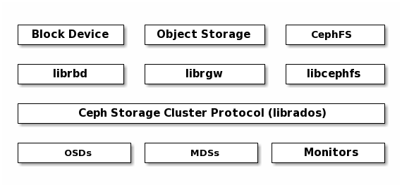
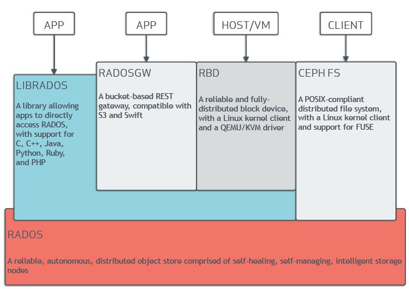
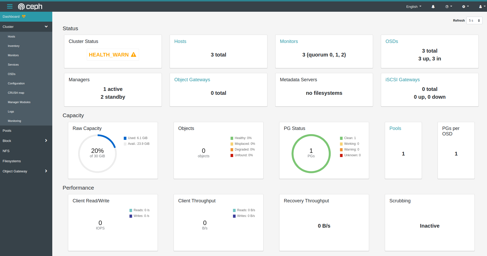
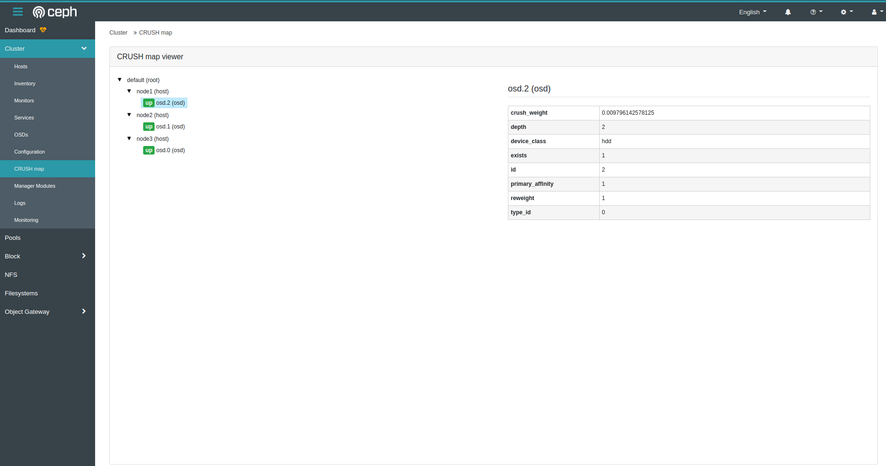

### Setting Up Ceph Storage the Hard Way

Hello friends, 

In this article, we'll try to install Ceph, one of Red Hat's open source distributed storage solutions, without using any deployment tool, entirely as described in its documentation.

I recommend doing this kind of installation only for educational purposes. Our goal is to try to understand the installations and configurations done during the installation of Ceph. Trying to set up and manage real production environments this way would be very exhausting. Also, since it'll be an installation that's very prone to mistakes, it makes more sense to use deployment tools.

- [Cephadm](https://docs.ceph.com/en/pacific/cephadm/#cephadm): Deployment tool with an independent cli
- [Rook](https://rook.io/): Installation method for Kubernetes environments
- [Ceph-Ansible](https://docs.ceph.com/ceph-ansible/): Installation method with Ansible
- Ceph-[deploy](https://docs.ceph.com/projects/ceph-deploy/en/latest/): This installation is no longer supported.
- [Deepsea](https://github.com/SUSE/DeepSea): Deployment option for Salt
- [Puppet-ceph](https://github.com/openstack/puppet-ceph)
- **[Manual Installation](https://docs.ceph.com/en/pacific/install/index_manual/#install-manual)**: We'll do the installation with this method

Our prerequisite is knowing a bit of [Vagrant](https://www.vagrantup.com/docs) and Linux.

Happy reading, I hope it'll be useful.


### Setting Up the Lab Environment

We'll use 3 machines. The specs and the ceph components to be installed will be as follows

- Ubuntu 20.04, an extra disk at /dev/sdb
- The Ceph MON, MGR,MDS, OSD components will be installed on all three machines.


You can find both methods for setting up the lab environment with Vagrant below.

- libvirt (kvm-qemu): Can only run on Linux
- Virtualbox: Can run on Mac, Windows and Linux


#### Setting Up the Vagrant Lab Environment with Libvirt

If you don't want to deal with too much, prefer the Vagrant-VirtualBox installation below.

- we install the kvm-qemu packages

```bash
sudo apt update && sudo apt install -y qemu qemu-kvm libvirt-daemon bridge-utils virt-manager virtinst libvirt-clients

sudo systemctl status libvirtd

sudo systemctl enable --now libvirtd

```

We install [Vagrant](https://www.vagrantup.com/downloads).

```bash
curl -fsSL https://apt.releases.hashicorp.com/gpg | sudo apt-key add -
sudo apt-add-repository "deb [arch=amd64] https://apt.releases.hashicorp.com $(lsb_release -cs) main"
sudo apt-get update && sudo apt-get install vagrant
```

Then we install the [vagrant-libvirt](https://github.com/vagrant-libvirt/vagrant-libvirt) plugin. 

```bash
sudo apt-get install libxslt-dev libxml2-dev libvirt-dev zlib1g-dev ruby-dev

vagrant plugin install vagrant-libvirt
```

**WARNING:** If you get an error about not being able to access the https://rubygems.org page while installing the plugin, apply the steps below. For details, visit [this page](https://stackoverflow.com/questions/49800432/gem-cannot-access-rubygems-org).


Open the _/etc/gai.conf_ file and add the line _"precedence  2a04:4e42::0/32  5"_ at the very bottom, removing the quotes. Then restart the network service.


**WARNING:** if you get an error saying the st.h file doesn't exist, run the command below. Pay attention to your version number.

```bash
sudo ln -s /opt/vagrant/embedded/include/ruby-3.0.0/ruby/st.h /opt/vagrant/embedded/include/ruby-3.0.0/st.h
```


**WARNING:** If you keep getting errors with the command above in the Vagrant-libvirt installation, you can also try installing it with the command below.

```bash
sudo apt install ruby-libvirt
```

Now we're ready to bring up our lab environment. We run the system with the command below. Downloading the first box will take a while.

```shell
mkdir -p ~/ceph/vagrant && cd ~/ceph/vagrant

cat <<EOF | Vagrantfile

# -*- mode: ruby -*-
# vi: set ft=ruby :


# if you want to install centops, it's enough to write generic/centos8 instead of generic/ubuntu2004

# https://github.com/vagrant-libvirt/vagrant-libvirt
ENV['VAGRANT_DEFAULT_PROVIDER'] = 'libvirt'

Vagrant.configure("2") do |config|

# node1
config.vm.define "node1" do |node1|
    node1.vm.box = "generic/ubuntu2004"
    node1.vm.hostname="node1"
    node1.vm.network "private_network", ip: "10.200.10.10"
    
    node1.vm.provider :libvirt do |lv|
       lv.memory=2048
       lv.cpus=1
       #lv.host = "node1"
       lv.storage :file, :size => '10G'
# the disk will be added to the machine as /dev/vdb
    end 
 end


# node2
config.vm.define "node2" do |node2|
    node2.vm.box = "generic/ubuntu2004"
    node2.vm.hostname="node2"
    node2.vm.network "private_network", ip: "10.200.10.11"
    
    node2.vm.provider :libvirt do |lv|
       lv.memory=2048
       lv.cpus=1
       #lv.host = "node2"
       lv.storage :file, :size => '10G'
# the disk will be added to the machine as /dev/vdb
    end
 end


# node3
config.vm.define "node3" do |node3|
    node3.vm.box = "generic/ubuntu2004"
    node3.vm.hostname="node3"
    node3.vm.network "private_network", ip: "10.200.10.12"
    
    node3.vm.provider :libvirt do |lv|
       lv.memory=2048
       lv.cpus=1
       #lv.host = "node3"
       lv.storage :file, :size => '10G'
# the disk will be added to the machine as /dev/vdb
    end 
 end

end


EOF

vagrant up

```

#### Setting Up the Vagrant Lab Environment with Virtualbox

After installing [VirtualBox](https://www.virtualbox.org/wiki/Downloads) and then [Vagrant](https://www.vagrantup.com/downloads) on our machine, we create a file named [Vagrantfile](https://www.vagrantup.com/docs/providers/virtualbox/configuration) in a folder we opened on our computer and copy the lines below into it.

```Vagrantfile
# -*- mode: ruby -*-
# vi: set ft=ruby :


# if you want to install centops, it's enough to write generic/centos8 instead of generic/ubuntu2004


Vagrant.configure("2") do |config|

# node1
config.vm.define "node1" do |node1|
    node1.vm.box = "generic/ubuntu2004"
    node1.vm.hostname="node1"
    node1.vm.network "private_network", ip: "10.200.10.10"
    
    node1.vm.provider :virtualbox do |lv|
       lv.memory=2048
       lv.cpus=1
       #lv.host = "node1"
       lv.storage :file, :size => '10G'
# the disk will be added to the machine as /dev/vdb
    end 
 end


# node2
config.vm.define "node2" do |node2|
    node2.vm.box = "generic/ubuntu2004"
    node2.vm.hostname="node2"
    node2.vm.network "private_network", ip: "10.200.10.11"
    
    node2.vm.provider :virtualbox do |lv|
       lv.memory=2048
       lv.cpus=1
       #lv.host = "node2"
       lv.storage :file, :size => '10G'
# the disk will be added to the machine as /dev/vdb
    end
 end


# node3
config.vm.define "node3" do |node3|
    node3.vm.box = "generic/ubuntu2004"
    node3.vm.hostname="node3"
    node3.vm.network "private_network", ip: "10.200.10.12"
    
    node3.vm.provider :virtualbox do |lv|
       lv.memory=2048
       lv.cpus=1
       #lv.host = "node3"
       lv.storage :file, :size => '10G'
# the disk will be added to the machine as /dev/vdb
    end 
 end

end
```
then, on the terminal or command-com, while in the directory where the Vagrantfile is located, we run the _vagrant up_ command

**After doing the installation with either method, we connect to our machines with ssh**


- Username: vagrant
- Password: vagrant

while our terminal is still in the same directory as the Vagrantfile, we can connect with the command below.

```bash
vagrant ssh node1
```

When we connect to all the machines this way and ping the (10.200.10.10,11 and 12) ips, we should get a response. 

### We're Starting the Ceph Installation

We'll run some commands on all machines, so being able to run commands in more than one terminal at the same time will save time. One of the best known is [Tmux](https://thevaluable.dev/tmux-config-mouseless/); you can click the link and examine it in detail.

**1. First, we need to make sure the NTP service is running on all machines.**

For this, we run the timedatactl command.

```bash
timedatectl

# result
               Local time: Wed 2021-07-14 16:20:38 UTC
           Universal time: Wed 2021-07-14 16:20:38 UTC
                 RTC time: Wed 2021-07-14 16:20:39    
                Time zone: UTC (UTC, +0000)           
System clock synchronized: yes                        
              NTP service: active                     
          RTC in local TZ: no         

```

In the end, as above, we need to be able to see that the NTP service is active and synced. If you brought up Vagrant with Ubuntu 20.04, it's installed, but if you still have problems, you can install it by following [this link](https://linuxconfig.org/ubuntu-20-04-ntp-server).


**2. We install Ceph on all machines**

```bash
wget -q -O- 'https://download.ceph.com/keys/release.asc' | sudo apt-key add -

release=lsb_release -sc

sudo apt-add-repository 'deb https://download.ceph.com/debian-octopus/ focal main'

sudo apt update && sudo apt upgrade

sudo apt install ceph
```

We'll need about 1 GB of space for the installation.

When the installation is finished, we do a version check.

```bash
ceph -v

# as a result, the octopus version should have been installed

ceph version 15.2.13 (c44bc49e7a57a87d84dfff2a077a2058aa2172e2) octopus (stable)

```


**3. We edit the hosts file of all machines**

we add the lines below

```bsh
sudo vim /etc/hosts

# we add the lines below

10.200.10.10 node1
10.200.10.11 node2
10.200.10.12 node3
```

**4. We change the password of the root user**

We change the root password on all machines

```bash
sudo passwd root
# we changed it to vagrant

```


### MON (Monitor) Installation

Before starting the installation, let's examine the Monitor components below.

- **Unique Identifier:** the fsid is a unique identifier for the cluster.
- **Cluster Name:**  It's a descriptive name with no spaces for the Ceph cluster. The default cluster name is ceph, but a different name can also be specified. For example, when you run more than one cluster in a multi-region configuration, the cluster name (e.g. Us-west, us-east) identifies the cluster for the current CLI session. Note: To identify the cluster name on the command line interface, specify the Ceph configuration file with the cluster name (e.g. Ceph.conf, us-west.conf, us-east.conf, etc.). Also see the _ceph --cluster {cluster-name}_ command for CLI usage.
- **Monitor Name (mon):**  Each monitor instance within a cluster has a unique name. In common practice, the CephMonitor name is the host name (one Ceph Monitor per host is recommended. It's also recommended not to mix Ceph Monitors with Ceph OSDDaemons). You can use the _hostname -s_ command to get the host's short name.
- **Monitor Map:** To bootstrap the monitors, you need to create a monitor map. The monitor map requires the fsid, the cluster name (or uses the default) and at least one host name and IPaddress.
- **Monitor Keyring:**  Monitors communicate with each other via a secret key (keyring). You should create a keyring with the monitor secret and use it in the initial bootstrap of the monitors.
- **Administrator Keyring:** to use the ceph CLI tools, you need to have a _client.admin_ user. So you need to create the admin user and keyring and also add the _client.admin_ user to the monitor keyring.

**1. We create the ceph.conf file on all machines**


We'll create the cluster id only on our node1 machine and use it on the others too.

we run the command below only on the node1 machine.

```shell

uuidgen

# in the end, a GUID like the one below was created.

7fa60b7c-9d9c-46c2-a57b-e537ab26a58f
```

we add this code, our monitor nodes and all the necessary settings to the ceph.conf files on all machines

```conf
cat <<EOF | sudo tee -a /etc/ceph/ceph.conf
[global]
fsid = 7fa60b7c-9d9c-46c2-a57b-e537ab26a58f
mon initial members = node1, node2, node3
mon host = 10.200.10.10, 10.200.10.11, 10.200.10.12
public_network = 10.200.10.0/24

auth cluster required = none # if auth is wanted, cephx should be written
auth service required = none # if auth is wanted, cephx should be written
auth client required = none # if auth is wanted, cephx should be written
osd journal size = 1024
osd pool default size = 3
osd pool default min size = 2
osd pool default pg num = 50
osd pool default pgp num = 50
osd crush chooseleaf type = 1
EOF
```

**2. We create the Keyrings**

We continue from node1 again; when we're done here, we'll distribute what we did on node1 to the others too. We create the Secret Keys.

```
# monitor secret key.
sudo ceph-authtool --create-keyring /tmp/ceph.mon.keyring --gen-key -n mon. --cap mon 'allow *'

# we create the adminsitrator keyring, create the client.admin user and add the user to the keyring
sudo ceph-authtool --create-keyring /etc/ceph/ceph.client.admin.keyring --gen-key -n client.admin --cap mon 'allow *' --cap osd 'allow *' --cap mds 'allow *' --cap mgr 'allow *'

# we create the bootstrap-osd keyring, create the client.bootstrap-osd user and add the user to the keyring.
sudo ceph-authtool --create-keyring /var/lib/ceph/bootstrap-osd/ceph.keyring --gen-key -n client.bootstrap-osd --cap mon 'profile bootstrap-osd' --cap mgr 'allow r'

# we add all the keys we created to ceph.mon.keyring

sudo ceph-authtool /tmp/ceph.mon.keyring --import-keyring /etc/ceph/ceph.client.admin.keyring
sudo ceph-authtool /tmp/ceph.mon.keyring --import-keyring /var/lib/ceph/bootstrap-osd/ceph.keyring
```

**3. We Create the Monitor Maps**

We're still continuing from the node1 machine.

```
monmaptool --create --add node1 10.200.10.10 --add node2 10.200.10.11 --add node3 10.200.10.12  --fsid 7fa60b7c-9d9c-46c2-a57b-e537ab26a58f /tmp/monmap

# Command result

monmaptool: monmap file /tmp/monmap
monmaptool: set fsid to 7fa60b7c-9d9c-46c2-a57b-e537ab26a58f
monmaptool: writing epoch 0 to /tmp/monmap (3 monitors)
```

**4. We move the keys and monitor map files we created to the other servers**

while on the node1 machine


If you get an error while running the commands below, run them as root with the _sudo su_ command.

```bash
scp /tmp/monmap root@node2:/tmp/
scp /tmp/monmap root@node3:/tmp/


scp /etc/ceph/ceph.client.admin.keyring root@node2:/etc/ceph/
scp /etc/ceph/ceph.client.admin.keyring root@node3:/etc/ceph/

scp /tmp/ceph.mon.keyring root@node2:/tmp/
scp /tmp/ceph.mon.keyring root@node3:/tmp/

```
we'll use the files later.


**5. We create the data folder for the Monitor and start the Monitors**

We run this command on all machines. But on each machine we should do it using its own hostname.


For example, for the node1 machine 

```bash
sudo  mkdir /var/lib/ceph/mon/ceph-node1

sudo  ceph-mon --mkfs -i node1 --monmap /tmp/monmap --keyring /tmp/ceph.mon.keyring

sudo ls /var/lib/ceph/mon/ceph-node1

# result
kv_backend  store.db
```

for node2


```bash
sudo  mkdir /var/lib/ceph/mon/ceph-node2
sudo  ceph-mon --mkfs -i node2 --monmap /tmp/monmap --keyring /tmp/ceph.mon.keyring

sudo ls /var/lib/ceph/mon/ceph-node2

# result
kv_backend  store.db
```


for node3

```bash
sudo  mkdir /var/lib/ceph/mon/ceph-node3
sudo  ceph-mon --mkfs -i node3 --monmap /tmp/monmap --keyring /tmp/ceph.mon.keyring

sudo ls /var/lib/ceph/mon/ceph-node3

# result
kv_backend  store.db
```

We change the ownership of the files and directories.

```bash
sudo chown -R ceph:ceph /var/lib/ceph/mon
sudo chown -R ceph:ceph /var/log/ceph
sudo chown -R ceph:ceph /var/run/ceph
sudo chown ceph:ceph /etc/ceph/ceph.client.admin.keyring
sudo chown ceph:ceph /etc/ceph/ceph.conf
sudo chown ceph:ceph /etc/ceph/rbdmap
```

We restart the Monitor on all machines.


for node1

```bash
sudo systemctl start ceph-mon@node1
sudo systemctl status ceph-mon@node1
```

for node2

```bash
sudo systemctl start ceph-mon@node2
sudo systemctl status ceph-mon@node2

```

for node3

```bash
sudo systemctl start ceph-mon@node3
sudo systemctl status ceph-mon@node3

```

After seeing that the monitor is running on all machines, we continue with the Manager installation.

### MGR (Manager) Installation

We should run it separately on all machines. The example for node1 is below; on the others, instead of node1, we should write the hostname of whichever machine we'll run it on (node,node3). 


for node1
```bash
sudo -u ceph mkdir /var/lib/ceph/mgr/ceph-node1
sudo ceph auth get-or-create mgr.node1 mon 'allow profile mgr' osd 'allow *' mds 'allow *' -o /var/lib/ceph/mgr/ceph-node1/keyring
sudo chown -R ceph:ceph /var/lib/ceph/mgr
sudo systemctl enable ceph-mgr.target
sudo systemctl enable ceph-mgr@node1
sudo systemctl restart ceph-mgr@node1
ceph mon enable-msgr2
```

for node2

```bash
sudo -u ceph mkdir /var/lib/ceph/mgr/ceph-node2
sudo ceph auth get-or-create mgr.node2 mon 'allow profile mgr' osd 'allow *' mds 'allow *' -o /var/lib/ceph/mgr/ceph-node2/keyring
sudo chown -R ceph:ceph /var/lib/ceph/mgr
sudo systemctl enable ceph-mgr.target
sudo systemctl enable ceph-mgr@node2
sudo systemctl restart ceph-mgr@node2
ceph mon enable-msgr2
```


for node3

```bash
sudo -u ceph mkdir /var/lib/ceph/mgr/ceph-node3
sudo ceph auth get-or-create mgr.node3 mon 'allow profile mgr' osd 'allow *' mds 'allow *' -o /var/lib/ceph/mgr/ceph-node3/keyring
sudo chown -R ceph:ceph /var/lib/ceph/mgr
sudo systemctl enable ceph-mgr.target
sudo systemctl enable ceph-mgr@node3
sudo systemctl restart ceph-mgr@node3
ceph mon enable-msgr2
```


we check the system by running the command below on any of the nodes

```bash
ceph -s

# as a result, in the services section we can see that node1 is active and the other two are waiting in standby.

  cluster:
    id:     7fa60b7c-9d9c-46c2-a57b-e537ab26a58f
    health: HEALTH_WARN
            mons are allowing insecure global_id reclaim
            3 monitors have not enabled msgr2
            OSD count 0 < osd_pool_default_size 3
 
  services:
    mon: 3 daemons, quorum node1,node2,node3 (age 80m)
    mgr: node1(active, starting, since 1.35779s), standbys: node2, node3
    osd: 0 osds: 0 up, 0 in
 
  data:
    pools:   1 pools, 1 pgs
    objects: 0 objects, 0 B
    usage:   0 B used, 0 B / 0 B avail
    pgs:     100.000% pgs unknown
             1 unknown

```
By the way, it's possible to install many modules on the manager. for example, for the web ui dashboard, the link below can be checked. 

- https://docs.ceph.com/en/latest/mgr/dashboard/#enabling


We can activate the dashboard by running the commands below on node1.

```bash
ceph mgr module enable dashboard
ceph mgr module ls


# result

   1 {
   2     "always_on_modules": [
   3         "balancer",
   4         "crash",
   5         "devicehealth",
   6         "orchestrator",
   7         "pg_autoscaler",
   8         "progress",
   9         "rbd_support",
  10         "status",
  11         "telemetry",
  12         "volumes"
  13     ],
  14     "enabled_modules": [
  15         "dashboard",
  16         "iostat",
  17         "restful"
  18     ],
  19     "disabled_modules": [
  20     ...   

```

If the dashboard settings are also made before the monitors start, there won't be problems on restarts. The setting below can be added to the _/etc/ceph/ceph.conf_ file.

```bash
[mon]
mgr initial modules = dashboard balancer
```


There are many more modules.


- Dashboard module
- Ceph RESTful API
- Alerts module
- DiskPrediction module
- Local pool module
- RESTful module
- Zabbix module
- Prometheus module
- Influx module
- Hello module
- Telegraf module
- Telemetry module
- Iostat module
- Crash module
- Insights module
- Orchestrator module
- Rook module


### OSD (Object Storage Daemon) Installation

- First, we copy the _ceph.keyring_ file under the bootstrap-osd folder on node1 to the other nodes.

If there's a problem in this step, [this link](https://docs.ceph.com/en/latest/install/manual-deployment/#long-form) should be checked. the keyring may not exist and may need to be recreated. see item 4 in the link.

while on node1

```bash
sudo scp /var/lib/ceph/bootstrap-osd/ceph.keyring root@node2:/var/lib/ceph/bootstrap-osd/
sudo scp /var/lib/ceph/bootstrap-osd/ceph.keyring root@node3:/var/lib/ceph/bootstrap-osd/

```
- Then we set up the extra disk attached to our machines (nodes) as an OSD.

For this, on all nodes we get the list of our disks with the _fdisk -l_ command.

Most likely the one that's _/dev/vdb_ is the extra disk attached later.

We create the OSD. While on Node1, we run the command below. We do the same on all nodes.

```bash
sudo ceph-volume lvm create --data /dev/vdb
```

When the commands are run, we can see that the OSDs are given ids like 0,1.2 etc in order.

If you mix up these ids, you'll be running a service that isn't on the machine, and naturally it won't work. to run the correct id on the correct machine, when we check the _sudo ls /var/lib/ceph/osd_ directory on each machine, we'll see one of the folders named ceph-0, ceph-1, ceph-2. For example, if the machine we check has the ceph-1 folder, then we'll run the _sudo systemctl restart ceph-osd@1_ service on that machine.

On all nodes, we restart the OSD with whichever OSD id it has.

for example, on node1 the OSD id was 0

```OSD
sudo systemctl restart ceph-osd@0
```

for node 2

```OSD
sudo systemctl restart ceph-osd@1
```
for node 3

```OSD
sudo systemctl restart ceph-osd@2
```

- the volume list can be retrieved. it should be run separately on each machine

for example, the osd list on node1 in my cluster

```OSD
sudo ceph-volume lvm list

====== osd.2 =======

  [block]       /dev/ceph-98012ae9-ce95-436d-b2f9-b109ce86e4c9/osd-block-13243528-50a7-4ca7-9181-15e8df77573f

      block device              /dev/ceph-98012ae9-ce95-436d-b2f9-b109ce86e4c9/osd-block-13243528-50a7-4ca7-9181-15e8df77573f
      block uuid                Mvi6eR-7O5X-kYjw-uoYT-duMq-p1rT-JHFJtM
      cephx lockbox secret      
      cluster fsid              7fa60b7c-9d9c-46c2-a57b-e537ab26a58f
      cluster name              ceph
      crush device class        None
      encrypted                 0
      osd fsid                  13243528-50a7-4ca7-9181-15e8df77573f
      osd id                    2
      osdspec affinity          
      type                      block
      vdo                       0
      devices                   /dev/vdb


```


- let's also look at the state of our cluster

```OSD
ceph -s

  cluster:
    id:     7fa60b7c-9d9c-46c2-a57b-e537ab26a58f
    health: HEALTH_WARN
            mons are allowing insecure global_id reclaim
 
  services:
    mon: 3 daemons, quorum node1,node2,node3 (age 2h)
    mgr: node1(active, since 2h), standbys: node2, node3
    osd: 3 osds: 3 up (since 13m), 3 in (since 3h)
 
  data:
    pools:   1 pools, 1 pgs
    objects: 0 objects, 0 B
    usage:   6.4 GiB used, 24 GiB / 30 GiB avail
    pgs:     1 active+clean

```

### MDS (Metadata Server) Installation

Source: https://docs.ceph.com/en/latest/install/manual-deployment/#adding-mds

- The commands below are run on all 3 nodes.


node1 example
```OSD
sudo -u ceph mkdir -p /var/lib/ceph/mds/ceph-node1
sudo ceph-authtool --create-keyring /var/lib/ceph/mds/ceph-node1/keyring --gen-key -n mds.node1
sudo ceph auth add mds.node1 osd "allow rwx" mds "allow" mon "allow profile mds" -i /var/lib/ceph/mds/ceph-node1/keyring
sudo chown -R ceph:ceph /var/lib/ceph/mds
sudo systemctl restart ceph-mds@node1
```

node2 example

```OSD
sudo -u ceph mkdir -p /var/lib/ceph/mds/ceph-node2
sudo ceph-authtool --create-keyring /var/lib/ceph/mds/ceph-node2/keyring --gen-key -n mds.node2
sudo ceph auth add mds.node2 osd "allow rwx" mds "allow" mon "allow profile mds" -i /var/lib/ceph/mds/ceph-node2/keyring
sudo chown -R ceph:ceph /var/lib/ceph/mds
sudo systemctl restart ceph-mds@node2
```

node3 example

```OSD
sudo -u ceph mkdir -p /var/lib/ceph/mds/ceph-node3
sudo ceph-authtool --create-keyring /var/lib/ceph/mds/ceph-node3/keyring --gen-key -n mds.node3
sudo ceph auth add mds.node3 osd "allow rwx" mds "allow" mon "allow profile mds" -i /var/lib/ceph/mds/ceph-node3/keyring
sudo chown -R ceph:ceph /var/lib/ceph/mds
sudo systemctl restart ceph-mds@node3
```

- the lines below are added to the end of the _/etc/ceph/ceph.conf_ file on all nodes.


```conf
[mds.node1]
host = node1

[mds.node2]
host = node2

[mds.node3]
host = node3
```

- then all services are restarted from scratch on all nodes.

node1 example (osd 2 is on the node1 machine for me)
```bash
sudo systemctl restart ceph-mon@node1
sudo systemctl restart ceph-mgr@node1
sudo systemctl restart ceph-mds@node1
sudo systemctl restart ceph-osd@2

```

node2 example
```bash
sudo systemctl restart ceph-mon@node2
sudo systemctl restart ceph-mgr@node2
sudo systemctl restart ceph-mds@node2
sudo systemctl restart ceph-osd@1

```

node3 example (osd 0 is on the node3 machine for me)
```bash
sudo systemctl restart ceph-mon@node3
sudo systemctl restart ceph-mgr@node3
sudo systemctl restart ceph-mds@node3
sudo systemctl restart ceph-osd@0

```

- then the cluster is checked

```bash
ceph mds stat

#result
 3 up:standby
```

another check

```bash
ceph -s

  cluster:
    id:     7fa60b7c-9d9c-46c2-a57b-e537ab26a58f
    health: HEALTH_WARN
            mons are allowing insecure global_id reclaim
 
  services:
    mon: 3 daemons, quorum node1,node2,node3 (age 18s)
    mgr: node1(active, since 17s), standbys: node3, node2
    mds:  3 up:standby
    osd: 3 osds: 3 up (since 16s), 3 in (since 5h)
 
  task status:
 
  data:
    pools:   1 pools, 1 pgs
    objects: 0 objects, 0 B
    usage:   6.3 GiB used, 24 GiB / 30 GiB avail
    pgs:     1 active+clean
```

final check for the OSDs


```bash
ceph osd tree


ID  CLASS  WEIGHT   TYPE NAME       STATUS  REWEIGHT  PRI-AFF
-1         0.02939  root default                             
-3         0.00980      host node1                           
 2    hdd  0.00980          osd.2       up   1.00000  1.00000
-5         0.00980      host node2                           
 1    hdd  0.00980          osd.1       up   1.00000  1.00000
-7         0.00980      host node3                           
 0    hdd  0.00980          osd.0       up   1.00000  1.00000

```

up to here, we've built the bottom layer in the image




now object (amazon s3), block (disk) and file storage (nfs, smb) can be installed on top of this cluster




### Services That Need to Be Running

- services that need to run with the same name on all machines. 

The first of these services, that is, ceph.target, makes it possible to start and stop the target services below all together. For the differences between a target and a service, you can take a look at the resources below

- https://unix.stackexchange.com/questions/159462/what-is-systemds-target-service-and-socket
- https://unix.stackexchange.com/questions/301987/how-to-create-a-systemd-target

simply put, while the system boots up, it runs the services expected to run at certain levels at the related level and grouped together. We can also write our own target file. For example, for 2 or more services that need to run together at the same time, we can specify which one will run first and which after, and which target will kick in in case of a conflict. 


```bash
sudo systemctl enable ceph.target
sudo systemctl enable ceph-mgr.target
sudo systemctl enable ceph-mon.target
sudo systemctl enable ceph-osd.target

sudo systemctl enable ceph-radosgw.target
```
If we look at all the services and targets running on node1, we can read from their descriptions what the targets do.

```bash
systemctl  | grep  ceph

  var-lib-ceph-osd-ceph\x2d2.mount   loaded active mounted   /var/lib/ceph/osd/ceph-2                                                     
  ceph-crash.service                 loaded active running   Ceph crash dump collector                                                    
  ceph-mds@node1.service             loaded active running   Ceph metadata server daemon                                                  
  ceph-mgr@node1.service             loaded active running   Ceph cluster manager daemon                                                  
  ceph-mon@node1.service             loaded active running   Ceph cluster monitor daemon                                                  
  ceph-osd@2.service                 loaded active running   Ceph object storage daemon osd.2                                             
  system-ceph\x2dmds.slice           loaded active active    system-ceph\x2dmds.slice                                                     
  system-ceph\x2dmgr.slice           loaded active active    system-ceph\x2dmgr.slice                                                     
  system-ceph\x2dmon.slice           loaded active active    system-ceph\x2dmon.slice                                                     
  system-ceph\x2dosd.slice           loaded active active    system-ceph\x2dosd.slice                                                     
  system-ceph\x2dvolume.slice        loaded active active    system-ceph\x2dvolume.slice                                                  
  ceph-fuse.target                   loaded active active    ceph target allowing to start/stop all ceph-fuse@.service instances at once  
  ceph-mds.target                    loaded active active    ceph target allowing to start/stop all ceph-mds@.service instances at once   
  ceph-mgr.target                    loaded active active    ceph target allowing to start/stop all ceph-mgr@.service instances at once   
  ceph-mon.target                    loaded active active    ceph target allowing to start/stop all ceph-mon@.service instances at once   
  ceph-osd.target                    loaded active active    ceph target allowing to start/stop all ceph-osd@.service instances at once   
  ceph.target                        loaded active active    ceph target allowing to start/stop all ceph*@.service instances at once      
```

If we examine ceph-mgr.target, it can be understood a bit better.

```bash

cat /lib/systemd/system/ceph-mgr.target

[Unit]
Description=ceph target allowing to start/stop all ceph-mgr@.service instances at once
PartOf=ceph.target
After=ceph-mon.target
Before=ceph.target
Wants=ceph.target ceph-mon.target

[Install]
WantedBy=multi-user.target ceph.target
```

- each of the lines below should run on a different machine. so how will we know which service will run on which machine? 

When we check the _sudo ls /var/lib/ceph/osd_ directory on each machine, we'll see one of the folders named ceph-0, ceph-1, ceph-2. For example, if the machine we check has the ceph-1 folder, then we'll run the _sudo systemctl restart ceph-osd@1_ service on that machine.

```bash
sudo systemctl start ceph-osd@0
sudo systemctl start ceph-osd@1
sudo systemctl start ceph-osd@2
```


- Services to run on each machine according to its hostname

```bash
sudo systemctl enable ceph-mgr@node1
sudo systemctl start ceph-mgr@node1

sudo systemctl enable ceph-mgr@node2
sudo systemctl start ceph-mgr@node2

sudo systemctl enable ceph-mgr@node3
sudo systemctl start ceph-mgr@node3
```


- Services to run on each machine according to its hostname

```bash
sudo systemctl enable ceph-mon@node1
sudo systemctl start ceph-mon@node1

sudo systemctl enable ceph-mon@node2
sudo systemctl start ceph-mon@node2

sudo systemctl enable ceph-mon@node3
sudo systemctl start ceph-mon@node3
```

- Services to run on each machine according to its hostname

```bash
sudo systemctl restart ceph-mds@node1
sudo systemctl restart ceph-mds@node2
sudo systemctl restart ceph-mds@node3
```

### Troubleshooting


- **dashboard-related errors**
  1. make sure the modules are installed. They should be among the Available or always on modules

  ```bash
  ceph mgr module ls
  ```

  2. make sure the services are running

  ```bash
  sudo systemctl status ceph-mgr@node1
  ```
  in the end, if there's still an error, it'll show up.


  3. dashboard-related commands
  ```

  # ceph mgr module disable dashboard

  #  dashboard
  ceph config set mgr mgr/dashboard/server_addr 0.0.0.0
  ceph config set mgr mgr/dashboard/server_port 9000 # 443 or 8443 is used for ssl

  #  dashboard 
  # ceph dashboard create-self-signed-cert # to create a certificate. if we want to use our own certificate, the documentation should be checked


  #  dashboard  ssl
  ceph config set mgr mgr/dashboard/ssl false # it should be true for ssl

  #  dashboard 
  ceph mgr module enable dashboard # it already needs to be enabled to be able to run the commands above, that is, for ssl, ip and port

  #  dashboard 
  ceph dashboard set-login-credentials username_gelmeli -i sifrenin_oldugu_dosya_adresi


  #  mgr - if everything is fine, the dashbord should appear under the mgr services.
  ceph mgr services
  echo :
  {
    "dashboard": "https://0.0.0.0:9000/"
  }
  ```
By the way, we also need to pay attention to the following: all the machines should have a dns record on our own host machine, that is, for this example, we should make the hosts file settings we specified at the beginning on our host machine too.


```bash
sudo vim /etc/hosts

# we add the lines below

10.200.10.10 node1
10.200.10.11 node2
10.200.10.12 node3
```

### Dashboard


when we go to the https://10.200.10.10:8443 address in the browser, we'll see a page like the one below. 




CRUSH map




### Resources

- https://access.redhat.com/documentation/en-us/red_hat_ceph_storage/3/html-single/administration_guide/index
- https://access.redhat.com/documentation/en-us/red_hat_ceph_storage/3/html/installation_guide_for_ubuntu/deploying-red-hat-ceph-storage (a must-read)
- https://documentation.suse.com/ses/6/html/ses-all/book-storage-deployment.html
- https://documentation.suse.com/ses/6/single-html/ses-admin/index.html