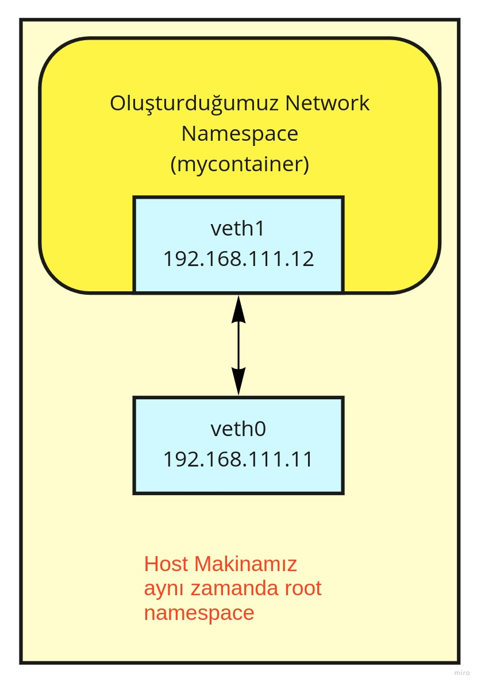
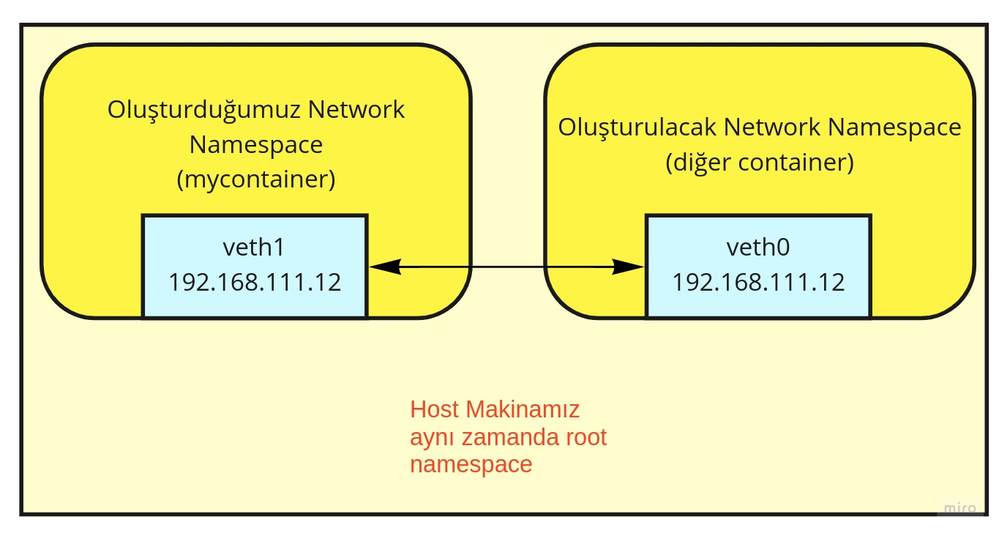
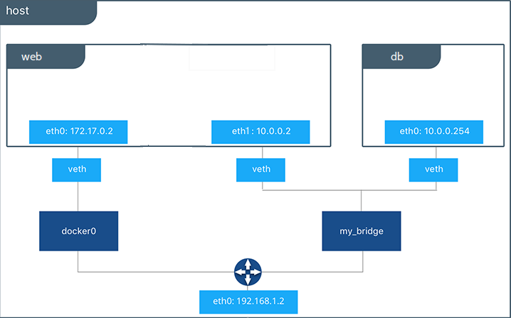
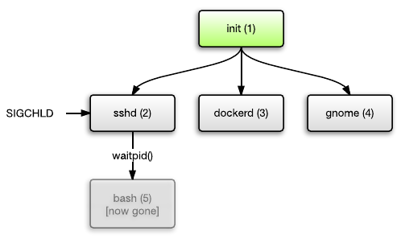
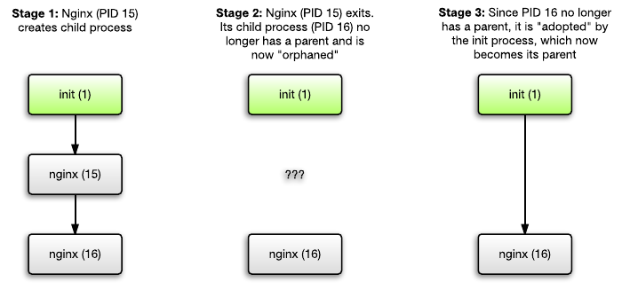

 
# Creating a Container Using Linux Namespaces

Hello friends,

In this article, we'll both explore the Linux namespace structure and try to build a structure similar to Docker containers using namespaces.

Let's start with this fact first. The concept of a container doesn't actually exist directly in Linux. What I mean is that, in the Linux source code, there's no such thing as a container in the sense we usually know it. Containers are created using the [namespace](https://en.wikipedia.org/wiki/Linux_namespaces) features provided by the Linux kernel. Docker and similar container runtimes wrap these features, a very small part of which we'll see below, and offer us an environment that is much easier to use.


Counting cgroup as well, there are seven namespaces.

- **Mount (mnt)**: Used to create an isolated file system tree.
- **Process ID (pid)**: Isolates process IDs. The main goal is to make bash (or whatever other application we'll run) see itself as process number 1 in the namespace we create. Normally, processes are nested. We'll try to make the application we run (bash) behave as if it were the only thing running in its own isolated environment.
- **Network (net)**: The goal of the network namespace is to make the container infrastructure we build, that is, the processes we isolate, run in a network environment isolated from the physical infrastructure they run on.
- **Interprocess Communication (ipc)**: Refers to isolating how processes communicate with each other (semaphores, message queues, shared memory segments, ...).
- **UTS**: Isolates the hostname. The real goal is to isolate the domain of the system the process belongs to. This way, the system clock is isolated as well.
- **User ID (user)**: Refers to isolating the user running the process, both in terms of permissions and identity.

Apart from these, we'll also use chroot and control groups.

- **Control group (cgroup)**: Refers to limiting, prioritizing, keeping under control and monitoring the resources that running processes use from the system.
- **chroot**: Changes the root folder of the process to be run. It isolates the root folder.

Of course, each of these topics deserves to be studied on its own. Here we'll take a more practical approach. Rather than diving into these topics and drowning in them, we'll try to understand how a container system is built on Linux.

The kernel offers us two APIs to create namespaces. When developing an application, a namespace is created by making the related system call.

- **clone**: Creates a new process in the given namespace types. When developing an application, it's created by calling the related CLONE_NEW* function. If you'd like to see an example written in GoLang, please visit [this link](https://medium.com/@teddyking/linux-namespaces-850489d3ccf).
- **unshare**: Moves an already running process into a namespace. Since it can be used from the terminal, the namespace concept is usually explained with this tool on the internet. We'll follow the same path.


While exploring namespaces, we'll frequently go back and forth between two terminals. For convenience, I'll put the "1111" tag at the top of the shell scripts for the first terminal we open, where we start creating the namespace, and the "2222" tag for the shell scripts I wrote for the second terminal.

# User Namespace

Our goal is to isolate users' identities, attributes, user IDs, user groups, root folders and [capabilities](https://man7.org/linux/man-pages/man7/capabilities.7.html).


- The -U option means we're creating a user namespace
- The --kill-child option makes sure that when the unshared process ends, the signal is passed on to the forked child processes.

After the namespace is created, when we check our identity with id, we can see that we're logged in as nobody. This is actually defined in the passwd file of the root namespace.


```shell
##################### 1111

cd $HOME

unshare -U --kill-child  /bin/bash

# id
uid=65534(nobody) gid=65534(nogroup) groups=65534(nogroup)

cat /etc/passwd

# nobody:x:65534:65534:nobody:/nonexistent:/usr/sbin/nologin
```

Now let's create a file and check its ownership both in the namespace we just created and in the root namespace.

```shell
##################### 1111

echo merhaba dünya > test.txt

ls -l test.txt
# -rw-rw-r-- 1 nobody nogroup 15 Tem  5 13:00 test.txt
```

Let's open another terminal and check the ownership of the same file in the root namespace.

The username part will be the username you used while running the command. In other words, since we didn't specify otherwise, the system mapped the nobody user in the newly created user namespace to the user that ran the unshare command in the root namespace.

```shell
##################### 2222
cd $HOME

ls -l test.txt
# -rw-rw-r-- 1 username group_name 8 Tem  5 12:58 test.txt
```

When we try to create a new namespace in the terminal of the namespace we created, we can see that we don't have permission. We'll get an error even if we try with sudo. That's because in the namespace we just created, even the passwd file appears to be owned by nobody. If you check it in the root namespace, you can see that it's owned by the root user.

```shell
##################### 1111
unshare -iu /bin/bash
# unshare: unshare failed: Operation not permitted

sudo unshare -iu /bin/bash
# sudo: /etc/sudo.conf is owned by uid 65534, should be 0
# sudo: /usr/bin/sudo must be owned by uid 0 and have the setuid bit set
```
We need to fix this in the namespace we just created. For this, we need to understand the _subuid (subordinate)_ and _subgid_ concepts Linux offers us. With these, we can let a user in Linux have more than one user ID and group ID. So how will this help us? One of the places where this is used best is container technologies.

Normally, Linux uses the range 0-65536 for user IDs. However, to run a container with an unprivileged user, the container needs to be isolated from the host system and sometimes from other containers. For this, the user ID and group ID of the user inside the container need to be raised. These IDs aren't shared with the host system. This way, even if the user somehow manages to get out of the container, they can't do anything, because the user's counterpart on the host system is a user with very few permissions. For example, UIDs starting from 1,000,000 inside the container correspond to a regular user on the system. A user who is root inside the container will be an ordinary user outside.

To use this system, we need to edit two files. We can do this with the CLI, or by editing the files directly.

First, we get the PID of the shell running in the namespace we created.

```shell
##################### 1111
echo $$
# 38289
```
Then we add entries to the subuid and subgid map records of this process. We run the code below in the other terminal.

```shell
##################### 2222

# instead of the 38289 id, you should write your own pid.
echo "0 1000 65335" | sudo tee /proc/38289/uid_map
echo "0 1000 65335" | sudo tee /proc/38289/gid_map
```

This means that, for this process, the user with ID 0 in the container namespace will be the user with ID 1000 in the root namespace. After this step, let's check our identity again in the terminal running inside the namespace we created.

```shell
##################### 1111
id
#uid=0(root) gid=0(root) groups=0(root),65534(nogroup),1(daemon)
```

We're now the root user in this user namespace. Let's create a file and check its ownership.

```shell
##################### 1111
echo > test2.txt

ls -l test2.txt

#-rw-rw-r-- 1 root root 1 Tem  5 15:46 test2.txt
```

Let's check from the other terminal which user it corresponds to on the system.

```shell
##################### 2222
ls -l test2.txt
# -rw-rw-r-- 1 username group_name 1 Tem  5 15:46 test2.txt


id
# uid=1000(username) gid=1000(group_name)...
```
As you can see, even though we're root inside the namespace, we appear as our own user on the host system.

When we made changes to the _/proc/38289/uid_map_ and _/proc/38289/gid_map_ files, we actually also added entries to the _/etc/subuid_ and _/etc/subgid_ files. We could have done the same thing directly in these files.

Let's look at the contents of these files in the terminal we opened in the root namespace.

```shell
##################### 2222
cat /etc/subuid
#root:100000:65536

cat /etc/subgid
# root:100000:65536

```
For example, the command below in the root namespace would do the same job.
```shell
##################### 2222
sudo usermod --add-subuids 100000-165535 --add-subgids 100000-165535 root
```

In conclusion, here's what we need to pay attention to: even though the user inside the container we created sees itself as root in its own environment, it will be a less privileged user in the host environment.


# IPC and UTC Namespace

Now that we're root inside the container, we can create new namespaces.


```shell
##################### 1111
unshare --ipc --uts --kill-child /bin/bash
hostname mycontainer
```
We've changed our container's hostname to mycontainer. Now let's check both whether our hostname has changed and the communication between processes.


```shell
##################### 1111
hostname
# mycontainer

ipcs

# ------ Message Queues --------
# key        msqid      owner      perms      used-bytes   messages

# ------ Shared Memory Segments --------
# key        shmid      owner      perms      bytes      nattch     status

# ------ Semaphore Arrays --------
# key        semid      owner      perms      nsems

```
Let's run the same commands in the other terminal we opened in the root namespace. We can see the differences between the root namespace and the namespace we created.

```shell
##################### 2222
hostname
# your pc name will show up here

ipcs

# ------ Message Queues --------
# key        msqid      owner      perms      used-bytes   messages

# ------ Shared Memory Segments --------
# key        shmid      owner      perms      bytes      nattch     status
# 0x00000000 28         username 600        393216     2          dest
# 0x00000000 32806      username 600        524288     2          dest
# 0x00000000 32807      username 600        393216     2          dest
# 0x00000000 47         username 600        524288     2          dest

# ------ Semaphore Arrays --------
# key        semid      owner      perms      nsems
```

# PID and Mount Namespace

When we check the PID of the active shell in the terminal of the namespace we created, it shows up as 74942 (that's the value on my machine).


```shell
##################### 1111
echo $$
# 74942

```

If we call the _pstree_ or _ps aux --forest_ commands in the root namespace, we can see the tree structure of all processes. The shell we ran is also under this tree structure, and its PID inside the namespace is the same as its PID in the root namespace.

If we list all bash PIDs in the root namespace, we can see the bash process with ID 74942.


```shell
##################### 2222
ps aux | grep bash

# username+   38288  0.0  0.0  10856   700 pts/1    S    12:54   0:00 unshare -U --kill-child /bin/bash
# username+   38289  0.0  0.0  14796  6592 pts/1    S    12:54   0:00 /bin/bash
# username+   74941  0.0  0.0  10856   772 pts/1    S    16:42   0:00 unshare --ipc --uts --kill-child /bin/bash
# username+   74942  0.0  0.0  14664  6360 pts/1    S+   16:42   0:00 /bin/bash
# username+   91343  0.0  0.0  11872  2992 pts/2    S+   18:39   0:00 grep --color=auto --exclude-dir=.bzr --exclude-dir=CVS --exclude-dir=.git --exclude-dir=.hg --exclude-dir=.svn --exclude-dir=.idea --exclude-dir=.tox bash

```
If we run these same commands in the terminal of the namespace we created, we'll see the same results. This shows that the namespace we created shares the same PID namespace as root.

Our goal is to isolate the PID namespace from root. To do this, we also need to mount the proc (process) directory into our new namespace. In other words, we shouldn't share the same processes as root.

- The -pid option says we want to create a process namespace
- The -mount option says we want to create a mnt namespace
- The --kill-child option makes sure that when the unshared process ends, the signal is passed on to the forked child processes.
- --fork, on the other hand, forks the related processes in the previous (root) namespace so that the unshare command can place itself in the new namespace. Otherwise, unshare creates the new namespace, but the bash that will run in it and its child processes are created, the process that finishes its job exits, and since the PID of the last remaining process in the system isn't zero, the kernel will directly shut down the namespace because there's no process with PID 1 in it. With the fork option, bash in the root namespace and the child processes under it are forked and created with their PIDs. This way, our unshare command is able to place itself in the new namespace.


```shell
##################### 1111
unshare --pid --fork --mount --kill-child  /bin/bash
mount -t proc proc /proc


ps aux

# USER         PID %CPU %MEM    VSZ   RSS TTY      STAT START   TIME COMMAND
# root           1  0.0  0.0  14664  6284 pts/1    S    19:08   0:00 /bin/bash
# root          31  0.0  0.0  15192  3712 pts/1    R+   19:09   0:00 ps aux

echo $$
#1
```

As you can see, we now have an isolated PID namespace separate from the root namespace. The PID of the bash we're using is now 1, which means it has become the init process. We'll look at the init process concept later on.

However, in this state, the system still physically uses the host system's file system. When we use the _ls_ command, we can still see that the _test.txt_ and _test2.txt_ files we created at the beginning are in the home directory.

For this, we need to change our root file system.

# Chroot

For this, we need a root file system. Of course, we could do this manually, but moving the whole root folder somewhere else is quite costly and means moving a lot of unnecessary files as well. Luckily, you can find many resources that have already done this.
- [Alpine Linux's mini root file system](https://dl-cdn.alpinelinux.org/alpine/v3.16/releases/x86_64/alpine-minirootfs-3.16.0-x86_64.tar.gz)
- [Ubuntu base root file system](http://cdimage.ubuntu.com/ubuntu-base/releases/)

We'll be using the Alpine version. For this, we run the commands below in the shell we opened in the root namespace.


```shell
##################### 2222
cd $HOME

mkdir mycontainer

wget https://dl-cdn.alpinelinux.org/alpine/v3.16/releases/x86_64/alpine-minirootfs-3.16.0-x86_64.tar.gz

tar -xvzf alpine-minirootfs-3.16.0-x86_64.tar.gz -C mycontainer

ls mycontainer
# bin   dev  home  lib32  libx32  mnt  proc  run   srv  tmp  var
# boot  etc  lib   lib64  media   opt  root  sbin  sys  usr
```

Again, we run the commands below in the terminal of the namespace we created.

```shell
##################### 1111
# we copy the related folder into our own mnt namespace
mount --bind mycontainer mycontainer
cd mycontainer
ls
# bin   dev  home  lib32  libx32  mnt  proc  run   srv  tmp  var
# boot  etc  lib   lib64  media   opt  root  sbin  sys  usr


# the pivot_root command wants a folder to attach the root of the real host system to.
mkdir old_rootfs

pivot_root . old_rootfs

cd /
ls

# bin   dev  home  lib32  libx32  mnt         opt   root  sbin  sys  usr
# boot  etc  lib   lib64  media   old_rootfs  proc  run   srv   tmp  var

cd bin

# since the root folder has changed, we mount the proc folder again
./mount -t proc proc ../proc

# and finally we unmount the old root folder.
./umount -l ../old_rootfs

./ls ../old_rootfs
# in the end we can't see any files or folders. in other words, we no longer have any link to the host root folder.

```

After changing our root folder, when we go to the root folder and look at the file and folder list, we can see, as shown above, that the root folder of our process has now changed.
# Network Namespace

The network namespace alone actually can't even be covered in a single article. First of all, you need to know a bit of Linux networking and a bit of [SDN](https://en.wikipedia.org/wiki/Software-defined_networking). However, let's try to understand how containers can isolate their networks without going into too much detail.

We run the commands below in the terminal on the root namespace.

```shell
##################### 2222
sudo ip link add rootveth type veth peer name containerveth
sudo ip link set rootveth up
sudo ip addr add 192.168.111.11/24 dev rootveth
```
Now let's create a network namespace in the namespace we just created.

```shell
##################### 1111
cd /
unshare --net  /bin/sh

# Then we find out the PID of our shell. `
# the goal is to attach the network we created in the root namespace to the network namespace this PID is in

echo $$
# 35
```

We need to find the counterpart of the PID we found above in the root namespace. For this, we run the commands below in the shell on the root namespace.

```shell
##################### 2222
# first, we list the processes that are shells

ps aux | grep /bin/sh

# username+   124598  0.0  0.0   1716  1112 pts/1    S+   23:30   0:00 /bin/sh


# if you haven't run any other command in between, it's usually the one just above the bottom of the list. the bottom one shows up in the list because of the command above.


# but we still can't be sure. To make sure the PID of the shell in the namespace is the same as the shell here, we run the command below.

cat /proc/124598/status | grep -i NSpid
# NSpid:  124598  35

# this way we've made sure

```
Now, with the command below in the shell on the root namespace, we change the namespace of one end of the veth we created earlier (the side we'll attach to the container).

```shell
##################### 2222
sudo ip link set containerveth netns /proc/124598/ns/net
```

Let's go back to the shell in the namespace we created, configure the attached network and test it.

```shell
##################### 1111
# first, let's check the attached network

ip link
# 1: lo: <LOOPBACK> mtu 65536 qdisc noop state DOWN qlen 1000
#     link/loopback 00:00:00:00:00:00 brd 00:00:00:00:00:00
# 19: containerveth@if20: <BROADCAST,MULTICAST,M-DOWN> mtu 1500 qdisc noop state DOWN qlen 1000
#     link/ether ee:bc:09:b2:00:32 brd ff:ff:ff:ff:ff:ff


# we can see that it's attached, now we configure it.

ip link set lo up
ip link set containerveth up
ip addr add  192.168.111.12/24 dev containerveth

# let's ping the other ip address on the network

ping -c 4  192.168.111.11

# PING 192.168.111.11 (192.168.111.11): 56 data bytes
# 64 bytes from 192.168.111.11: seq=0 ttl=64 time=0.111 ms
# 64 bytes from 192.168.111.11: seq=1 ttl=64 time=0.110 ms
# 64 bytes from 192.168.111.11: seq=2 ttl=64 time=0.114 ms
# 64 bytes from 192.168.111.11: seq=3 ttl=64 time=0.179 ms

# --- 192.168.111.11 ping statistics ---
# 4 packets transmitted, 4 packets received, 0% packet loss
# round-trip min/avg/max = 0.110/0.128/0.179 ms

```
Let's also ping the 192.168.111.12 ip address from the root namespace.

```shell
##################### 2222

ping -c 4  192.168.111.12

# PING 192.168.111.12 (192.168.111.12) 56(84) bytes of data.
# 64 bytes from 192.168.111.12: icmp_seq=1 ttl=64 time=0.069 ms
# 64 bytes from 192.168.111.12: icmp_seq=2 ttl=64 time=0.073 ms
# 64 bytes from 192.168.111.12: icmp_seq=3 ttl=64 time=0.109 ms
# 64 bytes from 192.168.111.12: icmp_seq=4 ttl=64 time=0.076 ms

# --- 192.168.111.12 ping statistics ---
# 4 packets transmitted, 4 received, 0% packet loss, time 3082ms
# rtt min/avg/max/mdev = 0.069/0.081/0.109/0.015 ms

```

Let's also try to understand what we did above with a diagram.




If desired, of course, a structure like the one below could also be set up.



However, when the number of machines goes beyond two, or when the host machine needs to communicate, or when we want to create more than one subnet, we'll need to put one or more bridges in the middle. As you know, Docker also builds its network system using a bridge. We can compare bridges to switches in real life.



However, there's a problem with our network namespace: we can't reach the internet. For this, we first run the commands below in the root namespace.

```shell
##################### 2222
# network packets need to be able to be forwarded
echo 1 > /proc/sys/net/ipv4/ip_forward


# we need to find the name of the interface you use to access the internet.
# if you're connected with a cable, it's usually an interface whose name starts with enp
# if you're connected wirelessly, it's usually an interface starting with wlp


ifconfig
# after running the command, you can see its name in the list

# we tell iptables that packets will be forwarded in both directions.
sudo iptables -A FORWARD -o wlp3s0 -i rootveth -j ACCEPT
sudo iptables -A FORWARD -i wlp3s0 -o rootveth -j ACCEPT

# then we do NAT for the container side ( 192.168.111.12/24 containerveth)

sudo iptables -t nat -A POSTROUTING -s 192.168.111.12/24 -o wlp3s0 -j MASQUERADE

```

In the namespace we created (inside the container), we set the default gateway, create our resolv.conf file and add server information for DNS resolution.


```shell
##################### 1111

ip route add default via 192.168.111.11

echo "nameserver 8.8.4.4" > /etc/resolv.conf


# and now we can reach the internet

ping -c 4 google.com

# PING google.com (172.217.17.142): 56 data bytes
# 64 bytes from 172.217.17.142: seq=0 ttl=58 time=49.952 ms
# 64 bytes from 172.217.17.142: seq=1 ttl=58 time=48.569 ms
# 64 bytes from 172.217.17.142: seq=2 ttl=58 time=51.519 ms
# 64 bytes from 172.217.17.142: seq=3 ttl=58 time=74.650 ms

```

# Cgroup Namespace

Its main purpose is to share system resources (like processor time, number of processes per group, amount of memory per control group or combination of such resources) with processes in a controlled way. While doing this, it uses resource limiting, prioritization, accounting and control features.

To put it another way, cgroups (Control Groups) is a feature of the Linux kernel that groups tasks (processes) together and is used to limit and isolate the usage of resources such as the processor, system memory and network bandwidth. Using cgroups, system administrators can set priorities between tasks and users, block things, and make the use of system resources more efficient.

 Cgroups contains eight resource controllers. These also consist of resource types with the same names, called subsystems.

- **blkio**: Applies limits on access to block devices (such as hard disks and USB disks).
- **cpu**: Schedules cgroups' access to the processor (CPU).
- **cpuacct**: Automatically reports the processor (CPU) usage of a task running under a cgroup.
- **cpuset**: Used to assign tasks to a specific processor or memory node on multi-processor systems.
devices: Denies or allows tasks access to devices.
- **freezer**: Suspends or resumes the execution of a task.
- **memory**: Limits the memory usage of tasks and reports their usage.
- **net_cls**: Applies limits on cgroups' use of network devices.


[Source](https://bidb.itu.edu.tr/seyir-defteri/blog/2013/09/06/cgroups-(kontrol-gruplari))

To keep things short and understand the topic, we'll only use memory.

To be able to run our resource tests, we install the stress-ng package with the shell on the namespace we created.

```shell
##################### 1111
apk update
apk add python3

```
Our goal is to give limited RAM to the namespace we created, and to make sure the running application is terminated when this RAM usage is exceeded.

To be able to work with cgroups in the root namespace, we do the installations below.

```shell
##################### 1111
sudo apt install libcgroup1 cgroup-tools cgroup-lite  cgroupfs-mount cpuset
```

After the installation, we'll be able to use the commands below.
- **cgclassify**: Moves a running process to the desired cgroup.
- **cgclear**: Removes the cgroup file system.
- **cgcreate**:	Creates a new group.
- **cgdelete**: Deletes a control group.
- **cgexec**: Runs the given command in a cgroup.
- **cgget**: Gets the parameters of subsystems from the desired control group.
- **cgset**: Sets parameters in the desired control group.
- **cgsnapshot**: Creates a configuration file from the given controller.
- **lscgroup**: Lists all cgroups.
- **lssubsys**: Lists the hierarchies of the given subsystem.

The topic will become a bit clearer when we put it into practice.

In the shell on the root namespace, we create a memory cgroup. Then we set our memory limit.

```shell
##################### 2222
cd /sys/fs/cgroup

sudo cgcreate -g memory:mycontainercg

ls /sys/fs/cgroup/memory

# the control group we created can be seen in the list.

# --- shortened
init.scope                          memory.swappiness
machine.slice                       memory.usage_in_bytes
memory.failcnt                      memory.use_hierarchy
memory.force_empty                  -.mount
memory.kmem.failcnt                 mycontainercg
memory.kmem.limit_in_bytes          notify_on_release
memory.kmem.max_usage_in_bytes      proc-fs-nfsd.mount
memory.kmem.slabinfo                proc-sys-fs-binfmt_misc.mount
# --- shortened

# maximum memory the process can use
sudo cgset -r memory.limit_in_bytes=100m mycontainercg
# maximum swap space the process can use
sudo cgset -r memory.memsw.limit_in_bytes=50m mycontainercg

# if desired, swap space can be disabled completely
echo 0 | sudo tee /sys/fs/cgroup/memory/mycontainercg/memory.swappiness


# let's read our values

sudo cgget -g memory:mycontainercg | grep byte


# memory.max_usage_in_bytes: 0
# memory.limit_in_bytes: 52428800 # <<-----50 mb equals this many bytes
# memory.memsw.max_usage_in_bytes: 0
# memory.kmem.max_usage_in_bytes: 0
# memory.usage_in_bytes: 0
# memory.memsw.limit_in_bytes: 52428800 # <<-----

```

In the shell on the namespace we created, we get the shell's pid.
```shell
##################### 1111
echo $$
# 33

# we need to find the counterpart of this pid in the root namespace.
```

In the shell on the root namespace, we first search for the /bin/sh processes. From there, we try to find the process that matches pid 33 in the namespace we opened.

```shell
##################### 2222
cd $HOME
ps aux | grep /bin/sh
# username+  40033  0.0  0.0   1716  1196 pts/1    S+   Tem07   0:00 /bin/sh


cat /proc/40033/status | grep -i NSpid
# NSpid:  40033  33

# After finding the right process, we attach this process to the cgroup we created.

sudo cgclassify -g memory:mycontainercg 40033

# we check the cgroup that the process with pid 40033 is attached to.

cat /proc/40033/cgroup

# 12:net_cls,net_prio:/
# 11:blkio:/user.slice
# 9:rdma:/
# 8:memory:/mycontainercg   <--------------------
# 7:devices:/user.slice
# 6:freezer:/user/username/0
# 5:cpu,cpuacct:/user.slice
# 4:perf_event:/
# 3:cpuset:/
# 2:hugetlb:/

# or the tasks the cgroup is assigned to (in cgroup jargon, a process means a task)

cat /sys/fs/cgroup/memory/mycontainercg/tasks
#40033


# we can also see the cgroup hierarchy through systemd
systemd-cgls


# the top cgroup list can be seen through the control group hierarchy
systemd-cgtop

```


Now we can run our memory test. If a process that uses more than 50 megabytes of memory is run in the shell on the namespace we created, the process should be killed.


With Python code, we first run our script that can exceed the 100 mb limit we set.


```shell
##################### 1111
cd /


cat << EOF > memory_test_100mb.py
import time

def veri_olustur_1kb():
    s = ""
    for i in range(1024):
        s += '*'
    return s

def veri_olustur_1mb():
    s = ""
    x = veri_olustur_1kb()
    for i in range(1024):
        s += x
    return s

print("Test Başla")
s = ""
x = veri_olustur_1mb()
for i in range(1024):
    print(str(i) + "mb oluşturuldu")
    s += x
    print(str(len(s)) + ' bytes')
    if i % 10 == 0:
        time.sleep(1)
        print("--------------------------")

print("İşlem başarıyla tamamlandı")

EOF


python3 memory_test_100mb.py

# in the end, the process was killed by the system

#  .... shortened
# 100663296 bytes
# 96mb oluşturuldu
# Killed


```


Then we run our code that can run without errors and without exceeding the 100 mb limit.

```shell
##################### 1111
cd /

cat << EOF > memory_test_50mb.py
import time

def veri_olustur_1kb():
    s = ""
    for i in range(1024):
        s += '*'
    return s

def veri_olustur_1mb():
    s = ""
    x = veri_olustur_1kb()
    for i in range(1024):
        s += x
    return s

print("Test Başla")
s = ""
x = veri_olustur_1mb()
for i in range(50):
    print(str(i) + "mb oluşturuldu")
    s += x
    print(str(len(s)) + ' bytes')
    if i % 10 == 0:
        time.sleep(1)
        print("--------------------------")

print("İşlem başarıyla tamamlandı")

EOF


python3 memory_test_50mb.py


# in the end, our process completed successfully.

# ... shortened
# 48mb oluşturuldu
# 51380224 bytes
# 49mb oluşturuldu
# 52428800 bytes
# İşlem başarıyla tamamlandı
```

Of course, container runtimes like Docker have much more complex structures than this. But I hope this has been enough to understand the concept.

If you like, let's also try to do everything we did here in one go, in a shorter way.


# All in One

We open a new shell on the root namespace and create a user namespace with the command below.

```shell
##################### 1111

cd $HOME

unshare -U --kill-child  /bin/bash

# we get the shell pid to do the user map below
echo $$
# 47558
```

In the shell on the root namespace

```shell
##################### 2222
# instead of the 47558 id, you should write the pid in your own user namespace.
echo "0 1000 65335" | sudo tee /proc/47558/uid_map
echo "0 1000 65335" | sudo tee /proc/47558/gid_map
```


While we're back in the shell where we created the user namespace, we create all namespaces other than the user namespace in one go. Then we create the network.

```shell
##################### 1111
unshare --mount --uts --ipc --net --pid --fork chroot mycontainer /bin/sh
mount -t proc proc /proc

id
# uid=0(root) gid=0(root) groups=0(root),65534(nogroup),1(daemon)

hostname mycontainer


# we'll need this for the network steps
echo $$
# 1

```
From this point on, you can set up the network as we did above.

# Examining the Container Runtime

## Docker Container Namespace List and Details

First, let's spin up an nginx container.

```shell
docker run -d --rm -p 8080:80 nginx
```
We use the command below to get the pid of the running container.

```shell
docker ps

# CONTAINER ID   IMAGE   COMMAND                  CREATED              STATUS              PORTS                                    NAMES
# f6fe50616d61   nginx   "/docker-entrypoint.…"   About a minute ago   Up About a minute   0.0.0.0:8080->80/tcp, :::8080->80/tcp    frosty_murdock

PID=$(docker inspect --format {{.State.Pid}} f6fe50616d61)
echo $PID
# 106519
```

To see the namespaces used by the container

```shell
PID=$(docker inspect --format {{.State.Pid}} f6fe50616d61)
sudo ls -la /proc/$PID/ns

# dr-x--x--x 2 root root 0 Tem  9 21:07 .
# dr-xr-xr-x 9 root root 0 Tem  9 21:07 ..
# lrwxrwxrwx 1 root root 0 Tem  9 21:15 cgroup -> 'cgroup:[4026531835]'
# lrwxrwxrwx 1 root root 0 Tem  9 21:15 ipc -> 'ipc:[4026533818]'
# lrwxrwxrwx 1 root root 0 Tem  9 21:15 mnt -> 'mnt:[4026533816]'
# lrwxrwxrwx 1 root root 0 Tem  9 21:07 net -> 'net:[4026533822]'
# lrwxrwxrwx 1 root root 0 Tem  9 21:15 pid -> 'pid:[4026533820]'
# lrwxrwxrwx 1 root root 0 Tem  9 21:15 pid_for_children -> 'pid:[4026533820]'
# lrwxrwxrwx 1 root root 0 Tem  9 21:15 time -> 'time:[4026531834]'
# lrwxrwxrwx 1 root root 0 Tem  9 21:15 time_for_children -> 'time:[4026531834]'
# lrwxrwxrwx 1 root root 0 Tem  9 21:15 user -> 'user:[4026531837]'
# lrwxrwxrwx 1 root root 0 Tem  9 21:15 uts -> 'uts:[4026533817]'

```

To attach to the container namespace

```shell
PID=$(docker inspect --format {{.State.Pid}} f6fe50616d61)
sudo nsenter --target $PID --mount --uts --ipc --net --pid

# we got inside the container without using any docker cli command
# root@f6fe50616d61:/#
```
To see the container's network

```shell

ID=$(docker inspect --format {{.Id}} f6fe50616d61)
PID=$(docker inspect --format {{.State.Pid}} f6fe50616d61)


sudo mkdir -p /var/run/netns && sudo touch /var/run/netns/$ID
sudo mount -o bind /proc/$PID/ns/net /var/run/netns/$ID

sudo ip netns ls
# f6fe50616d616940b784539a76356e5bdf93bf6f7686c921057368d1ddf4a109 (id: 3)


sudo ip netns exec $ID ip addr list

# 1: lo: <LOOPBACK,UP,LOWER_UP> mtu 65536 qdisc noqueue state UNKNOWN group default qlen 1000
#     link/loopback 00:00:00:00:00:00 brd 00:00:00:00:00:00
#     inet 127.0.0.1/8 scope host lo
#        valid_lft forever preferred_lft forever
# 51: eth0@if52: <BROADCAST,MULTICAST,UP,LOWER_UP> mtu 1500 qdisc noqueue state UP group default
#     link/ether 02:42:c0:a8:01:05 brd ff:ff:ff:ff:ff:ff link-netnsid 0
#     inet 192.168.1.5/24 brd 192.168.1.255 scope global eth0
#        valid_lft forever preferred_lft forever

```

## User Namespace

As you know, the Docker daemon runs with root privileges. Naturally, this doesn't provide real isolation. It's also possible to install Docker without root privileges. On its [official page](https://docs.docker.com/engine/security/rootless/), there's a detailed [document](https://docs.docker.com/engine/security/rootless/) where you can find a very detailed installation guide and solutions to problems you might run into.

As you know, unless we say otherwise, the commands running in the Docker images we build are run with the user defined in the image we use as a base. And usually, these base images use the root user.

You can use the commands below to test it.

```shell
docker run --rm ubuntu bash -c "whoami"
# root

docker run --rm centos bash -c "whoami"
# root

docker run --rm alpine /bin/sh -c "whoami"
# root
```

Changing this is possible by creating a user in the Dockerfile we write and by using the user mapping feature we used above while building our own container.

```shell
mkdir $HOME/DockerExample && cd $HOME/DockerExample

cat << EOF > Dockerfile
FROM ubuntu:18.04
RUN useradd --create-home kullanici
WORKDIR /home/kullanici
USER kullanici
EOF

docker build . -t usertest

# we must have created the same user on the host machine as well
sudo useradd --no-create-home kullanici
id kullanici
# user information on the host machine
# uid=1001(kullanici) gid=1004(kullanici) groups=1004(kullanici)

docker run --rm --user kullanici usertest /bin/sh -c "whoami && id"
# user information inside docker
# kullanici
# uid=1000(kullanici) gid=1000(kullanici) groups=1000(kullanici)

```

You can follow the links below on the _stackoverflow.com_ website on the subject.

- You can also check the best practices in the Docker reference pages under the [related heading](https://docs.docker.com/develop/develop-images/dockerfile_best-practices/#user).
- [Source 1](https://stackoverflow.com/questions/69180020/make-an-existing-docker-container-rootless)
- [Source 2](https://stackoverflow.com/questions/35734474/connect-to-docker-container-as-user-other-than-root/35736699#35736699)

Also, if you'd like this to be done for all the images you run on your system, you can do it by using the user mapping feature we covered in the user namespace section above. You can check the related heading ([Isolate containers with a user namespace](https://docs.docker.com/engine/security/userns-remap/)) in the official Docker pages.

## Init, Zombie and Orphan Processes

To understand the topic, we first need to understand the concepts of defunct process (zombie process) and orphan process. For this, let's try to understand the topic by making use of Ahmet Alp Balkan's [post on the subject](https://ahmet.im/blog/minimal-init-process-for-containers/) on his blog and [the blog at this link](https://blog.phusion.nl/2015/01/20/docker-and-the-pid-1-zombie-reaping-problem/).

For example, in the diagram below, when the bash process with pid 5 ends, if the parent process somehow can't close this process, or doesn't have the ability to do so, the process becomes a zombie process. When a process becomes a zombie, it's actually gone from the system, but its pid keeps hanging around. It doesn't take up enough space to cause a memory problem, but of course it creates clutter. And only the parent process can remove this process. Since the process is actually dead, we can't remove it, which is why it's called a zombie.

After a while, the main process (init process) calls the waitpid() action and asks for the zombie processes among the child processes to be killed completely. This cleanup is called **zombie reaping**. This process happens so fast that most of the time we don't even see zombies among the processes.

We can also trigger this process manually.

```shell
kill -s SIGCHLD parent_pid
```


[Image Source](https://blog.phusion.nl/2015/01/20/docker-and-the-pid-1-zombie-reaping-problem/)


An orphan process, on the other hand, is a process whose parent has died but which keeps running. Under normal conditions, when a child process's parent dies, the Linux kernel attaches the child process to the init process. The init process gets rid of (reaps) the orphan process.



[Image Source](https://blog.phusion.nl/2015/01/20/docker-and-the-pid-1-zombie-reaping-problem/)

But what happens if our init process is a process that can't fulfill the requirements of an init process? Under normal conditions, bash is a very good init process, but let's assume that somehow the init process changes once the container starts running. If this process, now the init process, can't handle zombie and orphan processes, and on top of that, if this child process is, for example, one that can't understand the ctrl+c SIGTERM, we might not be able to stop our container.

Of course, there are many init applications similar to Systemd, the most widely used init process on a real Linux operating system. However, to keep containers lighter, there are many init alternatives developed by the community instead of Systemd.

The best known ones are,

- [tini](https://github.com/krallin/tini)
- [s6](https://skarnet.org/software/s6/)
- [runit](http://smarden.org/runit/)
- [monit](https://mmonit.com/monit/#download)

Sample Dockerfile with tini

```Dockerfile
# Add Tini
ENV TINI_VERSION v0.19.0
ADD https://github.com/krallin/tini/releases/download/${TINI_VERSION}/tini /tini
RUN chmod +x /tini
ENTRYPOINT ["/tini", "--"]

# Run your program under Tini
CMD ["/your/program", "-and", "-its", "arguments"]
# or docker run your-image /your/program ...
```

Hope you found it useful.
See you in the next article, happy studying.

# References
- https://www.funtoo.org/LXD/What_are_subuids_and_subgids%3F
- https://wiki.t-firefly.com/en/ROC-RK3399-PC/linux_build_ubuntu_rootfs.html
- https://wiki.ubuntu.com/Base
- http://cdimage.ubuntu.com/ubuntu-base/releases/
- https://blog.quarkslab.com/digging-into-linux-namespaces-part-2.html
- https://ericchiang.github.io/post/containers-from-scratch/
- https://kevinboone.me/containerfromscratch_unshare.html
- https://man7.org/linux/man-pages/man4/veth.4.html
- https://bidb.itu.edu.tr/seyir-defteri/blog/2013/09/06/cgroups-(kontrol-gruplari)
- https://medium.com/@saschagrunert/demystifying-containers-part-i-kernel-space-2c53d6979504
- https://stackoverflow.com/questions/69180020/make-an-existing-docker-container-rootless
- https://stackoverflow.com/questions/35734474/connect-to-docker-container-as-user-other-than-root/35736699#35736699
- https://docs.docker.com/engine/security/userns-remap/
- https://www.scaler.com/topics/operating-system/zombie-and-orphan-process-in-os/
