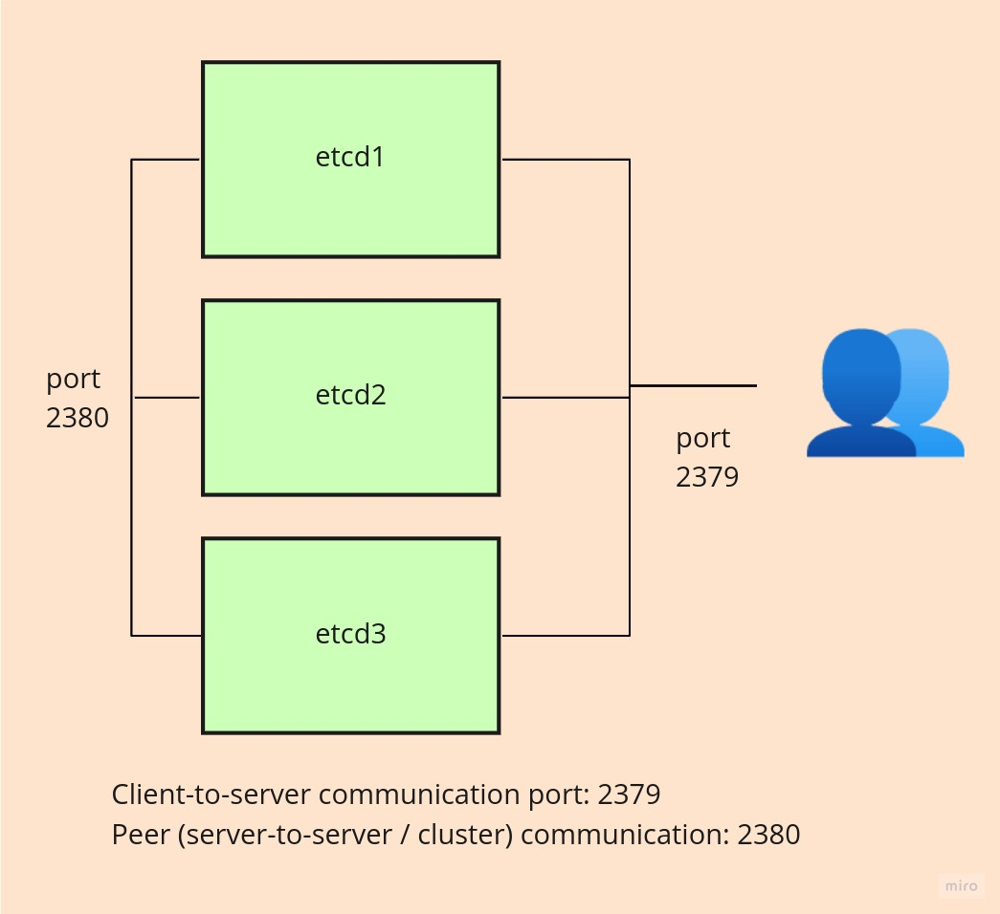

# ETCD Cluster Installation and Backup-Restore Operations

Hello friends, 

In this article, we'll set up a high available secure etcd cluster and then examine backup restore operations. 

Its name is usually always mentioned together with Kubernetes, but etcd is actually an independent tool. In other words, we don't need Kuberntes to install etcd or to use it in our projects. There are also [SDKs for many programming languages](https://etcd.io/docs/v3.4/integrations/). If you need a persistent key-value database, you can easily use it.

Our setup will be as follows.



## Setting Up the Vagrant Lab Environment with Virtualbox

After installing [VirtualBox](https://www.virtualbox.org/wiki/Downloads) and then [Vagrant](https://www.vagrantup.com/downloads) on our machine, we create a file named [Vagrantfile](https://www.vagrantup.com/docs/providers/virtualbox/configuration) in a folder we opened on our computer and copy the lines below into it.

```Vagrantfile
# -*- mode: ruby -*-
# vi: set ft=ruby :


# if you want to install centos, it's enough to write generic/centos8 instead of generic/ubuntu2004


Vagrant.configure("2") do |config|

# node1
config.vm.define "node1" do |node1|
    node1.vm.box = "generic/ubuntu2004"
    node1.vm.hostname="node1"
    node1.vm.network "private_network", ip: "10.200.10.10"
    
    node1.vm.provider :virtualbox do |lv|
       lv.memory=1024
       lv.cpus=1
    end 
 end


# node2
config.vm.define "node2" do |node2|
    node2.vm.box = "generic/ubuntu2004"
    node2.vm.hostname="node2"
    node2.vm.network "private_network", ip: "10.200.10.11"
    
    node2.vm.provider :virtualbox do |lv|
       lv.memory=1024
       lv.cpus=1

    end
 end


# node3
config.vm.define "node3" do |node3|
    node3.vm.box = "generic/ubuntu2004"
    node3.vm.hostname="node3"
    node3.vm.network "private_network", ip: "10.200.10.12"
    
    node3.vm.provider :virtualbox do |lv|
       lv.memory=1024
       lv.cpus=1

    end 
 end

end
```
Then, on the terminal or command-com, while in the directory where the Vagrantfile is located, we run the _vagrant up_ command

We connect to our machines with ssh.


- Username: vagrant
- Password: vagrant

while our terminal is still in the same directory as the Vagrantfile, we can connect with the command below.

```bash
vagrant ssh node1
```

When we connect to all the machines this way and ping the (10.200.10.10,11 and 12) ips, we should get a response. 

We do the operations below on all machines
- In the _/etc/ssh/sshd_config_ file, we uncomment the _#PasswordAuthentication yes_ line.
- We add the _PermitRootLogin yes_ line.
- as we assign the root password with the _sudo passwd root_ command.
- We update the service with _systemctl reload sshd_

## Creating the Certificates

We'll create our certificates on our host machine and share them with our etcd machines.

For this, we'll use the cfssl tool. For details, visit the _https://github.com/cloudflare/cfssl_ address.

To install it, we go to the _https://github.com/cloudflare/cfssl/releases_ address. We'll use version 1.6.1.

**For Linux**

- https://github.com/cloudflare/cfssl/releases/download/v1.6.1/cfssl_1.6.1_linux_amd64
- https://github.com/cloudflare/cfssl/releases/download/v1.6.1/cfssljson_1.6.1_linux_amd64


```bash

wget -q --show-progress --https-only --timestamping \
  https://github.com/cloudflare/cfssl/releases/download/v1.6.1/cfssl_1.6.1_linux_amd64 \
  https://github.com/cloudflare/cfssl/releases/download/v1.6.1/cfssljson_1.6.1_linux_amd64


chmod +x cfssl_1.6.1_linux_amd64 cfssljson_1.6.1_linux_amd64
sudo mv cfssl_1.6.1_linux_amd64 /usr/local/bin/cfssl
sudo mv cfssljson_1.6.1_linux_amd64  /usr/local/bin/cfssljson

cfssl version

# result
Version: 1.6.1
Runtime: go1.12.12

```
**For Mac**

It's enough to do the same operations done for Linux, just using the ones with darwin in the file name. 

**For Windows**

It'll be enough to download the files below to a suitable place.

- https://github.com/cloudflare/cfssl/releases/download/v1.6.1/cfssljson_1.6.1_windows_amd64.exe
- https://github.com/cloudflare/cfssl/releases/download/v1.6.1/cfssl-scan_1.6.1_windows_amd64.exe

**Now we can create our certificates**

First, we create the Certificate Authority (CA. Then, using it, we'll create our etcd certificates.

```bash

cd /tmp
cat > ca-config.json << EOF
{
    "signing": {
        "default": {
            "expiry": "8760h"
        },
        "profiles": {
            "etcd-cluster": {
                "expiry": "8760h",
                "usages": [
                    "signing",
                    "key encipherment",
                    "server auth",
                    "client auth"
                ]
            }
        }
    }
}
EOF 


cat > ca-csr.json << EOF
{
    "CN": "My own CA",
    "key": {
        "algo": "rsa",
        "size": 2048
    },
    "names": [
        {
            "C": "US",
            "L": "CA",
            "O": "My Company Name",
            "ST": "San Francisco",
            "OU": "Org Unit 1",
            "OU": "Org Unit 2"
        }
    ]
}
EOF 


cfssl gencert -initca ca-csr.json | cfssljson -bare ca

```
As a result, the files below should have been created.

```bash
ls

#result
ca-config.json
ca.csr
ca-csr.json
ca-key.pem
ca.pem
```

Now we can create our certificates.

```bash
cat > ca-csr.json << EOF
{
    "CN": "etcd-cluster",
    "hosts": [
        "localhost",
        "10.200.10.10",
        "10.200.10.11",
        "10.200.10.12",
        "127.0.0.1"
    ],
    "key": {
        "algo": "ecdsa",
        "size": 256
    },
    "names": [
        {
            "C": "US",
            "L": "CA",
            "ST": "San Francisco"
        }
    ]
}
EOF

# ca-config.json
# ca.csr
# ca-csr.json
# ca-key.pem
# ca.pem

cfssl gencert -ca=ca.pem -ca-key=ca-key.pem -config=ca-config.json -profile=etcd-cluster ca-csr.json | cfssljson -bare etcd-cluster

```
in the end, the 3 files below will have been created

```bash

etcd-cluster.csr
etcd-cluster-key.pem
etcd-cluster.pem
```


We copy our certificates to our etcd nodes. We run the command below on our local machine in the folder where our certificates are.

```bash

nodes=(10.200.10.10 10.200.10.11 10.200.10.12)

for node in ${nodes[@]}; do
    scp ca.pem etcd-cluster.pem etcd-cluster-key.pem root@$node:
done

```

We connect to all our nodes with ssh using our root user and run the commands below. To run the same command on all of them at the same time, you can use [Tmux](https://github.com/tmux/tmux) on Linux. As far as I know, [Cmder](https://cmder.net/) can do the same job for Windows environments too.

```bash

mkdir -p /etc/etcd/pki

mv ca.pem etcd-cluster.pem etcd-cluster-key.pem /etc/etcd/pki/

```

## Etcd Installation

Then we'll download the etcd binary. While still connected with ssh, we run the commands below on all nodes.


```bash
wget -q --show-progress "https://github.com/etcd-io/etcd/releases/download/v3.5.1/etcd-v3.5.1-linux-amd64.tar.gz"
tar zxf etcd-v3.5.1-linux-amd64.tar.gz
mv etcd-v3.5.1-linux-amd64/etcd* /usr/local/bin/
rm -rf etcd*
```

Now we can create our service (unit) file.

- 2380: this port is used when the servers communicate among themselves.
- 2379: needed for the nodes to communicate among themselves.


Run the command below separately on each node, changing the localip value.


For all configuration flags : https://etcd.io/docs/v3.5/op-guide/configuration

Since we didn't specify the --data-dir parameter in the configuration below and did the installation with the root user, the databases will be created in the root (/) directory (node1.etcd, node2.etcd, node3.etcd).

```bash
localip="10.200.10.12" # each node will have its own ip. so we need to run it separately

nodename=$(hostname -s)

node1="10.200.10.10"
node2="10.200.10.11"
node3="10.200.10.12"


cat <<EOF >/etc/systemd/system/etcd.service
[Unit]
Description=etcd

[Service]
Type=notify
ExecStart=/usr/local/bin/etcd --name ${nodename} --cert-file=/etc/etcd/pki/etcd-cluster.pem --key-file=/etc/etcd/pki/etcd-cluster-key.pem --peer-cert-file=/etc/etcd/pki/etcd-cluster.pem --peer-key-file=/etc/etcd/pki/etcd-cluster-key.pem --trusted-ca-file=/etc/etcd/pki/ca.pem --peer-trusted-ca-file=/etc/etcd/pki/ca.pem --peer-client-cert-auth --client-cert-auth --initial-advertise-peer-urls https://${localip}:2380 --listen-peer-urls https://${localip}:2380 --advertise-client-urls https://${localip}:2379 --listen-client-urls https://${localip}:2379,https://127.0.0.1:2379 --initial-cluster-token etcd-cluster-1 --initial-cluster node1=https://${node1}:2380,node2=https://${node2}:2380,node3=https://${node3}:2380 --initial-cluster-state new
Restart=on-failure
RestartSec=5

[Install]
WantedBy=multi-user.target
EOF
```

The lines below in the file show the addresses of the certificates we created and the addresses of the certificates they'll use while communicating among themselves (peer).

```
  --cert-file=/etc/etcd/pki/etcd-cluster.pem \\
  --key-file=/etc/etcd/pki/etcd-cluster-key.pem \\
  --peer-cert-file=/etc/etcd/pki/etcd-cluster.pem \\
  --peer-key-file=/etc/etcd/pki/etcd-cluster-key.pem \\
  --trusted-ca-file=/etc/etcd/pki/ca.pem \\
  --peer-trusted-ca-file=/etc/etcd/pki/ca.pem \\
```

If you made a change in the configuration and get an error starting with "couldn't find local name ...", the name we used with the hostname in the --name parameter on the first line and the name we specified in the --initial-cluster parameter must be the same.


Then we enable and start the service.

```bash

systemctl daemon-reload
systemctl enable --now etcd

```

If everything went well, our etcd service should be running. We can use the command below to test it.

```bash
systemctl status etcd
# in the end, we should see that the service is running.


# with the commands below, we can get information about our cluster via etcdctl. We can run them on any node.
ETCDCTL_API=3 etcdctl --endpoints=https://127.0.0.1:2379 --cacert=/etc/etcd/pki/ca.pem --cert=/etc/etcd/pki/etcd-cluster.pem --key=/etc/etcd/pki/etcd-cluster-key.pem  member list

# result
# 2c23f7e5644642b8, started, node1, https://10.200.10.10:2380, https://10.200.10.10:2379, false
# 77ae7dbb2fcbe2cc, started, node2, https://10.200.10.11:2380, https://10.200.10.11:2379, false
# e97ff5301dcea58e, started, node3, https://10.200.10.12:2380, https://10.200.10.12:2379, false


ETCDCTL_API=3 etcdctl --endpoints=https://127.0.0.1:2379 --cacert=/etc/etcd/pki/ca.pem --cert=/etc/etcd/pki/etcd-cluster.pem --key=/etc/etcd/pki/etcd-cluster-key.pem  endpoint status

ETCDCTL_API=3 etcdctl --endpoints=https://127.0.0.1:2379 --cacert=/etc/etcd/pki/ca.pem --cert=/etc/etcd/pki/etcd-cluster.pem --key=/etc/etcd/pki/etcd-cluster-key.pem  endpoint health
```

Finally, we can also connect to our etcd cluster from our host machine with etcdctl. All we need to do is install etcd and connect to the cluster by pointing to the certificates.

```bash
wget -q --show-progress "https://github.com/etcd-io/etcd/releases/download/v3.5.1/etcd-v3.5.1-linux-amd64.tar.gz"
tar zxf etcd-v3.5.1-linux-amd64.tar.gz
sudo mv etcd-v3.5.1-linux-amd64/etcd* /usr/local/bin/
rm -rf etcd*


ETCDCTL_API=3 etcdctl --endpoints=https://10.200.10.10:2379 --cacert=ca.pem --cert=etcd-cluster.pem --key=etcd-cluster-key.pem member list

# result

2c23f7e5644642b8, started, node1, https://10.200.10.10:2380, https://10.200.10.10:2379, false
77ae7dbb2fcbe2cc, started, node2, https://10.200.10.11:2380, https://10.200.10.11:2379, false
e97ff5301dcea58e, started, node3, https://10.200.10.12:2380, https://10.200.10.12:2379, false
```

Let's enter some records too. But first, so that we don't have to enter long certificate and endpoint information in every command, let's make the definitions below on our host machine. 

We run the commands below in the folder where our certificates are.

Our goal is to run commands on the remote etcd from our host machine.


```bash

export ETCDCTL_API=3 
export ETCDCTL_ENDPOINTS=https://10.200.10.10:2379,https://10.200.10.11:2379,https://10.200.10.12:2379
export ETCDCTL_CACERT=ca.pem
export ETCDCTL_CERT=etcd-cluster.pem
export ETCDCTL_KEY=etcd-cluster-key.pem
```
Now we can enter records.


```bash
etcdctl put key1 value1
# result OK

etcdctl put key2 value2
# result OK

etcdctl get key1
# result
key1
value1


etcdctl del key1
#result 1


etcdctl get key1
#result : empty

```

etcdctl isn't the only thing for managing and using the database.  You can reach many more tools from [this link](https://etcd.io/docs/v3.5/integrations/).


For more detailed information about Etcdctl, you can make use of [this link](https://github.com/etcd-io/etcd/tree/main/etcdctl).

### Backup-Restore Operations

One of the tools we can use to take backups is [Etcd-backup-restore](https://github.com/gardener/etcd-backup-restore). It's a tool we can use to take regular (scheduled) backups of your Etcd database. It can take backups to cloud systems as well as to the local disk. There's already enough information on its page. 

We'll try the other way, that is, doing backup and restore manually.


After the Etcd installation, we had connected to our etcd cluster from our host machine. In the same way, by running the commands below, we'll do backup-restore through our etcdctl cli.

We run the commands below in the folder where our certificates are.

```bash
export ETCDCTL_API=3 
export ETCDCTL_ENDPOINTS=https://10.200.10.10:2379,https://10.200.10.11:2379,https://10.200.10.12:2379
export ETCDCTL_CACERT=ca.pem
export ETCDCTL_CERT=etcd-cluster.pem
export ETCDCTL_KEY=etcd-cluster-key.pem

```

now we won't have to write long commands for etcdctl.

First, let's add a few keys to our database.

```bash
etcdctl put backupkey "added before backup"
# result OK

# let's read the same key
etcdctl get backupkey

#result
backupkey
added before backup

```

Then we take a snapshot. We should enter the address of a single server, so we take the snapshot after changing the endpoint.

```bash
export ETCDCTL_ENDPOINTS=https://10.200.10.10:2379

etcdctl snapshot save snapshotdb

# result
{"level":"info","ts":1642365289.2360406,"caller":"snapshot/v3_snapshot.go:68","msg":"created temporary db file","path":"snapshotdb.part"}
{"level":"info","ts":1642365289.2391188,"logger":"client","caller":"v3/maintenance.go:211","msg":"opened snapshot stream; downloading"}
{"level":"info","ts":1642365289.2391815,"caller":"snapshot/v3_snapshot.go:76","msg":"fetching snapshot","endpoint":"https://10.200.10.10:2379"}
{"level":"info","ts":1642365289.2411199,"logger":"client","caller":"v3/maintenance.go:219","msg":"completed snapshot read; closing"}
{"level":"info","ts":1642365289.2462823,"caller":"snapshot/v3_snapshot.go:91","msg":"fetched snapshot","endpoint":"https://10.200.10.10:2379","size":"20 kB","took":"now"}
{"level":"info","ts":1642365289.246416,"caller":"snapshot/v3_snapshot.go:100","msg":"saved","path":"snapshotdb"}
Snapshot saved at snapshotdb

```
Let's verify the snaphot

```bash

etcdctl --write-out=table snapshot status snapshotdb

# result
+----------+----------+------------+------------+
|   HASH   | REVISION | TOTAL KEYS | TOTAL SIZE |
+----------+----------+------------+------------+
| afc822ab |        5 |         12 |      20 kB |
+----------+----------+------------+------------+
```

Then let's do the restore. The backup was taken from a single node, but of course we'll be doing the restore to all nodes.

First, we stop the etcd service on all nodes.

```bash
systemctl stop etcd
```
Before doing the restore, let's rename the database folders (node1.etcd, node2.etcd, node3.etcd) in the root directory on all nodes. 

We'll copy the new one after the restore anyway.

```bash
etcdctl snapshot restore snapshotdb
```

After the command, a folder named default.etcd will be created on our host machine. We copy this folder to all nodes.

```bash
# node1
scm -r default.etcd root@10.200.10.10:/

# node2
scm -r default.etcd root@10.200.10.11:/

# node3
scm -r default.etcd root@10.200.10.12:/
```
Then, in the root directory of each node, we rename this file.

```bash
# to be run on node 1
mv default.etcd node1.etcd

# to be run on node 2
mv default.etcd node2.etcd

# to be run on node 3
mv default.etcd node3.etcd
```

We start the Etcd service on all nodes. 

```bash
systemctl start etcd
```
Finally, let's do our test.

on our host machine, with the command below we call the key we saved earlier. Same

```bash
etcdctl get backupkey

#result
backupkey
added before backup
```

That's it for this article. Hope you found it useful.


### Resources
- https://kubernetes.io/docs/tasks/administer-cluster/configure-upgrade-etcd/
- https://etcd.io/docs/v3.5/op-guide/clustering/
- https://etcd.io/docs/v3.5/op-guide/security/
- https://etcd.io/docs/v3.5/op-guide/configuration/
- https://etcd.io/docs/v3.5/op-guide/monitoring/
- https://pcocc.readthedocs.io/en/latest/deps/etcd-production.html
- https://thenewstack.io/tutorial-set-up-a-secure-and-highly-available-etcd-cluster/
- https://etcd.io/docs/v3.5/op-guide/recovery/
- https://etcd.io/docs/v3.3/dev-guide/interacting_v3/
