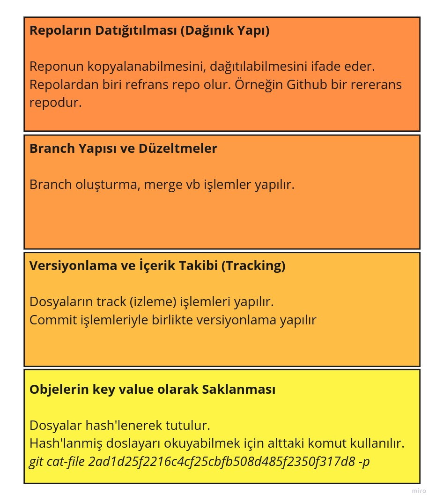
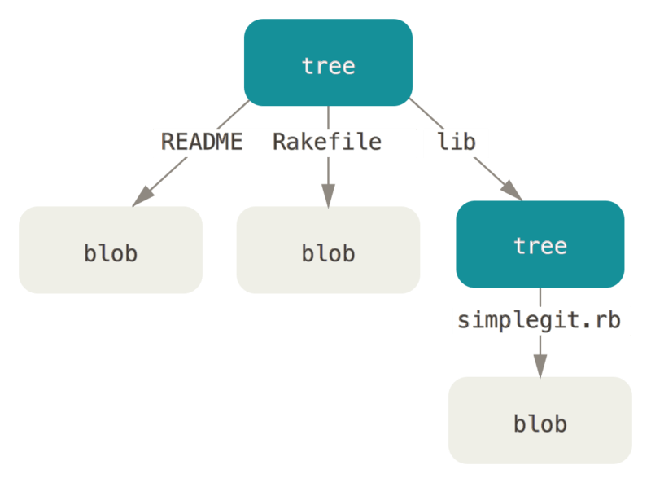
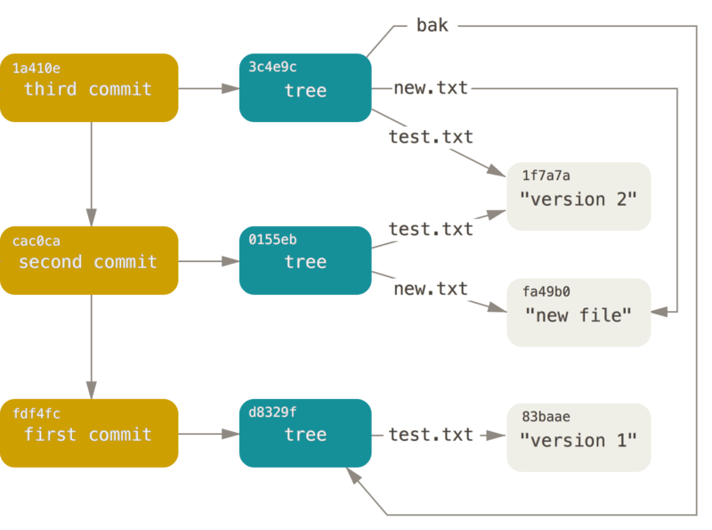
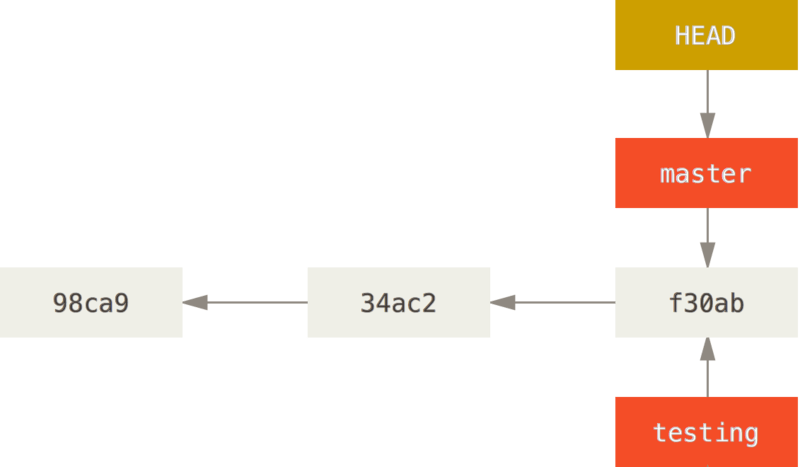
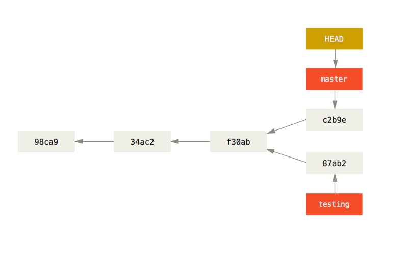
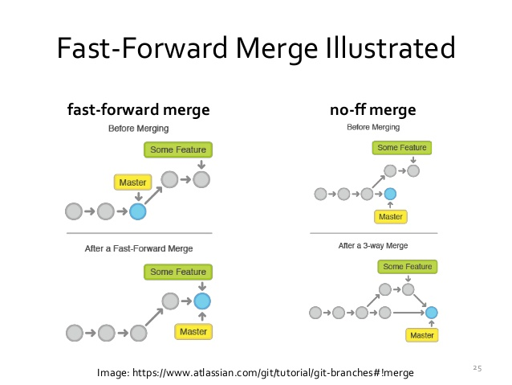
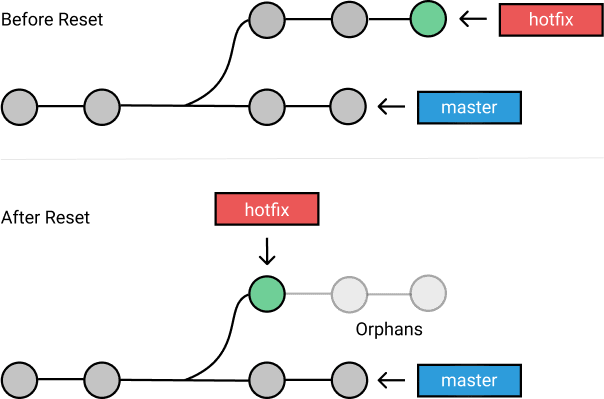
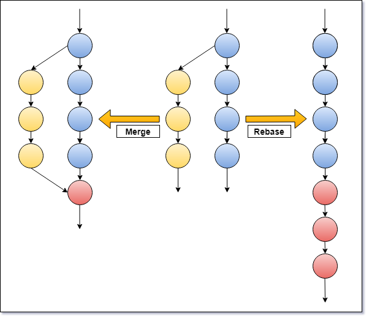
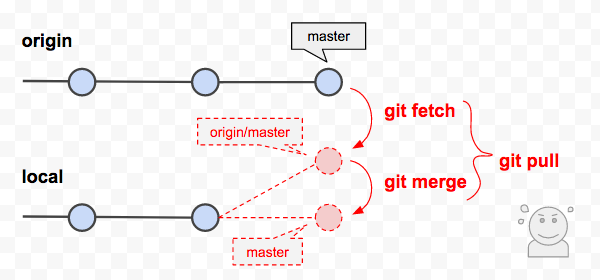

# Git in Depth 1

Hello, in this article we'll try to examine how Git organizes and manages files.

Basically, Git performs four fundamental functions.

1. Distribution of Repositories (Distributed Structure)
2. Branching and Corrections
3. Versioning and Content Tracking
4. Storing objects as key-value pairs.




Let's start examining from the inside out.

#### Storing Objects as Key-Value Pairs

**Key Value Store**

The hash (sha1) of every file is kept, and changes are tracked on top of it. Folders, and even commits, have a hash too.

For example, with the code below we get the hash of a string input.

```shell
echo "merhaba dünya" | git hash-object --stdin

# 2ad1d25f2216c4cf25cbfb508d485f2350f317d8
```

If we make even the slightest change to this string, the hash changes. This means the file has changed.

```
echo "merhaba dünya " | git hash-object --stdin
dd38a8c3d16d052a1b43ad961727d6a0d200d7c5
```

**Persistency**

After turning our folder into a git repository with git init, if we run the code below and look at the .git folder, we can see that there are some files and folders under the objects folder.

With the w parameter, we're telling it to write to disk.

```shell
echo "merhaba dünya" | git hash-object --stdin -w

#2ad1d25f2216c4cf25cbfb508d485f2350f317d8
```

If we ignore the info and pack folders and look at the others, we can see that there's one folder (named 2a in my case). Inside the folder there's a file whose name is the same as our hash.

This file contains the compressed binary blob form of the "merhaba dünya" text we wrote. Git also has commands to read this file.

The -t parameter means type, and it returns the type of the file.

```shell
git cat-file 2ad1d25f2216c4cf25cbfb508d485f2350f317d8 -t
blob
```

-p means print.

```shell
git cat-file 2ad1d25f2216c4cf25cbfb508d485f2350f317d8 -p
merhaba dünya
```

#### Versioning and Content Tracking

For this, we create a few files inside a folder, and also a file named readme in the root directory.

```
liste.txt
dosyalar/dosya1.txt
dosyalar/dosya2.txt
```

At this point, if you used your previous git repo, you can see only the blob file of our previous file in the objects folder under the .git folder. If you created a new git repository, no files will appear other than the info and pack folders.

If we check the status of our files with git status, we can see that the files are in the untracked state. In other words, git doesn't know anything about these files yet, meaning it isn't tracking them.

```shell
git status
On branch master

No commits yet

Untracked files:
  (use "git add <file>..." to include in what will be committed)
        dosyalar/
        liste.txt

```

If we run the _git commit_ command, we move the files to the staging area.

First we add the files. If we run the _git status_ command after this, we'll get a result like the one below.

```shell
git status

# On branch master

# No commits yet

# Changes to be committed:
#   (use "git rm --cached <file>..." to unstage)
#         new file:   dosyalar/dosya1.txt
#         new file:   dosyalar/dosya2.txt
#         new file:   liste.txt

```


If we commit our files and look with the _git log_ command, we can see the commit log of our files.

```
git log
#commit f56470d56df19e45bade938ff2d3a97276c35be6 (HEAD -> master)
#Author: Murat Çabuk <muratcabuk@mail.com>
#Date:   Thu Apr 22 21:33:02 2021 +0300

#    first commit
```

If we look at the objects folder under the .git folder again, we can see many folders. The first two digits of the hash code next to the commit in the log correspond to the names of the folders in the objects folder.

We now know how to read the contents of these hash files. But when we type the command, we get a result like the one below.

```shell
git cat-file f56470d56df19e45bade938ff2d3a97276c35be6 -p

#tree c7dcd38517a7e45cedf1da70e4edd47a2bcc748b
#author Murat Çabuk <muratcabuk@mail.com> 1619116382 +0300
#committer Murat Çabuk <muratcabuk@mail.com> 1619116382 +0300

#first commit

```
This part actually holds the metadata of the related data. The actual content is in the database. If you notice, there's a separate hash called tree for this. The first two digits of this hash also map to another folder under the objects folder.

If we read this hash as well, we'll get a result like the one below.

```shell
git cat-file c7dcd38517a7e45cedf1da70e4edd47a2bcc748b -p

#040000 tree cbca9028b3a2f44955d5b4e5bb31bf799a85a701    dosyalar
#100644 blob 40e987f47262db5476ff85dfc872e8294afaa5af    liste.txt
```

So, as you can see, there's a separate tree hash for each folder.



Here we need to pay attention to the following. If the content of any of the files already exists in the system, no new file and hash is created for it; the hash of that existing file in the system is used. So in our example, if the same text were written in dosya1.txt and dosya2.txt inside the dosyalar folder, and we read the contents of these two files with the _git cat-file_ command, we'd see the same hash for both files. In other words, blobs aren't files directly, they're the content of a file, and git doesn't keep the files or folders themselves. Through metadata, it keeps the hashes of the related blobs (and therefore the folder structure too).

Each commit is actually a hash, and each commit holds the hash information of the related blobs and other metadata. So if someone else applied exactly the same code here, the content hashes would be the same, but our commit hashes would be different, because the metadata would be different (author, date, etc.).

**Versioning**

To understand this part, we first change the content of our liste.txt file, commit it and then look at the log.

```shell
git log

# commit 562e2899f2b66c9b8c5a4eae3328de73e975be93 (HEAD -> master)
# Author: Murat Çabuk <muratcabuk@mail.com>
# Date:   Thu Apr 22 22:01:18 2021 +0300

#     second comit

# commit f56470d56df19e45bade938ff2d3a97276c35be6
# Author: Murat Çabuk <muratcabuk@mail.com>
# Date:   Thu Apr 22 21:33:02 2021 +0300

#     first commit

```

Now let's look at the content of the second commit.

```shell
git cat-file 562e2899f2b66c9b8c5a4eae3328de73e975be93 -p

# tree 150fe9fe5a342b53147a54aba2dd38afddd77246
# parent f56470d56df19e45bade938ff2d3a97276c35be6
# author Murat Çabuk <muratcabuk@mail.com> 1619118078 +0300
# committer Murat Çabuk <muratcabuk@mail.com> 1619118078 +0300

# second commit

```
If you notice, there's a piece of metadata here that's different from the previous ones, called parent. As you can also see above, this parent is actually the hash of the first commit.

However, a different tree has been created here, because there's a changed file in the same file structure. If we read this tree hash, we'll see that only the content blob hash of liste.txt, which we changed, has changed, while the tree hash of the dosyalar folder is the same as before. Since nothing changed in the content of the dosyalar folder, the hashes (map) of the previous blobs were used as they are.



```shell
git cat-file 150fe9fe5a342b53147a54aba2dd38afddd77246 -p
040000 tree cbca9028b3a2f44955d5b4e5bb31bf799a85a701    dosyalar
100644 blob ec30232b025202745d4c1497d93033a003a600ac    liste.txt
```

Of course, the following question may come to mind. Won't creating a new blob just because we changed a single line in a huge file make the file sizes grow? Actually, git does serious compression when creating blobs, and also, when creating blobs, it writes only the differences to the new blob, which saves space.

If we add a tag to a commit (it's actually called an annotated tag), this tag information is also written directly into the commit hash as metadata.

To recap, there are four types of objects under the objects folder

1. Blobs
2. Trees
3. Commit
4. Annotated tags


So far we've seen the key value map at the very bottom and the tracker layer, which is the layer above it.

- https://git-scm.com/book/en/v2/Git-Internals-Git-Objects


#### Branching and Corrections

**Branches**

Right now there's only one branch in our system, and that's master.

```shell
git brach

#*master

```
Branch information is located in the heads folder under the refs folder under .git. If we look at the content of this file, we again see a hash.

```shell
cat .git/refs/heads/master 

# 562e2899f2b66c9b8c5a4eae3328de73e975be93
```
This hash is actually the sha-1 hash of our second commit.

When we create a new branch from master, we'll see that a file containing the same hash as in master is created in the _.git/refs/heads/branchname_ folder.



If we make a change in the new branch and commit it to git, a picture like the one below will appear.



 
Which branch we're actively working on is determined by the HEAD file. The branch path is written in the HEAD file. The branch file, in turn, contains the hash showing which commit we're on.


When we merge, a new blob is actually opened for the commit as well. When this blob is read, a hash pointing to a tree is seen. In the metadata of this commit, we see that it has two parents at the same time, because two commits have been merged.



If the merge was done while on master, HEAD points to the master branch, and the master branch points to the last commit. The HEAD of the other branch, however, is in its old place, meaning it's not on the merge commit.

To bring the other branch onto the newly created commit as well, when we merge with the master branch while on the other branch, no new blob and tree is created. Because the old data, with the conflicts resolved too, has already been carried over to the new commit. When the commit operation runs, a message saying that a Fast-Forward was done appears on the screen. The reason is that the HEAD of the other branch is moved directly to the last commit.

**Orphaned Commit**

If somehow commits are left ahead of HEAD, these are called orphaned commits. Sometimes you may also see the term headless being used. These commits are deleted by git's garbage collector after a while.



**Rebasing**

In a classic merge, a commit is made, and the two branches are joined on this commit, adding two parents.

In a rebase, on the other hand, starting from the point where the other branch and the master branch first diverged, each commit of the other branch is copied as is and added to the master branch as a new commit. Finally, the other branch is deleted starting from the first junction point.



#### Distribution of Repositories (Distributed Structure)

Distribution means the following. Let's say we copied code from GitHub, and others like us copied the same code too. That means many developers have the code and a git repository based on that code at the same time.

In this case, one place needs to be the reference repo. Here, that place will be GitHub.

When we clone, some lines come already added to the .git/config file. For example, if we look at the local config file of this document, we can also see the address of the repo as the remote reference.

We can also see that there's a single branch locally and that it's mapped to the remote branch named origin.

```config
[core]
	repositoryformatversion = 0
	filemode = true
	bare = false
	logallrefupdates = true
[remote "origin"]
	url = https://github.com/muratcabuk/derinlemesine-git
	fetch = +refs/heads/*:refs/remotes/origin/*
[branch "master"]
	remote = origin
	merge = refs/heads/master

```

The command below is used to list all local and remote branches.
```
git branch --all

<!-- * master
  remotes/origin/master -->
```

Remote branch information is also located in the remotes folder under the refs folder.


To see the contents of the files under the refs (references) folder, we run the command below. As you can see, the remote and local master branches are on the same commit.

```shell
git show-ref master

# 49cb5e959fea43d37b8c2dbdb9bdedc29b3848a4 refs/heads/master
# 49cb5e959fea43d37b8c2dbdb9bdedc29b3848a4 refs/remotes/origin/master

```

**Push**

When we run the push command after making additions, deletions and changes on our local branch, git sends only the newly added commits and the related trees and other objects. The reason is that objects are immutable, so whatever we do, what actually happens is always that new objects are added. In other words, even when deleting, a new commit and its related trees and blobs are created.

**Local Remote Conflict, Pull and Fetch**

Let's say we did some things on our local master branch, but at the same time some code was also written on the remote branch. In this case, when we want to push our code to the remote, a conflict will occur. There are two ways to fix this.

**1.** By using the -f flag while pushing our code, we can make the changes made on the remote after we pulled orphaned, and attach the changes we made locally to the commit we got from the remote. However, in this case the git garbage collector will delete this part that's left headless.


**2.** We can resolve the related conflict locally and then push.

At this point we need to understand the difference between pull and fetch. The pull command also does a merge after getting the changes from the remote branch. Fetch, on the other hand, only gets the changes from the remote but doesn't merge.



After the conflicts are resolved locally and the merge is completed locally, you can push again.

For this reason, rebases done locally shouldn't be sent to the remote. Because this kind of merge will cause conflicts.

As you can see below, rebase adds all the steps as commits. It's likely that other developers who aren't aware of this will run into conflicts when they push. In that case, they'll have to understand what was done here and resolve the conflicts.


#### Resources

- https://medium.com/@gokhansengun/git-nas%C4%B1l-%C3%A7al%C4%B1%C5%9F%C4%B1r-bf405779116b
- https://git-scm.com/book/en/v2/Distributed-Git-Distributed-Workflows
- https://git-scm.com/docs/git-push
- https://git-scm.com/book/tr/v2/Git-Internals-Git-Objects
- https://git-scm.com/book/en/v2/Git-Branching-Branches-in-a-Nutshell
- https://www.atlassian.com/git/tutorials/using-branches
