# Git in Depth 2

Hello,

In this article, we'll examine the options of the _git merge_ command, which we use when combining our commits, that are used to manage the change it makes to the git history during the merge.

- No Fast-forward
- Fast-forward
- Fast-forward Only

We'll also try to understand the _git _rebase_ and _git cherry-pick_ commands, which change the history, by examining their relationship with and differences from the _git merge_ command.

These topics are usually covered in resources under the title "merge strategies", but that's an incorrect definition. If you look at the [official git documentation](https://git-scm.com/docs/git-merge) as well, you can see that the word strategies refers to the techniques used while resolving conflicts. It's also possible to use these techniques as options in merge operations.

There's a nice article about the use of Merge Strategies on the [Atlassian Bitbucket page](https://www.atlassian.com/git/tutorials/using-branches/merge-strategy).

Happy reading

#### No Fast-forward Merge

Let's say there are two commits on the master branch after the feature branch was created. Likewise, let's say there are two commits on feature. At time T, when the _git merge feature_ command is run while on master, __a new commit is created__ and __two parents__ appear in the metadata of this commit. One of them points to master and the other to the feature branch.

The command below can be used to check this.

```shell
git cat-file -p COMMIT_ID
```

As you can also see in the figure, the master branch splits into two parents (diverged).

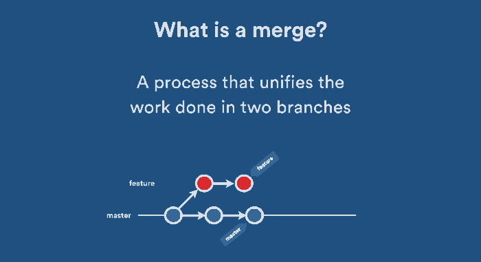


When we check with the _git log_ command, two parents can be seen in the descriptions in the form _Merge: 7222f6a c952e91_.

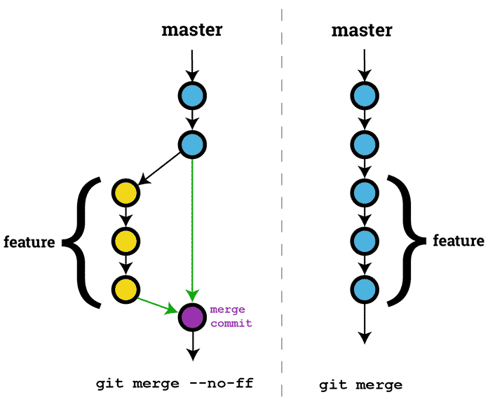

#### Fast-forward merge 

This is the default when the _git merge_ command is run, meaning --ff is run automatically. In this merge type, no branching or divergence occurs. __No new commit is created__; instead, the HEAD of the master branch is moved to the last commit on the feature branch. __A single parent__ is created/exists.

In the figure above, the one on the right shows the fast-forward merge.

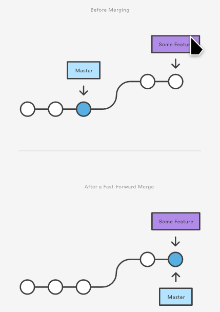

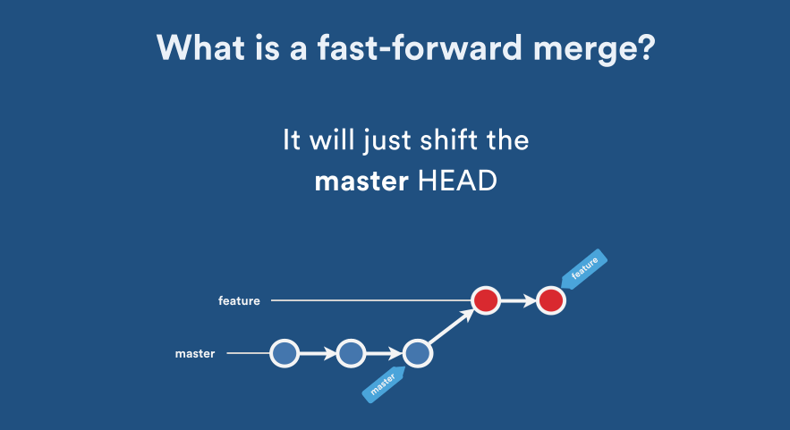

Unlike rebase, no new commits are created; the existing commits are used as they are. In rebase, on the other hand, the commits on the feature branch are copied to create new commits, and the old ones are deleted.


**Example Application**

First, you should run the command below to get the view below. Here we're defining an alias named t3.

```shell
git config --global alias.t3  "log --graph --abbrev-commit --decorate --format=format:'%C(bold blue)%h%C(reset) - %C(bold cyan)%aD%C(reset) %C(bold green)(%ar)%C(reset)%C(bold yellow)%d%C(reset)%n''          %C(white)%s%C(reset) %C(dim white)- %an%C(reset)' --all"

git t3
```

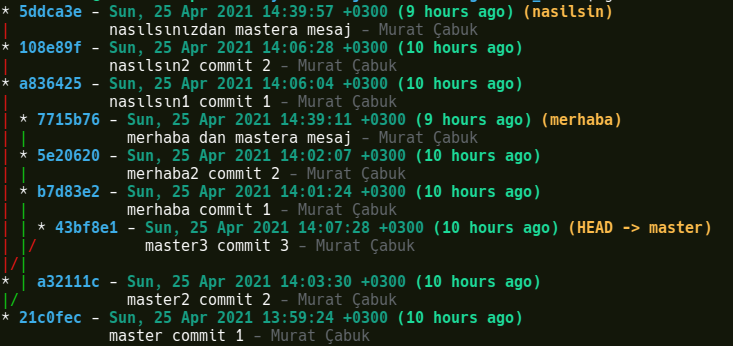

The "Merhaba" branch split off after the first commit of master. If you notice, the "nasilsin" branch also split off after the second commit of the master branch. Don't let the graph mislead you. The commit with id a32122c has nothing to do with the merhaba branch. The commit with id a32122c is the second commit of the master branch, and the "nasilsin" branch split off from this line.

HEAD, on the other hand, is on the master branch, on commit 43bf8e1.

After setting up a structure like the one above, let's do our merge operations.

```shell
git checkout master
git merge merhaba --ff
```
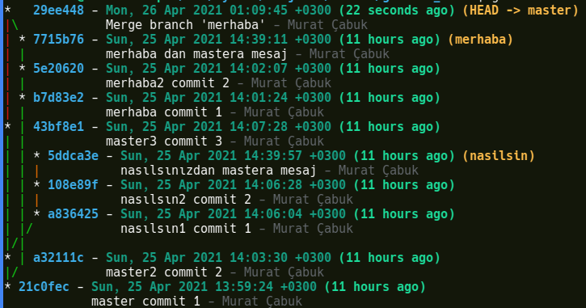

However, the result wasn't what we expected. Because the -ff command first tests with the --ff-only parameter whether a fast forward commit can be made, and if it can't, it creates a new commit and resolves the problems (conflicts) or has them resolved. So why didn't --ff-only work in our environment? Because there were changes on the master branch after the merhaba branch was created. For --ff-only to work, the history on the master branch would need to be in the "merhaba" branch.

To test such a situation, let's go back in the commit history.

```shell
git reflog
```
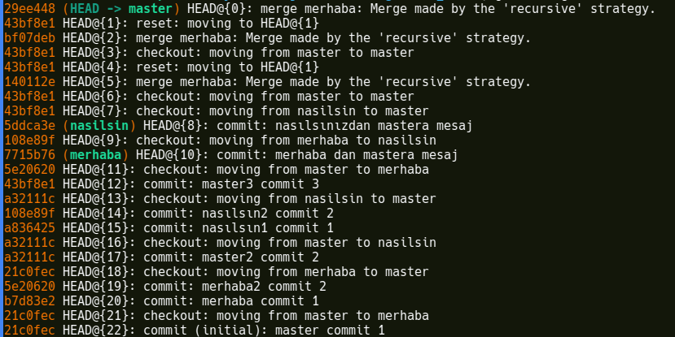

HEAD@{18} looks reasonable. It's the state where the "Merhaba" branch has finished its work and before the master branch moved on to changes.

```shell
git reset --hard HEAD@{18}
```


If you notice, HEAD is on master, on commit 1.
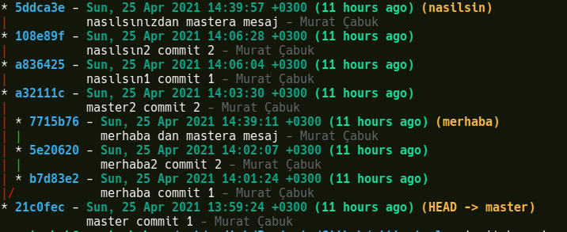

Then we perform the merge with the --ff-only parameter.

```shell
git merge merhaba --ff-only
# Updating 21c0fec..7715b76
# Fast-forward
#  master1.txt  | 3 ++-
#  merhaba1.txt | 1 +
#  merhaba2.txt | 1 +
#  3 files changed, 4 insertions(+), 1 deletion(-)
#  create mode 100644 merhaba1.txt
#  create mode 100644 merhaba2.txt

```
Right below the command there's a line saying "Updating 21c0fec..7715b76". This line actually shows where HEAD moved from and to. According to the move, HEAD is on the last commit on the merhaba branch. So, without creating a new commit, we made the commit just by moving HEAD.
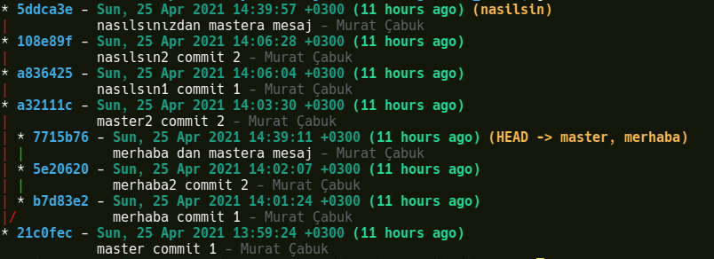


So, if we check our branch in this case, we can see that we're still on master.

```shell
git branch
# * master
#   merhaba
#   nasilsin
```

At this point, let's think about whether we can merge with the "nasilsin" branch. If we pay attention to the tree, as of where master currently is, it looks like other commits were added to the master branch after the "nasilsin" branch split off, following its merge with the "merhaba" branch. In this case, we can't do it.

```shell
git merge nasilsin --ff-only
# fatal: Not possible to fast-forward, aborting.
```
However, if we do it with the --ff command, this will be possible. Because --no-ff will run in the background, and a commit will be created and the problems will be resolved, or, for the ones that can't be resolved automatically, we'll be given the chance to resolve the conflicts manually.

```shell
git merge nasilsin --ff
# Merge made by the 'recursive' strategy.
#  master2.txt   | 2 ++
#  nasilsin1.txt | 1 +
#  nasilsin2.txt | 1 +
#  3 files changed, 4 insertions(+)
#  create mode 100644 master2.txt
#  create mode 100644 nasilsin1.txt
#  create mode 100644 nasilsin2.txt
```
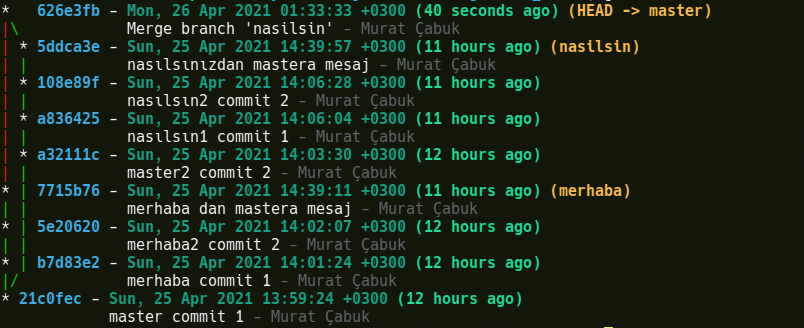

#### Squash Merge

Here, __a new commit is created__. If we look at the squash merge on the far right in the figure below, the C4 and C5 commits created on the feature branch were combined into a single commit and attached to C3 on the develop branch. In this commit type, there's __a single parent__ in the newly created branch, but the commit message keeps the messages of both commits on the feature branch together.

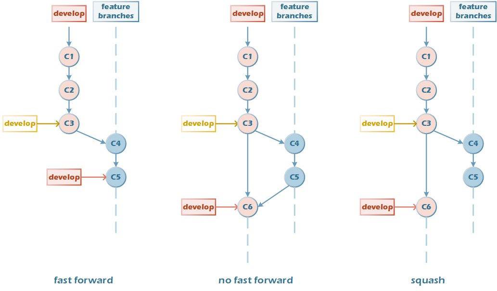

So, unlike the "no ff" option, there aren't 2 parents.

**example application**

To get the view below, you should first create the t3 alias by running the command below; if you created it before, you don't need to run it.

```shell
git config --global alias.t3  "log --graph --abbrev-commit --decorate --format=format:'%C(bold blue)%h%C(reset) - %C(bold cyan)%aD%C(reset) %C(bold green)(%ar)%C(reset)%C(bold yellow)%d%C(reset)%n''          %C(white)%s%C(reset) %C(dim white)- %an%C(reset)' --all"

git t3
```


The "Merhaba" branch split off after the first commit of the master branch. If you notice, the "nasilsin branch also split off after the second commit of the master branch. Don't let the graph mislead you, the commit with id a32122c has nothing to do with the merhaba branch. The commit with id a32122c is the second commit of the master branch, and the "nasilsin" branch split off from this line.

To commit all the commits on the "Merhaba" branch onto the master branch by creating a single commit, we run the command below.

```shell
git checkout master
git merge merhaba --squash
git commit # we have to run this, don't skip it
```

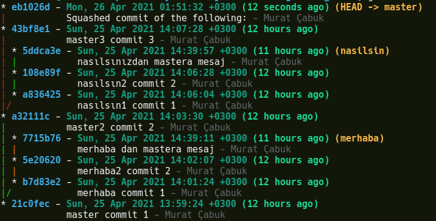

As you can see, the merge operation was completed by creating a commit with id eb1026d at the end of master for the 2 new branches on the "merhaba" branch.

#### Cherry-Pick

It means committing a commit from one branch to another branch by __copying__ it.

So the commits still remain on the other branch.

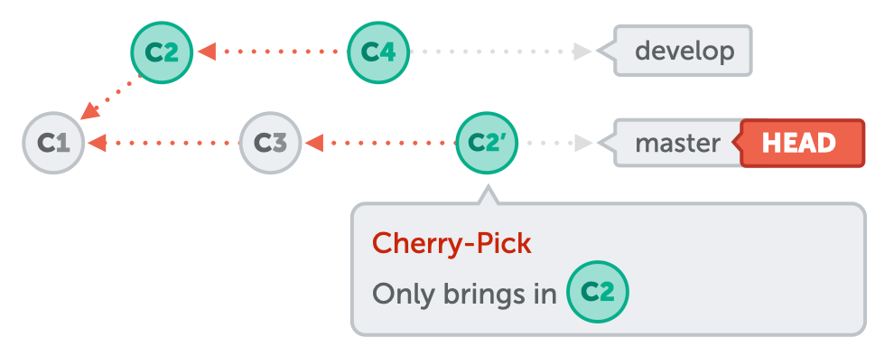

The commit copied from the feature branch isn't deleted from the feature branch.

__A single parent is created in the new commits__, but there end up being two copies of the same code, and their commit ids are different. It breaks the git history line.

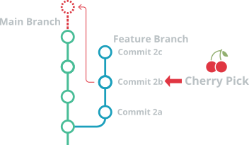

**Example Application**

To get the view below, you should run the alias creation command I repeated above.

```shell
git t3
```


Let's copy the commit with id 5e20620 on the "Merhaba" branch onto the master branch.

```shell
git checkout master

git cherry-pick 5e20620
# CONFLICT (modify/delete): merhaba1.txt deleted in HEAD and modified in 5e20620... merhaba2 commit 2. Version 5e20620... merhaba2 commit 2 of merhaba1.txt left in tree.
# error: could not apply 5e20620... merhaba2 commit 2
# hint: after resolving the conflicts, mark the corrected paths
# hint: with 'git add <paths>' or 'git rm <paths>'
# hint: and commit the result with 'git commit'

```

With this move, we're actually cutting the commit with id 5e20620 off from its parent while copying it to the master branch. In the previous step, a file named merhaba1.txt had been created, but since this link is gone with the new merge, this file needs to be deleted, and since a file named merhaba2.txt was created in the commit with id 5e20620 that we're trying to copy, it needs to be added to the index (stage). If we run the _git status_ command right at this moment, we'll see the same thing.

```shell
git status
# On branch master
# You are currently cherry-picking commit 5e20620.
#   (fix conflicts and run "git cherry-pick --continue")
#   (use "git cherry-pick --skip" to skip this patch)
#   (use "git cherry-pick --abort" to cancel the cherry-pick operation)

# Changes to be committed:
#         new file:   merhaba2.txt

# Unmerged paths:
#   (use "git add/rm <file>..." as appropriate to mark resolution)
#         deleted by us:   merhaba1.txt

```
We track the files and commit them.

```shell
git add .
git commit

git t3
```

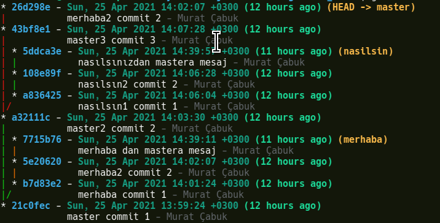


#### Rebase Instead of Merge

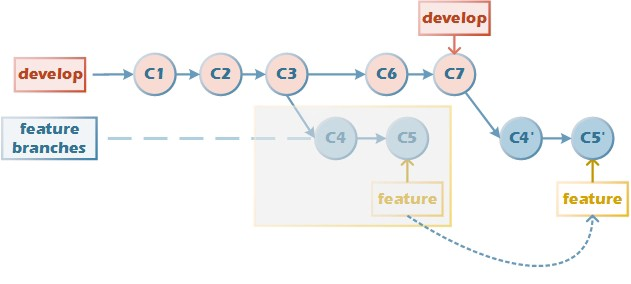

__Visually, we can compare rebase to fast-forward__. However, its structure and the way it happens are very different from it.

We can think of it like this: imagine we copy from the feature branch to the master branch one by one with cherry-pick, and then delete the feature branch we copied from. This explains rebase exactly. Of course, rebase does this in a single move.

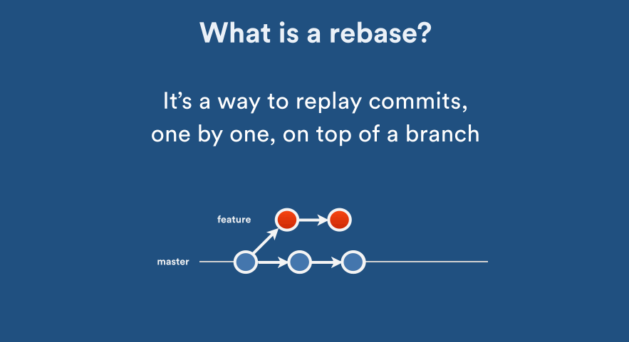


**Example Work**

```shell
git t3
```

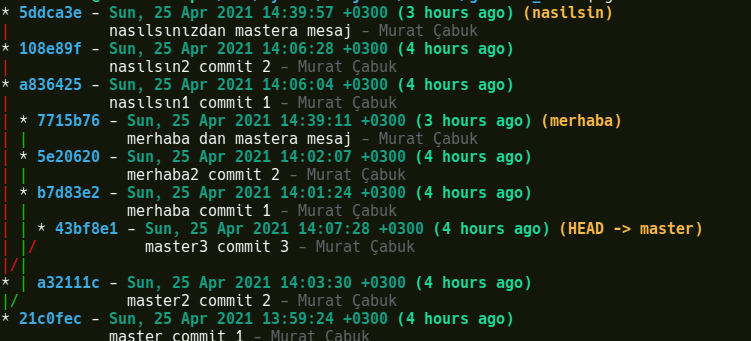

Now let's rebase the master branch onto merhaba. Normally, doing something like this doesn't make sense. Our goal is both to understand the logic of the rebase command and to undo the rebase in case of a mistake.

```
git checkout master

git rebase merhaba
```
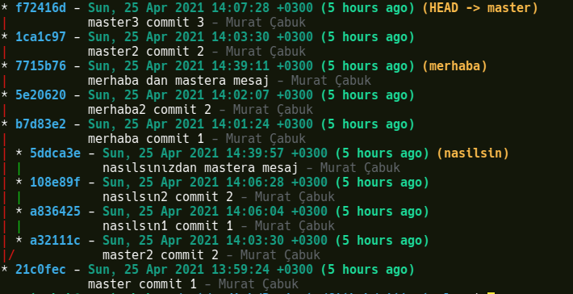

As you can see, the command copied the a32111c and 43bf8e1 commits, which were on the master branch before the rebase, onto the "merhaba" branch. The old commits no longer exist, and the new commit ids are as below.

a32111c --> 1ca197
43bf8e1 --> f72416d

If you notice, the first commit of the master branch wasn't moved; the reason is that the merhaba branch was created after the first commit of the master branch. In other words, the split started after commit 1. If it had started after commit 2, the copying would have been done after commit 2.

What we actually wanted to do was to bring the merhaba branch onto master. In this case, to undo the rebase we need to look at the reflogs.

```shell
git reflog
```


In the list, we can see the moves we made on the branches. If you notice, before the rebase operation, the last thing we did was at HEAD@{8}, where we made a commit called "nasılsınızdan master a mesaj" on the "nasilsin" branch, and at HEAD@{7} we switched to the master branch. In this case, it will be enough to go back to HEAD@{7}, that is, to commit id 43bf8e1.

```shell
git reset --hard 43bf8e1 # or HEAD@{7}
```
If we look at the new state, we can see that we've gone back to how we were before the rebase.

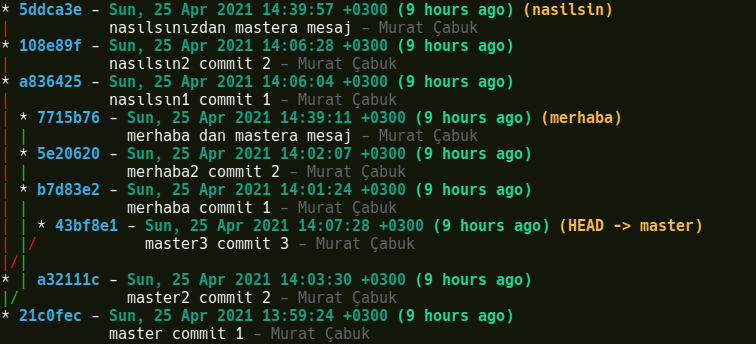

Now let's run the correct code.

```shell
git checkout merhaba

git rebase master
```
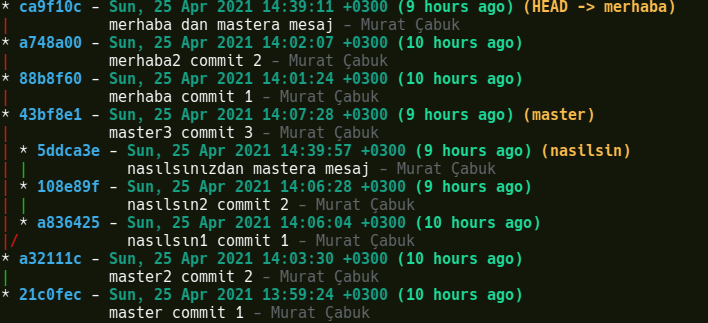

The commits on the merhaba branch have now been copied onto the master branch.

The rebase command could also have been run like this.

```shell
git rebase master merhaba

# we had run the command below while we were on the merhaba branch, which is the other version

#git rebase master
```

So what's the logic behind this? It looks as if the command works the other way around, but it doesn't. Actually, we need to be on whichever branch we're operating on. For example, in the _git merge_ command too, let's say we're going to merge the master branch into the merhaba branch; in this case, after checking out the master branch, we run the command as _git merge master -ff_.


I hope it was a useful article. See you in our next Git in depth article.
