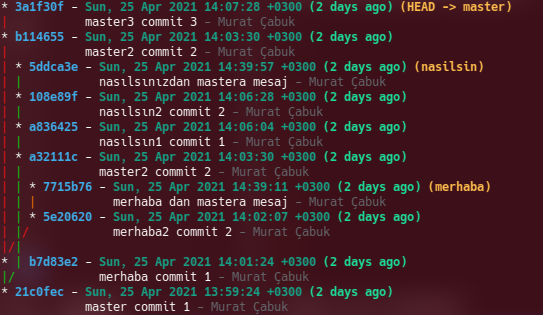
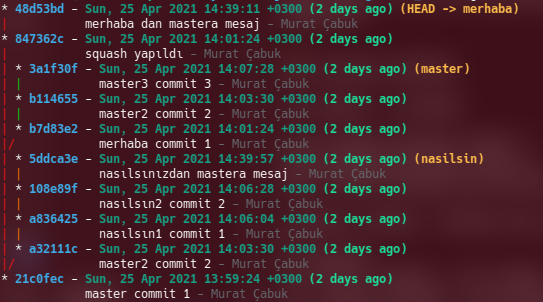
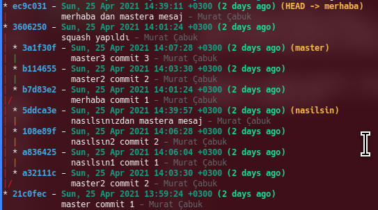
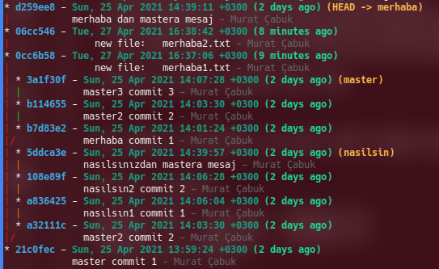
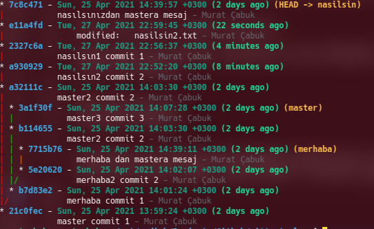
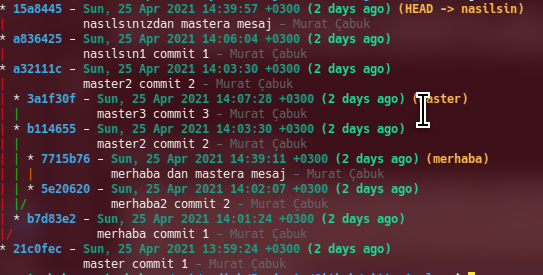

# Rewriting Git History with Interactive Rebase


Hello friends,

In this third article of our Git in Depth series, we'll try to learn and understand the topic of "interactive rebase".

As you can tell from the title, interactive rebase is used to change/rewrite our git history.

However, we need to keep the following warning in mind. Never rebase shared commits. Changes made to the past, especially on remote repos, can be very exhausting.

But again, for example, if a piece of information that shouldn't have been shared was written to the history, it may need to be deleted. For this, the best method is actually to delete a specific file or text from the entire history with the BFG tool. For details, you can [check out](https://docs.github.com/en/github/authenticating-to-github/removing-sensitive-data-from-a-repository) this link.

**The _git blame_ command gives all the changes made in a file and their commit information.**

```
git blame DOSYA_ADI
```

**Important Note: in interactive rebase, the commit chosen as the base isn't included in the rebase operation.** In other words, the first commit after the given commit is used as the base. So what if we needed to work on the root commit itself? For this, we need to add the --root parameter to the command.

A normal rebase actually just attaches one branch to the HEAD of another branch. But interactive rebase does much more. It can make changes to the history of all commits. In this sense, interactive rebase also covers normal rebase.

We'll be using the project below for our examples.



When we enter the command below, we'll be offered many options. We'll try to examine all of them.


```bash
git rebase -i commitid
```


## Squash (Combining two or more commits)

Its purpose is to combine two or more commits in the past.


Let's say we want to combine commit b7d83e2 on the merhaba branch with the next commit, 5e20620. For this, we need to start from the commit right before the first commit. According to our example, that first commit is actually commit 21c0fec on the master branch. However, this commit is also the commit where the merhaba branch is connected to master. So we should first switch to the merhaba branch and then run the interactive rebase.

If we needed to start the rebase from the root, then we'd need to add the --root option.

```bash
git checkout merhaba

git rebase -i 21c0fec

pick b7d83e2 merhaba commit 1
pick 5e20620 merhaba2 commit 2
pick 7715b76 merhaba dan mastera mesaj

# Rebase 21c0fec..7715b76 onto 21c0fec (3 commands)
#
# Commands:
# p, pick <commit> = use commit
# r, reword <commit> = use commit, but edit the commit message
# e, edit <commit> = use commit, but stop for amending
# s, squash <commit> = use commit, but meld into previous commit
# f, fixup <commit> = like "squash", but discard this commit's log message
# x, exec <command> = run command (the rest of the line) using shell
# b, break = stop here (continue rebase later with 'git rebase --continue')
# d, drop <commit> = remove commit
# l, label <label> = label current HEAD with a name
# t, reset <label> = reset HEAD to a label
# m, merge [-C <commit> | -c <commit>] <label> [# <oneline>]
# .       create a merge commit using the original merge commit's
# .       message (or the oneline, if no original merge commit was
# .       specified). Use -c <commit> to reword the commit message.
#
# These lines can be re-ordered; they are executed from top to bottom.
#
# If you remove a line here THAT COMMIT WILL BE LOST.
#
# However, if you remove everything, the rebase will be aborted.
#
# Note that empty commits are commented out
```

We'll continue with the **squash** option.

Our goal is to combine the two at the bottom. By the way, we need to pay attention to the following. The oldest commit will appear at the top. The reason is that we need to go from old to new, because what we do in the old ones will also affect the new ones. This may apply in cases such as deleting or adding a block of code, or deleting a file entirely, etc.

- **pick** : I don't want any change, you can take it as it is
- **reword**: change the commit message
- **squash** : combine two commits, but the combining is done into the previous commit
- **edit**: Stops the rebase and lets you make changes to the commit. If you make the change you want and continue the rebase (git rebase --continue), the content of that commit will change. Also, if the commit you're rebasing contains changes that are unrelated to each other or to the commit message, and you want to save the change that's unrelated to this commit as a separate commit, if you make the commits without leaving the rebase and then finish the rebase, you'll see that the changes have been split into separate commits. (source : https://mesuutt.com/2016/07/git-rebase-interactive/)
- **fixup**: like squash, combines the commit with the commit made before it. The only difference is that, as the commit message, it uses the message of the commit made before the commit marked as fixup (source : https://mesuutt.com/2016/07/git-rebase-interactive/).

So if we want to combine the 2 below, it's enough to write squash on the second one, because its parent is the commit above it in the list, that is, b7d83e2.

```
pick b7d83e2 merhaba commit 1
pick 5e20620 merhaba2 commit 2
```
On the screen, we edit the second commit and save the file.

```
pick b7d83e2 merhaba commit 1
squash 5e20620 merhaba2 commit 2
pick 7715b76 merhaba dan mastera mesaj
```

Once saving is complete, it lets us edit the commit message needed for the squash. We edit the message and save again.

In the first of these commits, we had written "merhaba commit 1" to a file called merhaba1.txt, and in the second commit "merhaba commit 2" to a file called merhaba2.txt.

The message that appears on the screen is as follows

```
[detached HEAD 847362c] squash yapıldı
 Date: Sun Apr 25 14:01:24 2021 +0300
 2 files changed, 2 insertions(+)
 create mode 100644 merhaba1.txt
 create mode 100644 merhaba2.txt
Successfully rebased and updated refs/heads/merhaba.
```
If we look at our tree structure again, we can see that commits b7d83e2 and 5e20620 have been combined into commit 847362c. But there's one more difference: commit 7715b76, the last commit of merhaba, which we didn't include in the combining, has also been recreated as commit 48d53bd on top of the squashed commit.



The previous tree structure


## Split Commmit (splitting commits into parts)

Let's go back to the very beginning.


For our example, let's say we changed two files in a single commit and want to split them into two separate commits. For this, let's first combine two commits like in the squash above, and then split them.

Again, we combine the first two commits on the merhaba branch.


```bash
git checkout merhaba

git rebase -i 21c0fec

pick b7d83e2 merhaba commit 1
squash 5e20620 merhaba2 commit 2
pick 7715b76 merhaba dan mastera mesaj
```

We write "squash yapıldı" as the message too, and complete the squash operation while keeping the previous two messages as well.



Let's take a look at what's in the combined commit with the command below.

```bash
git show 3606250 --name-only 

#result
commit 3606250c222cc5231569d3d6a35a0ed3bd30f924
Author: Murat Çabuk <muratcabuk@mail.com>
Date:   Sun Apr 25 14:01:24 2021 +0300

    squash yapıldı
    
    merhaba commit 1
    
    merhaba2 commit 2

merhaba1.txt
merhaba2.txt

```

As you can see, two of our files have been changed. Now our goal is to bring this back to its old state.

We write edit on the commit we want to split in two and save.

```bash
git rebase -i 21c0fec


edit 3606250 squash yapıldı
pick ec9c031 merhaba dan mastera mesaj
```

When we save the file, we're greeted with a screen like the one below.

```bash
Stopped at 3606250...  squash yapıldı
You can amend the commit now, with

  git commit --amend 

Once you are satisfied with your changes, run

  git rebase --continue

```
If we look at the status at this point, we'll see a screen like the one below

```bash
git status

#result
interactive rebase in progress; onto 21c0fec
Last command done (1 command done):
   edit 3606250 squash yapıldı
Next command to do (1 remaining command):
   pick ec9c031 merhaba dan mastera mesaj
  (use "git rebase --edit-todo" to view and edit)
You are currently editing a commit while rebasing branch 'merhaba' on '21c0fec'.
  (use "git commit --amend" to amend the current commit)
  (use "git rebase --continue" once you are satisfied with your changes)

nothing to commit, working tree clean

```
If we examine the log, we can see that HEAD is on commit 3606250 (that is, the commit newly opened for the squash). But to be able to split, we need to be in the previous state.

```bash
git log --oneline

3606250 (HEAD) squash yapıldı
21c0fec master commit 1
```

To go to the previous commit

```
git reset --mixed HEAD~
```
Then, if we look at the status, we can see that our two files aren't in the stage (index) area, meaning they aren't tracked.

```bash
git status

#result
interactive rebase in progress; onto 21c0fec
Last command done (1 command done):
   edit 3606250 squash yapıldı
Next command to do (1 remaining command):
   pick ec9c031 merhaba dan mastera mesaj
  (use "git rebase --edit-todo" to view and edit)
You are currently editing a commit while rebasing branch 'merhaba' on '21c0fec'.
  (use "git commit --amend" to amend the current commit)
  (use "git rebase --continue" once you are satisfied with your changes)

Untracked files:
  (use "git add <file>..." to include in what will be committed)
        merhaba1.txt
        merhaba2.txt

nothing added to commit but untracked files present (use "git add" to track)
```

Now we'll add and commit these files in order.

```bash
git add merhaba1.txt 
git commit -m "new file:   merhaba1.txt"

git add merhaba2.txt 
git commit -m "new file:   merhaba2.txt"
```

If we look at the status again, we can see that the rebase flow hasn't been completed.

```bash
git status

#result
interactive rebase in progress; onto 21c0fec
Last command done (1 command done):
   edit 3606250 squash yapıldı
Next command to do (1 remaining command):
   pick ec9c031 merhaba dan mastera mesaj
  (use "git rebase --edit-todo" to view and edit)
You are currently editing a commit while rebasing branch 'merhaba' on '21c0fec'.
  (use "git commit --amend" to amend the current commit)
  (use "git rebase --continue" once you are satisfied with your changes)

nothing to commit, working tree clean

```
Let's examine the logs. We can see that there are two commits.

```bash
git log --oneline

06cc546 (HEAD)  new file:   merhaba2.txt
0cc6b58         new file:   merhaba1.txt
21c0fec master commit 1
```

When we continue the rebase, since there are no other steps, the rebase will be completed.

```bash
git rebase --continue 
Successfully rebased and updated refs/heads/merhaba.
```

We can see the tree again.




If you pay attention to the Merhaba branch, you can see that two commits with ids 0cc6b58 and 06cc546 have been added. After the squash, there was only one here. You can also see the previous state below.

However, there's an interesting situation here: if you notice, the commit with id b7d83e2 hasn't been deleted from the master branch, which makes perfect sense. Because this commit is also the second commit of the master branch.

Below, in the previous version, we can see that this commit was kept when we did the squash as well.


## Reordeing (changing the order of commits)

Let's remember our initial tree structure.


On the nasilsin branch, we want to swap the places of commits 108e89f and 108e89f.

```bash
git checkout nasilsin

# we choose the previous commit
git rebase -i a32111c 

# the two were swapped

pick 108e89f nasılsın2 commit 2
pick a836425 nasılsın1 commit 1
pick 5ddca3e nasılsınızdan mastera mesaj

```
When we save, we get a message saying there's a conflict.

```bash
git rebase -i a32111c

#result
CONFLICT (modify/delete): nasilsin1.txt deleted in HEAD and modified in 108e89f... nasılsın2 commit 2. Version 108e89f... nasılsın2 commit 2 of nasilsin1.txt left in tree.
error: could not apply 108e89f... nasılsın2 commit 2
Resolve all conflicts manually, mark them as resolved with
"git add/rm <conflicted_files>", then run "git rebase --continue".
You can instead skip this commit: run "git rebase --skip".
To abort and get back to the state before "git rebase", run "git rebase --abort".
Could not apply 108e89f... nasılsın2 commit 2
```
So we first need to resolve the conflict.

First, let's take a look at the status

```bash
git status

#result
interactive rebase in progress; onto a32111c
Last command done (1 command done):
   pick 108e89f nasılsın2 commit 2
Next commands to do (2 remaining commands):
   pick a836425 nasılsın1 commit 1
   pick 5ddca3e nasılsınızdan mastera mesaj
  (use "git rebase --edit-todo" to view and edit)
You are currently rebasing branch 'nasilsin' on 'a32111c'.
  (fix conflicts and then run "git rebase --continue")
  (use "git rebase --skip" to skip this patch)
  (use "git rebase --abort" to check out the original branch)

Changes to be committed:
  (use "git restore --staged <file>..." to unstage)
        new file:   nasilsin2.txt

Unmerged paths:
  (use "git restore --staged <file>..." to unstage)
  (use "git add/rm <file>..." as appropriate to mark resolution)
        deleted by us:   nasilsin1.txt

```

It shows that a new file was added (nasilsin2.txt in the Changes to be committed section) and that one file is waiting in an unmerged state (Unmerged paths: deleted by us:   nasilsin1.txt).

Having such a situation in the unmerged state is actually perfectly normal. Because we're taking the second commit in place of the first, so the parent changes, and the previous commit (the one with nasilsin1.txt, which is currently in the unmerged state and will be deleted) won't have been made in this case, and therefore the file won't exist either. But since the system wants us to confirm this deletion, it can't do the merge. If we add the file to the stage (index) area with the add command, commit it and say rebase continue, we can move on to the next step. Actually, in the next step it will also have us resolve a conflict about this file needing to be created. Because this file will have been created after the swap.

The second conflict looks like this

```bash
git status

#result
interactive rebase in progress; onto a32111c
Last commands done (2 commands done):
   pick 108e89f nasılsın2 commit 2
   pick a836425 nasılsın1 commit 1
Next command to do (1 remaining command):
   pick 5ddca3e nasılsınızdan mastera mesaj
  (use "git rebase --edit-todo" to view and edit)
You are currently rebasing branch 'nasilsin' on 'a32111c'.
  (fix conflicts and then run "git rebase --continue")
  (use "git rebase --skip" to skip this patch)
  (use "git rebase --abort" to check out the original branch)

Unmerged paths:
  (use "git restore --staged <file>..." to unstage)
  (use "git add <file>..." to mark resolution)
        both added:      nasilsin1.txt
```

Before adding the file, let's take a look at its content

```bash
<<< <<<< HEAD
nasılsın2 commit 2
=======
nasılsın1 commit 1
>>>> >>> a836425... nasılsın1 commit 1
```

As you can see, the lines of both commits have been added to this file, but our expectation is that it only says "nasılsın1 commit 1", because that's what was written in the nasilsin1.txt file before.

We can add and commit.

Let's also take a look inside the nasilsin2.txt file.

```bash
cat nasilsin2.txt

#result
nasılsın1 commit 1
```

If you like, let's also change this file to its original text, that is, "nasilsin2 commit 2", then add and commit, and continue the rebase.



If you notice, the commit with the message "nasilsin2 commit 2" and "nasilsin1 commit 1" have swapped places. But an extra commit with id e11a4fd has also been added. That was actually our mistake. Since we didn't check the contents while swapping the first files, we ended up changing the content of commit 2 afterwards.

The previous state


## Dropping Commit (deleting a commit)

Let's see our initial state


Let's say we want to delete the commit with id 108e89f on the nasilsin branch.

We start with the previous commit.

```bash
git checkout nasilsin

git rebase -i a836425 

drop 108e89f nasılsın2 commit 2
pick 5ddca3e nasılsınızdan mastera mesaj
```

We write drop on the related commit and save. If a conflict came up, we'd have to resolve it too. But since the commit we deleted didn't affect the child commits, we didn't have any problems.



As you can see, the commit with the message "nasilsin2 commit 2" was deleted.


## Changing the next rebase step while the rebase is in progress

In rebase operations done one after another, you may have sometimes noticed that a step will cause serious problems. For example, trying to delete, in a later rebase step, a file we changed in the first rebase steps can take quite a lot of effort. Also, mistakes can sometimes be made.

While the rebase is in progress, before saying rebase --continue, we can run the command below. This way, it will be possible to change the next rebase steps.

```bash
git rebase --edit-todo
```

## Catching errors with the Exec command

Let's say that, for the changes we make during an interactive rebase, we want the unit tests in our code to be run, and to continue the rebase if they pass, or abort it otherwise. Or, for example, we want to write something to all the files in the commit and commit them. In cases like these, the exec command can be used.


In our example, we'll edit the last commit on the nasilsin branch, add a new file and write merhaba in it. While the rebase continues, we'll check whether the file contains merhaba. If it doesn't, we'll abort the rebase.


```bash
git rebase -i 108e89f

#result
edit 5ddca3e nasılsınızdan mastera mesaj
exec grep merhaba merhaba.txt; [ $? -eq 0 ] && echo "yes" || echo "no";
```

We add a file named merhaba and write merhaba in it.


```bash
git rebase --continue

#result
Executing: grep merhaba merhaba.txt; [ $? -eq 0 ] && echo "yes" || echo "no";
merhaba
yes
Successfully rebased and updated refs/heads/nasilsin.
```
If we had written 0 instead of yes and 1 instead of no, and had written something other than merhaba in the file, rebase continue would give an error and stop.


## Running Hook scripts

To see the previously defined hooks, you can look at the hooks folder under the .git folder.

```
commit-msg.sample*
  
fsmonitor-watchman.sample*
post-update.sample*
applypatch-msg.sample*
pre-applypatch.sample*
pre-commit.sample*
pre-merge-commit.sample*
prepare-commit-msg.sample*
pre-push.sample*
pre-rebase.sample*
pre-receive.sample*
update.sample*
```

Our goal is to do some checks before sending the commits. For this, let's rename the pre-commit.sample file to pre-commit, delete its contents or comment them out, and add the code below. Our goal is to do the exec command example we did just above.


We paste the code below into the pre-commit file.

```bash
grep merhaba merhaba.txt; [ $? -eq 0 ] && echo "yes" || exit 1;
```

Then, when we try to make a commit that doesn't follow the rule, we can see that the commit can't be made.

## Push rebase to remote 

We really shouldn't do this unless it's a very, very serious situation. But if we absolutely have to, you can use the command below.

Depending on the situation, the steps can be done in a different order.


We have four different options

```bash
# option 1
git push <remote> <branch> --force-with-lease
git push origin master --force-with-lease 
```
If --force is used directly, the team may have pushed between the time we pulled and the time we finished the rebase; in this case, all the commits they made may be lost.

So following the steps below after the rebase will be helpful.

- Make sure the team has completed all their commits and pushes
- If there's anyone planning to work on, or who has just started working on, the branch you'll rebase, tell them to cancel their work.
- Don't forget to pull before and after starting the rebase. If a conflict is bound to happen, try to resolve it in your local environment.
- 

Finally, sometimes it may be easier to start with a completely clean slate. In this case, you can completely delete the rebased branch from the remote, create a new branch and push the local branch.


## Changing all commits

If we want to do one or more operations on all commits, or on the commits we filter by certain criteria, we have a git command that's more capable than rebase for this.

**git filter-branch**: This command walks through the whole git commit graph, first finds the matching files specified in the filter, and then performs the operations specified in the command.

Naturally, it's not directly the subject of the interactive rebase topic. It's just a technique for us to misuse Rebase.
```bash
# deletes the filename file from all commits.
git filter-branch --tree-filter 'rm filename' HEAD


# deletes all commits belonging to the user named Murat Çabuk
git filter-branch --commit-filter '
	if [ "$GIT_AUTHOR_NAME" = "Murat Cabuk" ];
	then
		skip_commit "$@";
	else
		git commit-tree "$@";
	fi' HEAD

```


Hope you found it useful. See you in our other articles, happy reading.


### Resources
- https://git-scm.com/book/en/v2/Git-Tools-Rewriting-History
- https://varun.ca/rebase/
- https://git-scm.com/docs/git-rebase
- https://git-scm.com/book/en/v2/Git-Tools-Rewriting-History
- https://git-rebase.io/
- https://www.freecodecamp.org/news/the-ultimate-guide-to-git-merge-and-git-rebase/
- https://www.bryanbraun.com/2019/02/23/editing-a-commit-in-an-interactive-rebase/
- https://hackernoon.com/beginners-guide-to-interactive-rebasing-346a3f9c3a6d
- https://git-scm.com/docs/git-filter-branch#_examples
- https://git-scm.com/docs/git-filter-branch
- https://medium.com/@catalinaturlea/clean-git-history-a-step-by-step-guide-eefc0ad8696d
- https://ubuntu.com/blog/tricks-for-keeping-a-tidy-git-commit-history
- https://about.gitlab.com/blog/2018/06/07/keeping-git-commit-history-clean/
- https://spin.atomicobject.com/2017/04/23/maintain-clean-git-history/
- https://about.gitlab.com/blog/2018/06/07/keeping-git-commit-history-clean/
