# The Art of Using Branches in Source Control Management

Hello Friends,

In this article, we'll try to understand the concept of branches used in Git and similar Source Control Management (SCM) systems, and their usage scenarios.

We'll examine the topics below.

- Basic branch concepts
- Branch integration models
- Well-known branch flow strategies
- Choosing the right model

First of all, I'd like to add the following. I'm not an advocate of any of the models we'll examine. However, I care about applying best practices in the work I do. I believe there's a serious amount of experience and knowledge behind best practices. But if any one of these models were the best practice, we'd only be talking about/using that one anyway. We'll use the concept of best practice often, very often in this article, but the practices we're talking about here will be the internal best practices of the flow we're discussing.

Most likely, everyone reading this article will have some knowledge of the subject. So I'd like to give a warning. The article builds up the story gradually. For example, while examining a model, it doesn't try to find solutions to its shortcomings; it rather tries to understand it. So while reading, at first try to forget what you know and try to understand which problem the related model is trying to solve. Toward the end of the article, these pieces will come together to form a whole, and at that point we'll be examining some well-known flows. At that point, we'll also examine the missing sides of the flows and what can be done about them.

The article is basically based on [Martin Fowler](https://martinfowler.com/aboutMe.html)'s article titled "[Patterns for Managing Source Code Branches](https://martinfowler.com/articles/branching-patterns.html)", but as I mentioned above, our goal isn't just to learn the models in their plain form. So it'll be a long article that I compiled from many different sources and to which I frequently added my own experiences.

I hope it'll be a productive read for you.

# Basic Branch Concepts

## Source Branching

As you know, Git has a distributed structure. The moment a repo is cloned by different developers, many copies of the same repo are created, but in the final analysis only one of them is the source.

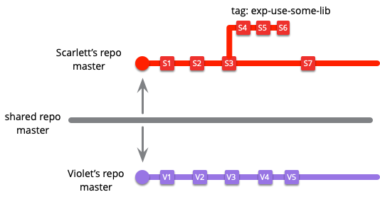

Scarlett and Violet will sooner or later combine their code on the master repo.   In this kind of work, exceptions aside, conflicts will mostly occur during the merge. And it's usually hard to resolve these conflicts without human intervention.

Branch graphs are usually drawn with the good intention that everything will go well and the code will be merged at frequent intervals without drifting apart too much. But of course, in reality it doesn't happen this way. We can see this situation in the figure below. As time passes, development is done for a long time on the code in the cloned branches, and the longer it takes, the further it drifts from the master branch. That's why merge processes can sometimes be a bit painful.

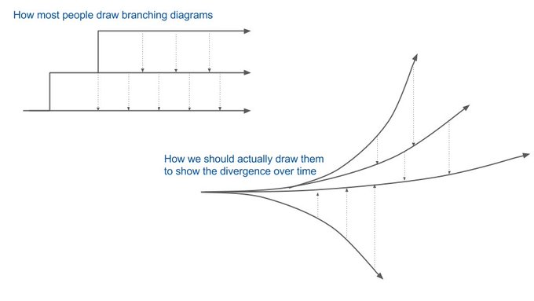

Even this kind of setup will make our job a lot easier than developing software with no branches at all.

Maybe in a team of two or three people, where communication is intense and easy, this can be manageable, but as teams grow, if scrum is being applied and completing a feature takes days, working directly with this method will be hard.

## Mainline

Unlike the Source Branch strategy we mentioned above, here there's no master branch other than the master branch shared among developers. We can keep the branch we're developing on up to date by taking the current state of the code from the main flow of the code (the master branch) whenever we want.

When we want to release a new version, we can create a release branch, make the adjustments and then release the version.

Let's pay attention here: the topic here isn't integration. Our goal is to try to understand the basic branch strategies. The alternative to the mainline strategy is the release train, which we'll see later.

## Healthy Branch

The goal here is to keep all branches, starting with the master branch, healthy. In other words, it's not a special branch on its own; it's more about making sure the main branches don't contain broken, non-working, problematic code.

Of course there are many techniques for this; the first ones that come to mind
- the first that comes to mind is TDD (Test Driven Development)
- all kinds of reviews and other tests that can be done automatically or manually before merging our code block (UI tests, functional tests, regression tests, etc.)

Naturally, these three branch types may not look very useful on their own. But for many years, software developers used these primitive structures.

As different needs emerged and teams started to grow, software development methodologies evolved too, and different approaches came about. To be able to understand these techniques and strategies, we also need to understand these primitive techniques.

# Integration Models

## Mainline Integration

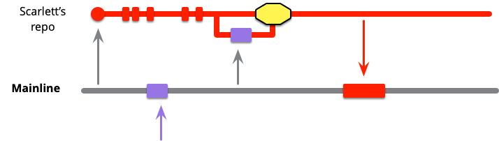

Let's imagine that Scarlett cloned the mainline (master) branch to herself and made some developments. But her teammate Violet hasn't been idle either; she has also merged the developments she made into the mainline (the purple box in the figure).  While Scarlet continues working, she can take this change whenever she wants. In the figure, the purple and yellow boxes on the red line show that Scarlet **fetch**ed this change and, after the related checks (like review and testing), took the code into her own master branch.

Of course, if there's a guarantee that the mainline is healthy, there won't be any need for her to do this kind of operation.

As time passes, Scarlett will also merge the work she's done into the mainline. The red box at the very end on the gray line in the mainline shows this situation. During this merge, if healthy branch is applied as a standard, the merge will be done after reviews and tests are done before the merge.

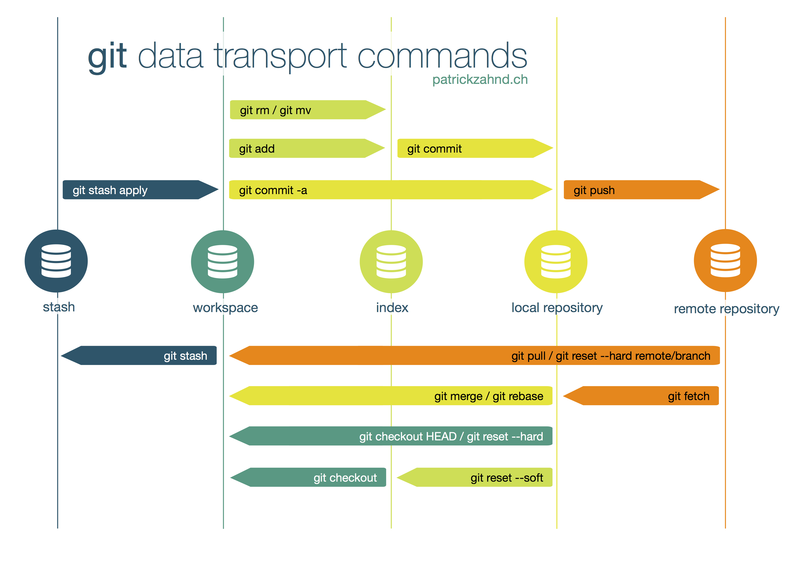

In a **fetch** operation, the code isn't taken directly into the workspace.

## Feature Branching

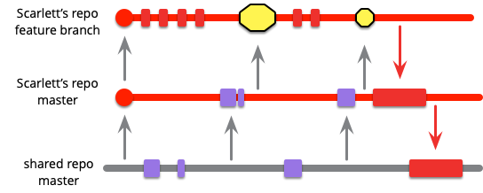

In this model, Scarlett creates another branch (a feature branch) from her own master branch and continues her developments on this branch. If she wants, she can take the developments made on the mainline into her own master branch at certain intervals. At certain intervals, she also merges into the branch she's working on (the feature branch). As soon as the feature branch developments are done, she merges her working code first into her own master branch and from there into the shared master branch (mainline).

In the figure, the yellow boxes show that Scarlett took the code she received in a controlled way, by resolving conflict problems.

This structure is actually used often in the industry. But here, how often the code will be sent to the mainline and how often it will be taken from the mainline is very important. Integration Frequency
at the same time also affects the continuous integration model, which has been getting more and more popular lately. We'll touch on these topics below too.

## Integration Frequency

The "State of DevOps" reports prepared every year by many big IT companies show that software teams that integrate more frequently, and the products they develop, are of higher quality.

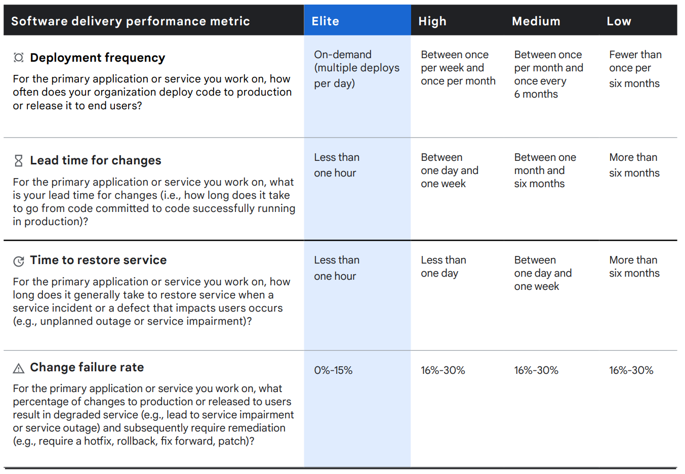

You can download the Google 2021 Report from [this link](https://cloud.google.com/devops/state-of-devops/).

### Low-Frequency Integration

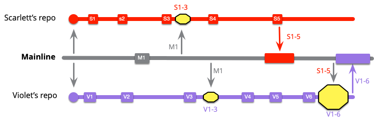

When we examine the figure, we can see that although Scarlett and Violet made changes many times in their own repos, they didn't merge into the mainline very often. For example, Scarlett didn't send her own changes to the mainline until commit S5. Violet also didn't send the work she did to the mainline for a long time, until V6.

Also, in S1-3 Scarlett and in V1-3 Violet didn't give each other the code they had written in the code they took from the mainline. In other words, for a long time these two developers wrote code unaware of each other. The unawareness we're talking about here is actually the code being unaware of each other. Since no code was shared for a long time, conflicts will inevitably occur in the merges that are made.

### High-Frequency Integration

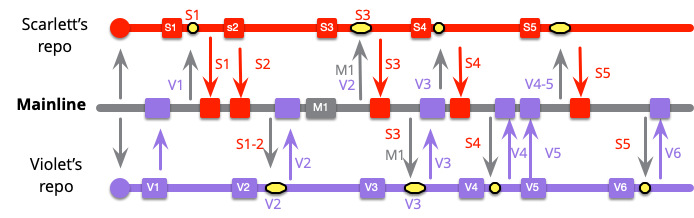

Thanks to frequent pull and push operations, the two developers will have the chance to continuously revise the code they write. This way, it will be possible to create healthy branches and run into fewer conflicts.

Integrations that aren't done for a long time can lead to problems that may take much longer to undo later.

At this point, we also need to talk about the concept of "integration fear". When teams have had a few bad code merging experiences, you see that they start to avoid integrating frequently. This leads to a less healthy and more problematic mainline.

Actually, source code systems are a communication tool. If code is shared frequently, that means communication will increase and errors will decrease.

One of the best ways to increase integration frequency is to reduce the feature size. If the feature concept can be brought down to the user story or even task level (even if it's not always possible), integration can be done at very short intervals.

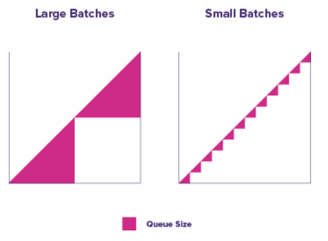
[Image Source](https://www.boost.co.nz/blog/2018/11/reduce-batch-size-agile-software-development)

While making things smaller, you can make use of the "INVEST" model, one of the effective story writing models.

- Independent: can be developed and delivered on its own
- Negotiable: open to discussion
- Valuable: provides value
- Estimable: its effort can be estimated
- Small: small in size
- Testable: can be tested.

A story of optimum size that includes all of these concepts can be completed in a very short time. This model can be preferred since it's practical and easy to remember, but my advice would be to do a more comprehensive research and find the model that you can most comfortably adapt to your domain and way of working. It's also possible to use these models together. For example, whichever model you prefer, you should be doing TDD in every case anyway.

We can say that FDD in particular, with its feature focus, is a more expert model when it comes to determining the optimum feature size.

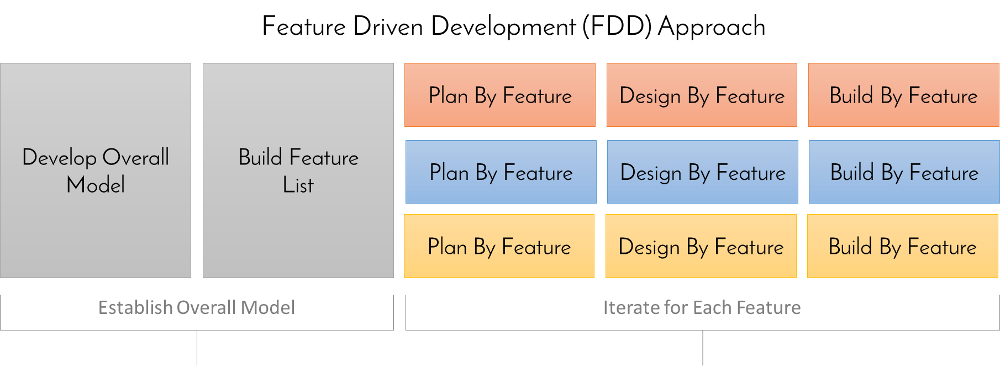
[Source](https://www.inflectra.com/Ideas/Topic/Feature-Driven-Development.aspx)

- [Feature Driven Development (FDD)](https://en.wikipedia.org/wiki/Feature-driven_development)
  - Example Story: (action result object) --> Calculate the total of a sale, Validate the password of a user
- [Behaviour Driven Development (BDD)](https://en.wikipedia.org/wiki/Behavior-driven_development)
- [Test Driven Development (TDD)](https://en.wikipedia.org/wiki/Test-driven_development)

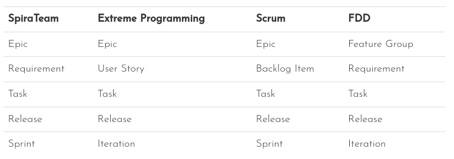
[Image Source](https://www.inflectra.com/Ideas/Topic/Feature-Driven-Development.aspx)

The biggest benefit of using a model is that it offers rules and techniques we need to follow while writing our stories. In situations where you don't know what to do, models like these will definitely guide you.

However, even if we split it into 2-3 hour sub-tasks, we may still need, say, a week of work to be able to release a feature in a fully usable form. There are some techniques that can be used in this case.

- Keystone Interface
- Feature Flag
- Trunk Based Development
- Branch By Abstraction

Of course, each of these techniques needs to be explained at length. Maybe in my other articles we can examine these topics one by one too. But let's write a paragraph for each and at least try to understand conceptually what they are.

#### Keystone Interface

Simply put, we can define it as leaving the code that triggers/enables the related feature to the very end, and integrating all the completed intermediate tasks into the mainline as soon as they're done.

For example, by leaving the UI part of the feature to the very end, we can integrate the code we write into the mainline at short intervals.

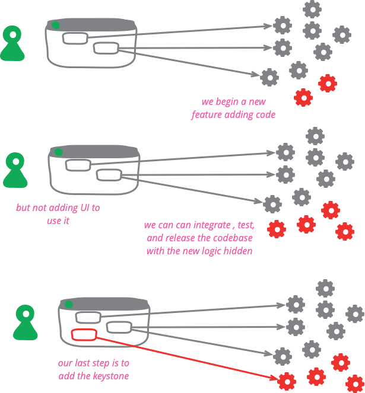
[Image Source](https://martinfowler.com/bliki/KeystoneInterface.html)

#### Feature Flag

It's based on keeping the release of the code we developed for a certain feature under control with a flag.

There are very capable libraries in popular programming languages for doing this.
- [Dotnet](https://docs.microsoft.com/en-us/azure/azure-app-configuration/use-feature-flags-dotnet-core?tabs=core5x), [libraries](https://featureflags.io/dotnet-feature-flags/)
- [Java](https://reflectoring.io/java-feature-flags/)
- [Python](https://www.split.io/blog/python-flask-feature-flags/#:~:text=Feature%20flags%20allow%20you%20to,without%20ever%20deploying%20new%20code.), [libraries](https://featureflags.io/java-feature-flags/)
- Go, [libraries](https://featureflags.io/go-feature-flags/)
- NodeJs, [libraries](https://featureflags.io/node-js-feature-flags/)
- A library you can use across all languages : [Unleash](https://docs.getunleash.io/sdks)

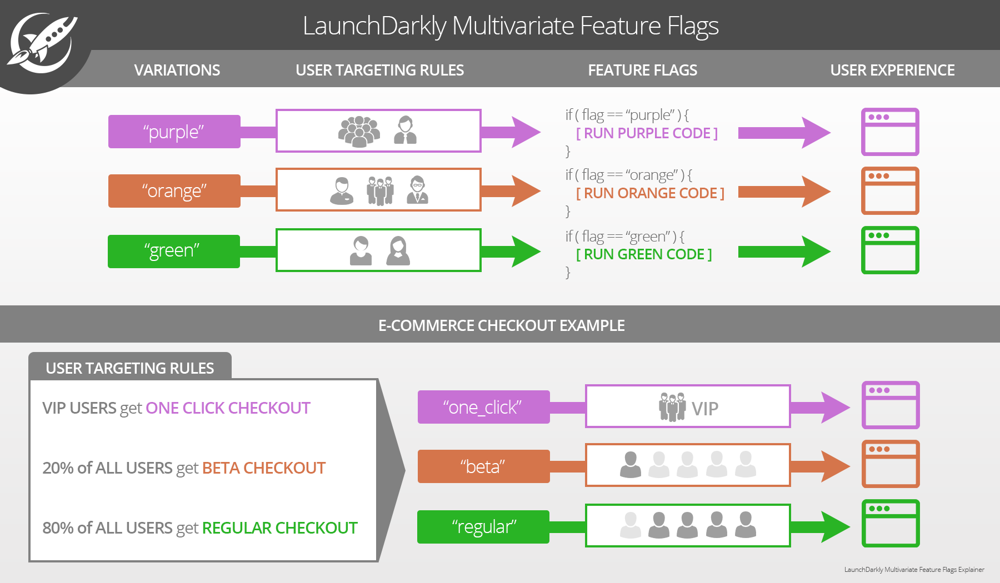
[Image Source](https://dzone.com/articles/feature-flag-driven-development)

#### Trunk Based Development

A model based on developers developing by integrating at short intervals on the mainline called trunk. In this model, parallel release, hotfix, feature, etc. branches are basically rejected. Developers merge the code they write directly onto the trunk (master) branch.

So how will releases be done? Here, the system offers 2 options

- 1. In the first method, release operations are done directly on the trunk branch. It's more suitable for teams that release very frequently. The logic is this: so many releases are done that the trunk can keep going without ever stopping. For this method, you need to be releasing more than once a day. If you release once a day or less, the 2nd method can be applied specifically for that release.

The green dots in the figure show commits. The red dot is a commit that needs a bugfix, and it was fixed in later commits.

[Image Source](https://trunkbaseddevelopment.com/release-from-trunk/)
- 2. In the second method, a branch is opened to manage release operations, but no bugfix/hotfix is done here. Fix operations are again done on the trunk branch and taken onto the release with cherry-pick. The most important thing to pay attention to is that the release is never merged onto the trunk branch.  When we're done with the release branch, we can delete the branch.
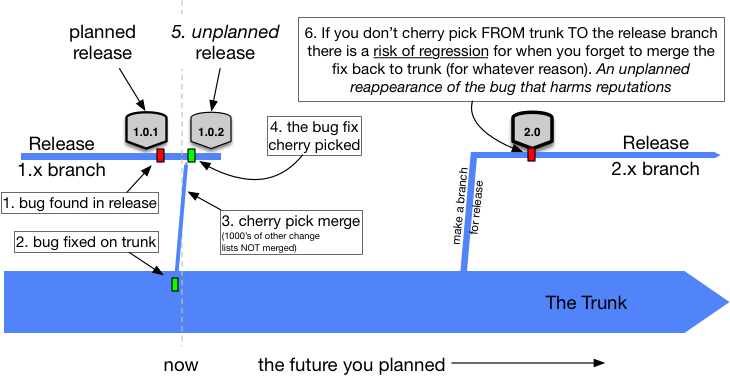
[Image Source](https://trunkbaseddevelopment.com/branch-for-release/)

Trunk based development is also a model that Google uses. You can reach the document on its official page from [this link](https://cloud.google.com/architecture/devops/devops-tech-trunk-based-development). You can also reach the YouTube video explaining how Google uses Trunk Based Development from [this link](https://www.youtube.com/watch?v=W71BTkUbdqE&t=869s).

#### Branch by Abstraction

It's actually a technique used to make large-scale changes while the system is running. It works by putting an abstraction layer in between, making the changes in another abstraction layer, and redirecting the client system that will use the newly added feature to the new abstraction layer. Actually, both layers are in the system, but the newly built one is either inaccessible or accessible only to a part of the system.

1. State
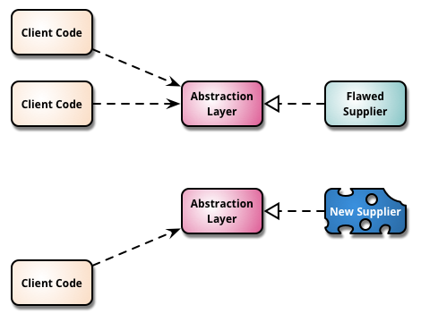

2. State
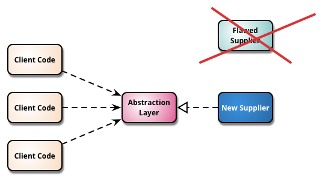
[Image Source](https://martinfowler.com/bliki/BranchByAbstraction.html)

## Continuous Integration

It's the integration model we've been hearing about often lately. The goal here is, so to speak, to make the application development process flow continuously like a river. It's hard to give an exact number, but the general opinion and experience show that a developer should integrate at least 2-3 times a day. According to the Google report we presented above, the application deployment model done several times a day is shown to be the best.

Another point of view is that there shouldn't be a need to wait for features that will take more than a day. We should never keep code in our own repo that hasn't been integrated for more than a day.

The first question that will come to mind here: in this case, what can we do for features that won't be finished in a day? You can use the techniques we mentioned above
- Trunk Based Development
- Keystone Interface
- Feature Flag
- Branch By Abstraction
together.

### Comparing Feature Branch and Continuous Integration

The success of continuous integration depends on features being made as small as possible. If a team can complete all the features it opens on the same day, then it can do both feature branch and continuous integration.  But it's also a fact that very few teams can achieve this.

You can download the Google 2021 Report from [this link](https://cloud.google.com/devops/state-of-devops/).

If we examine the benefits of continuous integration
- it reduces communication (unnecessary meetings disappear with very frequent integrations)
- less work comes up during integrations
- bugs are fixed faster
- integration fear decreases

But to reach this speed, you need to have a very good test system.

That's why we've heard of a lot of innovations in software development techniques over the last 5 years. Cloud native application development and container technologies are at the top of these. And among the most important techniques enabling cloud native application development comes the microservice architecture. Making architectural structures smaller and building less complex structures is as important as making features smaller; rather than spending time on architectural setups in monolith structures, responding directly to domain requests and working with small code blocks will speed teams up.

- [The Twelve-Factor App](https://12factor.net/)
- [Microservice Architectures](https://microservices.io/)
- [Extreme-Programming](http://www.extremeprogramming.org/rules.html)

Despite these benefits, two or more integrations a day may seem impossible for many teams. We can list the reasons for this as follows.

- Habits
- Fear of the unknown
- Legacy culture
- Effects of the business unit
- Regulations
- Unsuitable code architecture

Long code review processes are also a factor that makes it hard to apply continuous integration. For this reason, developing code with the [Pair Programming](http://www.extremeprogramming.org/rules.html) technique, which is applied without compromise in the [Extreme-Programming](http://www.extremeprogramming.org/rules.html) method, can reduce the review time. Tools like [Sonarqube](https://www.sonarqube.org/) that can do static code analysis can also be used.

That said, using the feature branch and pull request mechanism while developing open source applications is a beneficial approach. It seems hard for applications developed with this kind of community support to release every day. By their nature, they need to be under tight control, and features usually take a long time to complete (meaning it's practically impossible for every piece of work to be finished on the same day). So they're not very suitable for continuous integration.

# The Road from Mainline to Release

## Release Branch

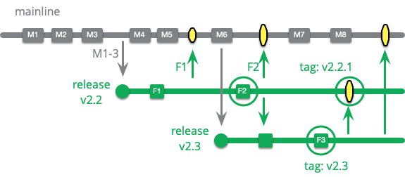

The goal of creating a release branch is to make sure all the snags preventing a release are fixed without stalling the code development process. A release branch is created for each version, and the changes made are regularly merged into the other release branches and the mainline. The biggest disadvantage of this structure is that the release branches you try to manage in parallel become hard to maintain after a while.

This actually isn't a development model we usually come across. In the industry, applications developed as closed source usually have a single version in production. So the release concept here refers to the situation in applications where we have to keep more than one version live at the same time. Open source projects, libraries, components, frameworks, etc. may have to publish more than one release. But of course this isn't the only way, meaning that opening a separate release branch for each version isn't the only option for keeping more than one version live.

The advantages of using a release branch,
- first of all, this system is ideal for keeping the mainline healthy.
- All the moves made (pull, push, commit, etc.) can be easily tracked.
- Keeping each release as a separate branch keeps all of them accessible at the same time.

## Maturity Branch

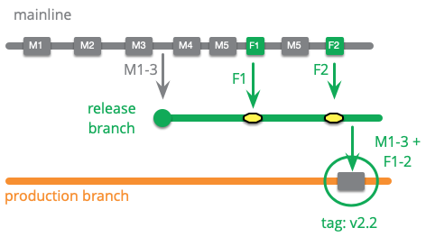
It's the branch where all released versions are kept. It has two main benefits.
- It makes it easy to reach the latest version still running in the production environment, and thus to track the version history when a bug comes up.
- It prepares a suitable environment for automation. It makes it possible to always switch to a working version using only the versions on the maturity branch.

As you can see in the figure, the production branch is used as the maturity branch here

In another usage, on the maturity branch, we can tag, for example, the version ready for testing as test-01 and the version that has become ready for prod as prod-01. This way, it will be possible to track the evolution of our code and design automation workflows in a more understandable way.

Another version of using a maturity branch is as seen in the figure below. The adjustments needed for the version are made on a release branch running parallel to the mainline, and it's tagged. The fixes and other adjustments made on the release are later merged into the mainline. This way, team members get these adjustments as well.

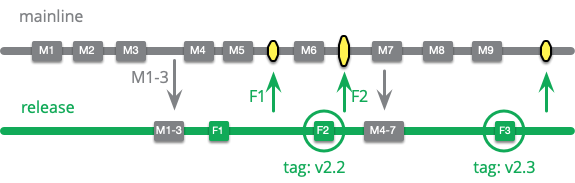

## Environment Branch
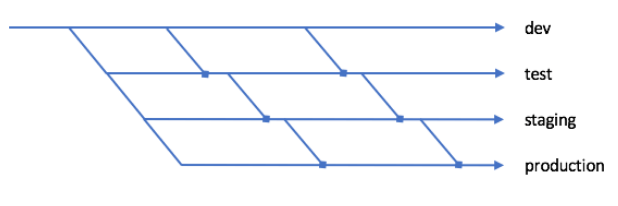
[Image Source](https://octopus.com/docs/deployments/patterns/branching)

It's used to make environment-specific adjustments for each environment. In the end, they're combined on the maturity branch (the production branch for the figure above).

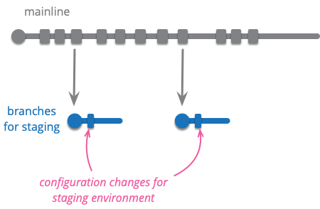
[Image Source](https://martinfowler.com/articles/branching-patterns.html#Low-frequencyIntegration)

The biggest problem of this model, which looks useful at first, is that a solution found for any environment doesn't give the expected result in other environments. To use this method more effectively, environment variables should be abstracted from the code. This way, environment variables can be assigned dynamically at runtime. The first two methods that come to mind;

- They can be kept in open files. (For example, web.config for IIS, web.xml for Java EE/TomCat)
- They can be kept as environment variables on the host.

This branch structure shouldn't be used for debugging or for managing environment variables per environment.

## Hotfix Branch

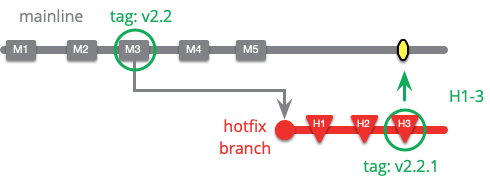

It's used to fix errors that come up suddenly. In cases where continuous integration is done, these fixes can also be made directly on the mainline.

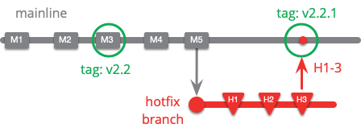
[Image Source](https://martinfowler.com/articles/branching-patterns.html#Low-frequencyIntegration)

Or, for example, if a release branch is used, fixes like these can be made on it as well. But in both cases, if the time spent while making the fix disrupts the team's commit routines, a hotfix branch must be opened.
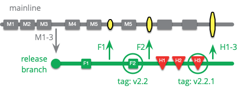
[Image Source](https://martinfowler.com/articles/branching-patterns.html#Low-frequencyIntegration)

Maybe the most important issue here is deciding what is and isn't a hotfix. The hotfix concept needs to be given substance, and its definition needs to be clearly laid out within the team.

A [Hotfix](https://en.wikipedia.org/wiki/Hotfix) means making a direct and quick change to the application outside of the [SDLC](https://en.wikipedia.org/wiki/Systems_development_life_cycle) development and test processes. This change should be of a size that won't cause the system downtime. In other words, users shouldn't feel this change made to the system. Apart from these, by looking at the error encountered in the application in terms of its

- criticality level,
- the time that will be spent fixing it,
- its effect on the code blocks it affects or depends on in order to be fixed,
- cost (man/day)
- etc.

you can also decide whether it's a hotfix/bugfix or not.

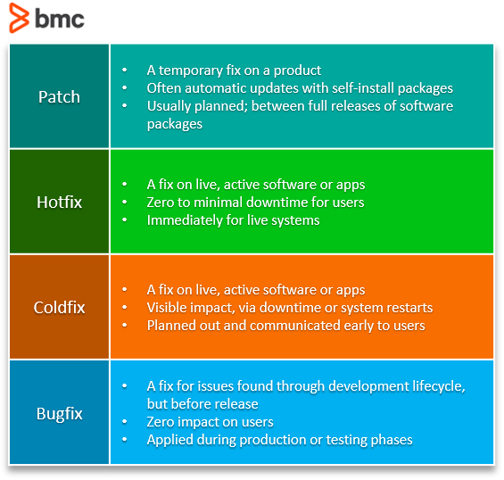
[Image Source](https://www.bmc.com/blogs/patch-hotfix-coldfix-bugfix/)

## Release Ready Mainline
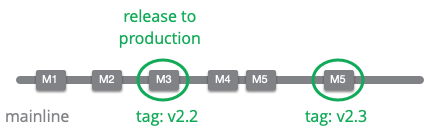

The mainline is used as a healthy branch by creating commits that can be released. In this model, not every commit is in a releasable state as in continuos deployment.  That's exactly the subtle difference between continuos delivery and continuous deployment.

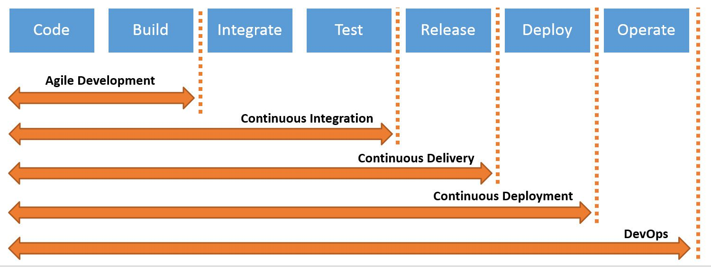
[Image Source](https://www.bmc.com/blogs/continuous-delivery-continuous-deployment-continuous-integration-whats-difference/)

This integration model looks very good as it is, of course, but for it to be successful, the time from an idea being formed to it going into prod needs to be very short. First of all, the team needs to be able to reach the commit frequency in the continuous integration model we talked about earlier.

If it takes a long time for requirements to come to life, we may have to use feature branches in our project. In this case, forcing the release ready mainline integration model may lead to bigger problems. We'll most likely have to deal with conflicts that will take a long time to resolve. To get out of this situation, we can use a release branch. This way, we won't block the flow of the mainline.

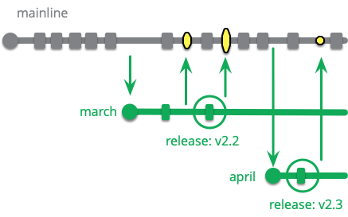
[Image Source](https://martinfowler.com/articles/branching-patterns.html#Low-frequencyIntegration)

Perhaps the biggest benefit/advantage of a release ready mainline is that it disciplines software teams. To try to keep a release-ready mainline alive, teams have to

- apply best practices and
- a good testing regime,
- keep their attention at the highest level during integrations.

## Release Train

It's used when release dates are regular. It lets teams focus on the feature they're working on. It's also a model that can be used for transitioning to the continuous integration model. As the team gains experience, the release intervals are shortened.

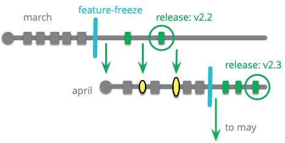
[Image Source](https://martinfowler.com/articles/branching-patterns.html#Low-frequencyIntegration)

Since releases are done on specific dates, the team can slow down or completely stop development shortly before the release. They complete the work that needs to be done before the release time, such as hotfixes, tests, environment adjustments, etc. For the next release (April) branch, a copy of the active (March) branch is taken, and coding starts for the April release. From this moment on, changes made on the March branch are carried over to the April branch.

If we're using a release ready mainline in our project, we don't have to manage many branches at the same time, meaning it may be possible to manage releases without using a release train.

[Image Source](https://martinfowler.com/articles/branching-patterns.html#Low-frequencyIntegration)

# Other Branch Models

- **Experimental Branch**

  It's a branch created to try out an idea. It makes more sense to do small tests. Most likely the code won't need to be integrated, but if a lot of effort really went into it and the code was written cleanly, it can be integrated.

- **Future Branch**

  When working with the continuous integration model, it's sometimes opened for changes that can't be integrated on the same day, or whose effects could be large even if they were. Unlike the feature branch, it's used in projects where continuous integration is done on a healthy mainline, that is, in environments where feature branches aren't used. Also, there's only one future branch in a project, and more than one developer can work on it.

- **Collaboration Branch**
  Sometimes, while writing code, you need to share the code with other developers without integrating it into the mainline.  A temporary branch is opened and sharing is done through it.

- **Team Integration Branch**
  
  It's the form of the Collaboration Branch applied more strictly and without a time limit. The goal is to provide a more controlled transition by creating intermediate healthy sub branches on the way to the mainline in cases where a very crowded team or more than one team needs to work on the same mainline.

## Git Branch Flows

### Git-Flow
Probably one of the best-known git flow policies is Gir-Flow. It's a workflow that [Vincent Driessen](https://nvie.com/posts/a-successful-git-branching-model/) described in detail in 2010.

The develop branch is used as the mainline. Feature branching is used so that more than one developer can work in a coordinated way. Developers are advised to use their own local repos as collaboration branches so that they can work on the same piece of work.

The master branch is used as the maturity branch. To move from the develop branch to master, developers use release branches, and for hotfixes they use hotfix branches.

Git-flow doesn't use the healthy branch and release ready mainline concepts at all. Since it doesn't offer us a solution related to these concepts, it looks like the community is finding its own solution. It also doesn't have a solution for QA. It also doesn't offer anything about how long features take to complete or about integration frequency.

[Vincent](https://nvie.com/posts/a-successful-git-branching-model/) himself has advised that git-flow has become a bit dated over the past 12 years and that developers should use simpler flows that are more suited to continuous integration. However, he also added that git-flow can still be used, especially if a closed source application is being developed and there's stable versioning, by coming up with solutions for the missing parts according to your way of working.

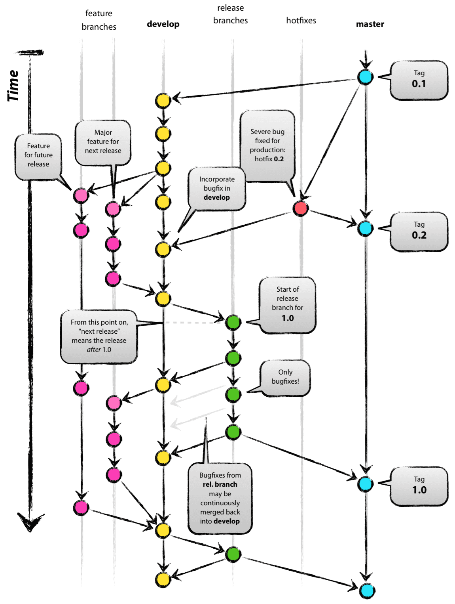

If we examine the figure, we can list some of its disadvantages as follows.
- We can see that hotfix and release branches are merged into both the develop and master branches. This increases complexity.
- A release ends with two builds. One on the last commit of the release branch, and the other when it's merged into the master branch.
- We can also see that developers using the develop branch as the mainline may lead to accidentally committing to the master branch. Because in SCM systems, the master branch usually comes as the default mainline branch.

To release a feature, the following steps are simply applied.

- first, the main branches need to be created; for this, the develop branch is created from the master branch.
- the feature branch is also created from develop.
- when the feature is completed, it's merged into the develop branch.
- when release time comes, a release branch (with the naming release-*) is created from the develop branch, and small bugfixes that come in during the time until it's merged into maturity (the master branch) are applied to this release branch.
- If the release is now ready for production, it's merged into master along with a release tag (usually with a pull request).  The same merge is also done (usually directly) into the develop branch.
- If the merged release won't be kept alive, that is, if no serious work other than future development or bugfixes specific to this release will be done, it can be deleted. If this kind of work will be done, the release isn't deleted.
- When a hotfix is needed, a branch is created from the master branch (with the naming hotfix-*). After the adjustments are made, it's merged into the master branch and, if your release branch is up, into it, otherwise into the develop branch. However, if it was merged into the release branch, it's also merged from the release into the develop branch.

Things to pay attention to
- Tests and code  reviews must definitely be done when merging into master.
- If there are doubts about whether the related release will go live, it may be necessary to use feature flags for these cases.
- As much as possible, try to ship one feature per release.

### GitHub Flow

It was born as a reaction to Git-flow. The simplest and clearest explanation of GitHub-flow belongs to Scott Chacon. You can reach his article from [this link](http://scottchacon.com/2011/08/31/github-flow.html).

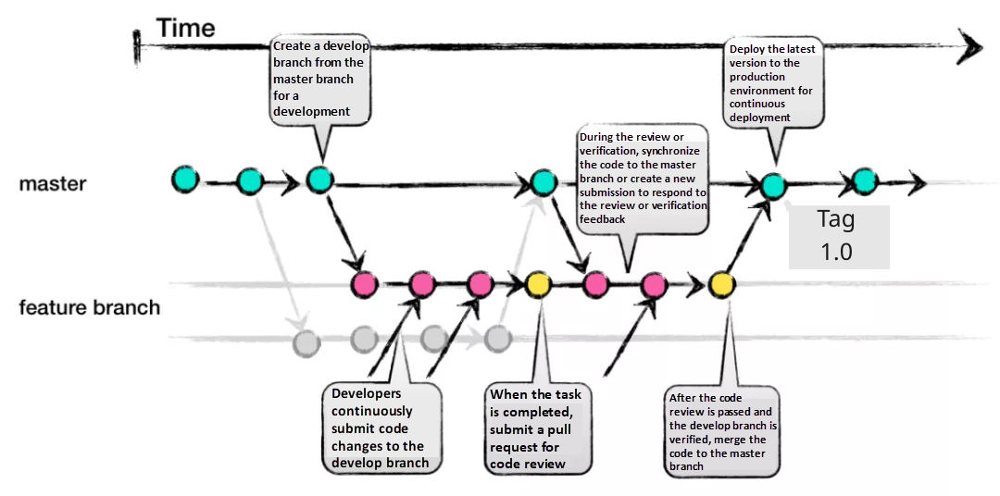
[Image Source](https://www.alibabacloud.com/blog/how-to-select-a-git-branch-mode_597255)

The following steps are applied

- Everything on the master branch is deployable.
- To work on a new feature/bugfix/hotfix, a descriptively named branch is created.
- Work is done on the local branch and pushed at certain intervals to the branch with the same name on the server.
- When you need feedback or help, or when the branch is thought to be ready to merge, a pull request is created.
- After someone else reviews the related code, the code can be merged.
- When the code is merged into master, it means it's now ready for deployment. The related commit is tagged with the version number and released.
  
Unlike Git-flow, GitHub-Flow manages a single version with high-frequency integration on a release-ready-mainline. In other words, there's no need for a release branch for GitHub-Flow. Developers do their development using feature branching. GitHub-Flow doesn't say anything about the size and timing of a feature. For code quality, review before integration is used. The develop branch in Git-Flow doesn't exist here, which prevents mistakes that could be made, and thanks to this the flow is simpler.

It's hard to keep the master branch healthy enough to be released at any moment. Just for this, you may even need a person for review and merge operations. It actually doesn't say anything directly about integration frequency either. Managing this speed is left entirely to the team. It also doesn't say anything about managing more than one release, but again here too it looks like the community has found its own solution. In some open source projects, you can see release branches managed in parallel. After all branches (feature/bugfix/hotfix) are opened on main, when development is finished, they're merged into the related release and the release is done. But this method isn't officially stated.

### Gitlab Flow
[GitLab-Flow](https://docs.gitlab.com/ee/topics/gitlab_flow.html), like GitHub-Flow, positions itself based on the problems of Git-Flow. But since GitHub-Flow leaves many questions about deployments, environments, versions and problematic integrations unanswered, it's a flow that emerged claiming to have found solutions for these areas as well. It has a structure like a mix of GitHub-Flow and Git-Flow.

- Here too, the mainline isn't in a state where it can be released at any moment, as it is in Git-Flow and GitHub-Flow. Instead, environment or release branches are used depending on the situation.
- Unlike Git-Flow and GitHub-Flow, the use of environment branches is supported.
- Release Branch and Environment branch exist as options in this flow.
- There's no Dev branch; you work by merging feature branches directly onto the mainline (main branch).
- If the environment based flow is used, deployment is done by tagging on the Production branch. If the release based flow is used, a release branch specific to the related version is opened.

GitLab offers different flows for the two cases. We'll continue in the same way.

#### Release Based Gitlab Flow

If an application is being developed for the outside world, it will most likely be necessary to keep more than one version of the application live at the same time; in this case, the version-based flow is used, and the steps below are applied.

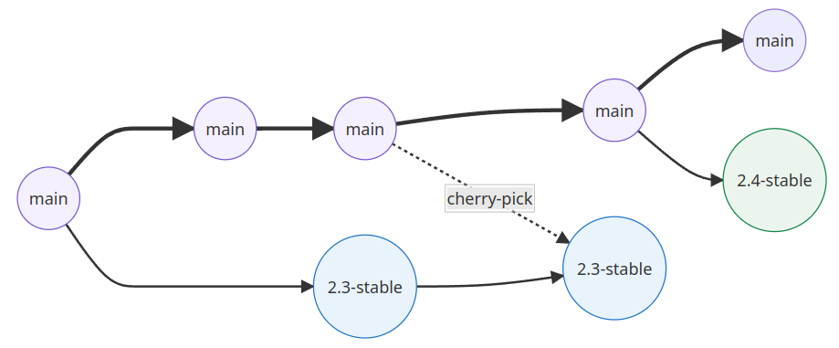

- A feature branch is opened from the mainline (master) branch.
- When development on the feature branch is finished, it's merged into the master branch with a pull/merge request. Meanwhile, code review and, if possible, tests are done too. The tests done here should be included in automation as much as possible.
- when release time comes, a release branch (with the naming release-*) is opened from the master branch. Release-specific operations are done. Here, absolutely no hotfix, bugfix or additional development is done on the release. The application is released from this point. By release, we may mean a deployment somewhere, or cutting the release and announcing it to the outside world.
- For Bugfix/Hotfixes, the master branch is used directly ([upstream-first policy](https://www.redhat.com/en/blog/what-open-source-upstream)). A branch is opened, and when the work is done, it's merged into the master branch with a merge/pull request. Then the bugfix/hotfix is pulled into the **related release** branch with [cherry-pick](https://git-scm.com/docs/git-cherry-pick). Since the movement is from upstream to downstream, there's no need to distribute it as in Git-Flow.

By putting tags like release-test-* or release-rc-* etc. on the release branch, you can indicate that it isn't exactly a release.

#### Environment Based Gitlab Flow

If it's closed to the outside and a single version will be live in the production environment at a time, the environment-based flow is used, and the steps below are applied.

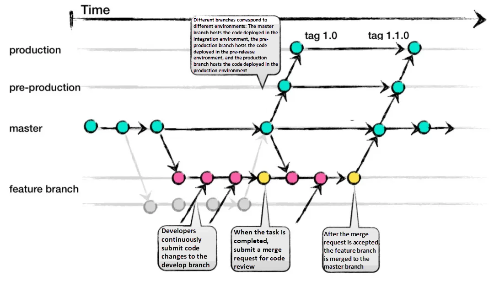
[Image Source](https://www.alibabacloud.com/blog/how-to-select-a-git-branch-mode_597255)

- A feature branch is opened from the mainline (master) branch.
- When development on the feature branch is finished, it's merged into the master branch with a pull/merge request. Meanwhile, code review and, if possible, tests are done too. The tests done here should be included in automation as much as possible.
- when release time comes, the master branch is merged into the pre-production branch. By the way, the number of pre-production branches can be increased, but it's not recommended.
- For Bugfix/Hotfixes, the master branch is used directly ([upstream-first policy](https://www.redhat.com/en/blog/what-open-source-upstream)). A branch is opened, and when the work is done, it's merged into the master branch with a merge/pull request. Then the bugfix/hotfix is pulled first into the pre-release and then into the release branches with [cherry-pick](https://git-scm.com/docs/git-cherry-pick). Since the movement is from upstream to downstream, there's no need to distribute it as in Git-Flow.

#### GitLab Flow Best Practices

GitLab has offered some best practices on its page; of course it's hard to apply all of them, but I'm adding them here at least to give an idea.

- You shouldn't commit directly to the Main Branch; feature branches should be used.
- Not only the commits made to the main branch, but all commits should be tested.
- All tests should be run on all commits.
- Review should be done before merging.
- Tags should be set by developers, not by CI (CI shouldn't be allowed to change the repo)
- Release management should be done using tags.
- Pushed commits shouldn't be rebased. This makes it hard to identify the evolution and test results, especially when cherry picking.
- Bugfixes should be done first on main and then on the release branches.
- Commit messages should explain not only what was done but also why it was done.
- Developers should start with the main branch and ultimately target the main branch.
# Closing and Recommendations

If you've read the whole article up to here, a lot of concepts must have settled in your head. But you may still have many questions in your mind, just as I do.

- Should we change the custom flow we're currently applying?
- If we're going to change it, how can we do that?
- When starting a new project, should we choose one of the flows, or can we create a flow of our own, or rather, would that be a sensible decision?
- Is it possible, is it sensible, to use the mentioned flows by modifying them?
- Is there a best practice for integration frequency?
- Is reaching the point of continious integration in particular sensible for every project?

and we may have many more questions in mind. It's impossible to give very definite, clear answers here, that is, to offer a best practice. As I said at the very beginning of the article, none of the practices mentioned here is a best practice. However, once you turn to any of them, they may have their own internal best practices. Even these are approaches that can be shaped according to your project structure and the internal dynamics and culture of the environment you work in.

[Vincent Driessen](https://nvie.com/posts/a-successful-git-branching-model/), who first announced Git-Flow with an article and years later added a note to the same article on his side saying that different flows should now be used due to changing conditions, also stated in the same article that Git-Flow can still be used under certain conditions, but that there's still no solution that's a cure for every ailment. He ends his article using exactly this sentence.

"To conclude, always remember that panaceas don't exist. Consider your own context. Don't be hating. Decide for yourself." So, evolve it according to your needs and use it.

But still, let's try to look for answers to the questions above one by one. I think if you put some thought into these basic questions in the environments you work in, you can create the most suitable flow.

- Should we change the custom flow we're currently applying?
  
If you're at the beginning of the road and you agree as a team on a flow you think is more suitable for you, changing it may make sense. If the project you're working on doesn't have an end date, that is, if it's a continuously developed project, changing it again seems sensible. But if the project duration is fixed and you've progressed a lot in the project, if changing the flow will delay the end date, switching to a new flow doesn't seem very sensible.

- If we're going to change it, how can we do that?

Taking as a base a commit on the master branch that the team agrees on, the new flow can start being applied from that point on.

- When starting a new project, should we choose one of the flows, or can we create a flow of our own, or rather, would that be a sensible decision?

This is probably the most important decision that needs to be made. Actually, developers go through decision-making situations like this many times during the project development process. Will a decision made by someone other than ourselves, the code they wrote, the best practice they mentioned, etc. suit us too? Of course this will vary depending on every situation and who's saying it. But at least we can say this: if we can use a flow by changing ourselves, we should definitely do it. Most likely, if we've gone on such a search in the first place, it means we've accepted that something is going wrong. And this comes down to changing ourselves.

- Is it possible, is it sensible, to use the mentioned flows by modifying them?

If the practice we adopt comes with strict rules of its own, that is, if it says "if you don't use this practice this way, it won't work and you'll be stranded", it will make sense to take that practice together with its best practices, meaning trying to change it doesn't seem sensible. But so far, apart from perhaps continious integration, there doesn't seem to be one that states such strict rules of its own (integration frequency should be high). In this case, it may make sense to adapt the parts that are open to change a bit to ourselves. However, saying, for example, "let's not use the develop branch in Git-Flow, let's write code directly to the master branch" isn't a modification anyway; it means creating a completely custom flow outside of Git-Flow. But, for example, increasing the pre-production layer while applying the environment based flow on GitLab-Flow won't harm the system.

- Is there a best practice for integration frequency?

Based on experience, we can say it should be at least two. Nobody states an upper limit, but of course there too we can set an optimum limit for ourselves.

- Is applying continious integration a best practice? Is it sensible for every project to aim to reach this point, to try to get to that point?

It'll be a very short answer, but since we already touched on it under the related topic of the article, we can answer directly that it isn't sensible.
- Because first of all, the project structure (microservice, monolith, modular, modular-monolith,...etc.) should support it.
- After the infrastructure, one of the most important factors is the competence of the team.
- Finally, whether the domain and business unit you work with are suitable for it.

If any one of these three isn't able to keep up with this pace, trying to apply continuos integration practices may be challenging. That said, evolving toward it step by step as a goal will be a very sensible decision. And I think the most suitable place to start this will be the project infrastructure. Along with that, this will develop the team's skills anyway. Finally, it will make sense to increase the business unit's turnaround speed for requesting work and for test results. Based on my experience, I can say that the hardest of these processes will be changing the business unit culture. So first of all, the business unit should be told how to make the concept of work (task) smaller, how to track it, and how beneficial this transition will be for everyone.

Despite this, I'm also aware of situations where applying best practices is impossible, for reasons such as sometimes pressure from the business unit, sometimes the heterogeneous structure in software teams, and sometimes stubborn attempts to preserve the structure that has been used for ages.

But I can also say this: since software teams are experts at finding remedies for problems, rather than pushing the conditions to make their situation better, they can sometimes prefer to accept the situation, even adapt to it, and on top of that produce a solution (!) to make this broken situation work better. I say this including myself: rather than fighting to change a wrong culture, finding an answer to the question "how do I best manage this broken situation" often feels easier. We often say, "instead of wasting time dealing with it and explaining the problem, I'll just do it and move on."

Our article ends here. Hope you found it useful.

# Resources
- https://martinfowler.com/articles/branching-patterns.html
- https://martinfowler.com/articles/continuousIntegration.html
- https://martinfowler.com/bliki/KeystoneInterface.html
- https://www.gitkraken.com/learn/git/best-practices/git-branch-strategy
- https://www.atlassian.com/git/tutorials/comparing-workflows
- https://gitential.com/git-branching-strategies-for-your-team-how-to-choose-the-best/
- https://launchdarkly.com/blog/git-branching-strategies-vs-trunk-based-development/
- https://towardsdatascience.com/how-to-structure-your-git-branching-strategy-by-a-data-engineer-45ff96857bb
- https://softwareengineering.stackexchange.com/questions/107884/to-branch-or-not-to-branch
- https://dev.to/jpdelimat/why-you-should-not-use-feature-branches-h68
- https://trunkbaseddevelopment.com/
- https://trunkbaseddevelopment.com/branch-for-release/
- https://cloud.google.com/architecture/devops/devops-tech-trunk-based-development
- https://www.boost.co.nz/blog/2018/11/reduce-batch-size-agile-software-development
- https://en.wikipedia.org/wiki/Behavior-driven_development
- https://en.wikipedia.org/wiki/Feature-driven_development
- https://en.wikipedia.org/wiki/Test-driven_development
- https://www.inflectra.com/Ideas/Topic/Feature-Driven-Development.aspx
- https://featureflags.io/
- https://docs.getunleash.io/sdks
- https://medium.com/geekculture/enhanced-working-flow-from-git-flow-github-flow-and-gitlab-flow-9fdb02ef65dd
- https://www.toptal.com/gitflow/enhanced-git-flow-explained
- https://www.alibabacloud.com/blog/how-to-select-a-git-branch-mode_597255
- https://docs.gitlab.com/ee/topics/gitlab_flow.html
- https://about.gitlab.com/topics/version-control/what-are-gitlab-flow-best-practices/
- https://jadsonjs.wordpress.com/2021/05/16/gitlab-flow/
- https://learn.gitlab.com/version-control/15-git-tips-to-impro
- https://nira.com/gitlab-workflow/
- https://docs.microsoft.com/en-us/azure/devops/repos/tfvc/effective-tfvc-branching-strategies-for-devops?view=azure-devops
- https://docs.microsoft.com/en-us/azure/devops/repos/tfvc/effective-feature-isolation-on-tfvc?view=azure-devops
- https://docs.microsoft.com/en-us/azure/devops/boards/backlogs/define-features-epics?view=azure-devops&tabs=agile-process
- https://www.alibabacloud.com/blog/how-to-select-a-git-branch-mode_597255
