# Authentication for Kubernetes Using OpenID (Keycloak)

Hello Friends


In this article, we'll look for answers to questions like: What are Oauth2 and OpenId? What is Keycloak? How is Kubernetes authentication done with Keycloak?

We can list the advantages of integrating Kubernetes with an oidc provider as follows.

- Using the same provider, we can also authorize the same users and user groups for our other applications.
- We become part of an SSO (Single-Sign-On) system. In other words, a user who has logged in to Kubernetes is also logged in to all the applications they're authorized for. 
- We don't have to deal with complex user creation and authorization processes. We don't give our Kubernetes cluster extra work.
- We get the chance to build a more secure system. Keycloak and similar systems can also apply techniques like multi factor authentication. 

To be able to do the examples in the article, you need to know a bit of linux, a bit of virtualization, Docker and a bit of Kubernetes.

Since I didn't want to split the topic, it turned out to be a bit of a long article. I hope it'll be useful.

happy reading.


## Kubetnetes Authentication

As you know, there's no object for real users in Kubetnetes. We can only create service accounts. You can also read the [official documentation](https://kubernetes.io/docs/reference/access-authn-authz/authentication/#users-in-kubernetes) on the topic.  

So how are we able to run commands with kubectl? Here, we actually go to Kubernetes not as a user but with a certificate approved by Kubernetes. This approved certificate also holds the information about which roles we have on the Kubernetes side. We won't go into the details of the topic too much; our goal isn't authentication with an X.509 certificate. So, in short, Kubernetes doesn't manage a user database. Actually, if we look at it in general too, Kubernetes doesn't do any job itself. It just sets the rules of the job and offers an environment where tools written in accordance with these rules and principles can work compatibly with each other. Identity management is one of them. 

If we also examine the official Kubernetes Authentication [page](https://kubernetes.io/docs/reference/access-authn-authz/authentication/#users-in-kubernetes), we can see that it supports the strategies below.
- X509 Client Certs
- Static Token File
- Bootstrap Tokens
- Service Account Tokens
- OpenID Connect Tokens
- Webhook Token Authentication

In this article, we'll see how authentication is done with OpenID Connect Tokens.
## What Is OpenID?

OpenID is an authentication protocol that provides single sign-on (SSO) using users' accounts on various websites. OpenID allows users to access different websites with a single identity and removes the need to remember a separate username and password for each website.

It's an open standard and is managed by the OpenID Foundation. The protocol carries out an authentication process using the verification service of the user's identity provider (OpenID provider). When the user wants to log in to a website with their OpenID account, the website redirects to the identity provider. The user authenticates at the identity provider and is then redirected to the website. The website verifies the identity provider's verification result and accepts the user as logged in.

OpenID relieves website owners of the burden of managing user accounts and offers users an easier experience. It also increases security, because while users give their credentials to a single trusted identity provider, they don't have to share account information separately with different websites.

OpenID can also be integrated with social media accounts. Users can create an OpenID account using social media accounts such as Facebook, Google and GitHub and use these accounts on different websites.

OpenID is a standard that makes authentication and single sign-on on the internet easier, and it's supported by many websites and services.

OpenID and OAuth 2.0 are two different but complementary protocols.  Let's look at their main differences and similarities.

- Protocol Family: OpenID was developed based on the OAuth 2.0 protocol. OAuth 2.0 is a protocol used for authorization and access control. OpenID is an authentication protocol built on top of OAuth 2.0.

- Authentication: OAuth 2.0 provides authorization and access control, but it has no authentication capabilities. OpenID extends the authentication process by using the authorization features of the OAuth 2.0 protocol. In other words, OpenID adds the ability to verify the user's credentials.

- Identity Provider: OAuth 2.0 manages the authorization process between the resource server and the client. A client that requires authentication receives an authorization document (access token) for the user's access to the resource server. While OpenID is based on OAuth 2.0, it also performs authentication using an identity provider (OpenID provider). The user verifies through the identity provider, and then the authorization process is carried out with OAuth 2.0.

- Client Application: Both OpenID and OAuth 2.0 are used by client applications (for example, websites or mobile applications). The client carries out the authorization process through the OAuth 2.0 protocol and interacts with the OpenID provider that verifies the user's credentials.

- OpenID Connect: OpenID Connect is a profile of OpenID built on top of OAuth 2.0. OpenID Connect uses the authorization mechanisms of OAuth 2.0 to make the authentication process easier. This way, authentication is also provided together with the authorization capabilities of OAuth 2.0.


Kubernetes also supports authentication with OpenID. You can see the authentication process with OpenID in the diagram below.

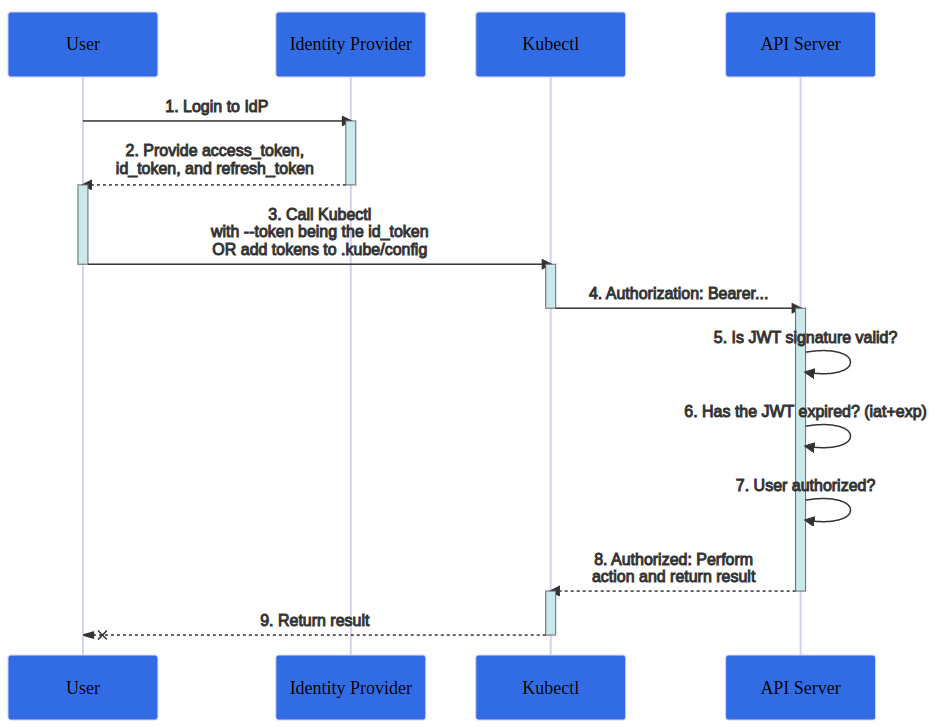

[Image Source](https://kubernetes.io/docs/reference/access-authn-authz/authentication/#openid-connect-tokens)

## What Is Keycloak?

Keycloak is an open source identity and access management solution. It's an application written in Java.It's used to manage the authentication and authorization of users. There are many paid/free authentication systems, but Keycloak is a tool that does both identity management and access management, and having RedHat behind it makes it stand out. With a little research, you can see how far ahead it is among open source identity management systems

Keycloak provides user management for many different applications and services at a single central point. This makes it possible for users to access multiple applications with a single account. Keycloak is built on standard protocols such as OAuth 2.0 and OpenID Connect and works as an identity provider.

Its basic capabilities are:

- Authentication and authorization: Keycloak provides user verification and applies authorization rules. It manages users' identities and access rights.

- Single sign-on (SSO): Keycloak lets a user access multiple applications once they've authenticated. Users can access different applications without the need to log in again and again.

- Integration with social identity providers: Keycloak provides integration with accounts on popular social media platforms. This way, users can log in using social accounts such as Facebook, Google and GitHub.

- Client management: Keycloak makes managing applications easier. It offers the ability to create, configure and manage client applications.

- Authorization and access control: Keycloak provides the ability to define customized access rights and authorizations for users. It provides role-based access control and makes managing permissions easier.


## Keycloak Installation and Configuration

In the work we'll do, everything will run on Linux, so we need to use a virtual Linux machine.

Kubernetes requires an SSL certificate when OpenID is used. So Keycloak needs to be published with ssl. 

Keyclock is normally a complex tool that's hard to master. Our main topic isn't learning Keycloak anyway. Our goal is to integrate Kubernetes with a tool that will offer OpenId support. We could do the same integration with another tool too.

First, we'll create our own custom Keycloak image. Then we'll bring it up together with Postgresql using our docker compose file. 

Don't forget to replace the **192.168.0.25** ip address in the yaml code below with the ip address of your own host machine.

we copy the yaml code below into a Dockerfile and build it. While building it, we use the **_docker build . -t mykeycloak:latest_** command.

```yaml
FROM ubuntu:22.04 as openssl


RUN apt -y update && apt -y upgrade
RUN apt -y install openssl

RUN mkdir /cert
WORKDIR /cert

# CA certificate
RUN openssl req -x509 \
            -sha256 -days 356 \
            -nodes \
            -newkey rsa:2048 \
            -subj "/CN=mykeycloak/C=US/L=San Fransisco" \
            -keyout rootCA.key -out rootCA.crt

#Server Private Key
RUN openssl genrsa -out server.key 2048

# create CSR conf file
RUN echo  '\
[ req ] \n\
default_bits = 2048 \n\
prompt = no \n\
default_md = sha256 \n\
req_extensions = req_ext \n\
distinguished_name = dn \n\
[ dn ] \n\
C = US \n\
ST = California \n\
L = San Fransisco \n\
O = muratcabuk \n\
OU = muratcabuk \n\
CN = mykeycloak \n\
[ req_ext ] \n\
subjectAltName = @alt_names \n\
[ alt_names ] \n\
DNS.1 = mykeycloak \n\
DNS.2 = demo.mykeycloak \n\
IP.1 = 192.168.0.25 \n\
IP.2 = 192.168.0.25 \n\
' > csr.conf

#Generate Certificate Signing Request (CSR) Using Server Private Key

RUN openssl req -new -key server.key -out server.csr  -config csr.conf

# create cer conf file
RUN echo '\
authorityKeyIdentifier=keyid,issuer \n\
basicConstraints=CA:FALSE \n\
keyUsage = digitalSignature, nonRepudiation, keyEncipherment, dataEncipherment \n\
subjectAltName = @alt_names \n\
[alt_names] \n\
DNS.1 = mykeycloak \n\
' > cert.conf

# Generate SSL certificate With self signed CA
RUN openssl x509 -req \
    -in server.csr \
    -CA rootCA.crt -CAkey rootCA.key \
    -CAcreateserial -out server.crt \
    -days 365 \
    -sha256 -extfile cert.conf


# PKCS12 keystore
RUN openssl pkcs12 -export -out keystore.p12 -inkey server.key -in server.crt -certfile server.crt -CAfile rootCA.crt -caname root -chain -passout pass:Abc123

RUN chmod -R 777 /cert

FROM quay.io/keycloak/keycloak:21.0 as builder

# Enable health and metrics support
ENV KC_HEALTH_ENABLED=true
ENV KC_METRICS_ENABLED=true

# Configure a database vendor
ENV KC_DB=postgres

WORKDIR /opt/keycloak

COPY --from=openssl /cert /opt/keycloak/cert

WORKDIR /opt/keycloak/cert


# Convert p12 to Keystore
RUN keytool -importkeystore -destkeystore ../conf/server.keystore -srckeystore keystore.p12 -srcstoretype PKCS12 -srcstorepass Abc123 -deststorepass password


WORKDIR /opt/keycloak

RUN /opt/keycloak/bin/kc.sh build


FROM quay.io/keycloak/keycloak:21.0

COPY --from=builder /opt/keycloak/ /opt/keycloak/

ENTRYPOINT ["/opt/keycloak/bin/kc.sh"]

```

We copy the yaml code below into a docker-compose.yml file. Then we bring up the applications using the **_docker compose -f docker-compose.yml up -d_** command.


```yaml
version: '3.9'
services:
  mypostgres:
    image: postgres:12-alpine
    container_name: mykeycloak-postgres
    hostname: mypostgres
    environment:
      POSTGRES_DB: keycloak
      POSTGRES_USER: keycloak
      POSTGRES_PASSWORD: keycloak
      HOSTNAME: mypostgres
    healthcheck:
      test: ["CMD-SHELL", "pg_isready"]
      interval: 10s
      timeout: 5s
      retries: 5
    volumes:
      - 'psql_data:/var/lib/postgresql/data'

# https://www.keycloak.org/server/containers
  mykeycloak:
    image: mykeycloak:latest
    container_name: mykeycloak
    command: start --optimized 
    environment:
       KC_DB: postgres
       KC_DB_URL: jdbc:postgresql://mypostgres:5432/keycloak
       KC_DB_DATABASE: keycloak
       KC_DB_USERNAME: keycloak
       KC_DB_SCHEMA: public
       KC_DB_PASSWORD: keycloak

       KC_HOSTNAME_STRICT: false
       KC_HOSTNAME_STRICT_HTTPS: false

       KC_HOSTNAME: mykeycloak

       KEYCLOAK_ADMIN: admin
       KEYCLOAK_ADMIN_PASSWORD: keycloak

       KEYCLOAK_USER: user
       KEYCLOAK_PASSWORD: keycloak

    depends_on:
       mypostgres:
         condition: service_healthy

    ports:
      - "8444:8443"

volumes:
  psql_data:
    driver: local
```

At this stage, we need to add our keycloak domain and ip address to our hosts file.  We add the line **_192.168.0.25 mykeycloak_** to our hosts file, changing the ip address to our own.

Kubernetes will ask for the CA certificate while connecting to Keycloak. We can use the command below to get the certificates we created from inside the Docker container. Choose the place you copy the folder to carefully, because later we'll need to map this path to the master nodes.


```shell
docker cp mykeycloak:/opt/keycloak/cert ./
```
We should see files like the ones in the image below. 

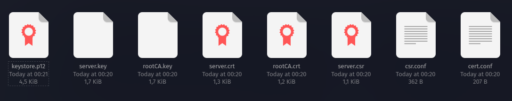

We need to rename the ootCA.crt file to rootCA.pem. Without going into details, I'd like to point out the following: if the content of our crt file is between BEGIN CERTIFICATE and END CERTIFICATE, taking a copy of our crt file with the pem extension is enough to create a pem file. Since the crt file we created is like this, we just take a copy of it.

```shell
cp rootCA.crt rootCA.pem
```


We need to copy the rootCA.pem file to the kubernetes master nodes. We'll do this after creating our Kubernetes cluster.

Now we can reach the keycloak admin panel by going to the **_https://mykeycloak:8444_** address in the browser. 

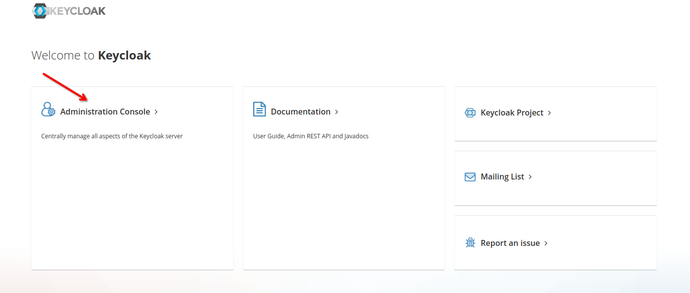

First, we create a Realm.  A realm is a security boundary zone where users, roles, access policies and authorization mechanisms are defined. A realm can be configured separately for different applications or services, and each can have its own authentication and access control rules.

Users and applications are managed within each realm. Users are registered to the realm, and for authentication they can log in with a username-password combination or through external identity providers such as social media accounts. Roles can be assigned to users, and these roles can be used to control access to applications or services.

A realm provides separately configurable access policies and authorization mechanisms. This is used to define which resources users can access and which operations they can perform. For example, a user in a realm may only have access to a specific application, or may perform specific operations if a specific role has been assigned.

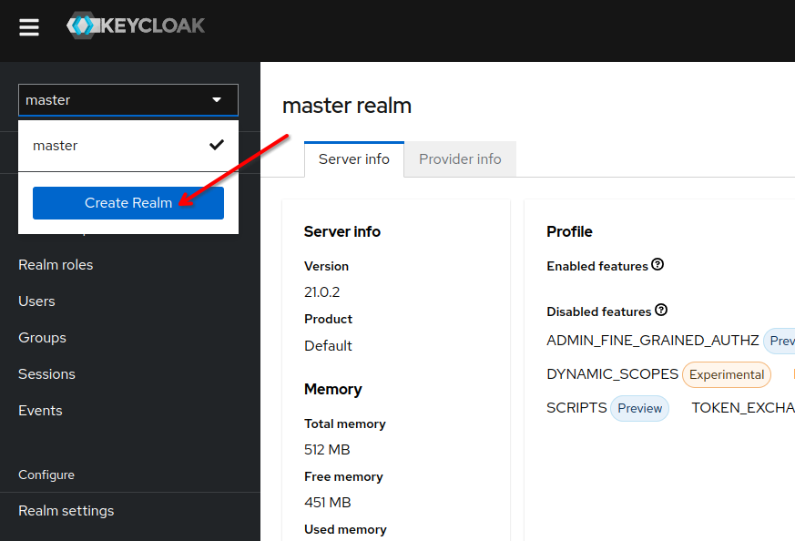

On the page that opens, we write Keycloak as the Realm Name and save.


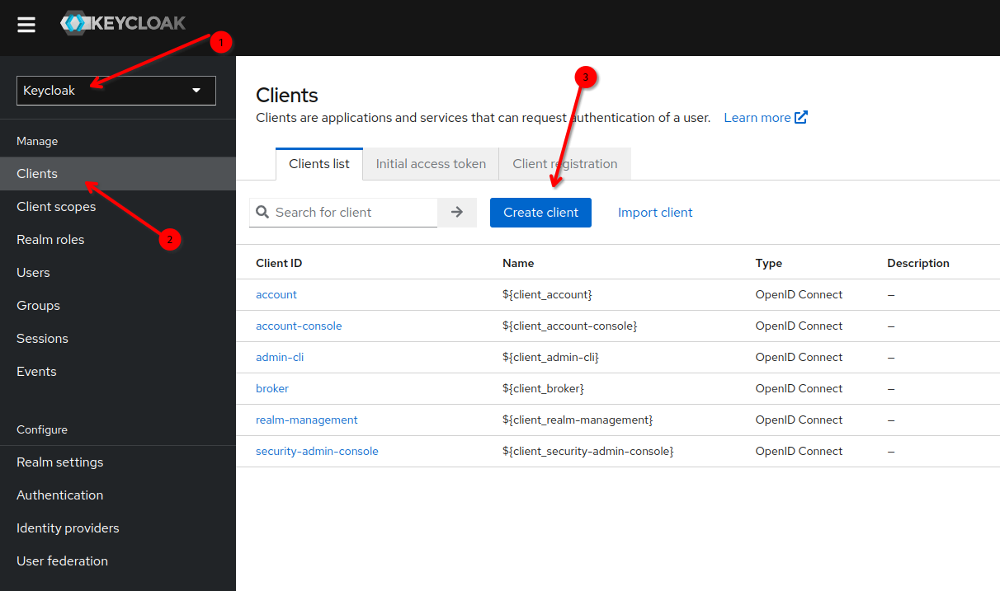

Then we create a new client. We'll use this client information later when authenticating with OpenId. 


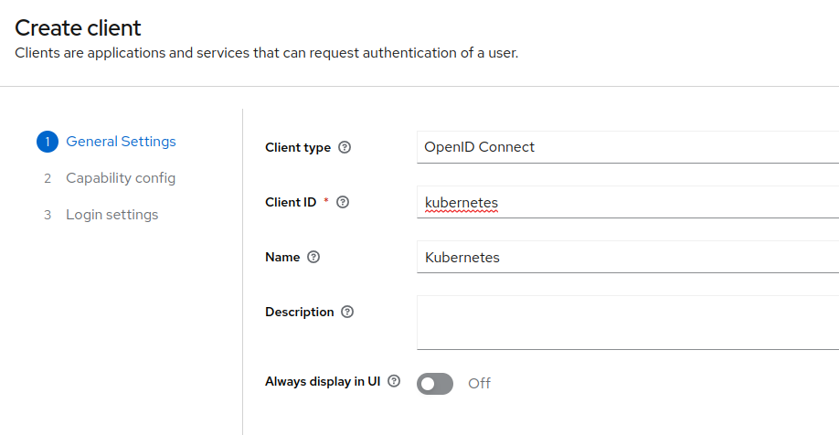

On the next screen, we activate client authentication by enabling the confidential access type.

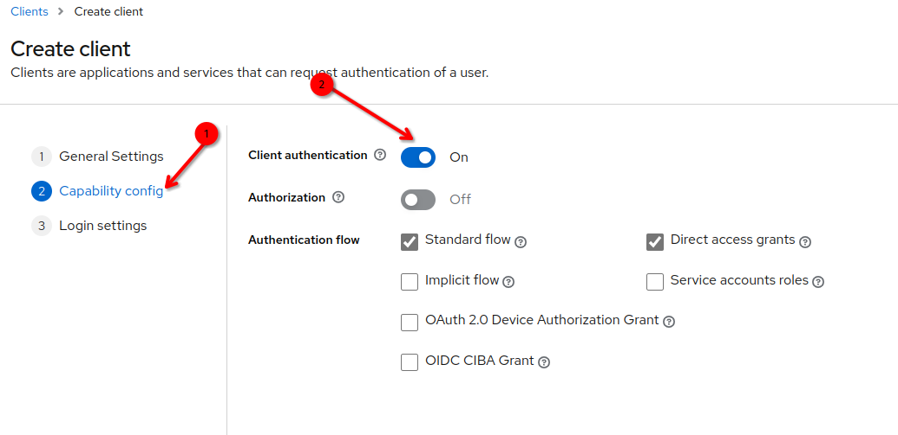

On the next screen, we define the redirect url using a wildcard (*). Of course, in production environments, be careful to enter the correct addresses instead of a wildcard.

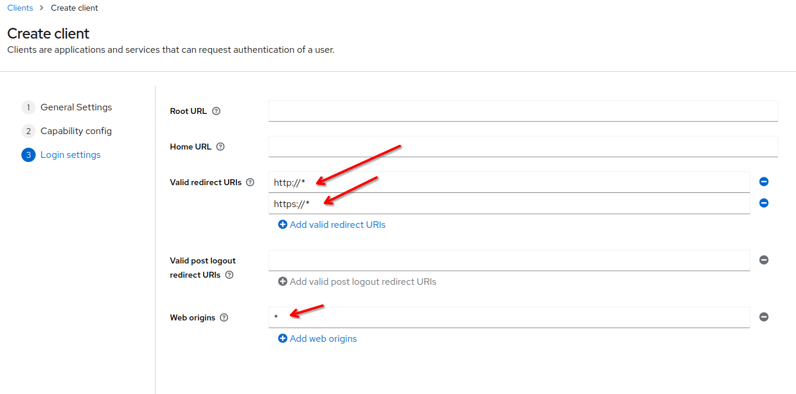

After this screen, we save. 

Now we can create the user groups, users and roles we'll log in with.

For this, let's switch to our client named kubernetes that we created earlier.

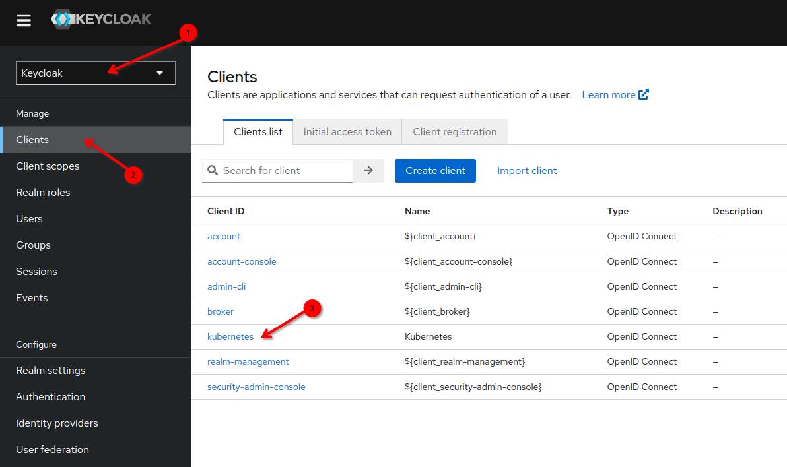

Then let's switch to the role tab and create two roles (admin and developer).


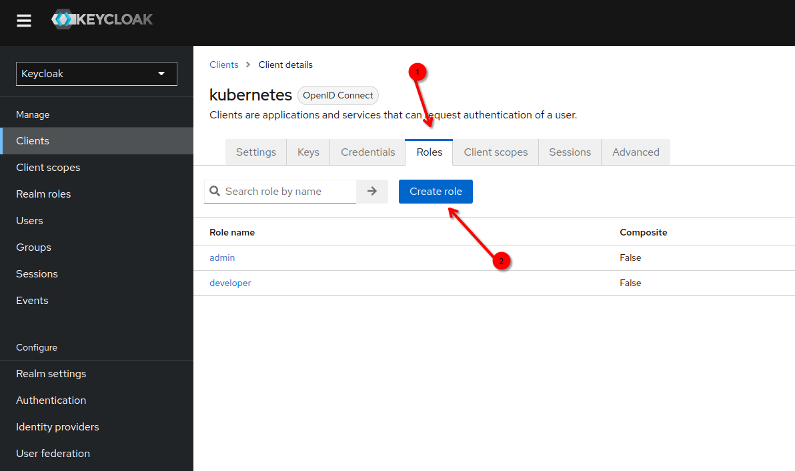


Then let's create our groups. We create two groups named developer-group and admin-group.

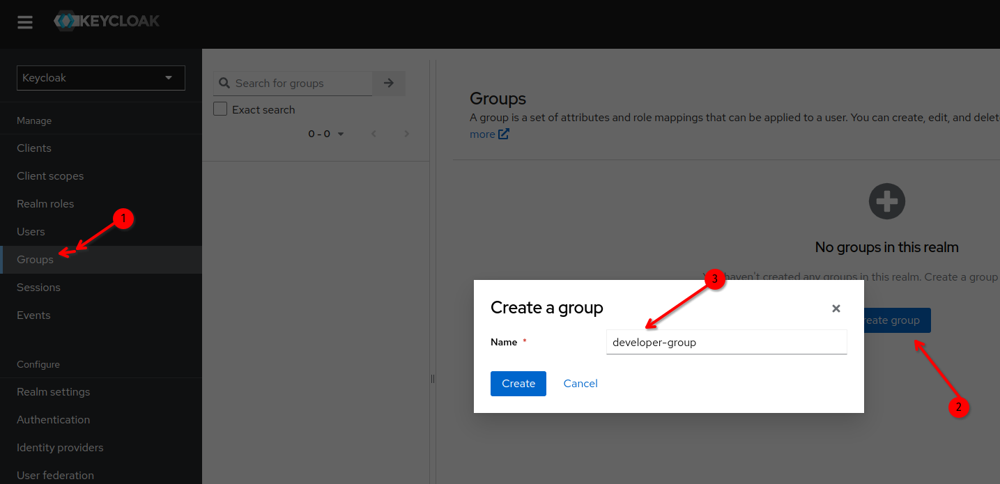

Then we create new users from the users menu. We create 4 users named admin1use, admin2user, developer1user and developer2user.

On the screen below, don't forget to activate Email verified. I forgot to do it in this screenshot, but you do it :). If you get the "Unable to authenticate the request" err="[invalid bearer token, oidc: email not verified]" error when you test, this is the reason. 


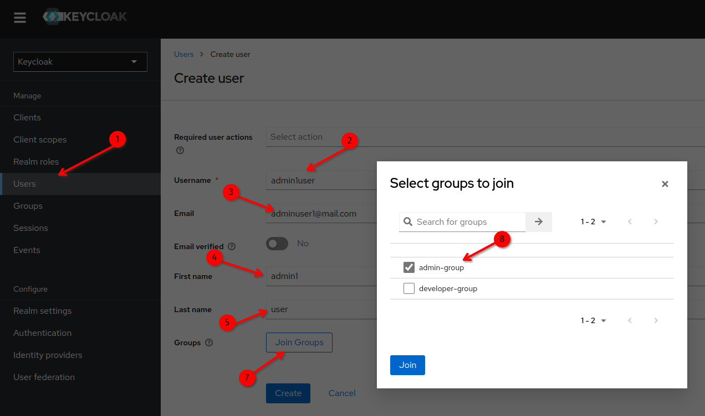

we should have 4 users like below

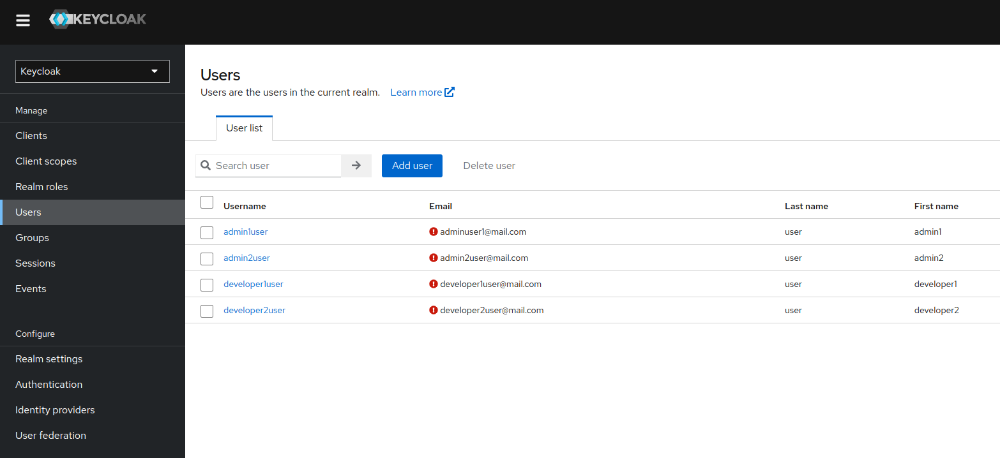

Then we add an attribute named name to each user.

On this page, let's also not forget to click credentials and add passwords for the users.

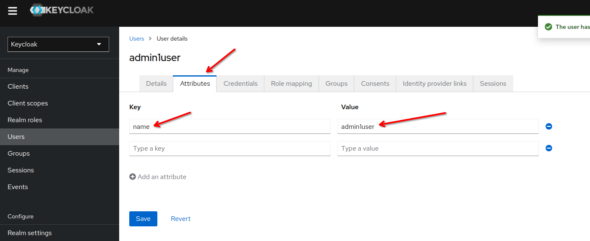

The applications that will use this system will ask us for the address of the well-known document. Using the information at this address, they'll communicate with the OpenId system we set up with Keycloak.

Address of the well-known  document: https://mykeycloak:8444/realms/Keycloak/.well-known/openid-configuration

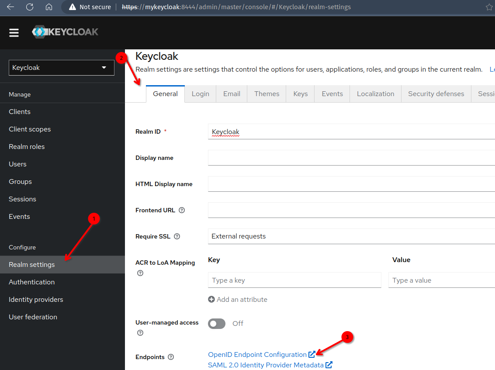

We should see a document similar to this
`
```json
{"issuer":"https://mykeycloak:8444/realms/Keycloak",
"authorization_endpoint":"https://mykeycloak:8444/realms/Keycloak/protocol/openid-connect/auth",
"token_endpoint":"https://mykeycloak:8444/realms/Keycloak/protocol/openid-connect/token",
"introspection_endpoint":"https://mykeycloak:8444/realms/Keycloak/protocol/openid-connect/token/introspect",
"userinfo_endpoint":"https://mykeycloak:8444/realms/Keycloak/protocol/openid-connect/userinfo",
"end_session_endpoint":"https://mykeycloak:8444/realms/Keycloak/protocol/openid-connect/logout",
"frontchannel_logout_session_supported":true,
"frontchannel_logout_supported":true,
"jwks_uri":"https://mykeycloak:8444/realms/Keycloak/protocol/openid-connect/certs",
"check_session_iframe":"https://mykeycloak:8444/realms/Keycloak/protocol/openid-connect/login-status-iframe.html",
"grant_types_supported":["authorization_code","implicit","refresh_token","password","client_credentials","urn:ietf:params:oauth:grant-type:device_code","urn:openid:params:grant-type:ciba"],
"acr_values_supported":["0","1"],
"response_types_supported":["code","none","id_token","token","id_token token","code id_token","code token","code id_token token"],
"subject_types_supported":["public","pairwise"],
"id_token_signing_alg_values_supported":["PS384","ES384","RS384","HS256","HS512","ES256","RS256","HS384","ES512","PS256","PS512","RS512"],
"id_token_encryption_alg_values_supported":["RSA-OAEP","RSA-OAEP-256","RSA1_5"],
"id_token_encryption_enc_values_supported":["A256GCM","A192GCM","A128GCM","A128CBC-HS256","A192CBC-HS384","A256CBC-HS512"],
"userinfo_signing_alg_values_supported":["PS384","ES384","RS384","HS256","HS512","ES256","RS256","HS384","ES512","PS256","PS512","RS512","none"],"userinfo_encryption_alg_values_supported":["RSA-OAEP","RSA-OAEP-256","RSA1_5"],
"userinfo_encryption_enc_values_supported":["A256GCM","A192GCM","A128GCM","A128CBC-HS256","A192CBC-HS384","A256CBC-HS512"],
"request_object_signing_alg_values_supported":["PS384","ES384","RS384","HS256","HS512","ES256","RS256","HS384","ES512","PS256","PS512","RS512","none"],
"request_object_encryption_alg_values_supported":["RSA-OAEP","RSA-OAEP-256","RSA1_5"],
"request_object_encryption_enc_values_supported":["A256GCM","A192GCM","A128GCM","A128CBC-HS256","A192CBC-HS384","A256CBC-HS512"],
"response_modes_supported":["query","fragment","form_post","query.jwt","fragment.jwt","form_post.jwt","jwt"],
"registration_endpoint":"https://mykeycloak:8444/realms/Keycloak/clients-registrations/openid-connect",
"token_endpoint_auth_methods_supported":["private_key_jwt","client_secret_basic","client_secret_post","tls_client_auth","client_secret_jwt"],"token_endpoint_auth_signing_alg_values_supported":["PS384","ES384","RS384","HS256","HS512","ES256","RS256","HS384","ES512","PS256","PS512","RS512"],"introspection_endpoint_auth_methods_supported":["private_key_jwt","client_secret_basic","client_secret_post","tls_client_auth","client_secret_jwt"],
"introspection_endpoint_auth_signing_alg_values_supported":["PS384","ES384","RS384","HS256","HS512","ES256","RS256","HS384","ES512","PS256","PS512","RS512"],
"authorization_signing_alg_values_supported":["PS384","ES384","RS384","HS256","HS512","ES256","RS256","HS384","ES512","PS256","PS512","RS512"],"authorization_encryption_alg_values_supported":["RSA-OAEP","RSA-OAEP-256","RSA1_5"],
"authorization_encryption_enc_values_supported":["A256GCM","A192GCM","A128GCM","A128CBC-HS256","A192CBC-HS384","A256CBC-HS512"],
"claims_supported":["aud","sub","iss","auth_time","name","given_name","family_name","preferred_username","email","acr"],
"claim_types_supported":["normal"],
"claims_parameter_supported":true,
"scopes_supported":["openid","profile","web-origins","roles","acr","phone","microprofile-jwt","offline_access","address","email"],
"request_parameter_supported":true,
"request_uri_parameter_supported":true,
"require_request_uri_registration":true,
"code_challenge_methods_supported":["plain","S256"],
"tls_client_certificate_bound_access_tokens":true,
"revocation_endpoint":"https://mykeycloak:8444/realms/Keycloak/protocol/openid-connect/revoke",
"revocation_endpoint_auth_methods_supported":["private_key_jwt","client_secret_basic","client_secret_post","tls_client_auth","client_secret_jwt"],
"revocation_endpoint_auth_signing_alg_values_supported":["PS384","ES384","RS384","HS256","HS512","ES256","RS256","HS384","ES512","PS256","PS512","RS512"],"backchannel_logout_supported":true,
"backchannel_logout_session_supported":true,"device_authorization_endpoint":"https://mykeycloak:8444/realms/Keycloak/protocol/openid-connect/auth/device","backchannel_token_delivery_modes_supported":["poll","ping"],
"backchannel_authentication_endpoint":"https://mykeycloak:8444/realms/Keycloak/protocol/openid-connect/ext/ciba/auth","backchannel_authentication_request_signing_alg_values_supported":["PS384","ES384","RS384","ES256","RS256","ES512","PS256","PS512","RS512"],"require_pushed_authorization_requests":false,
"pushed_authorization_request_endpoint":"https://mykeycloak:8444/realms/Keycloak/protocol/openid-connect/ext/par/request",
"mtls_endpoint_aliases":{"token_endpoint":"https://mykeycloak:8444/realms/Keycloak/protocol/openid-connect/token",
"revocation_endpoint":"https://mykeycloak:8444/realms/Keycloak/protocol/openid-connect/revoke",
"introspection_endpoint":"https://mykeycloak:8444/realms/Keycloak/protocol/openid-connect/token/introspect",
"device_authorization_endpoint":"https://mykeycloak:8444/realms/Keycloak/protocol/openid-connect/auth/device",
"registration_endpoint":"https://mykeycloak:8444/realms/Keycloak/clients-registrations/openid-connect",
"userinfo_endpoint":"https://mykeycloak:8444/realms/Keycloak/protocol/openid-connect/userinfo",
"pushed_authorization_request_endpoint":"https://mykeycloak:8444/realms/Keycloak/protocol/openid-connect/ext/par/request",
"backchannel_authentication_endpoint":"https://mykeycloak:8444/realms/Keycloak/protocol/openid-connect/ext/ciba/auth"}}
```


The information in the document contains the data needed to configure the OpenID provider's authentication and authorization services. Some important fields in the document are:


- issuer: A URL representing the identity provider name of the OpenID provider.
- authorization_endpoint: The URL used to carry out the authorization operation.
- token_endpoint: The URL used to get access tokens.
- userinfo_endpoint: The URL used to get user information.
- jwks_uri: The JSON Web Key Set (JWKS) URL, which contains the encryption keys and signing keys used by the identity provider.
- response_types_supported: A list of the supported response types (for example, code, id_token, token).
- scopes_supported: A list of the supported access permissions.
- claim_types_supported: A list of the supported identity claim types.


We can test what we've done. To be able to test, we need the client_secret information. You can get the client_secret information from the Credential tab on the kubernetes client page under the Keycloak realm we opened under Keycloack. 

```shell
curl -X POST https://mykeycloak:8444/realms/Keycloak/protocol/openid-connect/token -d "client_secret=GiSI4a3Z2rgmxV6G4JIkvcYtIhkJbnGz"  -d "grant_type=password" -d "client_id=kubernetes" -d "username=admin1user" -d "password=Abc-123" -d "scope=openid" -d "response_type=id_token" --cacert cert/rootCA.pem
```

When I ran this command, I got a result like this.

```json

{"access_token":"eyJhbGciOiJSUzI1NiIsInR5cCIgOiAiSldUIiwia2lkIiA6ICJfQmxKblVDYzBub1dMbld4YWNQaHY5cGtwOTFCV1R2N2ZJUFd2MTNYenE0In0.eyJleHAiOjE2ODgxMTk3MzYsImlhdCI6MTY4ODExOTQzNiwianRpIjoiNjY1ODgwM2MtMDJjMC00ODc1LWFhYzctOTlhNDZlOWNlZWRhIiwiaXNzIjoiaHR0cHM6Ly9teWtleWNsb2FrOjg0NDQvcmVhbG1zL0tleWNsb2FrIiwiYXVkIjoiYWNjb3VudCIsInN1YiI6ImY1MzY4N2UyLTI2ZWYtNDhmZi05NGMxLWY4NzJjNjg0MjU4MSIsInR5cCI6IkJlYXJlciIsImF6cCI6Imt1YmVybmV0ZXMiLCJzZXNzaW9uX3N0YXRlIjoiMjFjZmRkMGUtOTcxNy00ZDc2LTlhNmQtZDgzYWY3NzM1OTFlIiwiYWNyIjoiMSIsImFsbG93ZWQtb3JpZ2lucyI6WyIqIl0sInJlYWxtX2FjY2VzcyI6eyJyb2xlcyI6WyJkZWZhdWx0LXJvbGVzLWtleWNsb2FrIiwiYWRtaW4tcm9sZSIsIm9mZmxpbmVfYWNjZXNzIiwidW1hX2F1dGhvcml6YXRpb24iXX0sInJlc291cmNlX2FjY2VzcyI6eyJhY2NvdW50Ijp7InJvbGVzIjpbIm1hbmFnZS1hY2NvdW50IiwibWFuYWdlLWFjY291bnQtbGlua3MiLCJ2aWV3LXByb2ZpbGUiXX19LCJzY29wZSI6Im9wZW5pZCBwcm9maWxlIGVtYWlsIiwic2lkIjoiMjFjZmRkMGUtOTcxNy00ZDc2LTlhNmQtZDgzYWY3NzM1OTFlIiwiZW1haWxfdmVyaWZpZWQiOmZhbHNlLCJuYW1lIjoiYWRtaW4xIHVzZXIiLCJwcmVmZXJyZWRfdXNlcm5hbWUiOiJhZG1pbjF1c2VyIiwiZ2l2ZW5fbmFtZSI6ImFkbWluMSIsImZhbWlseV9uYW1lIjoidXNlciIsImVtYWlsIjoiYWRtaW4xdXNlckBtYWlsLmNvbSJ9.dwkk7trNbIuH1v4-3q8-pw7S0w0xMeA0nmwElbPq5WJFTIh77N27U7XPX6mZwMd1gFl5a26qi73lF0g1AbRpx_6bxS51_Jv6cN6Agw_sq8Rxh05WK36-JSHkqevWOm3IVwJkyncU46a0kbcqc15kHF2kRA855e8lxPgEpF8IEZjuknrQwrmtyP55xKlyapdHAZOILmEGoOg7SmH-P3jBAq_gqt0CRM1Hn_lDXV5OHD4pZWAUwMSYQWGMaz-O9x8rpEY2o2h7Dq6NKo5e_Ee04T6PaLqR8N7Rf-Sn2JoeLk3GD96mw83WbHEFB6_QY7zD1Dw4OVKFfaZR7Q1QVHL7pQ",

"expires_in":300,

"refresh_expires_in":1800,

"refresh_token":"eyJhbGciOiJIUzI1NiIsInR5cCIgOiAiSldUIiwia2lkIiA6ICJmYWU2MjdjMC0xODJjLTRhZmEtOTlmNS05MWY2OTQ0YzE3NmYifQ.eyJleHAiOjE2ODgxMjEyMzYsImlhdCI6MTY4ODExOTQzNiwianRpIjoiZmNiZjIwMjAtZmJmMS00Mjk4LTkyNTItNGE3MWY1Mjg2MGM1IiwiaXNzIjoiaHR0cHM6Ly9teWtleWNsb2FrOjg0NDQvcmVhbG1zL0tleWNsb2FrIiwiYXVkIjoiaHR0cHM6Ly9teWtleWNsb2FrOjg0NDQvcmVhbG1zL0tleWNsb2FrIiwic3ViIjoiZjUzNjg3ZTItMjZlZi00OGZmLTk0YzEtZjg3MmM2ODQyNTgxIiwidHlwIjoiUmVmcmVzaCIsImF6cCI6Imt1YmVybmV0ZXMiLCJzZXNzaW9uX3N0YXRlIjoiMjFjZmRkMGUtOTcxNy00ZDc2LTlhNmQtZDgzYWY3NzM1OTFlIiwic2NvcGUiOiJvcGVuaWQgcHJvZmlsZSBlbWFpbCIsInNpZCI6IjIxY2ZkZDBlLTk3MTctNGQ3Ni05YTZkLWQ4M2FmNzczNTkxZSJ9.H-zOSRkDK9me2woVO7AclsaK6s-9r9xnFQbrk4p_2V0",

"token_type":"Bearer",

"id_token":"eyJhbGciOiJSUzI1NiIsInR5cCIgOiAiSldUIiwia2lkIiA6ICJfQmxKblVDYzBub1dMbld4YWNQaHY5cGtwOTFCV1R2N2ZJUFd2MTNYenE0In0.eyJleHAiOjE2ODgxMTk3MzYsImlhdCI6MTY4ODExOTQzNiwiYXV0aF90aW1lIjowLCJqdGkiOiI5NGRiMTcwZS1hMGY1LTQzOGMtODhjYi05NTBlYWNlZWEzYWMiLCJpc3MiOiJodHRwczovL215a2V5Y2xvYWs6ODQ0NC9yZWFsbXMvS2V5Y2xvYWsiLCJhdWQiOiJrdWJlcm5ldGVzIiwic3ViIjoiZjUzNjg3ZTItMjZlZi00OGZmLTk0YzEtZjg3MmM2ODQyNTgxIiwidHlwIjoiSUQiLCJhenAiOiJrdWJlcm5ldGVzIiwic2Vzc2lvbl9zdGF0ZSI6IjIxY2ZkZDBlLTk3MTctNGQ3Ni05YTZkLWQ4M2FmNzczNTkxZSIsImF0X2hhc2giOiJVazVqMndqSi1GLUFkdDdhRHN2TjVnIiwiYWNyIjoiMSIsInNpZCI6IjIxY2ZkZDBlLTk3MTctNGQ3Ni05YTZkLWQ4M2FmNzczNTkxZSIsImVtYWlsX3ZlcmlmaWVkIjpmYWxzZSwibmFtZSI6ImFkbWluMSB1c2VyIiwicHJlZmVycmVkX3VzZXJuYW1lIjoiYWRtaW4xdXNlciIsImdpdmVuX25hbWUiOiJhZG1pbjEiLCJmYW1pbHlfbmFtZSI6InVzZXIiLCJlbWFpbCI6ImFkbWluMXVzZXJAbWFpbC5jb20ifQ.JcEwEJBWWagSrlTUHoy_SP9gPdQyRsWIaNriX2M-WUObft2NfX1NG1h2oAcmQLOfz1WpBpwbG32Bu6q9peRAS9q9L9JmJURsBnY03AKIYaWuCmLOto9O2p7C1u5plNyq4cHe95FcVU45OgsfSGGscQ3jqYdAnzt4_NI6MILXzQPzxiQ9oZol9X9hAFGbGFyTiE-tXNfgicjourjYYXX_M8CHeHMJygpljtUuartuERnUKdLLn1OTBisBAI3gbNVkhYd5jRv_PDikyoeFqvhmDB_R0shf29Bcw1urBdJSMqWTC53FWemBoftRjaz9lgA991uwvMyxdsqjeQ698lUoPw",

"not-before-policy":0,

"session_state":"21cfdd0e-9717-4d76-9a6d-d83af773591e",

"scope":"openid profile email"}

```

The token produced here is a JWT (Json Web Token) token. JWT tokens have 3 sections. These are indicated in the token using dots. If you look at the access_token, we can see that it's separated by 3 dots. The first of these fields contains the token's header information, that is, the token's meta data; the second contains the payload (claims), that is, the token's content; and the third contains the signature, that is, the token's signature. The signature is a signature used to verify the integrity of the JWT. The signature is determined by combining the header, the payload and a secret. The signature is used to verify that the JWT came from a correct and trusted source.

Now let's look at what's in the content of this token. for this, we copy the content of the acces_token into the encoded field on the jwt.io page.


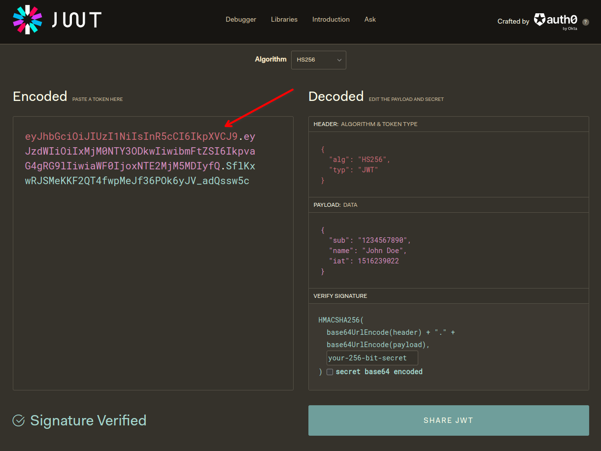


Mine was decoded like this.


```json
{
  "exp": 1688119736,
  "iat": 1688119436,
  "jti": "6658803c-02c0-4875-aac7-99a46e9ceeda",
  "iss": "https://mykeycloak:8444/realms/Keycloak",
  "aud": "account",
  "sub": "f53687e2-26ef-48ff-94c1-f872c6842581",
  "typ": "Bearer",
  "azp": "kubernetes",
  "session_state": "21cfdd0e-9717-4d76-9a6d-d83af773591e",
  "acr": "1",
  "allowed-origins": [
    "*"
  ],
  "realm_access": {
    "roles": [
      "default-roles-keycloak",
      "admin-role",
      "offline_access",
      "uma_authorization"
    ]
  },
  "resource_access": {
    "account": {
      "roles": [
        "manage-account",
        "manage-account-links",
        "view-profile"
      ]
    }
  },
  "scope": "openid profile email",
  "sid": "21cfdd0e-9717-4d76-9a6d-d83af773591e",
  "email_verified": false,
  "name": "admin1 user",
  "preferred_username": "admin1user",
  "given_name": "admin1",
  "family_name": "user",
  "email": "admin1user@mail.com"
}
```

But here there's no groups information that we plan to use on the kubernetes side. Of course, the Role information can be used too. or we can also add group information to our token.Also, we had thought we'd use the name data that comes with the token for the username, but the information we're looking for isn't there. The Username information is in the preferred_username field, or of course we can also use the email information.

Now, if you like, let's look at how we can add the group information to the token. For this, we need to add a client scope

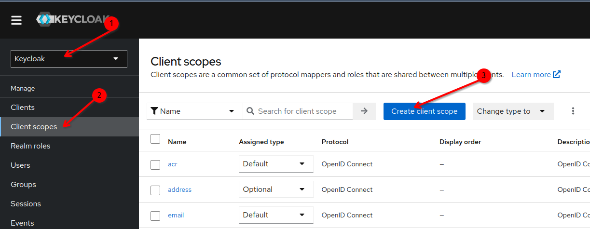

We write groups as the scope name. We make sure the protocol is OpenId.

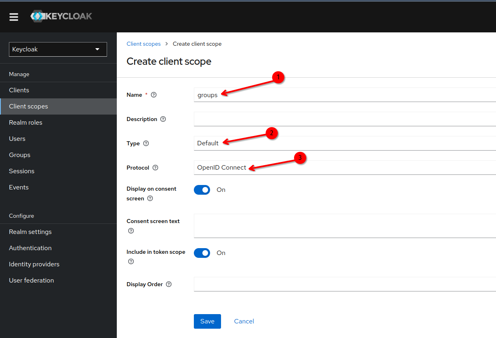

Then we select this client scope by clicking kubernetes under clients and clicking add client scope from the client scopes tab. 

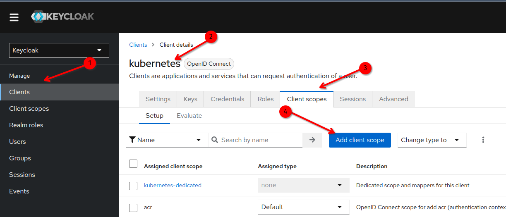

We say Add, and so our token will now also give the group information. To test it, when we get the token with the curl command above and decompile it on jwt.io, we can see that the groups information now comes too, like below.

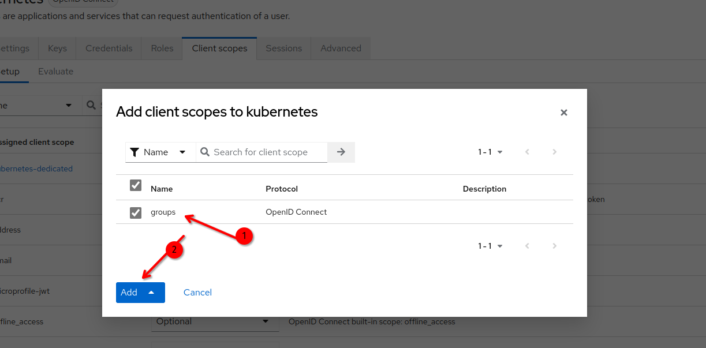

```json
{
  "exp": 1688129206,
  "iat": 1688128906,
  "jti": "0b7fc2ed-3eed-4bf5-a8c4-467ca2db9be8",
  "iss": "https://mykeycloak:8444/realms/Keycloak",
  "aud": "account",
  "sub": "f53687e2-26ef-48ff-94c1-f872c6842581",
  "typ": "Bearer",
  "azp": "kubernetes",
  "session_state": "cac33257-72b8-4563-9383-c4e9b870dfb7",
  "acr": "1",
  "allowed-origins": [
    "*"
  ],
  "realm_access": {
    "roles": [
      "default-roles-keycloak",
      "admin-role",
      "offline_access",
      "uma_authorization"
    ]
  },
  "resource_access": {
    "account": {
      "roles": [
        "manage-account",
        "manage-account-links",
        "view-profile"
      ]
    }
  },
  "scope": "openid profile email groups",
  "sid": "cac33257-72b8-4563-9383-c4e9b870dfb7",
  "email_verified": false,
  "name": "admin1 user",
  "groups": [
    "admin-group"
  ],
  "preferred_username": "admin1user",
  "given_name": "admin1",
  "family_name": "user",
  "email": "admin1user@mail.com"
}
```
Now we can move on to our settings on the kubernetes side.


## Kubernetes Cluster Installation with KinD (Kubernetes in Docker)

Usually, deployment tools like Minikube, K3d or Mikrok8s are used for Kubernetes installations in development and test environments. KinD isn't a very well-known tool. Its main feature is that it sets up the Kubetnetes cluster on Docker containers. This way, we don't need an extra machine to create the cluster. Also, since Docker images are used to create the cluster, creating the cluster is very fast. 

Unlike other tools, it gives us a complete Kubernetes cluster. The other tools, being restricted or optimized for specific purposes, offer many components developed for Kubernetes in a limited way as addons. Also, not all of them offer multinode cluster support. Some of the ones that do offer multinode, Microk8s for example, require more than one machine. Of course, this can sometimes be good and sometimes bad. But if what we need is a deployment tool that can be quickly set up and torn down, that offers as real a Kubernetes experience as possible, and that we can use for test and development, KinD offers us that.


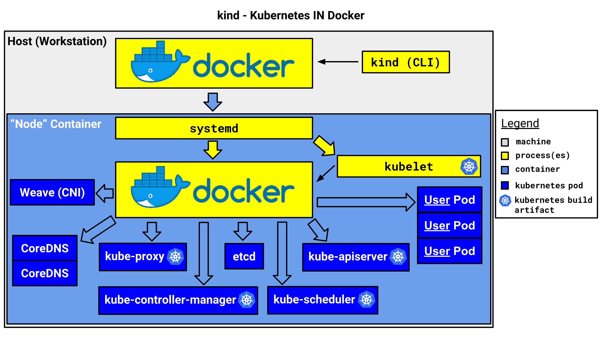
[Image Source](https://kind.sigs.k8s.io/docs/design/initial/)


For detailed information about KinD, you can look [here](https://kind.sigs.k8s.io/).

First, we install KinD on our machine.

```shell
[ $(uname -m) = x86_64 ] && curl -Lo ./kind https://kind.sigs.k8s.io/dl/v0.20.0/kind-linux-amd64
chmod +x ./kind
sudo mv ./kind /bin/kind
```

Then we create our cluster with the command below. Don't forget to copy the folder named cert, which contains our certificates that we copied earlier from our Keycloak container, to our home directory with the name ssl. 

We also create a folder named kind in your home directory. 

```shell
kind create cluster --name=keycloak-kubernetes --config - <<EOF
kind: Cluster
apiVersion: kind.x-k8s.io/v1alpha4
networking:
  kubeProxyMode: "ipvs"
kubeadmConfigPatches:
- |-
  kind: ClusterConfiguration
  apiServer:
    extraArgs:
      oidc-client-id: kubernetes
      oidc-issuer-url: https://mykeycloak:8444/realms/Keycloak
      oidc-username-claim: email
      oidc-groups-claim: groups
      oidc-ca-file: /etc/ca-certificates/keycloak/rootCA.pem
    controllerManager:
      extraArgs:
        bind-address: 0.0.0.0
    scheduler:
      extraArgs:
        bind-address: 0.0.0.0
nodes:
- role: control-plane
  extraMounts:
  - hostPath: ${HOME}/ssl/rootCA.pem
    containerPath: /etc/ca-certificates/keycloak/rootCA.pem
    readOnly: true
- role: worker
  extraMounts:
  - hostPath: ${HOME}/ssl/rootCA.pem
    containerPath: /etc/ca-certificates/keycloak/rootCA.pem
    readOnly: true
EOF

```

With this command, we add the lines below to our Kube-apiserver manifest file.

```
oidc-client-id: kubernetes
oidc-issuer-url: https://mykeycloak:8444/realms/Keycloak
oidc-username-claim: email
oidc-groups-claim: groups
oidc-ca-file: /etc/ca-certificates/keycloak/rootCA.pem
```

All of this information is information that appeared in the token we got earlier with the curl command. The issuer-url information, on the other hand, we get from our well-known document. 

Since KinD is set up on docker containers, we attached our certificate to our Kubernetes master nodes by mounting it.

Before continuing, if kubectl isn't installed on your host machine, you can install it with the command below too.

```shell
curl -LO "https://dl.k8s.io/release/$(curl -L -s https://dl.k8s.io/release/stable.txt)/bin/linux/amd64/kubectl"

chmod +x kubectl
mkdir -p ~/.local/bin
sudo mv ./kubectl /bin/kubectl
```

Let's look at the config file created after the installation. We can see that a new cluster has been added.

```shell

cat ${HOME}/.kube/config

--- KISALTILDI

- cluster:
    certificate-authority-data: LS0tLS1CRUdJTiBDRVJUSUZJQ0FURS0tLS0tCk1JSUMvakNDQWVhZ0F3SUJBZ0lCQURBTkJna3Foa2lHOXcwQkFRc0ZBREFWTVJNd0VRWURWUVFERXdwcmRXSmwKY201bGRHVnpNQjRYRFRJek1EY3dNakUwTlRJeU5Wb1hEVE16TURZeU9URTBOVEl5TlZvd0ZURVRNQkVHQTFVRQpBeE1LYTNWaVpYSnVaWFJsY3pDQ0FTSXdEUVlKS29aSWh2Y05BUUVCQlFBRGdnRVBBRENDQVFvQ2dnRUJBSm5mCitTa2hGLzhObk5LbDlrR3VoczVD---KISALTILDI
    server: https://127.0.0.1:35529
  name: kind-keycloak-kubernetes

--- KISALTILDI

```

If we look at the container list, we can also see the containers created with KinD.

```shell 
docker container ls --format "table {{.Image}}\t{{.Names}}\t{{.Ports}}"


IMAGE                  NAMES                               PORTS
kindest/node:v1.27.3   keycloak-kubernetes-worker
kindest/node:v1.27.3   keycloak-kubernetes-control-plane   127.0.0.1:35529->6443/tcp
mykeycloak:latest      mykeycloak                          8080/tcp, 0.0.0.0:8444->8443/tcp, :::8444->8443/tcp
postgres:12-alpine     mykeycloak-postgres                 5432/tcp


```
Let's do a simple test. 

```shell
kubectl get nodes
NAME                                STATUS   ROLES           AGE     VERSION
keycloak-kubernetes-control-plane   Ready    control-plane   3m30s   v1.27.3
keycloak-kubernetes-worker          Ready    <none>          3m10s   v1.27.3

```

yes, our cluster looks installed. Now let's try to list the pods in the kube-system namespace.

```shell

kubectl get pods -n kube-system

NAME                                                        READY   STATUS    RESTARTS   AGE
coredns-5d78c9869d-kbwbp                                    1/1     Running   0          4m11s
coredns-5d78c9869d-sscfp                                    1/1     Running   0          4m11s
etcd-keycloak-kubernetes-control-plane                      1/1     Running   0          4m25s
kindnet-bpdwd                                               1/1     Running   0          4m10s
kindnet-zcd4n                                               1/1     Running   0          4m8s
kube-apiserver-keycloak-kubernetes-control-plane            1/1     Running   0          4m24s
kube-controller-manager-keycloak-kubernetes-control-plane   1/1     Running   0          4m24s
kube-proxy-gx7pj                                            1/1     Running   0          4m8s
kube-proxy-zwknn                                            1/1     Running   0          4m10s
kube-scheduler-keycloak-kubernetes-control-plane            1/1     Running   0          4m24s
```

Let's examine the details of our kube-apiserver pod.

```shell
kubectl describe pods kube-apiserver-keycloak-kubernetes-control-plane -n kube-system

--- KISALTILDI

Containers:
kube-apiserver:
Container ID:  containerd://a7dcf6ffd581246c23eadd46db40eadc18b23281e8e18e2b6a5388bcd54445b0
Image:         registry.k8s.io/kube-apiserver:v1.27.3
Image ID:      docker.io/library/import-2023-06-15@sha256:0202953c0b15043ca535e81d97f7062240ae66ea044b24378370d6e577782762
Port:          <none>
Host Port:     <none>
Command:
kube-apiserver
--advertise-address=172.21.0.2
--allow-privileged=true
--authorization-mode=Node,RBAC
--client-ca-file=/etc/kubernetes/pki/ca.crt
--enable-admission-plugins=NodeRestriction
--enable-bootstrap-token-auth=true
--etcd-cafile=/etc/kubernetes/pki/etcd/ca.crt
--etcd-certfile=/etc/kubernetes/pki/apiserver-etcd-client.crt
--etcd-keyfile=/etc/kubernetes/pki/apiserver-etcd-client.key
--etcd-servers=https://127.0.0.1:2379
--kubelet-client-certificate=/etc/kubernetes/pki/apiserver-kubelet-client.crt
--kubelet-client-key=/etc/kubernetes/pki/apiserver-kubelet-client.key
--kubelet-preferred-address-types=InternalIP,ExternalIP,Hostname
--oidc-ca-file=/etc/ca-certificates/keycloak/rootCA.pem
--oidc-client-id=kubernetes
--oidc-groups-claim=groups
--oidc-issuer-url=https://mykeycloak:8444/realms/Keycloak
--oidc-username-claim=email
--proxy-client-cert-file=/etc/kubernetes/pki/front-proxy-client.crt
--proxy-client-key-file=/etc/kubernetes/pki/front-proxy-client.key
--requestheader-allowed-names=front-proxy-client
--requestheader-client-ca-file=/etc/kubernetes/pki/front-proxy-ca.crt
--requestheader-extra-headers-prefix=X-Remote-Extra-
--requestheader-group-headers=X-Remote-Group
--requestheader-username-headers=X-Remote-User
--runtime-config=
--secure-port=6443
--service-account-issuer=https://kubernetes.default.svc.cluster.local
--service-account-key-file=/etc/kubernetes/pki/sa.pub
--service-account-signing-key-file=/etc/kubernetes/pki/sa.key
--service-cluster-ip-range=10.96.0.0/16
--tls-cert-file=/etc/kubernetes/pki/apiserver.crt
--tls-private-key-file=/etc/kubernetes/pki/apiserver.key
State:          Running
Started:      Sun, 02 Jul 2023 17:52:33 +0300

--- KISALTILDI
```
As you can see, the oidc-related parameters contain the information we gave with the KinD command.

## Kubernetes Authentication with Keycloak

So let's try to understand what what we've done will be good for. As we mentioned earlier, Kubernetes doesn't offer us an identity management mechanism. We can create a role and their permissions. But we can't directly create an object called user. Exactly at this point, by making Kubernetes recognize Keycloak for identity management and verification operations, we'll make it possible to do the job of creating users and assigning them to the related roles through Keycloak.


With what we've done so far, we've actually handled the integration job. Now let's use the system we created.


First, let's create ClusterRoles and ClusterRoleBindings on the Kubernetes side that match the groups we created on Keycloak.

We create a ClusterRole and ClusterRoleBinding for Developer-group.


```shell

cat <<EOF | kubectl apply  -f -
kind: ClusterRole
apiVersion: rbac.authorization.k8s.io/v1
metadata:
  name: developer-clusterrole
rules:
  - apiGroups: [""]
    resources: ["namespaces","pods"]
    verbs: ["get", "watch", "list"]
---
kind: ClusterRoleBinding
apiVersion: rbac.authorization.k8s.io/v1
metadata:
  name: developer-clusterrolebinding
roleRef:
  apiGroup: rbac.authorization.k8s.io
  kind: ClusterRole
  name: developer-clusterrole
subjects:
- kind: Group
  name: "developer-group"
  apiGroup: rbac.authorization.k8s.io
EOF

```
We create a ClusterRole and ClusterRoleBinding for Admin-group.


```shell

cat << EOF | kubectl apply -f -

apiVersion: rbac.authorization.k8s.io/v1
kind: ClusterRole
metadata:
  name: admin-clusterrole
rules:
- apiGroups: [""]
  resources: ["namespaces"]
  verbs: ["get", "list", "watch"]
- apiGroups: ["rbac.authorization.k8s.io"]
  resources: ["clusterroles", "clusterrolebindings"]
  verbs: ["get", "list", "watch"]

---
apiVersion: rbac.authorization.k8s.io/v1
kind: ClusterRoleBinding
metadata:
  name: admin-clusterrolebinding
subjects:
roleRef:
  kind: ClusterRole
  name: admin-clusterrole
  apiGroup: rbac.authorization.k8s.io
subjects:
- kind: Group
  name: "admin-group"
  apiGroup: rbac.authorization.k8s.io
EOF
```

Now we can do authentication with Keycloak. Basically, what we need to do is actually as follows: First, we'll create a token with one of the users we created on Keycloak, then, by gathering this token information and the other information seen in the example command below, we'll add the necessary information to our kube.config file.

```shell
 kubectl config set-credentials USER_NAME \
    --auth-provider=oidc \
    --auth-provider-arg=idp-issuer-url=( issuer url ) \
    --auth-provider-arg=client-id=( your client id ) \
    --auth-provider-arg=client-secret=( your client secret ) \
    --auth-provider-arg=refresh-token=( your refresh token ) \
    --auth-provider-arg=idp-certificate-authority=( path to your ca certificate ) \
    --auth-provider-arg=id-token=( your id_token )
```

But there's also a plugin called oidc-login that lets us do this job more practically. Thanks to this plugin, we can do this whole setup much more practically and quickly. To be able to install this plugin, we first need to install a plugin manager called krew. To install Krew, we run the command below.

```shell
(
  set -x; cd "$(mktemp -d)" &&
  OS="$(uname | tr '[:upper:]' '[:lower:]')" &&
  ARCH="$(uname -m | sed -e 's/x86_64/amd64/' -e 's/\(arm\)\(64\)\?.*/\1\2/' -e 's/aarch64$/arm64/')" &&
  KREW="krew-${OS}_${ARCH}" &&
  curl -fsSLO "https://github.com/kubernetes-sigs/krew/releases/latest/download/${KREW}.tar.gz" &&
  tar zxvf "${KREW}.tar.gz" &&
  ./"${KREW}" install krew
)


export PATH="${KREW_ROOT:-$HOME/.krew}/bin:$PATH"

source ~/.bashrc
```

Then we can install the plugin.

```shell
  kubectl krew install oidc-login

```

We run the plugin with the command below. When we run the command, a browser will open and ask us to enter the information of one of the users we created earlier in Keycloak. When the login is finished, it'll give us a ready-made command. Using this command, we'll update our kube.config file.

```shell
kubectl oidc-login setup \
--oidc-issuer-url=https://mykeycloak:8444/realms/Keycloak \
--oidc-client-id=kubernetes \
--oidc-client-secret=GiSI4a3Z2rgmxV6G4JIkvcYtIhkJbnGz \
--certificate-authority=$HOME/ssl/rootCA.pem \
--insecure-skip-tls-verify
```


When the command was run, after entering our username and password on the page that opened, we got a result like the one below. If we pay attention to the returned token information, the group information we created in Keycloak and assigned our user to appears in the group  section. We had also defined this group inside the ClusterRoleBinging (admin-clusterrolebinding). This way, we also determined our user's permissions within the cluster. Since, after our user is verified by Keycloak, the group information is included in the token information returned to Kubernetes, and since we specified in the kube-apiserver configuration that this information should be read by Kubernetes, Kubernetes will assign the related role to our user.

```shell
## 2. Verify authentication

You got a token with the following claims:

{
"exp": 1688287386,
"iat": 1688287086,
"auth_time": 1688286890,
"jti": "2263a3e5-8b78-450b-bf3e-c49edd80f24f",
"iss": "https://mykeycloak:8444/realms/Keycloak",
"aud": "kubernetes",
"sub": "f53687e2-26ef-48ff-94c1-f872c6842581",
"typ": "ID",
"azp": "kubernetes",
"nonce": "MoxYCXQ1XzClqtTSnkVvl38RLvsIzc8EwtJcVeEXgbk",
"session_state": "ba5f3e07-bfd2-44f9-806d-457dfcc3b6c9",
"at_hash": "hoMQl5skcdpMf9c57u0IaQ",
"acr": "0",
"sid": "ba5f3e07-bfd2-44f9-806d-457dfcc3b6c9",
"email_verified": true,
"name": "admin1 user",
"groups": [
"admin-group"
],
"preferred_username": "admin1user",
"given_name": "admin1",
"family_name": "user",
"email": "admin1user@mail.com"
}

## 3. Bind a cluster role

Run the following command:

kubectl create clusterrolebinding oidc-cluster-admin --clusterrole=cluster-admin --user='https://mykeycloak:8444/realms/Keycloak#f53687e2-26ef-48ff-94c1-f872c6842581'

## 4. Set up the Kubernetes API server

Add the following options to the kube-apiserver:

--oidc-issuer-url=https://mykeycloak:8444/realms/Keycloak
--oidc-client-id=kubernetes

## 5. Set up the kubeconfig

Run the following command:

kubectl config set-credentials oidc \
--exec-api-version=client.authentication.k8s.io/v1beta1 \
--exec-command=kubectl \
--exec-arg=oidc-login \
--exec-arg=get-token \
--exec-arg=--oidc-issuer-url=https://mykeycloak:8444/realms/Keycloak \
--exec-arg=--oidc-client-id=kubernetes \
--exec-arg=--oidc-client-secret=GiSI4a3Z2rgmxV6G4JIkvcYtIhkJbnGz \
--exec-arg=--certificate-authority=/home/kullanici_adiniz/ssl/rootCA.pem \
--exec-arg=--insecure-skip-tls-verify

## 6. Verify cluster access

Make sure you can access the Kubernetes cluster.

kubectl --user=oidc get nodes

You can switch the default context to oidc.

kubectl config set-context --current --user=oidc

You can share the kubeconfig to your team members for on-boarding.
```


We've actually done the steps up to item 5. All we need to do is run the command in item 5 by specifying the path of our kubeconfig file.

```shell
kubectl --kubeconfig ${HOME}/kind/kube.config config set-credentials oidc \
--exec-api-version=client.authentication.k8s.io/v1beta1 \
--exec-command=kubectl \
--exec-arg=oidc-login \
--exec-arg=get-token \
--exec-arg=--oidc-issuer-url=https://mykeycloak:8444/realms/Keycloak \
--exec-arg=--oidc-client-id=kubernetes \
--exec-arg=--oidc-client-secret=GiSI4a3Z2rgmxV6G4JIkvcYtIhkJbnGz \
--exec-arg=--certificate-authority=/home/kullanici_adiniz/ssl/rootCA.pem \
--exec-arg=--insecure-skip-tls-verify

# When the command is run, we should get the result below.

# User "oidc" set.
```

If we look at the content of our kube.config file, we'll see that a section like the one below has been added.

```yaml
- name: oidc
  user:
    exec:
      apiVersion: client.authentication.k8s.io/v1beta1
      args:
      - oidc-login
      - get-token
      - --oidc-issuer-url=https://mykeycloak:8444/realms/Keycloak
      - --oidc-client-id=kubernetes
      - --oidc-client-secret=GiSI4a3Z2rgmxV6G4JIkvcYtIhkJbnGz
      - --certificate-authority=/home/kullaniciadiniz/ssl/rootCA.pem
      - --insecure-skip-tls-verify
      command: kubectl
      env: null
      provideClusterInfo: false
```

Now let's try to do some operations using our oidc user settings.


```shell
kubectl get namespace --user oidc

NAME                 STATUS   AGE
default              Active   139m
kube-node-lease      Active   139m
kube-public          Active   139m
kube-system          Active   139m
local-path-storage   Active   139m
```

If our session has closed, with this command a browser will open and ask us for an authorized username and password. If our user is authorized to get the namespace list, we'll be able to get the namespace list. If you remember, we had given our admin users the permission to get the namespace list.

If you run into an error, try the methods below.

- Make sure your Keycloak OIDC provider is configured correctly. Make sure your settings such as oidc-issuer-url, oidc-client-id, oidc-username-claim, oidc-groups-claim and oidc-ca-file are correct. Make sure the correct users and groups have been created in the Keycloak admin panel.

- Check the kubeconfig file you use when you run the Kubectl command. Make sure it's configured correctly and is compatible with the OIDC provider. Make sure the kubeconfig file has the correct user credentials (token, cert, key, etc.).

- Make sure the users and groups you created on Keycloak, and the users and groups that Kubernetes roles are assigned to, are configured correctly. Make sure you've assigned the necessary roles and permissions to users and groups.

- To verify the integration with the Keycloak OIDC provider, you can make a verification request to the OIDC provider using curl or a similar tool instead of kubectl. This way, you can check whether the user was successfully authenticated with the OIDC provider.

- In the KinD configuration, make sure the correct OIDC settings are configured for the API server, controller manager and scheduler. Make sure the changes you made have been successfully applied to the KinD cluster.

- Check the logs of the Kubernetes API server. Are there any error or warning messages in these logs? Make sure the API server isn't having any errors while communicating with Keycloak.

- Check network access: Check the network access between the Kubernetes API server and Keycloak. Make sure both services are on the same network or can access the network. Also, check the security groups or network policies between the API server and Keycloak. Make sure the necessary ports are open and the traffic isn't blocked.

- Check the SSL/TLS certificates: Check the SSL/TLS certificates used for secure communication between Keycloak and the API server. Verify that the certificate used by Keycloak (oidc-ca-file) and the certificates used by the API server (ca.crt) are valid and can verify each other.

Hope you found it useful. Take care

See you in our other articles.


