### Working with Kustomize and Helm with Monokle Desktop
In our [previous](monokle.md) article, we touched on the topics below about Monokle Desktop.
- What is Monokle Desktop, what is it for?
- Project management with Monokle,
- Cluster management,
- Deploying and observing the differences between the local configuration and Kubernetes
- Observing the differences between two clusters and syncing the two clusters  
  

In this article, we'll examine what can be done on Helm and Kustomize with Monokle.

We'll continue with the two clusters we set up with Kind in the previous article. If your Lab environment isn't ready, you can do the setup from the previous article.

### Using Kustomize

As the example project, we'll use the examples on Kubernetes-sigs' Github page. For this, after forking [this repo](git@github.com:kubernetes-sigs/kustomize.git), we clone it to our local machine. I cloned it by changing its name to kustomize-example.

After opening Monokle Desktop, we go to new project and click the "open a local folder" option. On the screen that opens, we select the "kustomize-examples/examples/wordpress/" directory.

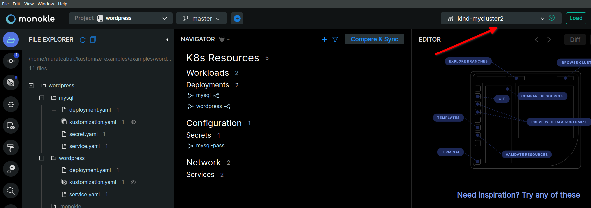

We should make sure that both clusters are loaded.

To set up Kustomize, we go to the Setting menu at the top right.

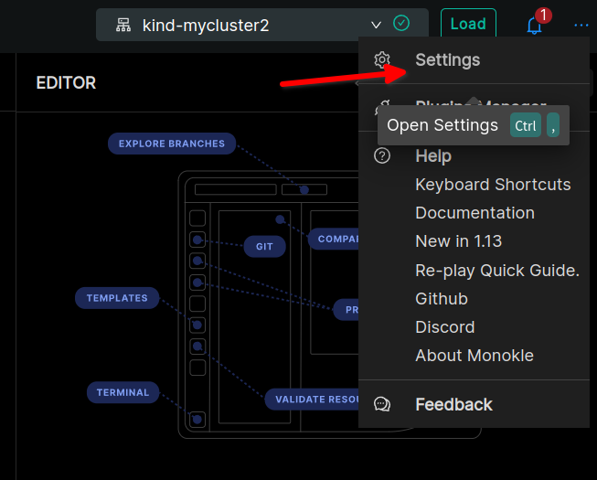

kubectl is enough to use Kustomize. In Kubectl 1.14 and above, Kustomize has been added natively into kubectl. We also activate the "Enable Helm-related functionality when invoking Kustomize" option.

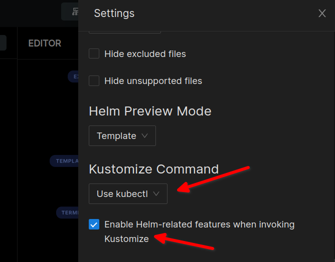

When we switch to the Kustomize menu on the left, the content of our kustomization.yaml files can be seen.

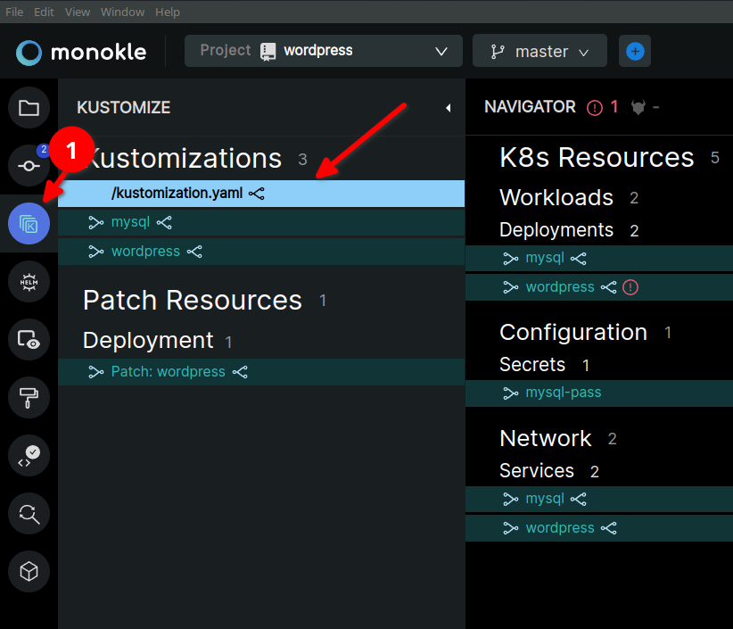

For example, if we click the small link icon to the right of Mysql, we can also see which resources will be created in Kubernetes together with this Mysql.

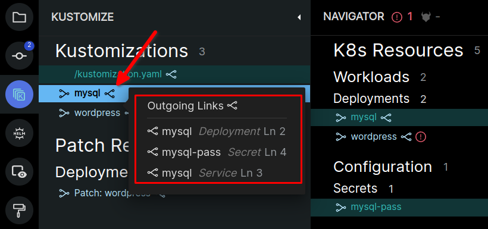

If we click the "preview" link that appears when we hover over the related resources, we can get more detailed information about the resources that will be created.

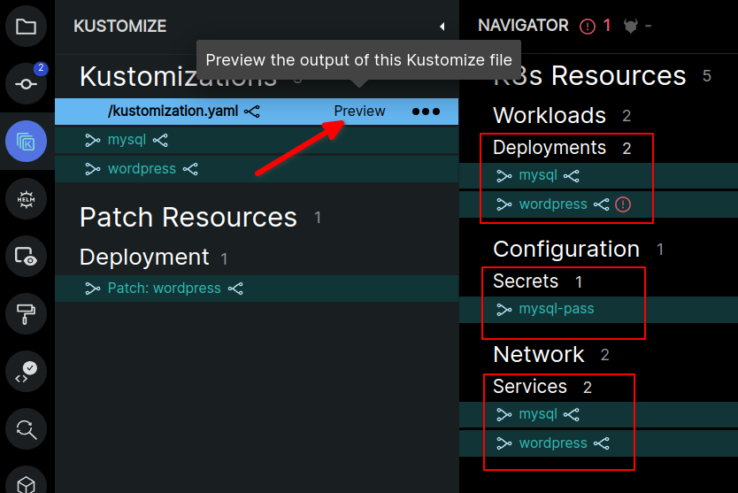

As you can also see in the image above, Monokle tells us that there's an error on wordpress; it says that the "hostPath: {}" key on deployment.yaml under Wordpress can't be empty. In other words, it gives us the chance to see the error before even deploying.

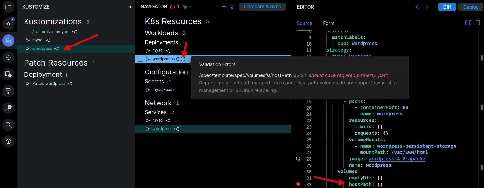

We turn the "hostPath: {}" line into a comment line with the "#" sign.

Now we can deploy. For this, we select the kind-mycluster cluster and click the Deploy button. 

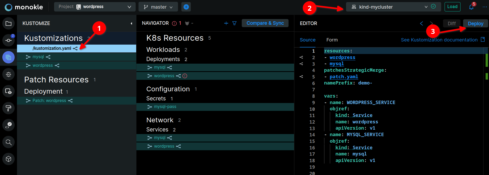

When we switch to cluster mode and check the deployments, we can see that mysql and wordpress have been deployed.

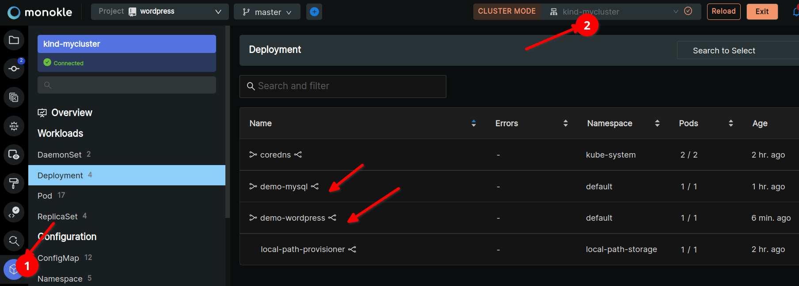

As we did in our previous article, we can sync the two clusters here too.

For this, we first switch to File Explorer from the menu on the left and click the Compare & Sync button in the Navigator panel in the middle. Then we need to apply the steps below. We filter the differences between Kind-MyCluster and Kind-MyCluster2 and sync the deployment, secret and service resources related to the mysql and wordpress applications located in Kind-MyCluster. In the image below only deployment appears selected; don't forget to select the others.

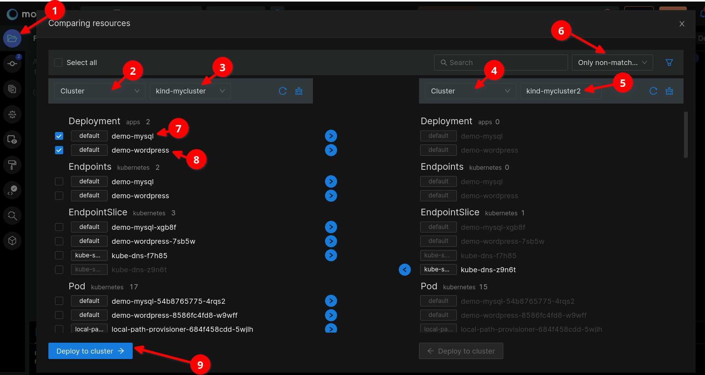

### Using Helm

I won't get into topics such as what Helm is or how it's installed at all. There are already many resources explaining that.

For our example, we'll use Bitnami's Helm Charts. We fork it from its [Github](https://github.com/bitnami/charts) page and use it. 

On Monokle Desktop, we open the Joomla folder through new project.

To be able to preview, we open the panel by clicking the (+) sign under Preview Configuration.

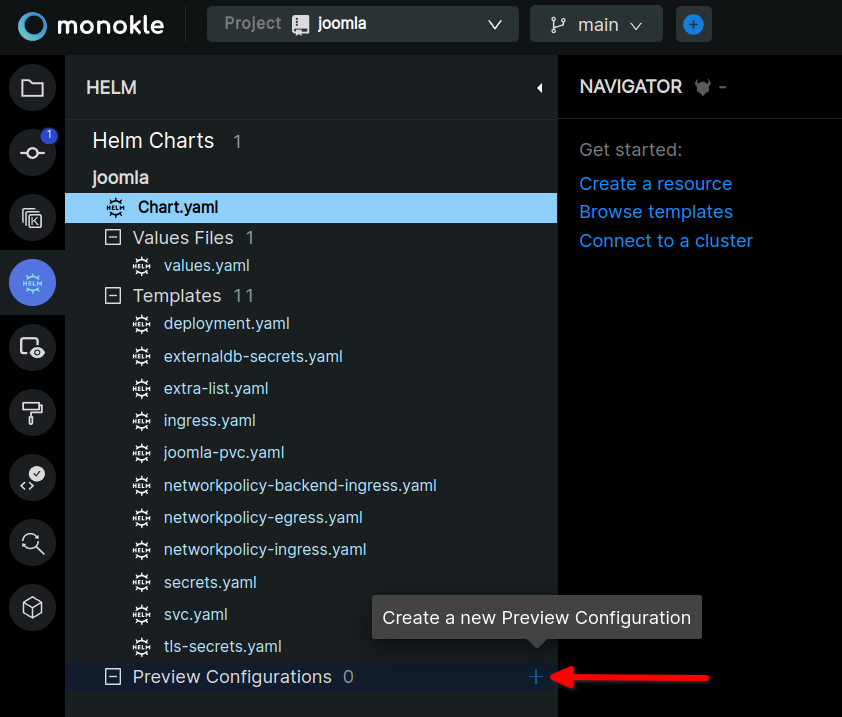

We write the configuration name. We select the Values files, but since we opened a Helm chart that already follows the standards, there was no need anyway. We save it by clicking the Save and Preview button.

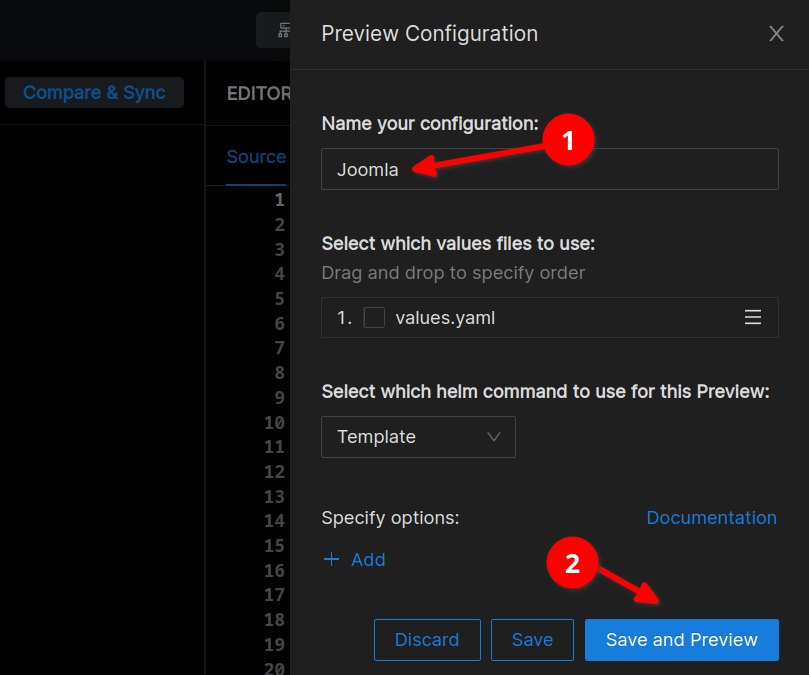

To install the Helm dependencies, we run the "helm dependency update" command while in the Joomla folder. Then we switch to preview mode by clicking preview on values.yaml.

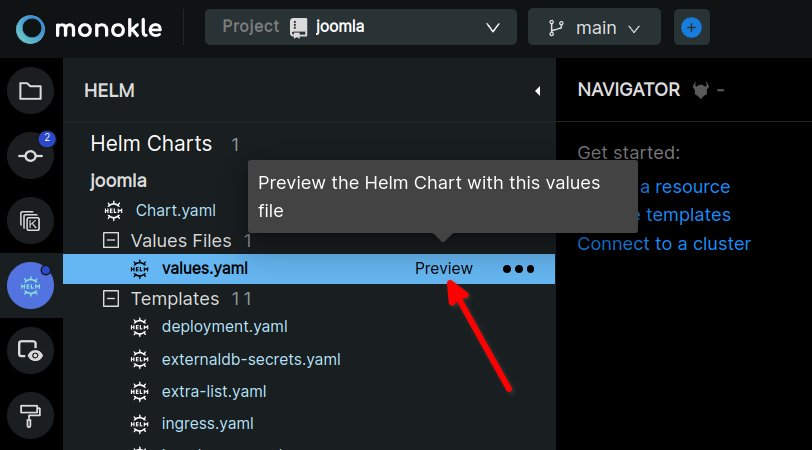

Again there are some errors, validation is active here too, but this time we won't get hung up on them. I just wanted to show here that we can do the installation by clicking the install button at the top right.

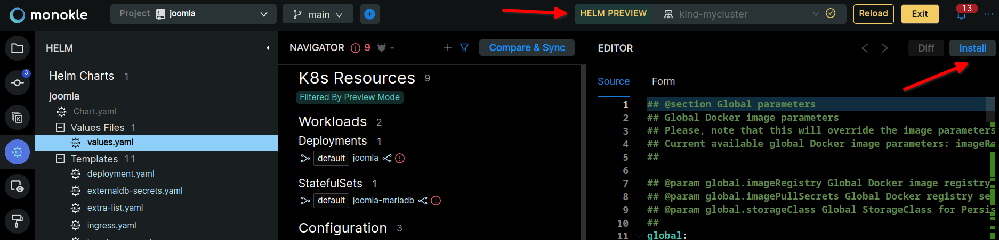

When we click the Install button, we'll see a message like the one below.

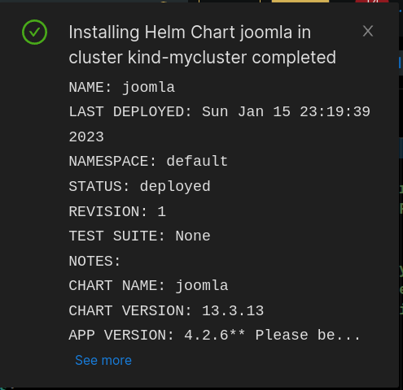

As is known, Helm is a tool known for its complexity. Naturally, Monokle is a very good tool for understanding a Helm template created for a large system. For example, for Joomla, many resources such as Joomla, MariaDb, ingress, secret, network policy and volume are configured and installed. When you click any resource on the Navigator, we get the chance to see the other resources the related resource is connected to.

With this article, we've touched on almost all the features of Monokle Desktop. As you can see, it's a tool that's very easy to learn and use. Especially if you manage more than one cluster, it's a tool that will make your job much easier. First of all, it doesn't keep state, meaning you don't have to use a database or anything. It's not a Web Application, so there's no need for a server installation, etc. 

Hope you found it useful.
