### Kubernetes Cluster and Configuration Management with Monokle Desktop 

In this article, we'll examine a tool called Monokle, which lets us manage our Kubernetes clusters and resources through a GUI.

Literally, [Monokle](https://monokle.io/) means monocle. Of course, put like that it doesn't mean much, but if you look at the image below you'll understand what it is. Its logo resembles one too. Monokle is pronounced "ˈmänək(ə)l".


According to the definition on its [official page](https://monokle.io/), "Monokle is a set of tools for creating and maintaining high-quality Kubernetes configurations throughout the entire application lifecycle".

The tools in the toolset.
- **Monokle Desktop** is a unified visual tool for authoring, analyzing and deploying Kubernetes configurations, covering the entire configuration lifecycle from creation to validation and deployment. 
- **Monokle CLI** is a flexible and easy-to-use command line tool for validating Kubernetes configurations as part of your existing pre-deployment workflows. 
- **Monokle Cloud** is a free, browser-based tool for exploring, validating and managing your Kubernetes configurations and GitOps repos on GitHub. 


In this article, we'll mostly be examining Monokle Desktop.


So what kinds of benefits does it have?


- We can fix our configuration errors in realtime using templates.
- We can see the results before going to deployment, and we can also track inventory changes on Helm and Kustomize.

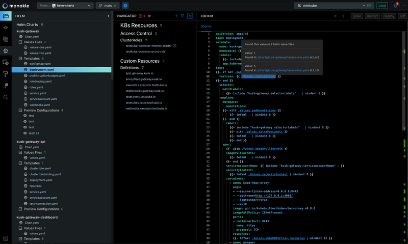

- It makes it easier for us to understand the dependencies and relationships between Kubernetes resources and configurations.
  
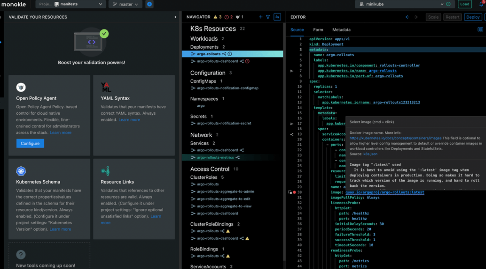

- We can compare desired states between Git branches and repos.
- We can compare the differences between Kubernetes namespaces and clusters.
- We can more easily understand the differences between our real environment and the configuration we have.
  
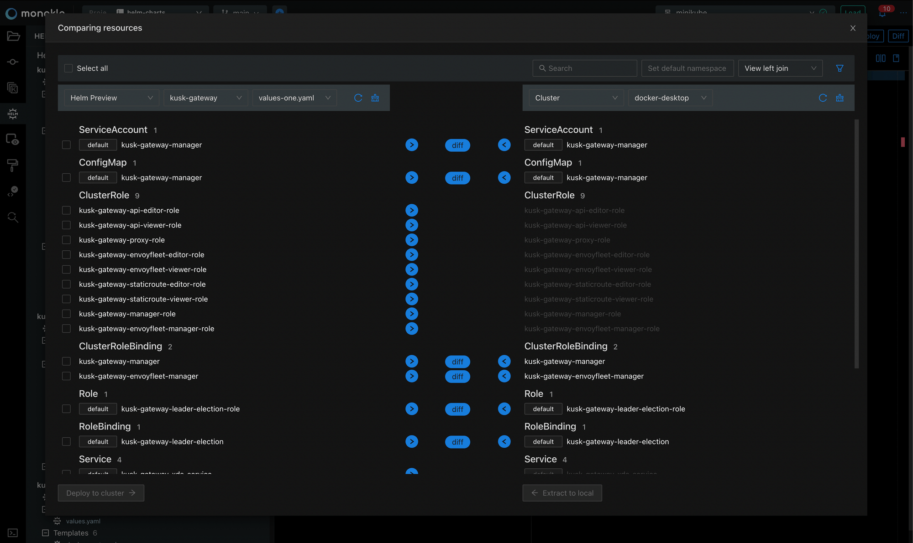
- We can push updates directly to Git.
  
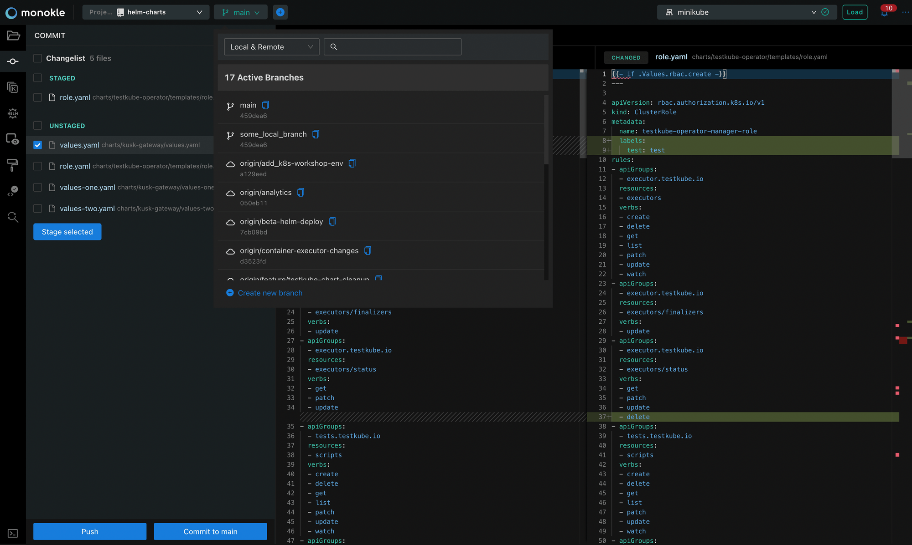

### Setting Up the Lab Environment  

We'll set up our lab environment with [Kind](https://kind.sigs.k8s.io/). Kind is a Kubernetes cluster deployment tool developed to be used in Kubernetes' tests.

It lets us do Kubernetes deployments on Docker containers. Since we don't create virtual machines, we can both bring up our cluster very quickly and our resource consumption is reduced. Also, since it uses native Kubernetes, you can use many native tools developed for Kubernetes (Nginx ingress, Calico, Istio, MetalLB, etc.).

Apart from Kind, there are other Lightweight Kubernetes deployment tools too.

- [Minikube](https://minikube.sigs.k8s.io/docs/start/): Cross Multinode isn't supported. In other words, multinode is only supported on the same machine. It doesn't offer a fully native solution, so it has its own solution in place of some tools. For example, service mesh, load balancing, storage, etc. 
- [Microk8s](https://microk8s.io/): It's a tool developed by Canonical. It was developed to be used for IoT devices, test environments and development. It can also be used in production environments that aren't large. It doesn't offer a fully native solution. So it has a plugin system for some needs. Cross Multinode is supported. For High Availability, instead of ETCD it uses a distributed database called [Dqlite](https://dqlite.io/docs/explanation/architecture), built on Sqlite. 
- [K3s](https://docs.k3s.io/): It was developed for IoT devices, test and development. It's a single 100 MB binary file. In this form it isn't as advanced as Mikrok8s. It supports setting up clusters on virtual machines. However, since it doesn't offer a native installation, it may not be possible to use every tool developed for Kubernetes.
- [K3d](https://k3d.io/): It isn't a Kubernetes deployment tool on its own. It sort of wraps K3s and lets us create, via the cli, a cluster that will run on docker containers. In this form, we could say that the combination of K3s and K3d actually corresponds to a tool like Minikube or Microk8s.


In this case, Microk8s looks the most suitable for IoT, dev, test and small production environments. But if you're looking for a fully native test environment, then Kind looks suitable. If your goal is to directly install and test native Kubernetes tools, KinD makes sense since it offers a native environment.

First, we need to install Kind on our local machine. For this, you can do the installation suitable for your operating system from its official page. There are brew for MacOs and Chocolatey for Windows package managers. Also, if you like, you can run it directly from the binary.

You can use the commands below for Linux.


```bash
curl -Lo ./kind https://kind.sigs.k8s.io/dl/v0.17.0/kind-linux-amd64
chmod +x ./kind
sudo mv ./kind /usr/local/bin/kind
```

We create our cluster using the Kind cli. For this, we copy the code below into a file named cluster.yaml.

```bash

kind: Cluster
apiVersion: kind.x-k8s.io/v1alpha4
nodes:
- role: control-plane
- role: worker
- role: worker
- role: worker
```


Then, while in the directory where the file is located, we create our cluster with the command below in the terminal.

```bash
kind create cluster --name mycluster --config cluster.yaml
```
To install Kubectl 

- [Linux](https://kubernetes.io/docs/tasks/tools/install-kubectl-linux/)
- [Mac Os](https://kubernetes.io/docs/tasks/tools/install-kubectl-macos/)
- [Windows](https://kubernetes.io/docs/tasks/tools/install-kubectl-windows/)


Installation for Linux

```bash
curl -LO "https://dl.k8s.io/release/$(curl -L -s https://dl.k8s.io/release/stable.txt)/bin/linux/amd64/kubectl"

chmod +x kubectl
mv ./kubectl /usr/local/bin/kubectl
```

We use the command below to test it. We can see that a file named config has been created under the .kube folder in our Home folder. A context named kind-mycluster was created in this file, and using it we can run commands on our cluster.


```bash
kubectl cluster-info --context kind-mycluster

# Kubernetes control plane is running at https://127.0.0.1:41415
# CoreDNS is running at https://127.0.0.1:41415/api/v1/namespaces/kube-system/services/kube-dns:dns/proxy

# To further debug and diagnose cluster problems, use 'kubectl cluster-info dump'.

```

Now that our lab environment is ready, we can examine Monokle.


### Monokle Desktop

Installation files for all operating systems are available on [this page](https://monokle.io/download).

On the first launch, if we want, we can create a new project. In the second step of the project creation screen, there are ready-made templates with which we can create Kubernetes resources. Of course, we can also create these in our existing projects.

But we'll use the examples in the official Kubernetes [Github repo](https://github.com/kubernetes/examples). For this, first fork the repo to your own account. I forked it by changing its name to kubernetes-examples. Then clone the repo to your local machine.

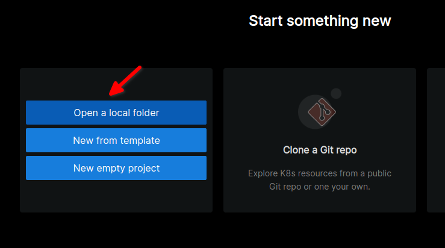

When we get to the New Project button, we click the "Open a local folder" button and select our folder. When the loading is complete, we can see our Kubernetes cluster at the top right. Later, when we examine the differences between two clusters, we'll create our second cluster as well.

If the cluster doesn't appear, first make sure it's up. If that part seems to be working, you can learn how to integrate it from the [Monokle documentation](https://kubeshop.github.io/monokle/cluster-integration/).

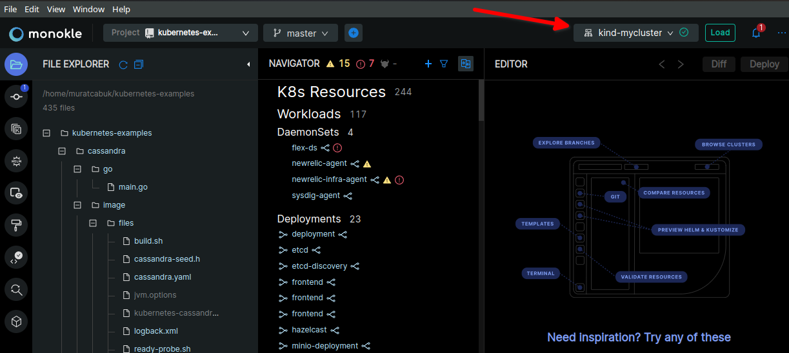


#### Image Management

If we click Images in the menu on the left, we can reach the list of all the images we use in our project.


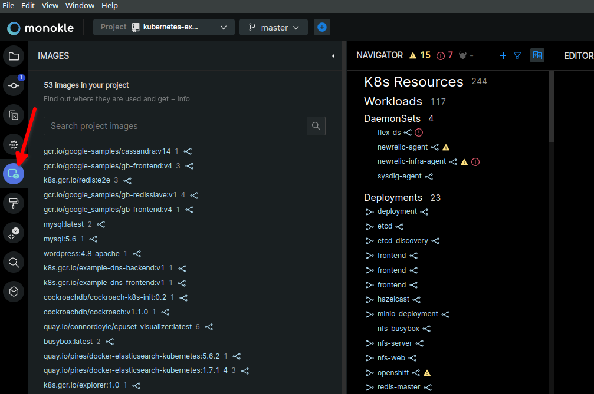


When we hover over the images with the mouse, a replace link will appear. When we click it, we can change the image's tag.

#### Cluster Management

If we click Clusters in the left menu, we need to load one of the clusters we're connected to from the top right. When we select and load the cluster we set up in the lab environment, we can see all our resources. Of course, since we haven't done a deployment yet, only the system resources are visible.

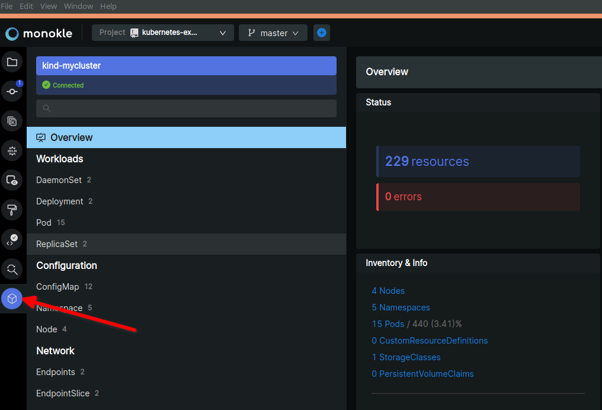


To be able to deploy our application, we click exit in the section at the top right where we loaded the cluster. 

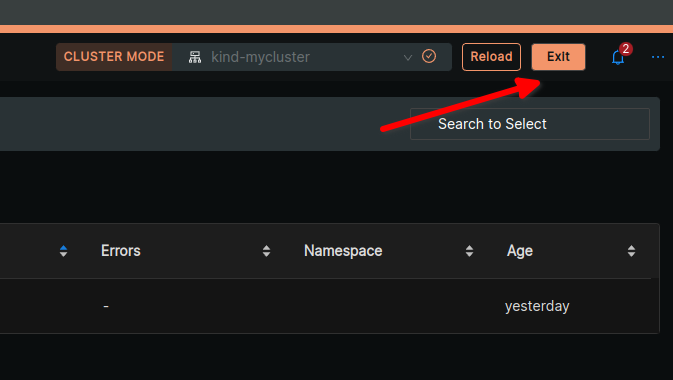

#### Deployment

We click the File Explorer menu again.

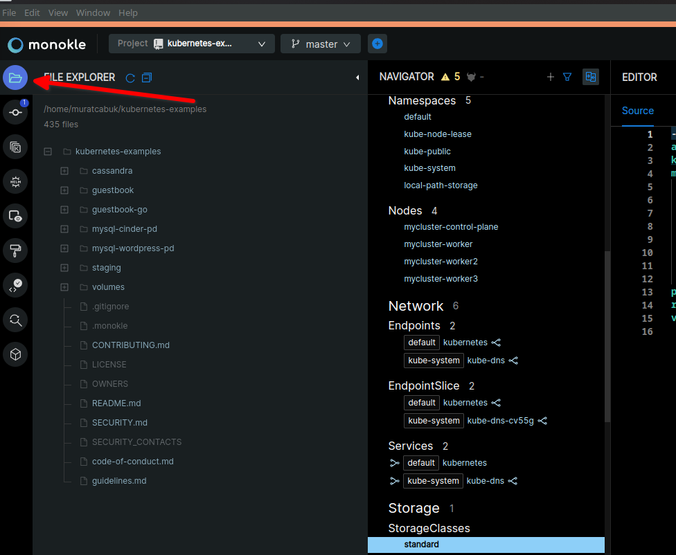


The most suitable one for testing is the application named guestbook. We deploy the files below in order.

- redis-replica-deployment.yaml
- redis-replica-service.yaml
- frontend-deployment.yaml
- frontend-service.yaml

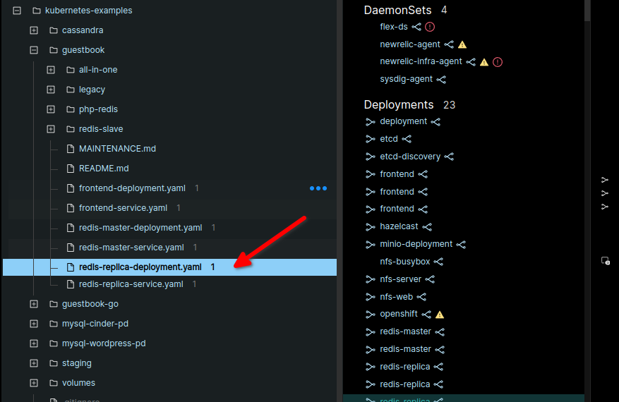

While the file is selected, we click the deploy button at the top right.

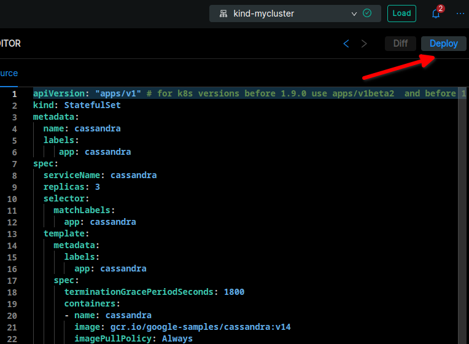

Now we can go back to cluster mode and see whether the guestbook resources have been deployed.

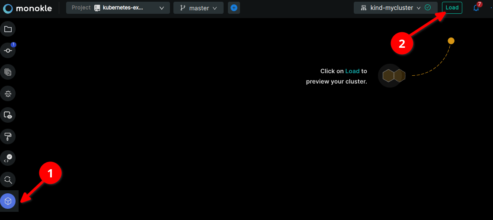

Then we can switch to deployments and see that our redis and php applications have been deployed.

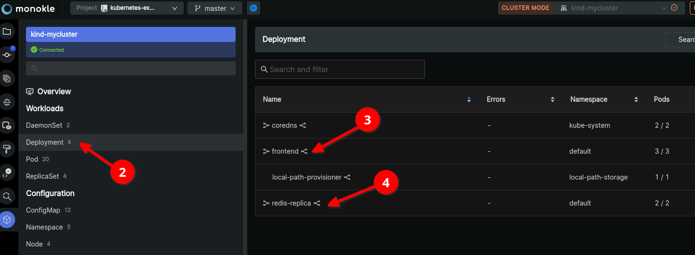

#### Deployment Diff

Let's exit cluster mode, switch back to the file explorer, click the frontend-deployment-yaml file and reduce the replica count to 2 on the right.

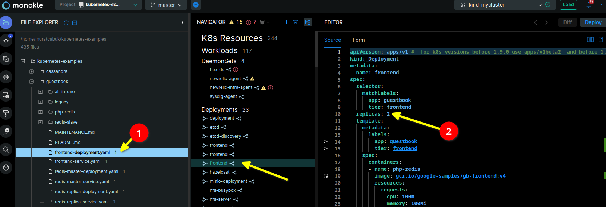

While still in the file explorer, let's load our cluster from the top right. We shouldn't be in cluster mode.

We select our frontend application from the Navigator panel and click the Diff button at the top right. 

When we select the /guestbook/frontend-deployment.yaml file at the top right of the panel that opens, we should see a screen like the one below. 

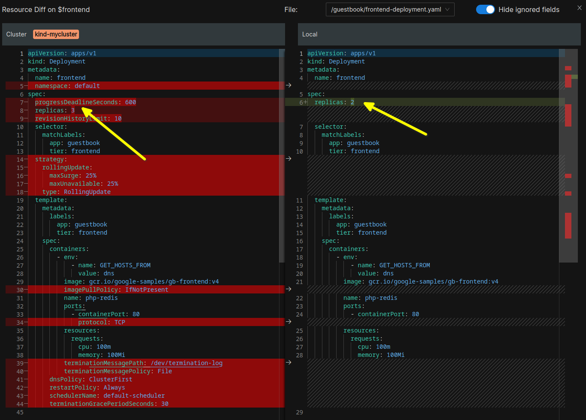

Using the buttons at the very bottom of this screen, we can deploy the new version to the cluster, and we can also change our local copy from the cluster.

Also, while the related resource is selected, we can switch to form mode and observe our resources visually too.  


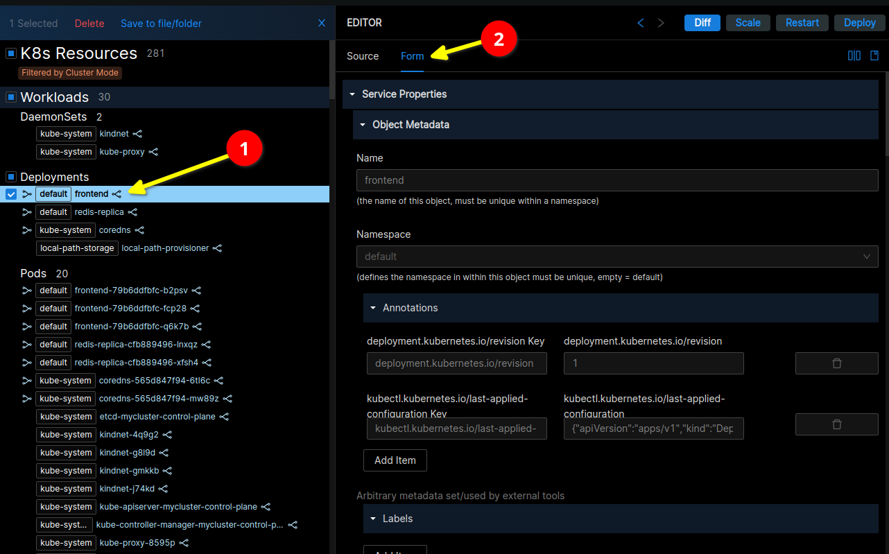

Also, with the 3 dots that appear when we hover over the related resource, we can delete the resource from the cluster.


From the Navigator panel, we can compare all resources with the resources defined in the local manifest/configuration (yaml) files. For example, Nemaspace definitions, pods, network rules, storages, controllers, RBACs, etc.


#### Cluster Comparisons

For this we'll need a second cluster. All we need to do for this is bring up the second cluster using the Kind cluster configuration file we created earlier.

We had created a file named cluser.yaml in a folder. While in this directory, we run the command below on the console.

```bash
kind create cluster --name mycluster2 --config cluster.yaml
```


After our cluster is set up, while still on the file explorer, we again load our kind-mycluster2 cluster from the top right corner. Then we click the "Compare & Sync" button in the Navigator panel.


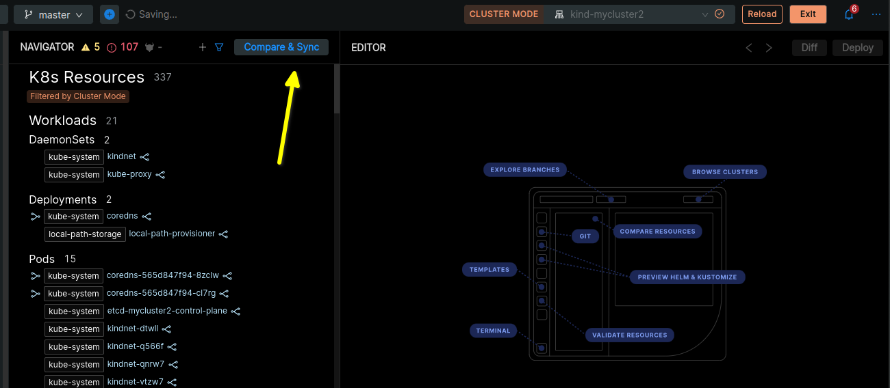

When we select both clusters in the window that opens, we can see the diff button on the resources that are the same. If a resource exists on one side but not on the other, we can deploy the resource from the side that has it to the cluster on the side that doesn't.


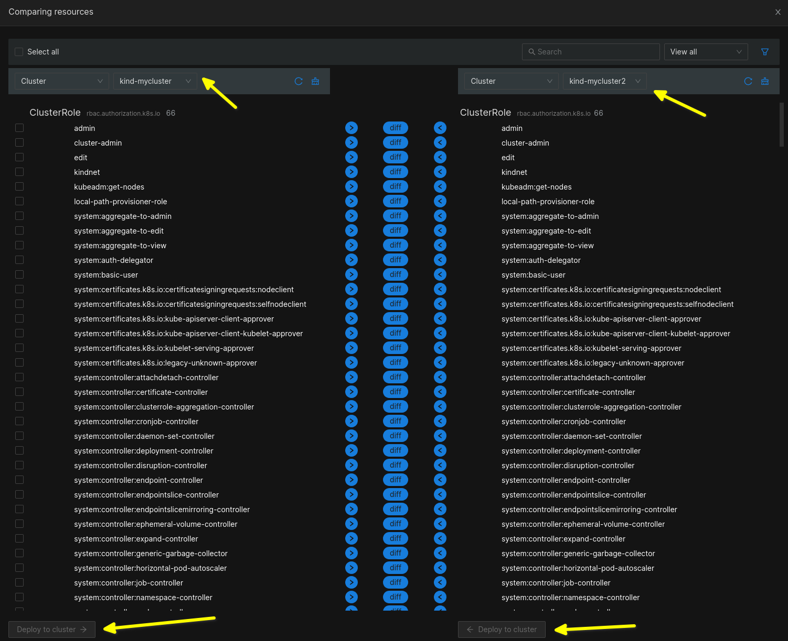

We select the resources to deploy our guestbook application, which we deployed earlier, to the cluster we just created. 


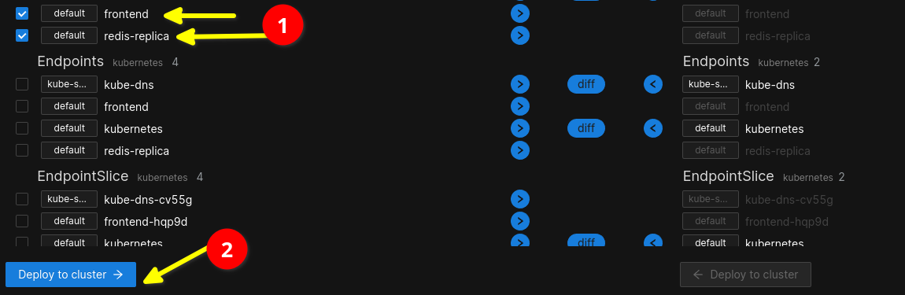

When we select the resources, we can see that the "Deploy to cluster" button below becomes active. We click this button.

After a short while, we can see the applications on the second cluster too.

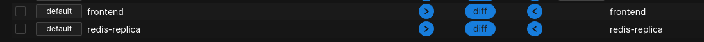

#### Git Management

Apart from these, we can also send the changes we made on the files to Git.

For this, we switch to the Git tab from the menu on the left. We select the files we want to send. We send the changes by first clicking the "Stage selected" button and then the "Sync" button below.

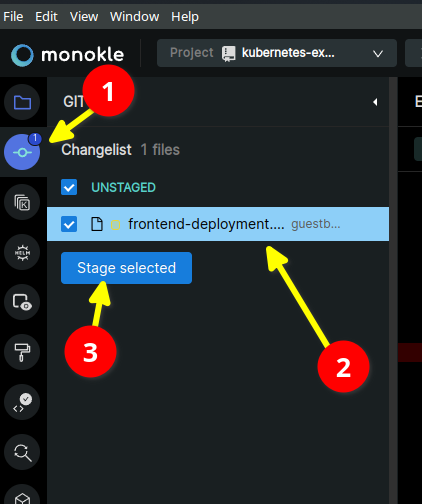


#### Validation with Monokle

Monokle doesn't only do validation in terms of syntax. It also validates best practices and security standards.

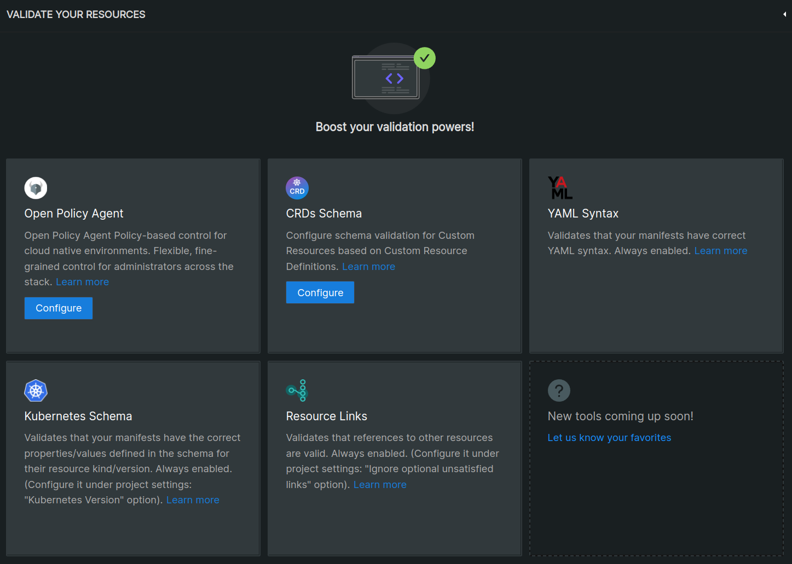

It does validation with 5 different techniques. 

- **Open Policy Agent (OPA)**: This tool is actually a tool approved by the [CNCF](https://www.cncf.io/). It has its own language (Rego) for creating custom policies. It runs the [security rules](https://github.com/aquasecurity/defsec) that the defsec team of [AquaSec](https://www.aquasec.com/) wrote with Rego on OPA.
- [Custom Resource Definition Schemas](https://kubernetes.io/docs/tasks/extend-kubernetes/custom-resources/custom-resource-definitions/): If there are CRDs you use in your system, when you provide their schema links, the configurations can be validated against these schemas.

I won't go into the details of the others since they can be guessed anyway.  That's it for now. Our goal was to give an introduction to Monokle and explore its interface and capabilities a bit. But of course Monokle isn't just this. I recommend you also read the [Kustomize](https://kubeshop.github.io/monokle/kustomize/) and [Helm](https://kubeshop.github.io/monokle/helm/) sections. Especially if you manage more than one cluster and keep your resources on Git, it's a tool that does its job well enough.

Hope you found it useful.

See you in our other articles.

