# Rancher Longhorn Distributed Storage Installation, Backup and Restore Operations  

Hello Friends,

First, let's try to understand what Longhorn is and how it works.

Longhorn is a distributed block storage system developed for Kubernetes by Rancher.


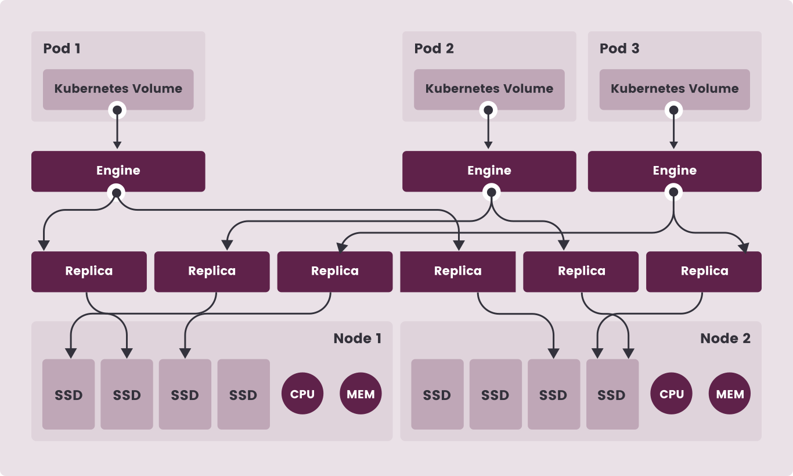
Source: [Longhorn](https://longhorn.io/docs/1.2.3/concepts/)

As you can see in the figure, Longhorn Managers run on all nodes as a [Daemonset](https://kubernetes.io/docs/concepts/workloads/controllers/daemonset/) and communicate with the Kubernetes API. When there's a new volume request, it again creates a Longhorn volume [CRD](https://kubernetes.io/docs/concepts/extend-kubernetes/api-extension/custom-resources/) on the API. CRD is a system Kubenetes offers so that we can extend the Kubernetes API.

To fulfill the volume request, Longhorn Manager creates a Longhorn Engine on the node and attaches the volume to it. Then it creates replicas of the volume on the other nodes. However, we can't run these replicas for writing and reading by applications that will run on more than one node at the same time. In other words, normally with Longhorn we can't create a single volume for more than one pod (a solution came in version 1.1; we'll touch on it later in the article). These copies are kept only for maximum  availability. The pod you'll bring up needs to come up on the same node as the volume. So in this form, Longhorn makes storages accessible as [ReadWriteOnce](https://kubernetes.io/docs/concepts/storage/persistent-volumes/#access-modes). Because Longhorn isn't a distributed file system. For details, you can read [this section](https://longhorn.io/docs/1.2.3/concepts/#horizontal-scaling-for-kubernetes-workloads-with-persistent-storage). So what will we do when we really need to create more than one pod? For this, [Longhorn's recommendation](https://longhorn.io/docs/1.2.3/concepts/#horizontal-scaling-for-kubernetes-workloads-with-persistent-storage) is that we create a [StatefulSet](https://kubernetes.io/docs/concepts/workloads/controllers/statefulset/). Of course, this won't always meet our need.

That's why, with the [Longhorn v1.1.0](https://longhorn.io/blog/longhorn-v1.1.0/)  version, it announced that it supports the ReadWriteMany(RWX) feature. While doing this, it uses the [NFS](https://tr.wikipedia.org/wiki/A%C4%9F_Dosya_Sistemi) we know. In other words, Longhorn doesn't directly offer a solution for ReadWriteMany. Because it isn't a native storage solution itself anyway. It's just an easy-to-use and easy-to-understand solution that lets us use the storage system we have with Kubernetes.  

So in this case, it first shares the space on our disk as NFS and then creates a volume over it. The first question that may come to mind here: if [Kubernetes already supports NFS as shared persistent storage](https://kubernetes.io/docs/concepts/storage/volumes/#nfs), what's the need for Longhorn? We can say that features such as the maximum  availability we mentioned earlier, the backup/restore capability, the support it gives to monitoring tools and the fact that it lets us easily manage these  capabilities through the UI are the most important reasons for using Longhorn. 


In this article,

- We'll set up a Kubernetes cluster with RKE, Rancher's Kubernetes deployment tool
- Then we'll examine the Longhorn component, which is again Rancher's storage solution.


Our main goal 
- to test the Longhorn storage system with applications running on one or more nodes that use it
- to back up Longhorn and restore from the backup


Now we can move on to the installations.


### We're Setting Up the Lab Environment


We'll set up our lab environment with [Vagrant](https://www.vagrantup.com/), using [Virtualbox](https://www.virtualbox.org/) as the provider.


- For the Vagrant installation, visit the [official Vagrant page](https://www.vagrantup.com/downloads).
- For the VirtualBox installation, visit the [official VirtualBox page](https://www.virtualbox.org/wiki/Downloads). 


In the Vagrant setup, the operations needed for network settings, Docker installation and Kubernetes installation are done. But we'll do the operations directly related to Longhorn manually. We'll add the extra disk and install the nfs client ourselves. 


We'll have 3 machines

1. master1 : 10.200.10.41
2. worker1 : 10.200.10.51
3. worker2 : 10.200.10.52

we'll attach a 10 GB disk to the worker nodes. 


ssh needs to be installed on our Host machine. It comes installed on Linux distributions and Mac OS, but we have to install it for Windows. You can get help from the links below.

- [Installation for Windows](https://docs.microsoft.com/en-us/windows-server/administration/openssh/openssh_install_firstuse)
- [Installation for Ubuntu](https://ubuntu.com/server/docs/service-openssh)
- [Installation for Centos](https://linuxhint.com/enable_ssh_centos8/)

If you've completed the Vagrant installation, we create a folder, create a file named Vagrantfile inside it and copy the code below into this file.

```Vagrantfile
# -*- mode: ruby -*-
# vi: set ft=ruby :

MASTER_COUNT = 1
WORKER_COUNT  = 2


MASTER_IP_PREFIX  = "192.168.56.4"
WORKER_IP_PREFIX  = "192.168.56.5"

PROVIDER = "virtualbox"

ENV['VAGRANT_DEFAULT_PROVIDER'] = PROVIDER

$allscript = <<-ALLSCRIPT
  
MASTER_COUNT=$1
WORKER_COUNT=$2
MASTER_IP_PREFIX=$3
WORKER_IP_PREFIX=$4
   
echo $MASTER_COUNT
echo $WORKER_COUNT
echo $MASTER_IP_PREFIX
echo $WORKER_IP_PREFIX

echo "===================== root user is being activated ====================="
   
sudo su
   
echo -e "rkeadmin\nrkeadmin" | passwd root
echo "export TERM=xterm" | tee -a /etc/bash.bashrc
   
echo "===================== swap is being disabled =========================="
   
sed -i "/swap/d" /etc/fstab
swapoff -a
systemctl disable --now ufw
   
echo "=================== sysctl is being updated for the kubernetes network =============="
   
modprobe overlay
modprobe br_netfilter
   
cat <<EOF | sudo tee -a /etc/sysctl.d/kubernetes.conf
net.bridge.bridge-nf-call-ip6tables = 1
net.bridge.bridge-nf-call-iptables  = 1
net.ipv4.ip_forward                 = 1
EOF
sysctl --system
   
echo "============= ssh settings are being made ============="
   
sed -i "s/#PasswordAuthentication yes/PasswordAuthentication yes/" /etc/ssh/sshd_config
echo "PermitRootLogin yes" | sudo tee -a /etc/ssh/sshd_config
   
systemctl reload sshd
   
echo "===================== host files are being edited ==================="
for i in $(seq 1 $MASTER_COUNT); do
   echo "$MASTER_IP_PREFIX_VAR$i master$i" >>/etc/hosts
done
   
for i in $(seq 1 $WORKER_COUNT); do
   echo "$WORKER_IP_PREFIX$i worker$i" >>/etc/hosts
done
   

echo "===========docker is being installed ================"
   
curl -fsSL https://download.docker.com/linux/ubuntu/gpg | sudo gpg --dearmor -o /usr/share/keyrings/docker-archive-keyring.gpg
   
echo \
   "deb [arch=amd64 signed-by=/usr/share/keyrings/docker-archive-keyring.gpg] https://download.docker.com/linux/ubuntu \
   $(lsb_release -cs) stable" | sudo tee /etc/apt/sources.list.d/docker.list >/dev/null
   
apt update
   
apt-get install -y docker-ce docker-ce-cli containerd.io
   
groupadd docker
   
gpasswd -a $USER docker
   
usermod -aG docker $USER
   
chmod 666 /var/run/docker.sock
   
systemctl enable docker
   
systemctl restart docker

ALLSCRIPT


Vagrant.configure("2") do |config|

# master
(1..MASTER_COUNT).each do |i|

config.vm.define "master#{i}" do |master|
   master.vm.box = "generic/ubuntu2004"
   master.vm.network "private_network", ip: MASTER_IP_PREFIX+"#{i}"
   master.vm.hostname = "master#{i}"

   master.vm.provider :PROVIDER do |lv|
       lv.memory=2048
       lv.cpus=2
    end
 end
end


# worker
(1..WORKER_COUNT).each do |i|

config.vm.define "worker#{i}" do |worker|
   worker.vm.box = "generic/ubuntu2004"
   worker.vm.network "private_network", ip: WORKER_IP_PREFIX+"#{i}"
   worker.vm.hostname = "worker#{i}"
   

   worker.vm.provider :PROVIDER do |lv|
       lv.memory=2048
       lv.cpus=2
       lv.storage :file, :size => '10G'

   end
 end
end

# globally defined shell provision. It will run on all vms 
config.vm.provision :shell, run: "once" do |s|
   s.args = [MASTER_COUNT,WORKER_COUNT, MASTER_IP_PREFIX,WORKER_IP_PREFIX] 
   s.inline = $allscript
end

end

```

While in the directory where the folder is, we bring up our machines with the command below in the terminal.

```bash
vagrant up
```

Downloading the first machine may take a bit long. When they all start running, we copy the ssh key we'll create on our host machine to all the Machines; our goal is to be able to log in without a password.

- Linux and Mac users can do the copying with the command below.

```bash
MASTER_COUNT=1
WORKER_COUNT=2
MASTER_IP_PREFIX="192.168.56.4"
WORKER_IP_PREFIX="192.168.56.5"


ssh-keygen -t rsa -N "" -f ~/.ssh/rkekey

for i in $(seq 1 $MASTER_COUNT); do
    ssh-copy-id -i ~/.ssh/rkekey.pub -o StrictHostKeyChecking=no root@$MASTER_IP_PREFIX$i
    echo key copied: $MASTER_IP_PREFIX$i
done


for i in $(seq 1 $WORKER_COUNT); do
    ssh-copy-id -i ~/.ssh/rkekey.pub -o StrictHostKeyChecking=no root@$WORKER_IP_PREFIX$i
    echo key copied: $WORKER_IP_PREFIX$i
done

```

- For Windows, run the command below via cmd. Don't forget to change the username.

```powershell
# when you run the command, enter rkekey as the key name and leave the password empty
ssh-keygen

# don't forget to change the username part
type C:\Users\kullanici_adiniz\.ssh\id_rsa.pub | ssh root@192.168.56.41 'cat >> .ssh/authorized_keys'
type C:\Users\kullanici_adiniz\.ssh\id_rsa.pub | ssh root@192.168.56.51 'cat >> .ssh/authorized_keys'
type C:\Users\kullanici_adiniz\.ssh\id_rsa.pub | ssh root@192.168.56.52 'cat >> .ssh/authorized_keys'
```

We've brought up our environment with Vagrant; now we can deploy our Kubernetes cluster with RKE.


### Kubernetes Cluster Installation with RKE


We download the rke binary into the folder we created for the vagrantfile on our host machine. For this, you can download the binary suitable for your operating system from the [release page](https://github.com/rancher/rke/releases/tag/v1.3.6). 

- **WARNING** Linux and Mac users, don't forget to make the binary you downloaded executable 

For example configuration files, you can look at [this page](https://rancher.com/docs/rke/latest/en/example-yamls/).  


We create our cluster.yaml file with the command below.


```bash
# the command below will create our example cluster.yaml file by asking us questions.
rke config --name cluster.yml
```
When we run the command, the system will ask us some questions.


The questions and the answers we need to give are as follows

```
[+] Cluster Level SSH Private Key Path [~/.ssh/id_rsa]: ~/.ssh/rkekey
[+] Number of Hosts [1]: 3
[+] SSH Address of host (1) [none]: 192.168.56.41
[+] SSH Port of host (1) [22]: 
[+] SSH Private Key Path of host (192.168.56.41) [none]: 
[-] You have entered empty SSH key path, trying fetch from SSH key parameter
[+] SSH Private Key of host (192.168.56.41) [none]: 
[-] You have entered empty SSH key, defaulting to cluster level SSH key: ~/.ssh/rkekey
[+] SSH User of host (192.168.56.41) [ubuntu]: root
[+] Is host (192.168.56.41) a Control Plane host (y/n)? [y]: 
[+] Is host (192.168.56.41) a Worker host (y/n)? [n]: n
[+] Is host (192.168.56.41) an etcd host (y/n)? [n]: y
[+] Override Hostname of host (192.168.56.41) [none]: master1
[+] Internal IP of host (192.168.56.41) [none]: 192.168.56.41
[+] Docker socket path on host (192.168.56.41) [/var/run/docker.sock]: 
[+] SSH Address of host (2) [none]: 192.168.56.51
[+] SSH Port of host (2) [22]: 
[+] SSH Private Key Path of host (192.168.56.51) [none]: 
[-] You have entered empty SSH key path, trying fetch from SSH key parameter
[+] SSH Private Key of host (192.168.56.51) [none]: 
[-] You have entered empty SSH key, defaulting to cluster level SSH key: ~/.ssh/rkekey
[+] SSH User of host (192.168.56.51) [ubuntu]: root
[+] Is host (192.168.56.51) a Control Plane host (y/n)? [y]: n
[+] Is host (192.168.56.51) a Worker host (y/n)? [n]: y
[+] Is host (192.168.56.51) an etcd host (y/n)? [n]: n
[+] Override Hostname of host (192.168.56.51) [none]: worker1
[+] Internal IP of host (192.168.56.51) [none]: 192.168.56.51
[+] Docker socket path on host (192.168.56.51) [/var/run/docker.sock]: 
[+] SSH Address of host (3) [none]: 192.168.56.52
[+] SSH Port of host (3) [22]: 
[+] SSH Private Key Path of host (192.168.56.52) [none]: 
[-] You have entered empty SSH key path, trying fetch from SSH key parameter
[+] SSH Private Key of host (192.168.56.52) [none]: 
[-] You have entered empty SSH key, defaulting to cluster level SSH key: ~/.ssh/rkekey
[+] SSH User of host (192.168.56.52) [ubuntu]: root
[+] Is host (192.168.56.52) a Control Plane host (y/n)? [y]: n
[+] Is host (192.168.56.52) a Worker host (y/n)? [n]: y
[+] Is host (192.168.56.52) an etcd host (y/n)? [n]: n
[+] Override Hostname of host (192.168.56.52) [none]: worker2
[+] Internal IP of host (192.168.56.52) [none]: 192.168.56.52
[+] Docker socket path on host (192.168.56.52) [/var/run/docker.sock]: 
[+] Network Plugin Type (flannel, calico, weave, canal, aci) [canal]: calico
[+] Authentication Strategy [x509]: 
[+] Authorization Mode (rbac, none) [rbac]: 
[+] Kubernetes Docker image [rancher/hyperkube:v1.21.8-rancher2]: 
[+] Cluster domain [cluster.local]: 
[+] Service Cluster IP Range [10.43.0.0/16]: 
[+] Enable PodSecurityPolicy [n]: 
[+] Cluster Network CIDR [10.42.0.0/16]: 
[+] Cluster DNS Service IP [10.43.0.10]: 
[+] Add addon manifest URLs or YAML files [no]: 
```

In the end, a cluster.yaml file and an admin config (kube_config_cluster.yml) file were created.

Now we can bring up our cluster.

```bash

rke up

```

Now we're ready to install Longhorn. But to be able to also test Longhorn's ability to work with more than one disk, we need to attach disks to our worker machines.


### We're Adding an Extra Disk

First, we shut down our machines. Because since we brought up our machines with Vagrant and they're still running, VirtualBox won't let us add a disk.

While in the Vagrant folder, we run the command below.

```bash
vagrant halt
```

We get the vm list on VirtualBox.

``` bash
 
VBoxManage list vms

# result

"vagrant-installation_master1_1643664669743_678" {e35e9c91-8c52-4c32-b840-a17caaafb82e}
"vagrant-installation_worker1_1643664750271_11503" {db5e7aeb-4cb6-4145-95b2-06fc13ff873a}
"vagrant-installation_worker2_1643664827019_17988" {d7d363f2-62e4-4021-81da-622a5748688a}
```

We'll attach disks to the worker nodes. For this, we create 2 disks.


```bash
VBoxManage createmedium disk --filename "./disk1.vdi" --size 10000 --format VDI --variant Fixed
VBoxManage createmedium disk --filename "./disk2.vdi" --size 10000 --format VDI --variant Fixed
```

Then we add a sata controller and attach our disks.

```bash
# add a sata controller
vboxmanage storagectl vagrant-installation_worker1_1643664750271_11503 --name "SATA Controller" --add sata --controller IntelAHCI --portcount 1 --bootable on
# attach the disk to the sata controller
VBoxManage storageattach vagrant-installation_worker1_1643664750271_11503 --storagectl "SATA Controller" --device 0 --port 0 --type hdd --medium "./disk1.vdi"

# add a sata controller
vboxmanage storagectl vagrant-installation_worker2_1643664827019_17988 --name "SATA Controller" --add sata --controller IntelAHCI --portcount 1 --bootable on
# attach the disk to the sata controller
VBoxManage storageattach vagrant-installation_worker2_1643664827019_17988 --storagectl "SATA Controller" --device 0 --port 0 --type hdd --medium "./disk2.vdi"
```

We can start our machines again.

```bash
vagrant up
```

After the machines boot up, we'll mount the disks we attached. Before mounting, we need to format them.


for worker1, after connecting to the machine with ssh, we run the commands below

```bash

ssh root@192.168.56.51 -i ~/.ssh/rkekey

mkdir /mnt/data

mkfs -t ext4 /dev/sdb


# we find out the UUID of our disk
blkid /dev/sdb

# /dev/sdb: UUID="e4daf767-18eb-4b94-a569-594a484b00ad" TYPE="ext4"

```
we'll edit the fstab file for a permanent mount.


```bash
vim /etc/fstab

# we add the line below. But when adding it, add it above the line starting with VAGRANT-BEGIN

UUID=e4daf767-18eb-4b94-a569-594a484b00ad  /mnt/data ext4  defaults  0  0

# it won't work if there's an error
mount -a

df -h

```

we run the same commands for worker2 too.

then we restart the machines.

```bash
vagrant reload
```
### We're Installing Longhorn

While I was preparing this article, the latest released version was 1.2.3. There are different installation methods, but today we'll do the installation with kubectl. You can access the installation document on its [official  page](https://longhorn.io/docs/1.2.3/deploy/install/install-with-kubectl/).


You can do the installation with the command below. It may take 2-3 minutes to complete.

```bash
kubectl --kubeconfig kube_config_cluster.yml  apply -f https://raw.githubusercontent.com/longhorn/longhorn/v1.2.3/deploy/longhorn.yaml
```

We can use the command below to check it.


```bash
kubectl --kubeconfig kube_config_cluster.yml get pods --namespace longhorn-system


# when it's fully installed, we should see a result like the one below

NAME                                        READY   STATUS    RESTARTS   AGE
csi-attacher-5f46994f7-6fmmh                1/1     Running   0          7m7s
csi-attacher-5f46994f7-k9d65                1/1     Running   0          7m7s
csi-attacher-5f46994f7-ph97c                1/1     Running   0          7m7s
csi-provisioner-6ccbfbf86f-l9fp4            1/1     Running   0          7m7s
csi-provisioner-6ccbfbf86f-n4ksb            1/1     Running   0          7m7s
csi-provisioner-6ccbfbf86f-q6ftj            1/1     Running   0          7m7s
csi-resizer-6dd8bd4c97-d855d                1/1     Running   0          7m6s
csi-resizer-6dd8bd4c97-nlnv4                1/1     Running   0          7m6s
csi-resizer-6dd8bd4c97-tnlz8                1/1     Running   0          7m6s
csi-snapshotter-86f65d8bc-6t9gx             1/1     Running   0          7m6s
csi-snapshotter-86f65d8bc-p7tmz             1/1     Running   0          7m6s
csi-snapshotter-86f65d8bc-wmc54             1/1     Running   0          7m6s
engine-image-ei-fa2dfbf0-65fnn              1/1     Running   0          7m19s
engine-image-ei-fa2dfbf0-j7vqx              1/1     Running   0          7m19s
instance-manager-e-03f0a7a7                 1/1     Running   0          7m16s
instance-manager-e-7b546830                 1/1     Running   0          7m19s
instance-manager-r-1a43ec1c                 1/1     Running   0          7m19s
instance-manager-r-a5fc21fa                 1/1     Running   0          7m16s
longhorn-csi-plugin-5wpzr                   2/2     Running   0          7m6s
longhorn-csi-plugin-ls29s                   2/2     Running   0          7m6s
longhorn-driver-deployer-784546d78d-dzwnj   1/1     Running   0          8m1s
longhorn-manager-gg2vw                      1/1     Running   0          8m1s
longhorn-manager-v96xd                      1/1     Running   1          8m1s
longhorn-ui-9fdb94f9-hssvk                  1/1     Running   0          8m1s

```


Let's also examine what has been installed apart from the pods

```bash

kubectl --kubeconfig kube_config_cluster.yml get all --namespace longhorn-system


NAME                               TYPE        CLUSTER-IP      EXTERNAL-IP   PORT(S)     AGE
service/csi-attacher               ClusterIP   10.43.76.160    <none>        12345/TCP   9m52s
service/csi-provisioner            ClusterIP   10.43.34.194    <none>        12345/TCP   9m52s
service/csi-resizer                ClusterIP   10.43.43.125    <none>        12345/TCP   9m51s
service/csi-snapshotter            ClusterIP   10.43.215.4     <none>        12345/TCP   9m51s
service/longhorn-backend           ClusterIP   10.43.36.237    <none>        9500/TCP    10m
service/longhorn-engine-manager    ClusterIP   None            <none>        <none>      10m
service/longhorn-frontend          ClusterIP   10.43.178.210   <none>        80/TCP      10m
service/longhorn-replica-manager   ClusterIP   None            <none>        <none>      10m

NAME                                      DESIRED   CURRENT   READY   UP-TO-DATE   AVAILABLE   
daemonset.apps/engine-image-ei-fa2dfbf0   2         2         2       2            2  
daemonset.apps/longhorn-csi-plugin        2         2         2       2            2  
daemonset.apps/longhorn-manager           2         2         2       2            2  

NAME                                       READY   UP-TO-DATE   AVAILABLE   AGE
deployment.apps/csi-attacher               3/3     3            3           9m52s
deployment.apps/csi-provisioner            3/3     3            3           9m52s
deployment.apps/csi-resizer                3/3     3            3           9m51s
deployment.apps/csi-snapshotter            3/3     3            3           9m51s
deployment.apps/longhorn-driver-deployer   1/1     1            1           10m
deployment.apps/longhorn-ui                1/1     1            1           10m

NAME                                                  DESIRED   CURRENT   READY   AGE
replicaset.apps/csi-attacher-5f46994f7                3         3         3       9m52s
replicaset.apps/csi-provisioner-6ccbfbf86f            3         3         3       9m52s
replicaset.apps/csi-resizer-6dd8bd4c97                3         3         3       9m51s
replicaset.apps/csi-snapshotter-86f65d8bc             3         3         3       9m51s
replicaset.apps/longhorn-driver-deployer-784546d78d   1         1         1       10m
replicaset.apps/longhorn-ui-9fdb94f9                  1         1         1       10m

```

If you notice, among the services there's a service named "service/longhorn-frontend". Let's examine this service from locahost by doing a portforward.

```
kubectl --kubeconfig kube_config_cluster.yml --namespace longhorn-system port-forward service/longhorn-frontend 8080:80
```


When we go to the http://localhost:8080 address on our host machine, we can see the longhorn interface. Now let's edit the service and turn it into a nortPort.


```bash
kubectl --kubeconfig kube_config_cluster.yml --namespace longhorn-system patch svc longhorn-frontend --type='json' -p '[{"op":"replace","path":"/spec/type","value":"NodePort"},{"op":"replace","path":"/spec/ports/0/nodePort","value":31999}]'

```
We need to connect through any of the worker nodes. For example, when we open the http://192.168.56.51:31999 address in the browser, we can see the dashboard.

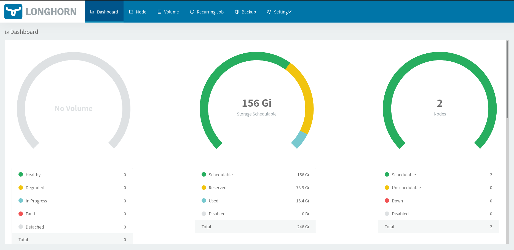

### We're Adding a Disk to Longhorn

On the Dashboard, we click the Node tab at the top and click the hamburger menu (Edit Node and Disks) located to the right of each node, as also seen in the image below. Then we click the "add disk" button on the popup that opens.

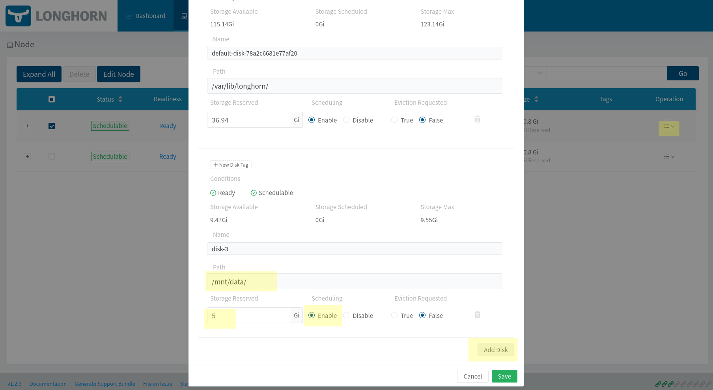

We write the mount address of the disk we permanently added on the machines and how much of the disk will be used. In our example, we allocated it as 5 Gb. Longhorn also adds this 2 GB space we added to the pool. It lets us use as much of the total space as the volume we want. In other words, there's no such thing as selecting a disk while creating a volume.

Again, if we want, we can also add a volume through the dashboard. For this, we click the volumes tab in the menu at the top. On the page that opens, we click the "Create Volume" button at the top right.


**WARNING**: since our number of worker nodes is 2, don't forget to enter 2 as the replica count too. If they're incompatible, you may get an error later. So it makes sense to set the default replica count to 2 by clicking the settings tab in the menu at the top.

Notice that we set it as ReadWriteOnce. In other words, the volume we create here will be able to be attached to a single node. We'll be doing the ReadWriteMany example later.


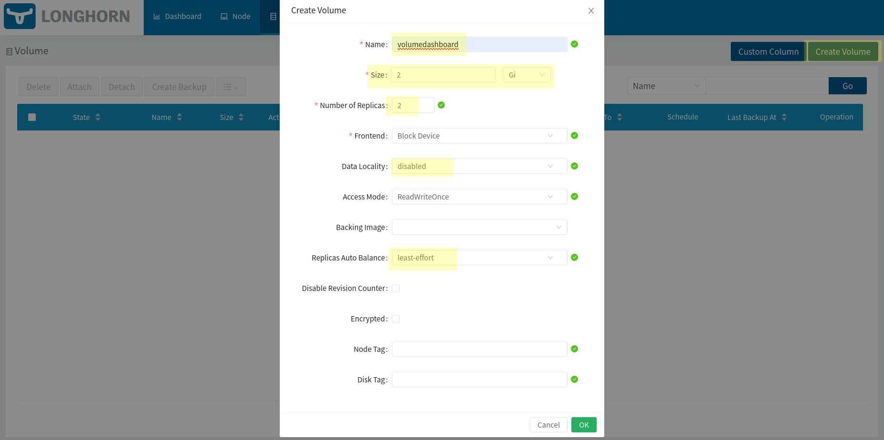

- [Data Locality](https://longhorn.io/docs/1.2.3/references/settings/#default-data-locality) : It's used to make sure the replicas are kept on the node where the pod is, as much as possible.
- [Auto-balance-replicas](https://longhorn.io/docs/1.2.3/references/settings/#replica-auto-balance):  When a new node is added, it rearranges the replicas and sets whether they'll also be distributed to the new nodes.


After the creation process is finished, if we go to the volume details, we'll see a screen like the one below.

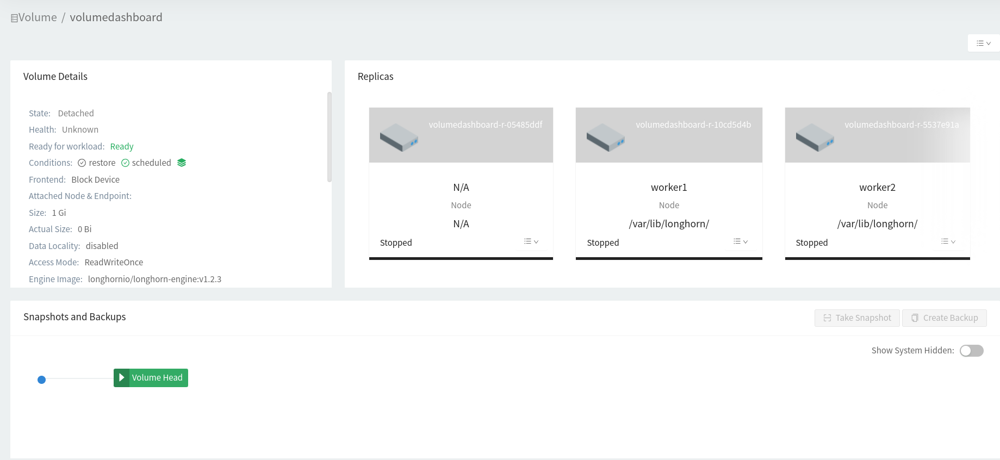

After attaching the volume to a pod and using it, we'll come back and look at this screen again. Now let's create a [PersistentVolumeClaim](https://kubernetes.io/docs/concepts/storage/persistent-volumes/#persistentvolumeclaims).

Let's also do the PVC first through the dashboard; for this, we click the "create pvc" link from the hamburger menu right to the right of the volume we created. We can say default for the Namespace part and save. As below, the pv/pvc column will now appear as Bound.


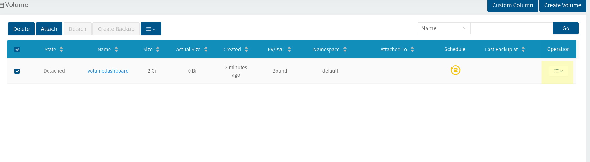


If we look at the volume details, we can see that the pvc name has now been assigned.

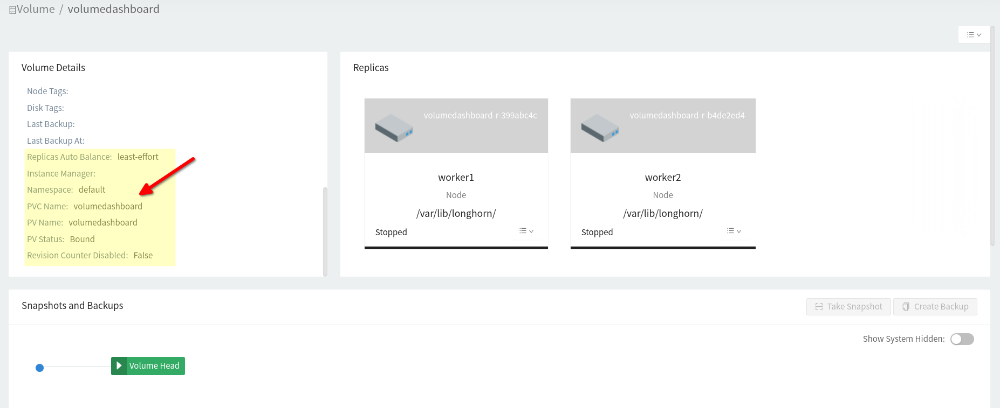


Now let's bring up an application that will use this volume we added.


```bash
cat <<EOF | kubectl --kubeconfig kube_config_cluster.yml apply -f -
apiVersion: v1
kind: Pod
metadata:
  name: mypod
spec:
  containers:
    - name: myfrontend
      image: nginx
      volumeMounts:
      - mountPath: "/var/www/html"
        name: mypd
  volumes:
    - name: mypd
      persistentVolumeClaim:
        claimName: volumedashboard
EOF
```

If we examine the pod's properties, we can see that the volumedashboard pvc is being used.


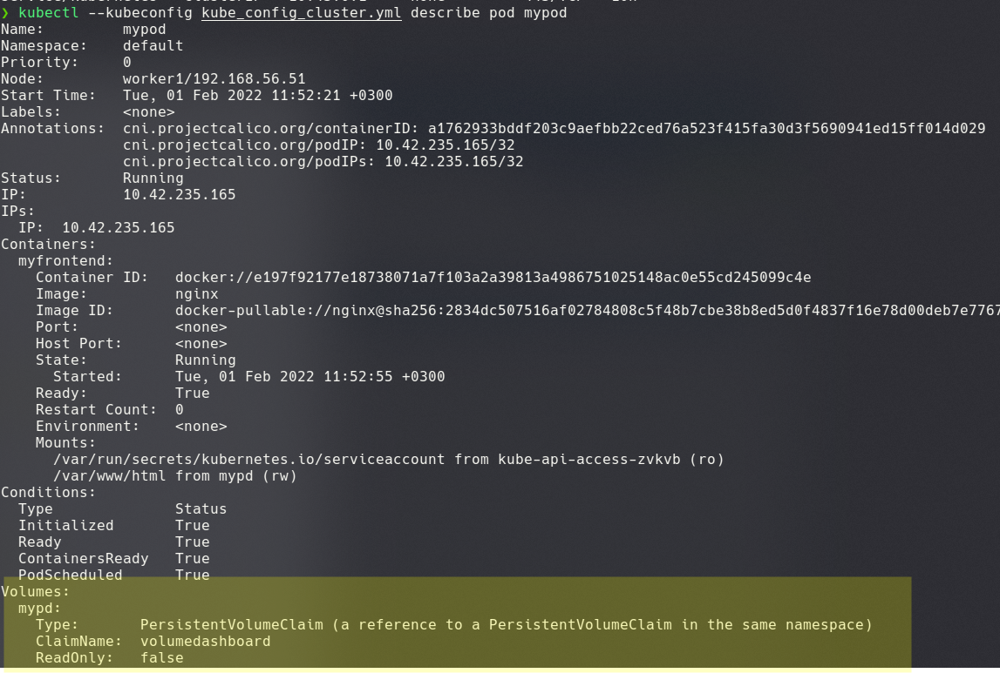


Also, if we look from the dashboard, we can see that it's healthily attached to the pod named mypod.

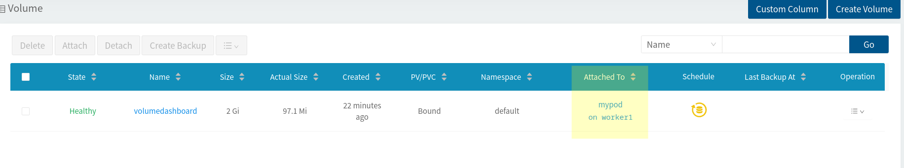


Let's add a second pod too.


```bash
cat <<EOF | kubectl --kubeconfig kube_config_cluster.yml apply -f -
apiVersion: v1
kind: Pod
metadata:
  name: mypod2
spec:
  containers:
    - name: myfrontend2
      image: nginx
      volumeMounts:
      - mountPath: "/var/www/html"
        name: mypd2
  volumes:
    - name: mypd2
      persistentVolumeClaim:
        claimName: volumedashboard
EOF
```

Let's examine the pvc details. We can see that it's being used by 2 pods.


```bash

kubectl --kubeconfig kube_config_cluster.yml describe pvc volumedashboard

# result

Name:          volumedashboard
Namespace:     default
StorageClass:  longhorn-static
Status:        Bound
Volume:        volumedashboard
Labels:        <none>
Annotations:   pv.kubernetes.io/bind-completed: yes
Finalizers:    [kubernetes.io/pvc-protection]
Capacity:      2Gi
Access Modes:  RWO
VolumeMode:    Filesystem
Used By:       mypod
               mypod2
Events:        <none>
```


### Backup / Restore Operations

First, let's go to the /var/www/html directory of one of the pods and create a file

```bash

kubectl --kubeconfig kube_config_cluster.yml exec -it mypod -- bash

# after logging in to the pod, we create a file with the commands below.

echo test > /var/www/html/test.txt

exit

```

then we take a backup by clicking the "take snaphot" button located in the volume  details.

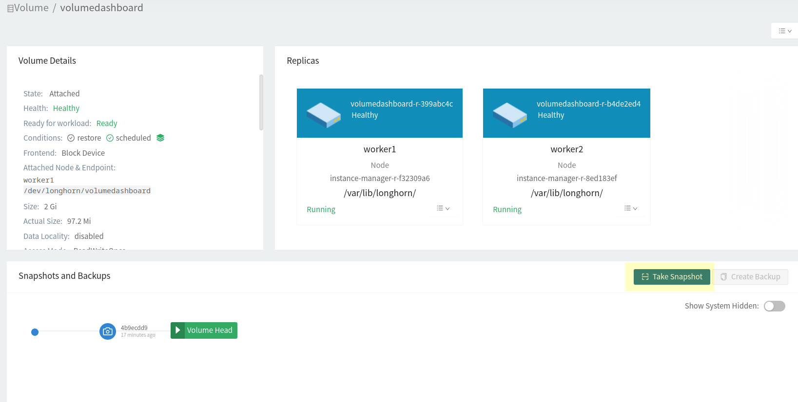

since I had taken a backup before, a second one was created for me.


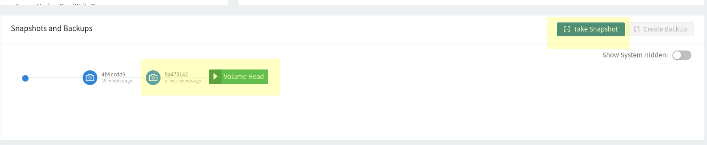


now let's delete the file we created.

```bash

kubectl --kubeconfig kube_config_cluster.yml exec -it mypod -- bash

# after logging in to the pod, we create a file with the commands below.

rm -rf /var/www/html/test.txt

ls /var/www/html/
# as a result, the file has been deleted

exit

```

to be able to test it, we first need to delete the pod. When we restore anyway, we won't be using the previous pod. Of course, in this case, since we have 2 pods, we need to delete both of them.

```bash

kubectl --kubeconfig kube_config_cluster.yml delete pod mypod --force
kubectl --kubeconfig kube_config_cluster.yml delete pod mypod2 --force

kubectl --kubeconfig kube_config_cluster.yml get all

# both pods should have been deleted

```
Now the volume has gone back to the detached state.

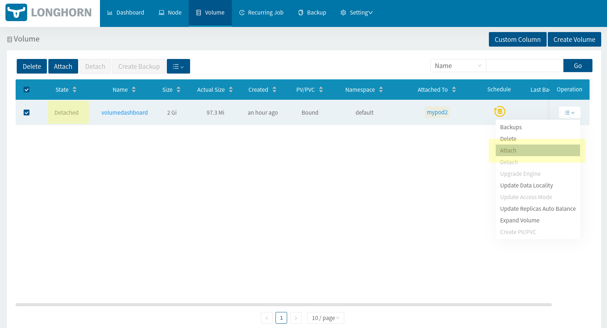


Let's click the Attach button and try to create the volume, which was created earlier on worker2, this time on the worker2 node. We select maintenance mode and click the OK button.

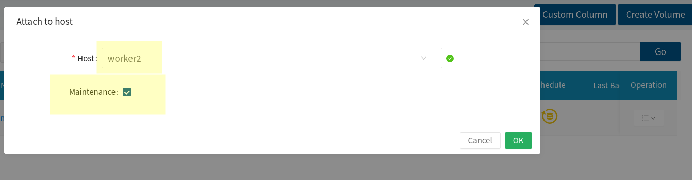


When it's attached, when we click the snapshot we created in the volume properties, we can see that the Revert button has become active. We can click it now.

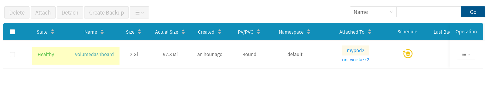

Then, to be able to attach the volume to our new pods, we need to detach it again.

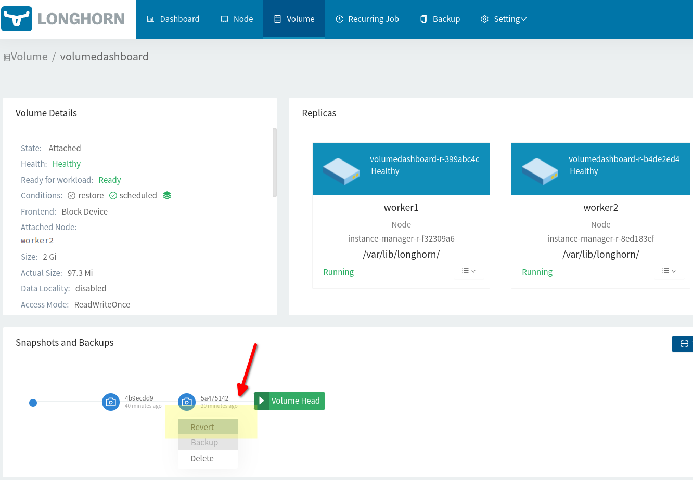


Now we can bring up our first pod again.


```bash
cat <<EOF | kubectl --kubeconfig kube_config_cluster.yml apply -f -
apiVersion: v1
kind: Pod
metadata:
  name: mypod
spec:
  containers:
    - name: myfrontend
      image: nginx
      volumeMounts:
      - mountPath: "/var/www/html"
        name: mypd
  volumes:
    - name: mypd
      persistentVolumeClaim:
        claimName: volumedashboard
EOF
```

Let's test whether our file has come back.

```bash
kubectl --kubeconfig kube_config_cluster.yml exec -it mypod -- bash

# after logging in to the pod, we get the file list.

ls /var/www/html/

# as a result, we can see that the test.txt file has come back.
```


To take regular snapshots/backups, you can define a scheduled job from the volume properties.


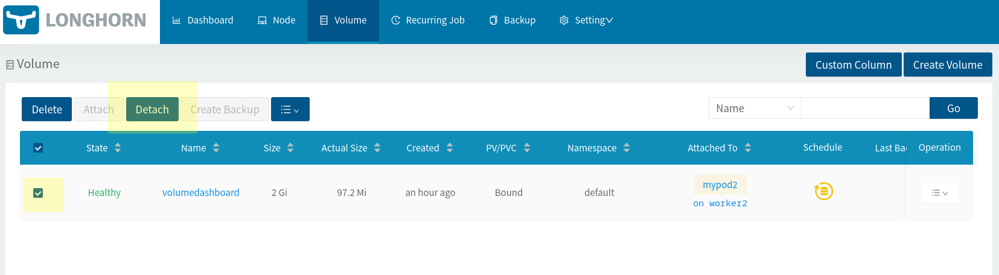

#### Creating a ReadWriteMany Volume

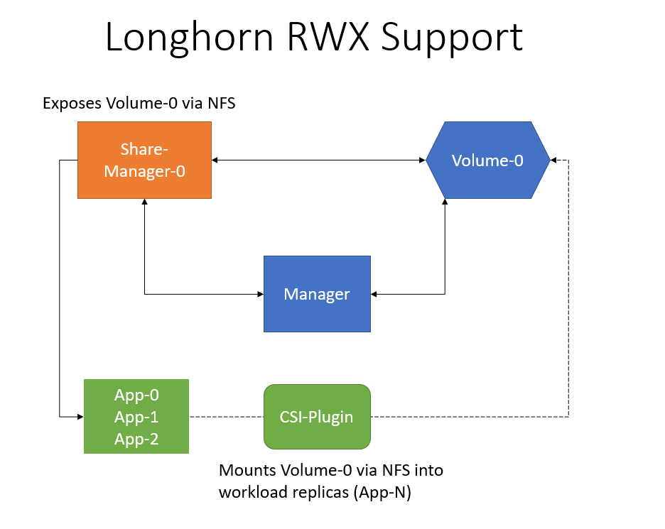


Now let's do the same operations with kubectl. But in this example, let's use the access mode as **[ReadWriteMany](https://longhorn.io/docs/1.2.3/advanced-resources/rwx-workloads/)**.

For **[ReadWriteMany](https://longhorn.io/docs/1.2.3/advanced-resources/rwx-workloads/)**, we need to install the nfs client on our worker nodes. For this, we connect to our worker nodes with ssh and install the nfs-common package.

```bash

# for worker1
ssh root@192.168.56.51 -i ~/.ssh/rkekey
# after connecting, we install it with the command below
apt install nfs-common


#for worker2
ssh root@192.168.56.52 -i ~/.ssh/rkekey
apt install nfs-common


```

First, we need to create a storage class. We won't create it in this example, because there's already one and it's the default one anyway. It was created when we first installed Longhorn. But if you want to create another one, you can follow the [official documentation](https://longhorn.io/docs/1.2.3/volumes-and-nodes/create-volumes/#creating-longhorn-volumes-with-kubectl).

```bash

kubectl --kubeconfig kube_config_cluster.yml get sc

NAME       PROVISIONER          RECLAIMPOLICY   VOLUMEBINDINGMODE   ALLOWVOLUMEEXPANSION   AGE
longhorn   driver.longhorn.io   Delete          Immediate           true                   13h

```

We create a [PVC](https://kubernetes.io/docs/concepts/storage/persistent-volumes/#persistentvolumeclaims) over this storage class. However

```bash

cat <<EOF | kubectl --kubeconfig kube_config_cluster.yml apply -f -
apiVersion: v1
kind: PersistentVolumeClaim
metadata:
  name: myclaimmany
spec:
  accessModes:
    - ReadWriteMany
  resources:
    requests:
      storage: 1Gi
  storageClassName: longhorn
EOF

```


let's check it. Pay attention to the Access Mode column. the one we created last (myclaimmany) RWX

```bash
kubectl --kubeconfig kube_config_cluster.yml get pvc -o wide

NAME              STATUS   VOLUME                                     CAPACITY   ACCESS MODES   STORAGECLASS      AGE     VOLUMEMODE
myclaimmany       Bound    pvc-f5731e65-4005-4ee6-96b6-c346ad309d80   1Gi        RWX            longhorn          64s     Filesystem
volumedashboard   Bound    volumedashboard                            2Gi        RWO            longhorn-static   5h55m   Filesystem


kubectl --kubeconfig kube_config_cluster.yml get volume -A

NAMESPACE         NAME                                       STATE      ROBUSTNESS   SCHEDULED   SIZE         NODE      AGE
longhorn-system   pvc-f5731e65-4005-4ee6-96b6-c346ad309d80   attached   degraded     False       1073741824   worker2   118s
longhorn-system   volumedashboard                            attached   healthy      True        2147483648   worker1   5h57m


```
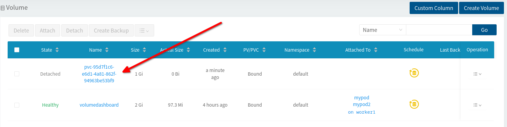


Now let's create a deployment


```bash

cat <<EOF | kubectl --kubeconfig kube_config_cluster.yml apply -f -
apiVersion: apps/v1
kind: Deployment
metadata:
  name: nginx-deployment
  labels:
    app: myapp
spec:
  replicas: 2
  selector:
    matchLabels:
      app: myapp
  template:
    metadata:
      labels:
        app: myapp
    spec:
      containers:
        - name: nginx
          image: nginx:1.14.2
          volumeMounts:
          - mountPath: "/var/www/html"
            name: mypd
          ports:
          - containerPort: 80

      volumes:
        - name: mypd
          persistentVolumeClaim:
            claimName: myclaimmany
EOF


```

let's look at the state of our deployment and pods. We can see that two pods related to the depleyment (nginx-deployment-cf4dc9684) are running.

```bash
kubectl --kubeconfig kube_config_cluster.yml get all
NAME                                   READY   STATUS    RESTARTS   AGE
pod/mypod                              1/1     Running   0          4h39m
pod/mypod2                             1/1     Running   0          3h47m
pod/nginx-deployment-cf4dc9684-bt56b   1/1     Running   0          2m13s
pod/nginx-deployment-cf4dc9684-vlf8c   1/1     Running   0          2m13s

NAME                 TYPE        CLUSTER-IP   EXTERNAL-IP   PORT(S)   AGE
service/kubernetes   ClusterIP   10.43.0.1    <none>        443/TCP   16h

NAME                               READY   UP-TO-DATE   AVAILABLE   AGE
deployment.apps/nginx-deployment   2/2     2            2           2m13s

NAME                                         DESIRED   CURRENT   READY   AGE
replicaset.apps/nginx-deployment-cf4dc9684   2         2         2       2m13s
```

Now, if you like, let's put a file in one of the pods and see whether it can be accessed from the other.


```bash

kubectl --kubeconfig kube_config_cluster.yml exec -it nginx-deployment-cf4dc9684-bt56b -- bash

# after connecting, we create the file
echo test > /var/www/html/test.txt

exit

# we connect to the other pod

kubectl --kubeconfig kube_config_cluster.yml exec -it nginx-deployment-cf4dc9684-vlf8c -- bash

ls /var/www/html/

# as a result, we should be able to see the test.txt file.

```


If you ask what more there is, I recommend you examine the topics below, which are explained in detail in its official documentation.
- [Monitoring](https://longhorn.io/docs/1.2.3/monitoring/)
- Choosing a [target](https://longhorn.io/docs/1.2.3/snapshots-and-backups/backup-and-restore/set-backup-target/#nfs-backupstore) for backup
- [Architecture and Concepts](https://longhorn.io/docs/1.2.3/concepts/)
- Basic [authentication](https://longhorn.io/docs/1.2.3/deploy/accessing-the-ui/longhorn-ingress/) with nginx for the UI Dasboard
- [Upgrade](https://longhorn.io/docs/1.2.3/deploy/upgrade/)
- [Networking](https://longhorn.io/docs/1.2.3/references/networking/)


That's it for now. Hope you found it useful. See you in our other articles...

