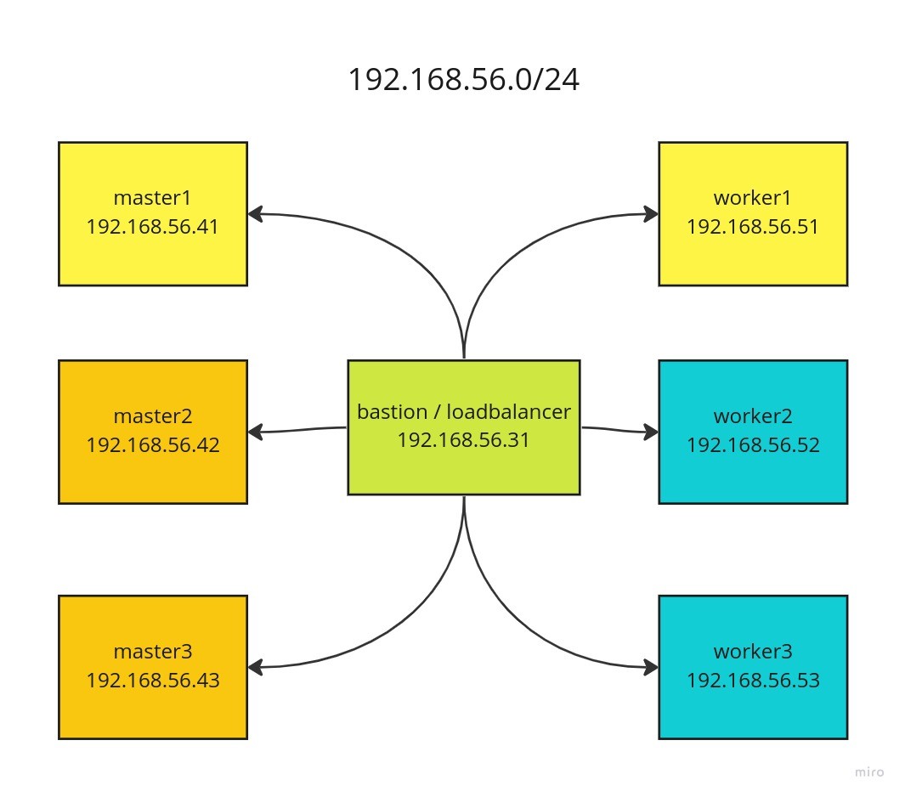
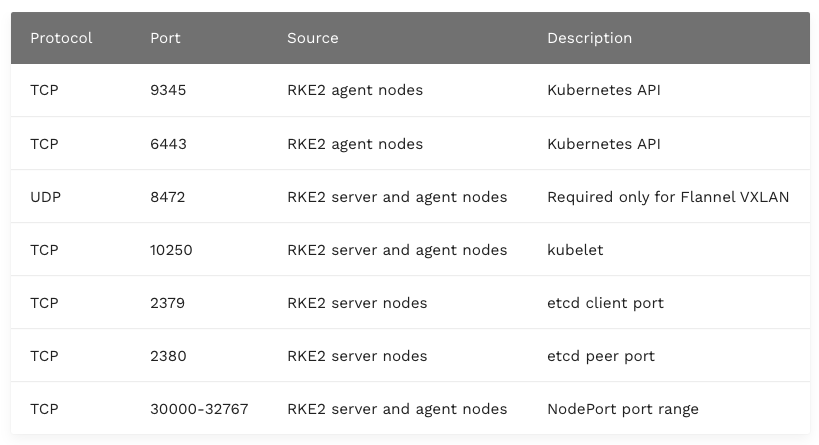
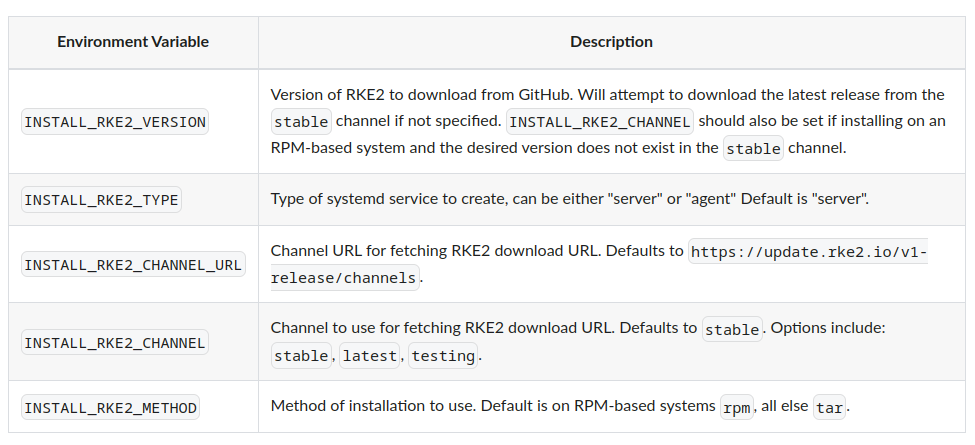

# Kubernetes Cluster Installation, Certificate Management and Backup/Restore Operations with RKE 2


Hello friends,

In our earlier article "[Rancher Longhorn Distributed Storage Installation, Backup and Restore Operations](https://medium.com/devopsturkiye/rancher-longhorn-distributed-storage-kurulumu-backup-ve-restore-i%CC%87%C5%9Flemleri-c8f56be457f6)", we had set up a Kubernetes cluster with RKE 1. The name RKE 2 may give us the impression that it's the next version of RKE 1, but it's a completely different deployment tool. If we look at the differences

- One of the most important differences is that it doesn't use Docker. RKE 1 does the deployment by building the whole setup on Docker.
- If you look at the [CNCF website](https://landscape.cncf.io/card-mode?selected=rke-government), you can see that its other name is RKE Goverment. It offers more security security compared to RKE 1. It's actually a deployment tool first developed for US government agencies.
- With its default configuration, it's able to pass the CIS (Center for Internet Security) Kubernetes benchmark.
- It's scanned with [Trivy](https://github.com/aquasecurity/trivy)  on every build.
- It's coded in accordance with US government security standards ([FIPS 140-2](https://docs.rke2.io/security/fips_support)).

Suse's goal is to offer a tool for migrating from RKE 1 to RKE 2 once enough development has been completed. You can also read about the topic on [this page](https://docs.rke2.io/#why-two-names).


### Kubernetes Installation with RKE 2





```vagrantfile

# -*- mode: ruby -*-
# vi: set ft=ruby :


# enter a number between 1-9
MASTER_COUNT = 3
WORKER_COUNT  = 3


MASTER_IP_PREFIX  = "192.168.56.4"
WORKER_IP_PREFIX  = "192.168.56.5"

PROVIDER = "virtualbox"

BASTION_IP = "192.168.56.31"

ROOT_PASS = "rkeadmin"


ENV['VAGRANT_DEFAULT_PROVIDER'] = PROVIDER

$allscript = <<-ALLSCRIPT
  
MASTER_COUNT=$1
WORKER_COUNT=$2
MASTER_IP_PREFIX=$3
WORKER_IP_PREFIX=$4
BASTION_IP=$5
ROOT_PASS=$6

   
echo master count : $MASTER_COUNT
echo worker count : $WORKER_COUNT
echo master ip prefix : $MASTER_IP_PREFIX
echo master worker prefix : $WORKER_IP_PREFIX
echo bastion ip : $BASTION_IP
echo root pass : $ROOT_PASS

sudo apt update && sudo apt upgrade -y

echo "===================== root user is being activated ====================="
   
sudo su


  
echo -e "$ROOT_PASS\n$ROOT_PASS" | passwd root
echo "export TERM=xterm" | tee -a /etc/bash.bashrc
   
echo "===================== swap is being disabled =========================="
   
sed -i "/swap/d" /etc/fstab
swapoff -a
systemctl disable --now ufw
   
echo "=================== sysctl is being updated for the kubernetes network =============="
   
modprobe overlay
modprobe br_netfilter
   
cat <<EOF | sudo tee -a /etc/sysctl.d/kubernetes.conf
net.bridge.bridge-nf-call-ip6tables = 1
net.bridge.bridge-nf-call-iptables  = 1
net.ipv4.ip_forward                 = 1
EOF
sysctl --system
   
echo "============= ssh settings are being made ============="
   
sed -i "s/#PasswordAuthentication yes/PasswordAuthentication yes/" /etc/ssh/sshd_config
echo "PermitRootLogin yes" | sudo tee -a /etc/ssh/sshd_config
   
systemctl reload sshd
   
echo "===================== host files are being edited ==================="
for i in $(seq 1 $MASTER_COUNT); do
   echo "$MASTER_IP_PREFIX$i master$i" >>/etc/hosts
done
   
for i in $(seq 1 $WORKER_COUNT); do
   echo "$WORKER_IP_PREFIX$i worker$i" >>/etc/hosts
done

echo "$BASTION_IP bastion" >>/etc/hosts
echo "$BASTION_IP rke.kubernetes.local" >>/etc/hosts

   
ALLSCRIPT


$bastionscript = <<-BASTION

MASTER_COUNT=$1
WORKER_COUNT=$2
MASTER_IP_PREFIX=$3
WORKER_IP_PREFIX=$4
BASTION_IP=$5
ROOT_PASS=$6

   
echo master count : $MASTER_COUNT
echo worker count : $WORKER_COUNT
echo master ip prefix : $MASTER_IP_PREFIX
echo master worker prefix : $WORKER_IP_PREFIX
echo bastion ip : $BASTION_IP
echo root pass : $ROOT_PASS


sudo apt install sshpass -y

sudo su

ssh-keygen -t rsa -N "" -f ~/.ssh/id_rsa

for i in $(seq 1 $MASTER_COUNT); do
    sshpass -p $ROOT_PASS ssh-copy-id -i ~/.ssh/id_rsa.pub -o StrictHostKeyChecking=no root@$MASTER_IP_PREFIX$i
    echo "yes \n" | scp ~/.ssh/id_rsa root@$MASTER_IP_PREFIX$i:.ssh/
    echo key copied: $MASTER_IP_PREFIX$i
done


for i in $(seq 1 $WORKER_COUNT); do
    sshpass -p $ROOT_PASS ssh-copy-id -i ~/.ssh/id_rsa.pub -o StrictHostKeyChecking=no root@$WORKER_IP_PREFIX$i
    echo "yes \n" | scp ~/.ssh/id_rsa root@$WORKER_IP_PREFIX$i:.ssh/
    echo key copied: $WORKER_IP_PREFIX$i
done

BASTION


Vagrant.configure("2") do |config|

# master
(1..MASTER_COUNT).each do |i|

config.vm.define "master#{i}" do |master|
   master.vm.box = "generic/ubuntu2004"
   master.vm.network "private_network", ip: MASTER_IP_PREFIX+"#{i}"
   master.vm.hostname = "master#{i}"

   master.vm.provider :PROVIDER do |lv|
       lv.memory=2048
       lv.cpus=2
    end
 end
end


# worker
(1..WORKER_COUNT).each do |i|

config.vm.define "worker#{i}" do |worker|
   worker.vm.box = "generic/ubuntu2004"
   worker.vm.network "private_network", ip: WORKER_IP_PREFIX+"#{i}"
   worker.vm.hostname = "worker#{i}"
   

   worker.vm.provider :PROVIDER do |lv|
       lv.memory=2048
       lv.cpus=2
       lv.storage :file, :size => '10G'

   end
 end
end


# bastion
config.vm.define "bastion" do |bastion|
   bastion.vm.box = "generic/ubuntu2004"
   bastion.vm.network "private_network", ip: BASTION_IP
   bastion.vm.hostname = "bastion"

   bastion.vm.provider :PROVIDER do |lv|
       lv.memory=2048
       lv.cpus=2
    end

   bastion.vm.provision "shell", run: "once", inline: $bastionscript, args: [MASTER_COUNT,WORKER_COUNT, MASTER_IP_PREFIX,WORKER_IP_PREFIX, BASTION_IP, ROOT_PASS]
 end


# globally defined shell provision. It will run on all vms 
config.vm.provision :shell, run: "once" do |s|
   s.args = [MASTER_COUNT,WORKER_COUNT, MASTER_IP_PREFIX,WORKER_IP_PREFIX, BASTION_IP, ROOT_PASS] 
   s.inline = $allscript
end

end
```


### Nginx External Load Balancer Installation

We'll do all our installation operations on our bastion server.This server will also act as the load balancer. For this, we'll install Nginx. After logging in to the bastion server, we switch to the root user and start the installation.

The ports used by the services.




```shell
sudo su
# apt update && apt upgrade -y
apt install nginx

mv /etc/nginx/nginx.conf /etc/nginx/nginx.conf.bak

cat << EOF > /etc/nginx/nginx.conf

worker_processes 4;
worker_rlimit_nofile 40000;


#to be able to use stream, we load the strem module among the dynamic modules
include /usr/share/nginx/modules/*.conf;
load_module /usr/lib/nginx/modules/ngx_stream_module.so;


events {
   worker_connections 8192;
}


# we can use it because we loaded the stream module.
stream {

   upstream master_backend {
         least_conn;
         server master1:9345 max_fails=3 fail_timeout=5s;
         server master1:9345 max_fails=3 fail_timeout=5s;
         server master1:9345 max_fails=3 fail_timeout=5s;
      }

   server {
         listen 9345;
         proxy_pass master_backend;
      }


   upstream kube_api {
         least_conn;
         server master1:6443 max_fails=3 fail_timeout=5s;
         server master2:6443 max_fails=3 fail_timeout=5s;
         server master3:6443 max_fails=3 fail_timeout=5s;
      }
   server {
         listen     6443;
         proxy_pass kube_api;
      }


   upstream rancher_web {
         least_conn;
         server master1:80 max_fails=3 fail_timeout=5s;
         server master1:80 max_fails=3 fail_timeout=5s;
         server master1:80 max_fails=3 fail_timeout=5s;
      }
   server {
         listen     80;
         proxy_pass rancher_web;
      }


   upstream rancher_web_https {
         least_conn;
         server master1:443 max_fails=3 fail_timeout=5s;
         server master1:443 max_fails=3 fail_timeout=5s;
         server master1:443 max_fails=3 fail_timeout=5s;
      }
   server {
         listen     443;
         proxy_pass rancher_web_https;
      }

}

EOF


systemctl status nginx


```
### RKE2 Server Installation

When we look at the RKE 2  documentation, the server concept refers to Kubernetes Master nodes, while the agent concept refers to Kubernetes worker nodes.

First, we'll install one master and one worker node each, and then add the other nodes. 

While still as the root user on the bastion server, we switch to the master1 node and run the server installation script.



[Source](https://docs.rke2.io/install/configuration)

We'll deliberately install an old version and upgrade it later.

You can follow the versions on the [official Github](https://github.com/rancher/rke2/releases) page.

For server configuration references, visit [this page](https://docs.rke2.io/reference/server_config).

```shell

ssh root@master1

curl -sfL https://get.rke2.io --output install.sh
chmod +x install.sh
INSTALL_RKE2_CHANNEL="stable" INSTALL_RKE2_TYPE="server" INSTALL_RKE2_VERSION="v1.22.4+rke2r2" sh install.sh

mkdir -p /etc/rancher/rke2

cat << EOF > /etc/rancher/rke2/config.yaml
write-kubeconfig-mode: "0644"
tls-san:
  - rke.kubernetes.local
  - 192.168.56.31
cni: "calico"
cluster-domain: "rke.kubernetes.local"
node-ip: "192.168.56.41"
EOF

# first enable, then start, like this

systemctl enable rke2-server

systemctl start rke2-server


```
We can find the kubectl tool in the "/var/lib/rancher/rke2/bin" directory. Also, to completely remove RKE 2 from the system, we can use the "rke2-killall.sh" and "rke2-uninstall.sh" scripts in the "/usr/local/bin" directory.

```shell
export PATH=$PATH:/var/lib/rancher/rke2/bin

export KUBECONFIG=/etc/rancher/rke2/rke2.yaml

source ~/.bashrc
```

you can use the command below to follow the logs

```bash
journalctl -u rke2-server -f
```

When we test it, we can see that the master1 node has come up. Our version number also appears as v1.22.4. 

```shell
kubectl get nodes -owide
NAME      STATUS   ROLES                       AGE    VERSION          INTERNAL-IP     EXTERNAL-IP   OS-IMAGE             KERNEL-VERSION      CONTAINER-RUNTIME
master1   Ready    control-plane,etcd,master   112s   v1.22.4+rke2r2   192.168.56.41   <none>        Ubuntu 20.04.5 LTS   5.4.0-132-generic   containerd://1.5.8-k3s1


```

To be able to add the other master and worker nodes, we'll need the node-token information.

```shell
cat /var/lib/rancher/rke2/server/node-token
# you should see a token like the one below

K1033e47d23de84c5fc84e596090feac30fca35c2a31d89b609ace433720bcc3692::server:47ae5521c9ba374917118eefb9f66c50
```

### RKE2 Agent Installation

As we also mentioned above, in the RKE 2 installation the agent concept means a worker node in Kubernetes.


While as the root user on our bastion server, we ssh to the worker1 node as root. Then we move on to the installation.

```shell

ssh root@worker1

curl -sfL https://get.rke2.io --output install.sh
chmod +x install.sh
INSTALL_RKE2_CHANNEL="stable" INSTALL_RKE2_VERSION="v1.22.4+rke2r2" INSTALL_RKE2_TYPE="agent" sh install.sh

mkdir -p /etc/rancher/rke2

cat << EOF > /etc/rancher/rke2/config.yaml
server: https://rke.kubernetes.local:9345
token: K1033e47d23de84c5fc84e596090feac30fca35c2a31d89b609ace433720bcc3692::server:47ae5521c9ba374917118eefb9f66c50
node-ip: "192.168.56.51"
EOF

systemctl enable rke2-agent

systemctl start rke2-agent
```

you can use the command below to follow the logs

```bash
journalctl -u rke2-agent -f
```


if you happen to get an error and want to start the operations over, we can use the "rke2-killall.sh" and "rke2-uninstall.sh" scripts in the "/usr/local/bin" directory. But if the worker node has been registered to kubernetes, that is, if you can see it in the node list, then you also need to delete it on the Kubernetes side. 

```shell
kubectl delete node worker1
```

### Other Server and Agent Installations

From now on, we do all the server and agent installations we'll do in the same way as the agent installation I did above. Only the configuration file will be different.


- **Installation script for the server**

Don't forget to change the node ip address. Unlike the first server we installed, we added the token.


```shell
ssh root@master2

curl -sfL https://get.rke2.io --output install.sh
chmod +x install.sh
INSTALL_RKE2_CHANNEL="stable" INSTALL_RKE2_TYPE="server" INSTALL_RKE2_VERSION="v1.22.4+rke2r2" sh install.sh

mkdir -p /etc/rancher/rke2

cat << EOF > /etc/rancher/rke2/config.yaml
server: https://rke.kubernetes.local:9345
tls-san:
  - rke.kubernetes.local
  - 192.168.56.31
token: K1033e47d23de84c5fc84e596090feac30fca35c2a31d89b609ace433720bcc3692::server:47ae5521c9ba374917118eefb9f66c50
cni: "calico"
cluster-domain: "rke.kubernetes.local"
node-ip: "192.168.56.42"
EOF

# first enable, then start, like this

systemctl enable rke2-server

systemctl start rke2-server

```
- **Installation script for the agent**

```shell
ssh root@worker2

curl -sfL https://get.rke2.io --output install.sh
chmod +x install.sh
INSTALL_RKE2_CHANNEL="stable" INSTALL_RKE2_VERSION="v1.22.4+rke2r2" INSTALL_RKE2_TYPE="agent" sh install.sh

mkdir -p /etc/rancher/rke2

cat << EOF > /etc/rancher/rke2/config.yaml
server: https://rke.kubernetes.local:9345
token: K1033e47d23de84c5fc84e596090feac30fca35c2a31d89b609ace433720bcc3692::server:47ae5521c9ba374917118eefb9f66c50
node-ip: "192.168.56.52"
EOF

systemctl enable rke2-agent

systemctl start rke2-agent

```

After the installations are finished, let's get the list of nodes on our master1 server

```shell
kubectl get nodes -owide


NAME      STATUS   ROLES                       AGE     VERSION          INTERNAL-IP     EXTERNAL-IP   OS-IMAGE             KERNEL-VERSION      CONTAINER-RUNTIME
master1   Ready    control-plane,etcd,master   10h     v1.22.4+rke2r2   192.168.56.41   <none>        Ubuntu 20.04.5 LTS   5.4.0-135-generic   containerd://1.5.8-k3s1
master2   Ready    control-plane,etcd,master   31m     v1.22.4+rke2r2   192.168.56.42   <none>        Ubuntu 20.04.5 LTS   5.4.0-135-generic   containerd://1.5.8-k3s1
master3   Ready    control-plane,etcd,master   22m     v1.22.4+rke2r2   192.168.56.43   <none>        Ubuntu 20.04.5 LTS   5.4.0-135-generic   containerd://1.5.8-k3s1
worker1   Ready    <none>                      7h37m   v1.22.4+rke2r2   192.168.56.51   <none>        Ubuntu 20.04.5 LTS   5.4.0-135-generic   containerd://1.5.8-k3s1
worker2   Ready    <none>                      108m    v1.22.4+rke2r2   192.168.56.52   <none>        Ubuntu 20.04.5 LTS   5.4.0-135-generic   containerd://1.5.8-k3s1
worker3   Ready    <none>                      96m     v1.22.4+rke2r2   192.168.56.53   <none>        Ubuntu 20.04.5 LTS   5.4.0-135-generic   containerd://1.5.8-k3s1

```


Let's publish an application to test it.

```shell

kubectl apply -f - <<EOF
apiVersion: apps/v1
kind: Deployment
metadata:
  name: nginx-deployment
spec:
  selector:
    matchLabels:
      app: nginx
  replicas: 2 
  template:
    metadata:
      labels:
        app: nginx
    spec:
      containers:
      - name: nginx
        image: nginx:latest
        ports:
        - containerPort: 80
EOF


kubectl expose deployment nginx-deployment --type=NodePort --port=80

```

we run the command below to get the port number

```shell

kubectl get svc

# nginx-deployment   NodePort    10.43.159.62   <none>        80:30016/TCP   44s
```
we test it with curl.We can see that a response came from Nginx.

```shell

curl worker1:30016
# <!DOCTYPE html>
# <html>
# <head>
# <title>Welcome to nginx!</title>
# <style>
# html { color-scheme: light dark; }
# body { width: 35em; margin: 0 auto;
# font-family: Tahoma, Verdana, Arial, sans-serif; }
# </style>
# </head>
# <body>
# <h1>Welcome to nginx!</h1>
# <p>If you see this page, the nginx web server is successfully installed and
# working. Further configuration is required.</p>

# <p>For online documentation and support please refer to
# <a href="http://nginx.org/">nginx.org</a>.<br/>
# Commercial support is available at
# <a href="http://nginx.com/">nginx.com</a>.</p>

# <p><em>Thank you for using nginx.</em></p>
# </body>
# </html>
```


We were running our kubectl commands on master1. To run them on our bastion server, we need to copy our kube.config file and install the kubectl cli. While on the bastion server, we run the commands below.


```shell

sudo su

curl -LO "https://dl.k8s.io/release/$(curl -L -s https://dl.k8s.io/release/stable.txt)/bin/linux/amd64/kubectl"
chmod +x kubectl
cp ./kubectl /usr/local/bin/


apt install bash-completion
source /usr/share/bash-completion/bash_completion
kubectl completion bash | sudo tee /etc/bash_completion.d/kubectl > /dev/null


mkdir -p $HOME/.kube
scp root@master1:/etc/rancher/rke2/rke2.yaml $HOME/.kube/config

```


### Kubernetes Upgrade with RKE2

- **On All Servers**

```shell
curl -sfL https://get.rke2.io | INSTALL_RKE2_CHANNEL=latest sh -

systemctl restart rke2-server
```

When we upgrade the servers, we can see that they've moved to the latest version.

```shell
NAME      STATUS   ROLES                       AGE     VERSION
master1   Ready    control-plane,etcd,master   12h     v1.26.0+rke2r1
master2   Ready    control-plane,etcd,master   132m    v1.26.0+rke2r1
master3   Ready    control-plane,etcd,master   122m    v1.26.0+rke2r1
worker1   Ready    <none>                      9h      v1.22.4+rke2r2
worker2   Ready    <none>                      3h28m   v1.22.4+rke2r2
worker3   Ready    <none>                      3h17m   v1.22.4+rke2r2
```


- **On All Agents**


```shell

curl -sfL https://get.rke2.io | INSTALL_RKE2_CHANNEL=latest sh -

systemctl restart rke2-agent

```

When we upgrade the agents too, we can see that they've moved to the latest version.


```shell
master1   Ready      control-plane,etcd,master   13h     v1.26.0+rke2r1
master2   Ready      control-plane,etcd,master   156m    v1.26.0+rke2r1
master3   Ready      control-plane,etcd,master   147m    v1.26.0+rke2r1
worker1   Ready      <none>                      9h      v1.26.0+rke2r1
worker2   Ready      <none>                      3h52m   v1.26.0+rke2r1
worker3   NotReady   <none>                      3h41m   v1.26.0+rke2r1
```

### Renewing Certificates


We list the certificates on the Master1 server. By default, certificates are valid for 1 year. If 90 days or less are left before the certificates expire, RKE2 renews them itself.

If we want to do it manually ourselves, we should follow the steps below. To renew the certificates, we first stop the rke2-server service. We renew the certificates and restart it.

Let's start working on our Master1 server.

```shell

systemctl stop rke2-server
rke2 certificate rotate
systemctl start rke2-server


```
When we check, we can see that all the certificates have been renewed.
```shell

ls -lsh /var/lib/rancher/rke2/server/tls
total 124K
4.0K -rw-r--r-- 1 root root 1.2K Jan  3 18:12 client-admin.crt
4.0K -rw------- 1 root root  227 Jan  3 18:12 client-admin.key
4.0K -rw-r--r-- 1 root root 1.2K Jan  3 18:12 client-auth-proxy.crt
4.0K -rw------- 1 root root  227 Jan  3 18:12 client-auth-proxy.key
4.0K -rw-r--r-- 1 root root  574 Jan  2 10:10 client-ca.crt
4.0K -rw------- 1 root root  227 Jan  2 10:10 client-ca.key
4.0K -rw-r--r-- 1 root root 1.2K Jan  3 18:12 client-controller.crt
4.0K -rw------- 1 root root  227 Jan  3 18:12 client-controller.key
4.0K -rw-r--r-- 1 root root 1.2K Jan  3 18:12 client-kube-apiserver.crt
4.0K -rw------- 1 root root  227 Jan  3 18:12 client-kube-apiserver.key
4.0K -rw------- 1 root root  227 Jan  3 18:12 client-kubelet.key
4.0K -rw-r--r-- 1 root root 1.2K Jan  3 18:12 client-kube-proxy.crt
4.0K -rw------- 1 root root  227 Jan  3 18:12 client-kube-proxy.key
4.0K -rw-r--r-- 1 root root 1.2K Jan  3 18:12 client-rke2-cloud-controller.crt
4.0K -rw------- 1 root root  227 Jan  3 18:12 client-rke2-cloud-controller.key
4.0K -rw-r--r-- 1 root root 1.2K Jan  3 18:12 client-rke2-controller.crt
4.0K -rw------- 1 root root  227 Jan  3 18:12 client-rke2-controller.key
4.0K -rw-r--r-- 1 root root 1.2K Jan  3 18:12 client-scheduler.crt
4.0K -rw------- 1 root root  227 Jan  3 18:12 client-scheduler.key
8.0K -rw-r--r-- 1 root root 4.9K Jan  3 18:13 dynamic-cert.json
4.0K drwxr-xr-x 2 root root 4.0K Jan  3 18:12 etcd
4.0K -rw-r--r-- 1 root root  591 Jan  2 10:10 request-header-ca.crt
4.0K -rw------- 1 root root  227 Jan  2 10:10 request-header-ca.key
4.0K -rw-r--r-- 1 root root  574 Jan  2 10:10 server-ca.crt
4.0K -rw------- 1 root root  227 Jan  2 10:10 server-ca.key
4.0K -rw------- 1 root root 1.7K Jan  2 10:10 service.key
4.0K -rw-r--r-- 1 root root 1.4K Jan  3 18:12 serving-kube-apiserver.crt
4.0K -rw------- 1 root root  227 Jan  3 18:12 serving-kube-apiserver.key
4.0K -rw------- 1 root root  227 Jan  3 18:12 serving-kubelet.key
4.0K drwx------ 2 root root 4.0K Jan  2 10:10 temporary-certs
```


### ETCD Backup Restore Operations with RKE2

By default, rke2 uses the "/var/lib/rancher/rke2" directory as the data folder. But it's possible to change this with the data-dir parameter in the configuration file.

Snapshot files are also put at the "/var/lib/rancher/rke2/server/db/snapshots" address, but it's possible to change that too with the etcd-snapshot-dir parameter. By the way, it's also possible to use the S3 API for backup operations.

To get more information about the configurations, check [this address](https://docs.rke2.io/reference/server_config).

For backup restore, we'll first deploy an application and then take a backup. After deleting the application, we'll restore it again and check whether the application comes back. 

First, let's get the list of pods under the default namespace. The pods of the nginx deployment I created earlier are visible.

```shell

kubectl get pods

# NAME                               READY   STATUS    RESTARTS        AGE
# nginx-deployment-585449566-nxt7t   1/1     Running   1 (3h59m ago)   20h
# nginx-deployment-585449566-s5ln4   1/1     Running   3 (4h ago)      22h

```


Now let's bring up another nginx. 


```shell

kubectl apply -f - <<EOF
apiVersion: apps/v1
kind: Deployment
metadata:
  name: nginx-deployment-before-backup
spec:
  selector:
    matchLabels:
      app: nginx
  replicas: 3 
  template:
    metadata:
      labels:
        app: nginx
    spec:
      containers:
      - name: nginx
        image: nginx:latest
        ports:
        - containerPort: 80
EOF
```

We check, and we can see the pods we just added.

```shell
kubectl get pods

NAME                                              READY   STATUS    RESTARTS       AGE
nginx-deployment-585449566-nxt7t                  1/1     Running   1 (4h3m ago)   20h
nginx-deployment-585449566-s5ln4                  1/1     Running   3 (4h3m ago)   22h
nginx-deployment-before-backup-6b7f675859-2djqq   1/1     Running   0              8s
nginx-deployment-before-backup-6b7f675859-5hl6l   1/1     Running   0              8s
nginx-deployment-before-backup-6b7f675859-jxq5n   1/1     Running   0              8s

```
Before deleting the deployment, we take a backup.

While on Master1, we can take a backup with the command below.  By the way, there's no need to stop the system.

```shell
rke2 etcd-snapshot save --name  before-delete-deployment

```
let's look at the snapshot list. The one we took most recently is visible at the very top.

```shell

rke2 etcd-snapshot ls

Name                                        Location                                                                                     Size    Created
before-delete-deployment-master1-1672776097 file:///var/lib/rancher/rke2/server/db/snapshots/before-delete-deployment-master1-1672776097 8241184 2023-01-03T20:01:37Z
etcd-snapshot-master1-1672660800            file:///var/lib/rancher/rke2/server/db/snapshots/etcd-snapshot-master1-1672660800            7938080 2023-01-02T12:00:00Z
pre-upgrade-snapshot-master1-1672774069     file:///var/lib/rancher/rke2/server/db/snapshots/pre-upgrade-snapshot-master1-1672774069     8241184 2023-01-03T19:27:49Z


```


Now let's delete the deployment. For this, let's look at our deployment list.

```shell

kubectl get deployment

NAME                             READY   UP-TO-DATE   AVAILABLE   AGE
nginx-deployment                 2/2     2            2           22h
nginx-deployment-before-backup   3/3     3            3           23m
```

we can delete both of them.

```shell
kubectl delete deployment nginx-deployment nginx-deployment-before-backup
```
When we check, we can see that it has been deleted.


```shell
kubectl get deployment

No resources found in default namespace.
```

To bring the system back, we stop the RKE2 service on all master nodes with the command below.

```shell

systemctl stop rke2-server
```


Then we reset the cluster with the snapshot we took on master1.

```shell

rke2 server --cluster-reset --cluster-reset-restore-path=/var/lib/rancher/rke2/server/db/snapshots/before-delete-deployment-master1-1672776097
```
When we do this operation, the db from before the restore is backed up to the "/var/lib/rancher/rke2/server/db/etcd-old-%date%/" address.


```shell
ls -lhs  /var/lib/rancher/rke2/server/db/
total 12K
4.0K drwx------ 3 root root 4.0K Jan  3 20:10 etcd
4.0K drwx------ 3 root root 4.0K Jan  3 18:12 etcd-old-1672776630
   0 -rw------- 1 root root    0 Jan  3 20:10 reset-flag
4.0K drwx------ 2 root root 4.0K Jan  3 20:01 snapshots
```

Now we can bring up the cluster.

We start the RKE2 service on Master1 with the command below.

```shell
systemctl start rke2-server
```
Before starting the other master servers, we delete the dbs on them. We won't delete them, let's move them, just in case.


```shell
mv /var/lib/rancher/rke2/server/db /var/lib/rancher/rke2/server/db_old
```

Now we can start the RKE2 service on these servers too.


```shell
systemctl start rke2-server
```

After all the servers start working, let's check whether the pods have come back.


```shell
kubectl get pods

NAME                                              READY   STATUS    RESTARTS       AGE
nginx-deployment-585449566-nxt7t                  1/1     Running   1 (5h4m ago)   21h
nginx-deployment-585449566-s5ln4                  1/1     Running   3 (5h5m ago)   23h
nginx-deployment-before-backup-6b7f675859-2djqq   1/1     Running   0              61m
nginx-deployment-before-backup-6b7f675859-5hl6l   1/1     Running   0              61m
nginx-deployment-before-backup-6b7f675859-jxq5n   1/1     Running   0              61m
```
We can see that all the pods have come back.


What did we learn?

- We set up a Kubernetes cluster with RKE2
- We renewed our Certificates with RKE2
- We took a backup of ETCD with RKE2 and then restored the cluster.

That's it for this article, hope you found it useful.

See you in our other articles, take care.


### Resources
- https://docs.rke2.io/install/configuration#configuration-file
- https://docs.rke2.io/reference/server_config
- https://docs.rke2.io/reference/linux_agent_config
- https://docs.rke2.io/advanced#certificate-rotation
- https://docs.rke2.io/upgrade/manual_upgrade
