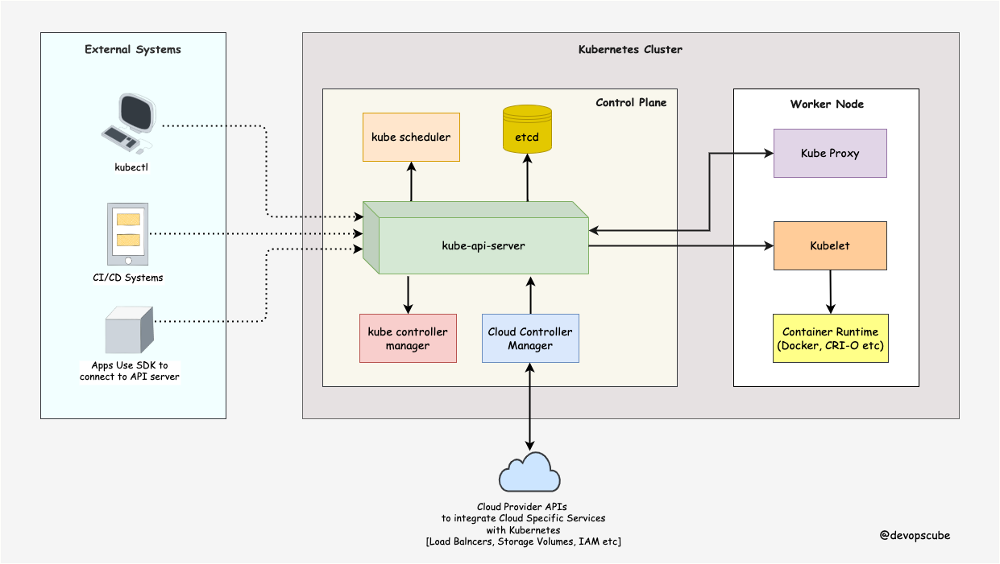
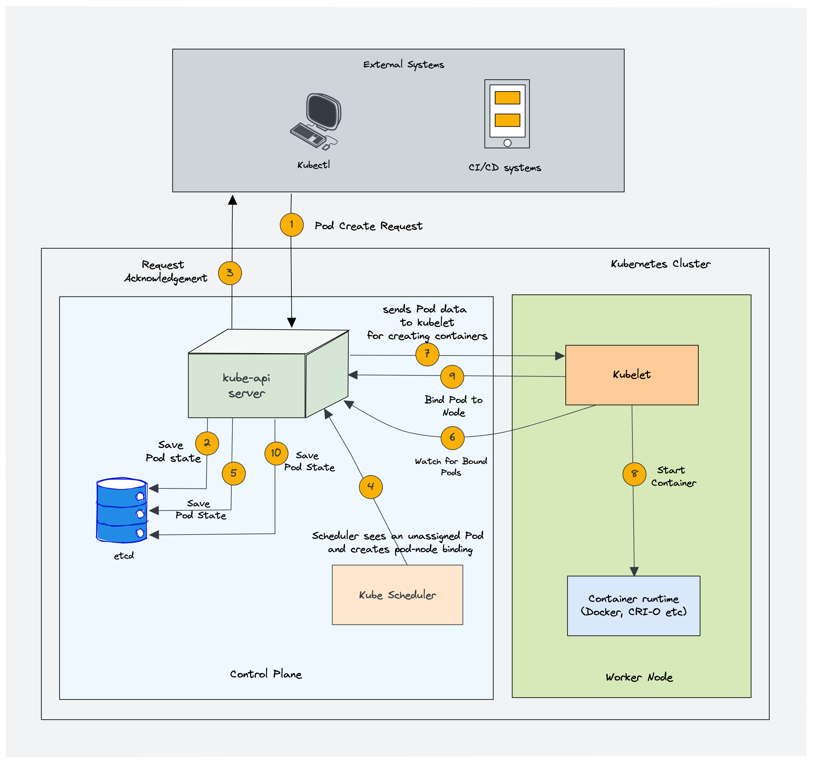
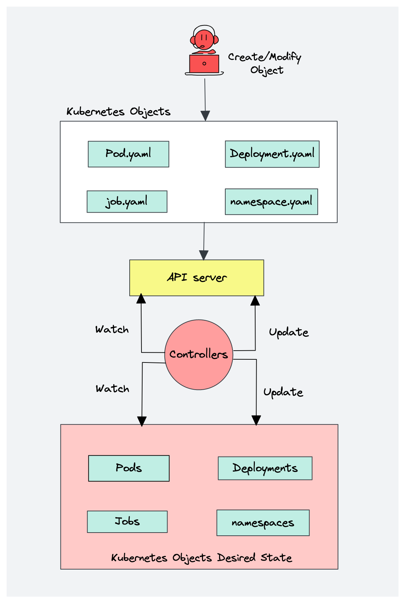
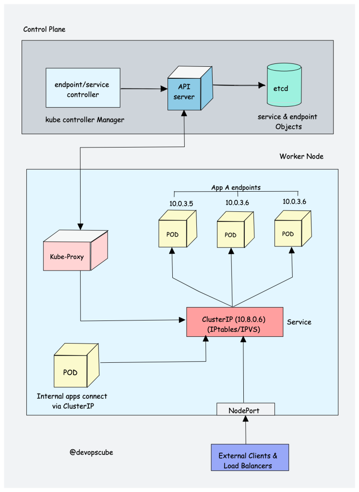
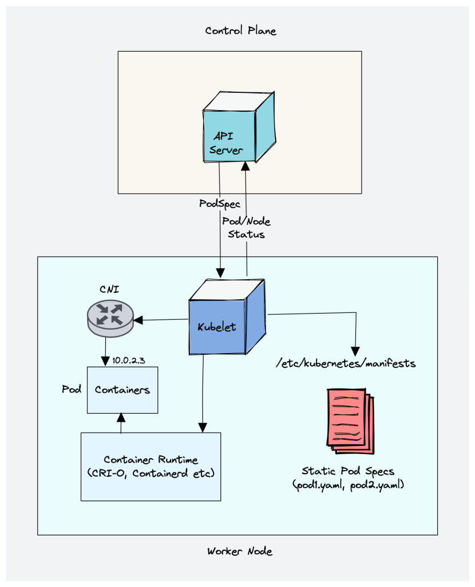
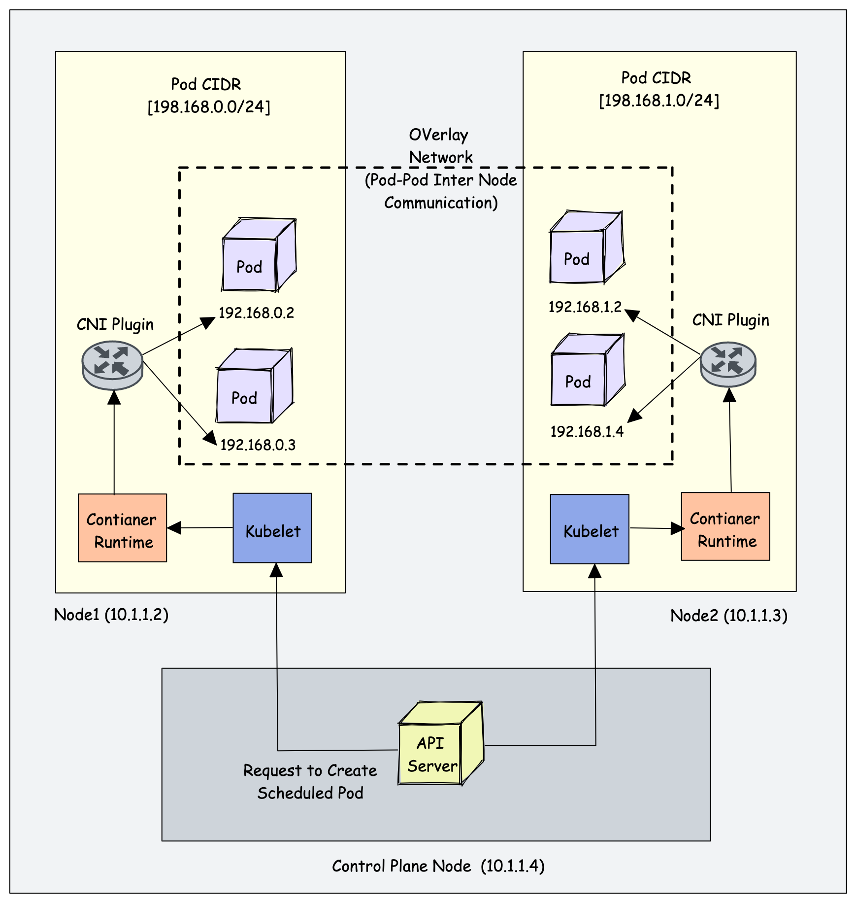

# Setting Up Kubernetes the Hard Way (Single Article and Up-to-Date 2024 Version)

About 2 years ago, I had published a much more comprehensive article series of 17 articles called "[Setting Up Kubernetes the Hard Way](https://medium.com/devopsturkiye/zor-yoldan-kubernetes-1-41ae00a0e77f)". As the lab environment, we had set it up in 4 different ways: LXD, KVM, Vagrant-Libvirt and Vagramt-Virtualbox. About 2 years have passed since then. There are many details in it, and it's still possible to benefit from those articles for many topics. In fact, in this article too, I'll refer to those pages in some places.

For those who come here without ever reading the other article series, I'll take the introduction from my old article.   

The title originally comes from Kelsey Hightower's article series on Github titled "[Kubernetes The Hard Way](https://github.com/kelseyhightower/kubernetes-the-hard-way)". If you like, for those who haven't heard of it, let's first talk about what this "Kubernetes The Hard Way" thing is.

Simply put, in his article Kelsey Hightower sets up the Controller Plane and Node (Worker) components of Kubernetes without using any deployment tool (for example Kubeadm, Ansible, RKE, etc.). 

At first, the clusters he set up were always on Google Cloud, but in his latest update he has now done the installation on a bare-metal  ARM64 system.

This time, I'll stick to Kelsey's installation as much as possible, but we'll do the installation on the x64 architecture. I'll drop plenty of notes along the way. We'll try to do a bit of troubleshooting.

Now let's look at which versions of which components we'll install. And a little reminder 



[image source](https://devopscube.com/kubernetes-architecture-explained/)


- **kubectl  1.30.3:** Lets users communicate with the Kubernetes API Server and is used to carry out various management tasks.
- **kube-apiserver  1.30.3**: Serves the Kubernetes API, and all operations are carried out through this API. Users, management tools and other components carry out operations such as creating, deleting or updating resources by communicating with this server. The API Server also manages authentication and authorization operations.
- **kube-controller-manager 1.30.3:** It's a component that runs the Kubernetes controllers. Controllers observe the state of Kubernetes objects and compare the desired state with the current state. If there's a difference, the controllers carry out the necessary corrective actions. For example, a Deployment controller makes sure that the specified number of Pods are running.
- **kube-scheduler: 1.30.3:**  Determines on which nodes newly created Pods will run. This decision is made by taking into account various factors such as the nodes' current resource usage, hardware capacities, network locations and specific policies. The Scheduler makes sure Pods are distributed in a balanced and efficient way.
- **kube-proxy: 1.30.3:** Runs on each node and routes traffic to Kubernetes Service objects. By applying network rules, it organizes the communication between Pods and routes the traffic coming in from the outside world to the related Pods. This is a way of managing dynamic IP addressing and doing load balancing within Kubernetes.
- **kubelet: 1.30.3:** It's an agent running on each Kubernetes node and manages the lifecycle of the Pods and containers on the node. Kubelet receives instructions from the API Server and interacts with the Container Runtime to start, stop or restart containers. It also monitors the health of Pods and carries out restart operations when needed.
- **crictl: 1.30.1:** Used to debug the Kubernetes cluster. Without using the Kubernetes API, operations can be done directly on Kubernetes components (pod, container, etc.). We can think of it like the Docker cli. It's a tool that can communicate with CRI-based continer runtimes.
- **runc 1.1.13:** It's a low-level container runtime; it provides isolation using features like cgroups, namespaces, etc. Actually, higher-level runtimes like Docker, Containerd or CRI-O use runc.
- **containerd 1.7.20:** It's a CRI-compatible Container Runtime.
- **etcd 3.5.15:**  Stores all the state information in the Kubernetes cluster (e.g. Pod, Service, ConfigMap). This information includes the desired state as well as the current state of the cluster, so the system can recreate the correct state in the event of any disruption.


We'll create a service file, certificate and kubeconfig file for the Kubernetes components in the list and run them. There's actually no magic. To bring up just one application, we need to bring up many services with TLS.

We'll set up our lab environment with Vagrant-Virtulbox. You can find the Vagrantfile below. 

If you haven't used Vagrant before, you don't need to get hung up on it. We won't have much to do with Vagrant commands. You just need to install Vagrant from [this page](https://developer.hashicorp.com/vagrant/install?product_intent=vagrant). And of course you also need to install Virtualbox.

We'll have a system like this.


|Hostname|DNS|ip|Description|CPU|RAM|Disk|
|--------|---|---|--------|---|---|----|
|bastion|bastion|192.168.56.31|The machine where I'll do the installations and manage our cluster|2|2|10|
|master1|master1.kubernetes.local|192.168.56.41|Kubernetes Server Node|2|2|10|
|worker1|worker0.kubernetes.local|192.168.56.51|Kubernetes Worker Node 1|2|2|10|
|worker2|worker1.kubernetes.local|192.168.56.52|Kubernetes Worker Node 2|2|2|10|


## Setting Up the Lab Environment

For us to be able to set up a Kubernetes cluster, our system needs to meet some prerequisites.

- The machines should be able to connect to each other over ssh with the root account without a password
- The ports you can check in the [official Kubernetes documentation](https://kubernetes.io/docs/reference/networking/ports-and-protocols/) should be open within the cluster. To keep it easy, we'll keep the firewall turned off between the servers. 
- Swap should be turned off
- The [NTP](https://tr.wikipedia.org/wiki/Network_Time_Protocol) settings of the servers should be made. In other words, the date and time should be the same on all servers.
- There shouldn't be any network obstacles. We already opened all the servers on the same subnet, and the firewall is off.
- (recommendation) If you have a large data center with many servers and different subnets, it'll make more sense to access the servers via DNS names rather than hostnames. Since there's no DNS in our own system, we'll simulate the situation by writing the DNS names into our hosts file.
- (recommendation) In your production environments, block the subnets of the pod network and the service networks across the data center.

Of course, many more topics need attention for production environments. Since I don't know where you'll run the lab environment we created, I just mentioned the small things that won't cause you problems.

The official Kubernetes documentation has prepared a very detailed page for the production environment. You can read it from [this link](https://kubernetes.io/docs/setup/production-environment/).

The scripts inside the Vagrantfile take care of the prerequisites needed for the Kubernetes installation. The details are written in the comment lines inside the script. If we hadn't written them into the Vagranfile, we'd run the commands below on the servers. Which commands will be run on which server is also written in the scripts.


We create a file named `Vagrantfile` in a folder and copy the code below into it. Then, while in the same directory, we run the `vagrant up` command. 

We'll be using the `Ubuntu 22.04 (jammy64)` version.

```ruby
# -*- mode: ruby -*-
# vi: set ft=ruby :

MASTER_COUNT = 1
WORKER_COUNT  = 2

MASTER_IP_PREFIX  = "192.168.56.4"
WORKER_IP_PREFIX  = "192.168.56.5"

PROVIDER = "virtualbox"

BASTION_IP = "192.168.56.31"

ROOT_PASS = "vagrant"

ENV['VAGRANT_DEFAULT_PROVIDER'] = PROVIDER

$allscript = <<-ALLSCRIPT

MASTER_COUNT=$1
WORKER_COUNT=$2
MASTER_IP_PREFIX=$3
WORKER_IP_PREFIX=$4
BASTION_IP=$5
ROOT_PASS=$6

echo master count : $MASTER_COUNT
echo worker count : $WORKER_COUNT
echo master ip prefix : $MASTER_IP_PREFIX
echo master worker prefix : $WORKER_IP_PREFIX
echo bastion ip : $BASTION_IP
echo root pass : $ROOT_PASS

sudo su

echo "============== the required installations are being done ====="

sudo apt install ntpstat socat conntrack ipset -y
sudo apt install ntp -y

 

echo "============== root user is being activated ===="

echo -e "$ROOT_PASS\n$ROOT_PASS" | (passwd root)
echo -e "$ROOT_PASS\n$ROOT_PASS" | (passwd vagrant)
echo "export TERM=xterm" | tee -a /etc/bash.bashrc

echo "============== ntp is being activated ===="

sudo apt install ntp
sudo systemctl restart ntp

timedatectl status

echo "============== swap and firewall are being disabled ===="

sed -i "/swap/d" /etc/fstab
swapoff -a
systemctl disable --now ufw

echo "============== sysctl is being updated for the kubernetes network ===="

# the required kernel modules are being installed

modprobe overlay
modprobe br_netfilter

cat <<EOF | sudo tee -a /etc/sysctl.d/kubernetes.conf
net.bridge.bridge-nf-call-ip6tables = 1
net.bridge.bridge-nf-call-iptables  = 1
net.ipv4.ip_forward                 = 1
EOF
sysctl --system

echo "============= ssh settings are being made ====="

sed -i "s/#PasswordAuthentication yes/PasswordAuthentication yes/" /etc/ssh/sshd_config
sed -i "s/#PermitRootLogin prohibit-password/PermitRootLogin yes/" /etc/ssh/sshd_config
sed -i "s/#PubkeyAuthentication yes/PubkeyAuthentication yes/" /etc/ssh/sshd_config

sudo systemctl restart ssh

echo "============= host files are being edited ==="
for i in $(seq 1 $MASTER_COUNT); do
    echo "$MASTER_IP_PREFIX$i master$i" >>/etc/hosts
    echo "$MASTER_IP_PREFIX$i master$i.kubernetes.local" >>/etc/hosts
done

for i in $(seq 1 $WORKER_COUNT); do
    echo "$WORKER_IP_PREFIX$i worker$i" >>/etc/hosts
    echo "$WORKER_IP_PREFIX$i worker$i.kubernetes.local" >>/etc/hosts
done

echo "$BASTION_IP bastion" >>/etc/hosts

ALLSCRIPT

$bastionscript = <<-BASTION

MASTER_COUNT=$1
WORKER_COUNT=$2
MASTER_IP_PREFIX=$3
WORKER_IP_PREFIX=$4
BASTION_IP=$5
ROOT_PASS=$6

echo master count : $MASTER_COUNT
echo worker count : $WORKER_COUNT
echo master ip prefix : $MASTER_IP_PREFIX
echo master worker prefix : $WORKER_IP_PREFIX
echo bastion ip : $BASTION_IP
echo root pass : $ROOT_PASS

sudo apt install sshpass -y

sudo su

ssh-keygen -t rsa -N "" -f ~/.ssh/id_rsa

for i in $(seq 1 $MASTER_COUNT); do
    sshpass -p $ROOT_PASS ssh-copy-id -i ~/.ssh/id_rsa.pub -o StrictHostKeyChecking=no root@$MASTER_IP_PREFIX$i
    echo "yes \n" | scp ~/.ssh/id_rsa root@$MASTER_IP_PREFIX$i:.ssh/
    echo key copied: $MASTER_IP_PREFIX$i
done


for i in $(seq 1 $WORKER_COUNT); do
    sshpass -p $ROOT_PASS ssh-copy-id -i ~/.ssh/id_rsa.pub -o StrictHostKeyChecking=no root@$WORKER_IP_PREFIX$i
    echo "yes \n" | scp ~/.ssh/id_rsa root@$WORKER_IP_PREFIX$i:.ssh/
    echo key copied: $WORKER_IP_PREFIX$i
done

BASTION

Vagrant.configure("2") do |config|

    # master
    (1..MASTER_COUNT).each do |i|

        config.vm.define "master#{i}" do |master|
            master.vm.box = "gusztavvargadr/ubuntu-server-2404-lts"
            master.vm.network "private_network", ip: MASTER_IP_PREFIX+"#{i}"
            master.vm.hostname = "master#{i}"
            master.ssh.username = "vagrant"
            master.ssh.password = $ROOT_PASS
            master.ssh.insert_key = "true"

            master.vm.provider :PROVIDER do |lv|
                lv.memory=2048
                lv.cpus=2
            end
        end
    end

    # worker
    (1..WORKER_COUNT).each do |i|

        config.vm.define "worker#{i}" do |worker|
            worker.vm.box = "gusztavvargadr/ubuntu-server-2404-lts"
            worker.vm.network "private_network", ip: WORKER_IP_PREFIX+"#{i}"
            worker.vm.hostname = "worker#{i}"
            worker.ssh.username = "vagrant"
            worker.ssh.password = $ROOT_PASS
            worker.ssh.insert_key = "true"


            worker.vm.provider :PROVIDER do |lv|
                lv.memory=2048
                lv.cpus=2
                lv.storage :file, :size => '10G'

            end
        end
    end

    # bastion 
    config.vm.define "bastion" do |bastion|
            bastion.vm.box = "gusztavvargadr/ubuntu-server-2404-lts"
            bastion.vm.network "private_network", ip: BASTION_IP
            bastion.vm.hostname = "bastion"
            bastion.ssh.username = "vagrant"
            bastion.ssh.password = $ROOT_PASS
            bastion.ssh.insert_key = "true"

            bastion.vm.provider :PROVIDER do |lv|
                lv.memory=2048
                lv.cpus=2
            end

            bastion.vm.provision "shell", run: "once", inline: $bastionscript, args: [MASTER_COUNT,WORKER_COUNT, MASTER_IP_PREFIX,WORKER_IP_PREFIX, BASTION_IP, ROOT_PASS]
    end

    # globally defined shell provision. It will run on all vms
    config.vm.provision :shell, run: "once" do |s|
        s.args = [MASTER_COUNT,WORKER_COUNT, MASTER_IP_PREFIX,WORKER_IP_PREFIX, BASTION_IP, ROOT_PASS]
        s.inline = $allscript
    end

end


```


After the installation finishes, we do the tests below. 

- While again in the directory where the Vagrantfile is located, we log in to the Bastion machine with the `vagrant ssh bastion` command. As soon as we log in, we switch to the root user and test by pinging all the machines by hostname.
- We need to be able to ssh from the Bastion machine to all machines with the root user without a password. Be sure to test this.
- While doing the tests, we also need to do them with DNS names. In other words, for example, if we're going to ssh from bastion to worker1, we should use `worker1.kubernetes.local` as the domain name.

If a problem came up in the tests, there may have been a problem in one or several of the steps we did in the Vagranfile. In this case, you can run the `vagrant up` command again, or we can delete all the machines with the `vagrant destroy` command and do the installation again with the `vagrant up` command. Finally, if it still isn't fixed, we can manually run the related command in the Vagrantfile in the places where we got an error.

You can also check it on Kelsey's [GitHub page](https://github.com/kelseyhightower/kubernetes-the-hard-way/blob/a9cb5f7ba50b3ed496a18a09c273941f80c6375a/docs/03-compute-resources.md).


## Preparing the Bastion Server for the Installation

We'll do the installation and configuration of all the servers through our Bastion server. So, since we'll share through this server both the applications the server needs and the binaries to be installed on the other servers, they need to be downloaded too.

Tools like openssl, git, curl, wget and ssh that are likely to be needed come installed already. For the other installations, we connect to our bastion server with the `vagrant ssh bastion` command and switch to the root user. We create a directory for our files.

```bash
KHOME=$HOME/kubernetes-files
mkdir $KHOME
cd $KHOME
```
We add the download addresses of all the applications we'll download to the `downloads.txt` file. You can find all the necessary binaries from the links below.

- https://www.downloadkubernetes.com
- https://github.com/opencontainers/runc/releases
- https://github.com/kubernetes-sigs/cri-tools/releases
- https://github.com/containerd/containerd/releases
- https://github.com/etcd-io/etcd/releases

```bash

mkdir -p $KHOME/downloads

cat << EOF > $KHOME/downloads/downloads.txt
https://dl.k8s.io/v1.30.3/bin/linux/amd64/kubectl
https://dl.k8s.io/v1.30.3/bin/linux/amd64/kube-apiserver
https://dl.k8s.io/v1.30.3/bin/linux/amd64/kube-controller-manager
https://dl.k8s.io/v1.30.3/bin/linux/amd64/kube-scheduler
https://dl.k8s.io/v1.30.3/bin/linux/amd64/kube-proxy
https://dl.k8s.io/v1.30.3/bin/linux/amd64/kubelet
https://github.com/containernetworking/plugins/releases/download/v1.5.1/cni-plugins-linux-amd64-v1.5.1.tgz
https://github.com/kubernetes-sigs/cri-tools/releases/download/v1.30.1/crictl-v1.30.1-linux-amd64.tar.gz
https://github.com/opencontainers/runc/releases/download/v1.1.13/runc.amd64
https://github.com/containerd/containerd/releases/download/v1.7.20/containerd-1.7.20-linux-amd64.tar.gz
https://github.com/etcd-io/etcd/releases/download/v3.5.15/etcd-v3.5.15-linux-amd64.tar.gz
EOF
```

We download the binaries with the command below

```bash

KHOME=$HOME/kubernetes-files 

wget -q --show-progress \
  --https-only \
  --timestamping \
  -P $KHOME/downloads \
  -i $KHOME/downloads/downloads.txt
```
When we list the files, we should see a list like the one below.

```
cni-plugins-linux-amd64-v1.5.1.tgz
containerd-1.7.20-linux-amd64.tar.gz
crictl-v1.30.1-linux-amd64.tar.gz
downloads.txt
etcd-v3.5.15-linux-amd64.tar.gz
kube-apiserver
kube-controller-manager
kubectl
kubelet
kube-proxy
kube-scheduler
runc.amd64
```

We can install kubectl on our Bastion server.

```bash
KHOME=$HOME/kubernetes-files

chmod +x $KHOME/downloads/kubectl

cp $KHOME/downloads/kubectl /usr/local/bin/

kubectl version --client

# Client Version: v1.30.3
# Kustomize Version: v5.0.4-0.20230601165947-6ce0bf390ce3


```

## Creating the TLS Certificates

We'll create the certificates with openssl. For this, we create our certificate configuration file with the command below. We'll create the certificates below.

- admin
- worker1
- worker2
- kube-proxy
- kube-scheduler
- kube-controller-manager
- kube-api-server
- service-accounts

You can see the certificate names in the configuration.


```bash

KHOME=$HOME/kubernetes-files

mkdir $KHOME/certs

cat << EOF > $KHOME/certs/ca.conf
[req]
distinguished_name = req_distinguished_name
prompt             = no
x509_extensions    = ca_x509_extensions

[ca_x509_extensions]
basicConstraints = CA:TRUE
keyUsage         = cRLSign, keyCertSign

[req_distinguished_name]
C   = US
ST  = Washington
L   = Seattle
CN  = CA

[admin]
distinguished_name = admin_distinguished_name
prompt             = no
req_extensions     = default_req_extensions

[admin_distinguished_name]
CN = admin
O  = system:masters

# Service Accounts: the certificate needed both for the admin user and for privileged operations across the whole system

[service-accounts]
distinguished_name = service-accounts_distinguished_name
prompt             = no
req_extensions     = default_req_extensions

[service-accounts_distinguished_name]
CN = service-accounts

# Worker Nodes: The certificates here are actually being created for kubelet.
# for authorization operations, CN (CommonName) naming in the form system:node:<nodeName> is required.
# https://kubernetes.io/docs/concepts/overview/components/#kubelet

[worker1]
distinguished_name = worker1_distinguished_name
prompt             = no
req_extensions     = worker1_req_extensions

[worker1_req_extensions]
basicConstraints     = CA:FALSE
extendedKeyUsage     = clientAuth, serverAuth
keyUsage             = critical, digitalSignature, keyEncipherment
nsCertType           = client
nsComment            = "Worker 1 Certificate"
subjectAltName       = DNS:worker1, IP:127.0.0.1
subjectKeyIdentifier = hash

[worker1_distinguished_name]
CN = system:node:worker1
O  = system:nodes
C  = US
ST = Washington
L  = Seattle

[worker2]
distinguished_name = worker2_distinguished_name
prompt             = no
req_extensions     = worker2_req_extensions

[worker2_req_extensions]
basicConstraints     = CA:FALSE
extendedKeyUsage     = clientAuth, serverAuth
keyUsage             = critical, digitalSignature, keyEncipherment
nsCertType           = client
nsComment            = "Worker 2 Certificate"
subjectAltName       = DNS:worker2, IP:127.0.0.1
subjectKeyIdentifier = hash

[worker2_distinguished_name]
CN = system:node:worker2
O  = system:nodes
C  = US
ST = Washington
L  = Seattle


# Kube Proxy Section
[kube-proxy]
distinguished_name = kube-proxy_distinguished_name
prompt             = no
req_extensions     = kube-proxy_req_extensions

[kube-proxy_req_extensions]
basicConstraints     = CA:FALSE
extendedKeyUsage     = clientAuth, serverAuth
keyUsage             = critical, digitalSignature, keyEncipherment
nsCertType           = client
nsComment            = "Kube Proxy Certificate"
subjectAltName       = DNS:kube-proxy, IP:127.0.0.1
subjectKeyIdentifier = hash

[kube-proxy_distinguished_name]
CN = system:kube-proxy
O  = system:node-proxier
C  = US
ST = Washington
L  = Seattle


# Controller Manager
[kube-controller-manager]
distinguished_name = kube-controller-manager_distinguished_name
prompt             = no
req_extensions     = kube-controller-manager_req_extensions

[kube-controller-manager_req_extensions]
basicConstraints     = CA:FALSE
extendedKeyUsage     = clientAuth, serverAuth
keyUsage             = critical, digitalSignature, keyEncipherment
nsCertType           = client
nsComment            = "Kube Controller Manager Certificate"
subjectAltName       = DNS:kube-proxy, IP:127.0.0.1
subjectKeyIdentifier = hash

[kube-controller-manager_distinguished_name]
CN = system:kube-controller-manager
O  = system:kube-controller-manager
C  = US
ST = Washington
L  = Seattle


# Scheduler
[kube-scheduler]
distinguished_name = kube-scheduler_distinguished_name
prompt             = no
req_extensions     = kube-scheduler_req_extensions

[kube-scheduler_req_extensions]
basicConstraints     = CA:FALSE
extendedKeyUsage     = clientAuth, serverAuth
keyUsage             = critical, digitalSignature, keyEncipherment
nsCertType           = client
nsComment            = "Kube Scheduler Certificate"
subjectAltName       = DNS:kube-scheduler, IP:127.0.0.1
subjectKeyIdentifier = hash

[kube-scheduler_distinguished_name]
CN = system:kube-scheduler
O  = system:system:kube-scheduler
C  = US
ST = Washington
L  = Seattle


# API Server

[kube-api-server]
distinguished_name = kube-api-server_distinguished_name
prompt             = no
req_extensions     = kube-api-server_req_extensions

[kube-api-server_req_extensions]
basicConstraints     = CA:FALSE
extendedKeyUsage     = clientAuth, serverAuth
keyUsage             = critical, digitalSignature, keyEncipherment
nsCertType           = client
nsComment            = "Kube Scheduler Certificate"
subjectAltName       = @kube-api-server_alt_names
subjectKeyIdentifier = hash


# Here, if we had a load balancer configuration, we'd need to enter its domain too.

[kube-api-server_alt_names]
IP.0  = 127.0.0.1
IP.1  = 10.32.0.1
DNS.0 = kubernetes
DNS.1 = kubernetes.default
DNS.2 = kubernetes.default.svc
DNS.3 = kubernetes.default.svc.cluster
DNS.4 = kubernetes.svc.cluster.local
DNS.5 = server.kubernetes.local
DNS.6 = api-server.kubernetes.local

[kube-api-server_distinguished_name]
CN = kubernetes
C  = US
ST = Washington
L  = Seattle


[default_req_extensions]
basicConstraints     = CA:FALSE
extendedKeyUsage     = clientAuth
keyUsage             = critical, digitalSignature, keyEncipherment
nsCertType           = client
nsComment            = "Admin Client Certificate"
subjectKeyIdentifier = hash
EOF

```

Our file was created at the `/root/kubernetes-files/ca.conf` address. We can create the certificates with the command below.

```bash
KHOME=$HOME/kubernetes-files

cd $KHOME/certs

{
  openssl genrsa -out ca.key 4096
  openssl req -x509 -new -sha512 -noenc \
    -key ca.key -days 3653 \
    -config ca.conf \
    -out ca.crt
}

certs=(
  "admin" "worker1" "worker2"
  "kube-proxy" "kube-scheduler"
  "kube-controller-manager"
  "kube-api-server"
  "service-accounts"
)


for i in ${certs[*]}; do
  openssl genrsa -out "${i}.key" 4096

  openssl req -new -key "${i}.key" -sha256 \
    -config "ca.conf" -section ${i} \
    -out "${i}.csr"
  
  openssl x509 -req -days 3653 -in "${i}.csr" \
    -copy_extensions copyall \
    -sha256 -CA "ca.crt" \
    -CAkey "ca.key" \
    -CAcreateserial \
    -out "${i}.crt"
done

```

The certificates in the list below should have been created.

```bash
ls -1 *.crt *.key *.csr

# result
# 
# admin.crt
# admin.csr
# admin.key
# ca.crt
# ca.key
# kube-api-server.crt
# kube-api-server.csr
# kube-api-server.key
# kube-controller-manager.crt
# kube-controller-manager.csr
# kube-controller-manager.key
# kube-proxy.crt
# kube-proxy.csr
# kube-proxy.key
# kube-scheduler.crt
# kube-scheduler.csr
# kube-scheduler.key
# service-accounts.crt
# service-accounts.csr
# service-accounts.key
# worker1.crt
# worker1.csr
# worker1.key
# worker2.crt
# worker2.csr
# worker2.key
```

## Distributing the Client and Server Certificates

First, let's distribute the client certificates. Our worker nodes are each a client for kubeapi.


```bash

# note that we use the worker1 and worker2 certificates we prepared for the worker nodes as the kubelet certificates.

# Kubelet: manages the lifecycle of the Pods and containers on the node. Kubelet receives instructions from the API Server and interacts with the Container Runtime to start, stop or restart containers. It also monitors the health of Pods and carries out restart operations when needed.
KHOME=$HOME/kubernetes-files

cd $KHOME/certs

for host in worker1 worker2; do
  ssh root@$host mkdir /var/lib/kubelet/
  
  scp ca.crt root@$host:/var/lib/kubelet/
    
  scp $host.crt \
    root@$host:/var/lib/kubelet/kubelet.crt
    
  scp $host.key \
    root@$host:/var/lib/kubelet/kubelet.key
done
```
Now let's distribute the server certificates too. For now, let's copy them to root. Later we'll gather them into the correct directories.

```bash
scp ca.key ca.crt kube-api-server.key kube-api-server.crt service-accounts.key service-accounts.crt root@master1:~/
```

## Creating the Kubernetes Configuration Files for Authentication 

Now, using the certificates we created in the previous section, let's create the configuration files for authentication. These configuration files we'll create are generally called kubeconfig.

Let's understand what we're trying to do. All the components we see in the image below connect to the kube-api-server. TLS is required for all of these connections, and we've already created the certificates. Also, many parameters are needed for these components to run. Also, so that the components run automatically when the servers are restarted, we need to bring up the applications as services services.  For all of these, we need our kubeconfig file within the configuration of the kubelets. We can create it with the kubectl cli. 

Of course, we'll need these configuration files not just for kubelet but for all the components.


[image source](https://devopscube.com/kubernetes-architecture-explained/)
 

We continue from the Bastion server. To create the configurations, we need to be in the certs folder.

In the commands, the `--embed-certs=true` parameter is used to write the certificate data directly into the kubeconfig file by encoding it in base64. Of course, this parameter could be left out and it could be used as an address instead. We didn't prefer that here. Both usages have pros and cons.

By the way, if you notice, all the kubeconfig files are created with the same method. So there's no magic. The files here do the same job as the kubeconfig file we use when operating with the admin user with kubectl. As you know, there's no user amangement in Kubernetes, only service accounts.

### Creating the Client Authentication Configurations

- **Kubelet Kubeconfig**


```bash

KHOME=$HOME/kubernetes-files

cd $KHOME/certs

for host in worker1 worker2; do
  kubectl config set-cluster kubernetes-the-hard-way \
    --certificate-authority=ca.crt \
    --embed-certs=true \
    --server=https://master1.kubernetes.local:6443 \
    --kubeconfig=${host}.kubeconfig

  kubectl config set-credentials system:node:${host} \
    --client-certificate=${host}.crt \
    --client-key=${host}.key \
    --embed-certs=true \
    --kubeconfig=${host}.kubeconfig

  kubectl config set-context default \
    --cluster=kubernetes-the-hard-way \
    --user=system:node:${host} \
    --kubeconfig=${host}.kubeconfig

  kubectl config use-context default \
    --kubeconfig=${host}.kubeconfig
done
```


When the process is finished, two kube configs will have been created.

```
worker1.kubeconfig
worker2.kubeconfig
```


- **Kube-proxy Kubeconfig**

When we run the command below, a file named `kube-proxy.kubeconfig` will have been created.

```bash
{
  kubectl config set-cluster kubernetes-the-hard-way \
    --certificate-authority=ca.crt \
    --embed-certs=true \
    --server=https://master1.kubernetes.local:6443 \
    --kubeconfig=kube-proxy.kubeconfig

  kubectl config set-credentials system:kube-proxy \
    --client-certificate=kube-proxy.crt \
    --client-key=kube-proxy.key \
    --embed-certs=true \
    --kubeconfig=kube-proxy.kubeconfig

  kubectl config set-context default \
    --cluster=kubernetes-the-hard-way \
    --user=system:kube-proxy \
    --kubeconfig=kube-proxy.kubeconfig

  kubectl config use-context default \
    --kubeconfig=kube-proxy.kubeconfig
}
```

- **Kube-controller-manager Kubeconfig**
When we run the command below, a file named `kube-controller-manager.kubeconfig` will have been created.

```bash
{
  kubectl config set-cluster kubernetes-the-hard-way \
    --certificate-authority=ca.crt \
    --embed-certs=true \
    --server=https://master1.kubernetes.local:6443 \
    --kubeconfig=kube-controller-manager.kubeconfig

  kubectl config set-credentials system:kube-controller-manager \
    --client-certificate=kube-controller-manager.crt \
    --client-key=kube-controller-manager.key \
    --embed-certs=true \
    --kubeconfig=kube-controller-manager.kubeconfig

  kubectl config set-context default \
    --cluster=kubernetes-the-hard-way \
    --user=system:kube-controller-manager \
    --kubeconfig=kube-controller-manager.kubeconfig

  kubectl config use-context default \
    --kubeconfig=kube-controller-manager.kubeconfig
}
```

- **Kube-scheduler Kubeconfig**



[image source](https://devopscube.com/kubernetes-architecture-explained/)


When we run the command below, a file named `kube-scheduler.kubeconfig` will have been created.


```bash
{
  kubectl config set-cluster kubernetes-the-hard-way \
    --certificate-authority=ca.crt \
    --embed-certs=true \
    --server=https://master1.kubernetes.local:6443 \
    --kubeconfig=kube-scheduler.kubeconfig

  kubectl config set-credentials system:kube-scheduler \
    --client-certificate=kube-scheduler.crt \
    --client-key=kube-scheduler.key \
    --embed-certs=true \
    --kubeconfig=kube-scheduler.kubeconfig

  kubectl config set-context default \
    --cluster=kubernetes-the-hard-way \
    --user=system:kube-scheduler \
    --kubeconfig=kube-scheduler.kubeconfig

  kubectl config use-context default \
    --kubeconfig=kube-scheduler.kubeconfig
}

```

- **Kubeconfig for the Admin User**

When we run the command below, a file named `admin.kubeconfig` will have been created.

If you notice, as the server address we used the `https://127.0.0.1:6443` address instead of the `https://master1.kubernetes.local:6443` address like the ones above.

```bash
{
  kubectl config set-cluster kubernetes-the-hard-way \
    --certificate-authority=ca.crt \
    --embed-certs=true \
    --server=https://127.0.0.1:6443 \
    --kubeconfig=admin.kubeconfig

  kubectl config set-credentials admin \
    --client-certificate=admin.crt \
    --client-key=admin.key \
    --embed-certs=true \
    --kubeconfig=admin.kubeconfig

  kubectl config set-context default \
    --cluster=kubernetes-the-hard-way \
    --user=admin \
    --kubeconfig=admin.kubeconfig

  kubectl config use-context default \
    --kubeconfig=admin.kubeconfig
}
```

### Distributing the Kubeconfig Files


Let's copy the Kubelet and kube-proxy configurations to the servers. 

```bash

KHOME=$HOME/kubernetes-files

cd $KHOME/certs

for host in worker1 worker2; do
  ssh root@$host "mkdir /var/lib/{kube-proxy,kubelet}"
  
  scp kube-proxy.kubeconfig \
    root@$host:/var/lib/kube-proxy/kubeconfig \ # note: we save the kube-proxy.kubeconfig files as kubeconfig
  
  scp ${host}.kubeconfig \
    root@$host:/var/lib/kubelet/kubeconfig # note: we save the worker1.kubeconfig and worker2.kubeconfig files as kubeconfig
done
```

Let's also distribute the kubeconfig files of our controller (that is, master1) server. 


```bash

scp admin.kubeconfig \
  kube-controller-manager.kubeconfig \
  kube-scheduler.kubeconfig \
  root@master1:~/

```


### Creating the Encryption Key and Config for Encrypting Secret Data at Rest


Kubernetes stores various data, including the cluster state, application configurations and secrets. It also tries to make sure this data is stored securely. For details, you can visit [this page](https://kubernetes.io/docs/tasks/administer-cluster/encrypt-data/#understanding-the-encryption-at-rest-configuration).


```bash
# First, we create a folder named configs in the main directory
KHOME=$HOME/kubernetes-files

mkdir $KHOME/configs

cat << EOF > $KHOME/configs/encryption-config-template.yaml
apiVersion: apiserver.config.k8s.io/v1
kind: EncryptionConfiguration
resources:
  - resources:
      - secrets
    providers:
      - aescbc:
          keys:
            - name: key1
              secret: ${ENCRYPTION_KEY}
      - identity: {}
EOF


# we create the key
export ENCRYPTION_KEY=$(head -c 32 /dev/urandom | base64)

# we create our config file using the template file with the envsubst command.
envsubst < configs/encryption-config-template.yaml > configs/encryption-config.yaml

```
We also copy our configuration file to the root directory on our master1 server. When the time comes, we'll use all the files there. We'll use this configuration while bringing up the Kube-apiserver.
```bash
scp $KHOME/configs/encryption-config.yaml root@master1:~/
```

## We're Bringing Up Our Etcd Server


We'll install our Etcd database on our server1 server. To be able to bring up Etcd, we'll need our systemd (unit) file.

If you notice, unlike what we did in our earlier "[Setting Up Kubernetes the Hard Way](https://mcabuk.medium.com/zor-yoldan-kubernetes-11-760b7a0c7162)" article, we didn't use a certificate for ETCD here. Of course, this should never be done in production environments. We didn't feel the need here, because the Kube Api Server that will communicate with ETCD is already running on the same machine.


```bash
KHOME=$HOME/kubernetes-files

cd $KHOME/

mkdir units

cat << EOF > $KHOME/units/etcd.service
[Unit]
Description=etcd
Documentation=https://github.com/etcd-io/etcd

[Service]
Type=notify
ExecStart=/usr/local/bin/etcd \
  --name controller \
  --initial-advertise-peer-urls http://127.0.0.1:2380 \
  --listen-peer-urls http://127.0.0.1:2380 \
  --listen-client-urls http://127.0.0.1:2379 \
  --advertise-client-urls http://127.0.0.1:2379 \
  --initial-cluster-token etcd-cluster-0 \
  --initial-cluster controller=http://127.0.0.1:2380 \
  --initial-cluster-state new \
  --data-dir=/var/lib/etcd
Restart=on-failure
RestartSec=5

[Install]
WantedBy=multi-user.target
EOF


# we copy the files to the server1 server.
scp \
  downloads/etcd-v3.5.15-linux-amd64.tar.gz \
  units/etcd.service \
  root@master1:~/

```

Now we can bring up etcd. But for this, we need to connect to the master1 server. We connect from the Bastion server to the master1 server with the `ssh root@master1` command and run the commands below on the server.

Remember that we copied all our files to the root directory on the master1 server.


```bash
{
  tar -xvf etcd-v3.5.15-linux-amd64.tar.gz
  mv etcd-v3.5.15-linux-amd64/etcd* /usr/local/bin/
}
```

We configure Etcd.

```bash
{
  mkdir -p /etc/etcd /var/lib/etcd
  chmod 700 /var/lib/etcd
  cp ca.crt kube-api-server.key kube-api-server.crt \
    /etc/etcd/
}

mv etcd.service /etc/systemd/system/


```

We start the service.

```bash
{
  systemctl daemon-reload
  systemctl enable etcd
  systemctl start etcd
}
```

We verify the installation.

```bash
etcdctl member list

# As a result, we should get an output like the one below.

# 6702b0a34e2cfd39, started, controller, http://127.0.0.1:2380, http://127.0.0.1:2379, false
```

## We're Bringing Up the Control Plane

First, we'll need the 3 systemd (unit) files below.

- units/kube-apiserver.service
- units/kube-controller-manager.service
- units/kube-scheduler.service

We're working on our Bastion server.

- **kube-apiserver.service**


Notice that the certificates we created earlier, the encryption-config file and the service-cluster-ip range are passed as parameters.

```bash

KHOME=$HOME/kubernetes-files

cd $KHOME/

cat << EOF > units/kube-apiserver.service
[Unit]
Description=Kubernetes API Server
Documentation=https://github.com/kubernetes/kubernetes

[Service]
ExecStart=/usr/local/bin/kube-apiserver \
  --allow-privileged=true \
  --apiserver-count=1 \
  --audit-log-maxage=30 \
  --audit-log-maxbackup=3 \
  --audit-log-maxsize=100 \
  --audit-log-path=/var/log/audit.log \
  --authorization-mode=Node,RBAC \
  --bind-address=0.0.0.0 \
  --client-ca-file=/var/lib/kubernetes/ca.crt \
  --enable-admission-plugins=NamespaceLifecycle,NodeRestriction,LimitRanger,ServiceAccount,DefaultStorageClass,ResourceQuota \
  --etcd-servers=http://127.0.0.1:2379 \
  --event-ttl=1h \
  --encryption-provider-config=/var/lib/kubernetes/encryption-config.yaml \
  --kubelet-certificate-authority=/var/lib/kubernetes/ca.crt \
  --kubelet-client-certificate=/var/lib/kubernetes/kube-api-server.crt \
  --kubelet-client-key=/var/lib/kubernetes/kube-api-server.key \
  --runtime-config='api/all=true' \
  --service-account-key-file=/var/lib/kubernetes/service-accounts.crt \
  --service-account-signing-key-file=/var/lib/kubernetes/service-accounts.key \
  --service-account-issuer=https://master1.kubernetes.local:6443 \
  --service-cluster-ip-range=10.32.0.0/24 \
  --service-node-port-range=30000-32767 \
  --tls-cert-file=/var/lib/kubernetes/kube-api-server.crt \
  --tls-private-key-file=/var/lib/kubernetes/kube-api-server.key \
  --v=2
Restart=on-failure
RestartSec=5

[Install]
WantedBy=multi-user.target
EOF

```

- **kube-controller-manager.service**




```bash
KHOME=$HOME/kubernetes-files

cd $KHOME/

cat << EOF > units/kube-controller-manager.service
[Unit]
Description=Kubernetes Controller Manager
Documentation=https://github.com/kubernetes/kubernetes

[Service]
ExecStart=/usr/local/bin/kube-controller-manager \
  --bind-address=0.0.0.0 \
  --cluster-cidr=10.200.0.0/16 \
  --cluster-name=kubernetes \
  --cluster-signing-cert-file=/var/lib/kubernetes/ca.crt \
  --cluster-signing-key-file=/var/lib/kubernetes/ca.key \
  --kubeconfig=/var/lib/kubernetes/kube-controller-manager.kubeconfig \
  --root-ca-file=/var/lib/kubernetes/ca.crt \
  --service-account-private-key-file=/var/lib/kubernetes/service-accounts.key \
  --service-cluster-ip-range=10.32.0.0/24 \
  --use-service-account-credentials=true \
  --v=2
Restart=on-failure
RestartSec=5

[Install]
WantedBy=multi-user.target
EOF
```


- **kube-scheduler.service**


```bash
KHOME=$HOME/kubernetes-files

cd $KHOME/

cat << EOF > units/kube-scheduler.service
[Unit]
Description=Kubernetes Scheduler
Documentation=https://github.com/kubernetes/kubernetes

[Service]
ExecStart=/usr/local/bin/kube-scheduler \
  --config=/etc/kubernetes/config/kube-scheduler.yaml \
  --v=2
Restart=on-failure
RestartSec=5

[Install]
WantedBy=multi-user.target
EOF
```

- We copy the necessary files to the master1 server.


So that the Kubernetes API server (kube-apiserver) can communicate with kubelet, we'll create a file named `kube-apiserver-to-kubelet.yaml` for the necessary authorizations. This communication between Kube-apiserver and kubelet is critical for the Kubernetes cluster to work properly. This file will define the necessary permissions using Role-Based Access Control (RBAC).

```bash

KHOME=$HOME/kubernetes-files

cd $KHOME/

cat << EOF > configs/kube-apiserver-to-kubelet.yaml
apiVersion: rbac.authorization.k8s.io/v1
kind: ClusterRole
metadata:
  annotations:
    rbac.authorization.kubernetes.io/autoupdate: "true"
  labels:
    kubernetes.io/bootstrapping: rbac-defaults
  name: system:kube-apiserver-to-kubelet
rules:
  - apiGroups:
      - ""
    resources:
      - nodes/proxy
      - nodes/stats
      - nodes/log
      - nodes/spec
      - nodes/metrics
    verbs:
      - "*"
---
apiVersion: rbac.authorization.k8s.io/v1
kind: ClusterRoleBinding
metadata:
  name: system:kube-apiserver
  namespace: ""
roleRef:
  apiGroup: rbac.authorization.k8s.io
  kind: ClusterRole
  name: system:kube-apiserver-to-kubelet
subjects:
  - apiGroup: rbac.authorization.k8s.io
    kind: User
    name: kubernetes
EOF
```

We'll also need the file below for the KubeSchedulerConfiguration object for kube-scheduler.

```bash

cat << EOF > configs/kube-scheduler.yaml
apiVersion: kubescheduler.config.k8s.io/v1
kind: KubeSchedulerConfiguration
clientConnection:
  kubeconfig: "/var/lib/kubernetes/kube-scheduler.kubeconfig"
leaderElection:
  leaderElect: true
EOF

```

Now we can move the files.


```bash
scp \
  downloads/kube-apiserver \
  downloads/kube-controller-manager \
  downloads/kube-scheduler \
  downloads/kubectl \
  units/kube-apiserver.service \
  units/kube-controller-manager.service \
  units/kube-scheduler.service \
  configs/kube-scheduler.yaml \
  configs/kube-apiserver-to-kubelet.yaml \
  root@master1:~/

```
From this point on, we'll continue on the master1 server. For this, we connect to the master1 server with the `ssh root@master1` command.

We create the Kubernetes configuration directory.

```bash
mkdir -p /etc/kubernetes/config
```
We install the binaries.

```bash
{
  chmod +x kube-apiserver \
    kube-controller-manager \
    kube-scheduler kubectl
    
  mv kube-apiserver \
    kube-controller-manager \
    kube-scheduler kubectl \
    /usr/local/bin/
}
```

We configure the Api server.

```bash
{
  mkdir -p /var/lib/kubernetes/

  mv ca.crt ca.key \
    kube-api-server.key kube-api-server.crt \
    service-accounts.key service-accounts.crt \
    encryption-config.yaml \
    /var/lib/kubernetes/
}
```
We move our service file.

```bash
mv kube-apiserver.service \
  /etc/systemd/system/kube-apiserver.service
```

We configure the Contoller Manager.

```bash
mv kube-controller-manager.kubeconfig /var/lib/kubernetes/
mv kube-controller-manager.service /etc/systemd/system/
```

We configure the Kubernete Scheduler.

```bash
mv kube-scheduler.kubeconfig /var/lib/kubernetes/

mv kube-scheduler.yaml /etc/kubernetes/config/

mv kube-scheduler.service /etc/systemd/system/

```

We start the Controller services (kube-apiserver and kube-scheduler).

```bash
{
  systemctl daemon-reload
  
  systemctl enable kube-apiserver \
    kube-controller-manager kube-scheduler
    
  systemctl start kube-apiserver \
    kube-controller-manager kube-scheduler
}
```

Now let's confirm that it's working.

```bash

kubectl cluster-info \
  --kubeconfig admin.kubeconfig

# in the end, we should see that it's working like below.
# Kubernetes control plane is running at https://127.0.0.1:6443
```

## RBAC for Kubelet Authorization

While on the Master1 server, using the `kube-apiserver-to-kubelet.yaml` file we created earlier, we make the necessary authorizations so that the Kubernetes API server (kube-apiserver) can communicate with kubelet.

```bash
kubectl apply -f kube-apiserver-to-kubelet.yaml \
  --kubeconfig admin.kubeconfig

```

Now let's check whether everything is fine.

For this, we run the commands below on the bastion server.


```bash

KHOME=$HOME/kubernetes-files

curl -k --cacert $KHOME/certs/ca.crt https://master1.kubernetes.local:6443/version

# as a result, we should see something like below.

# {
#   "major": "1",
#   "minor": "30",
#   "gitVersion": "v1.30.3",
#   "gitCommit": "6fc0a69044f1ac4c13841ec4391224a2df241460",
#   "gitTreeState": "clean",
#   "buildDate": "2024-07-16T23:48:12Z",
#   "goVersion": "go1.22.5",
#   "compiler": "gc",
#   "platform": "linux/amd64"
# }

```

## We're Bringing Up the Worker Nodes

In this section, we'll set up the worker nodes. runc, the container networking plugin, containerd, kubelet, and kube-proxy will run on the worker nodes.


[image source](https://devopscube.com/kubernetes-architecture-explained/)

First, we create our configuration files. For this, we work as the root user on the bastion server.


- **10-bridge.conf:** this file is a CNI (Container Network Interface) plugin configuration file used in configuring the pod networks in the Kubernetes cluster. This file sets up a bridge network to configure the network connections of the pods running on each node in the Kubernetes cluster.

We'll talk about CNI later.

We'll create the "10-bridge.conf" file using this template below.

We'll use the configuration below for this cni-plugin. But for other specs, you can look at its [official page](https://github.com/containernetworking/cni/blob/main/SPEC.md).

```bash
KHOME=$HOME/kubernetes-files


cat << EOF > configs/10-bridge_template.conf
{
  "cniVersion": "1.0.0",
  "name": "bridge",
  "type": "bridge",
  "bridge": "cni0",
  "isGateway": true,
  "ipMasq": true,
  "ipam": {
    "type": "host-local",
    "ranges": [
      [{"subnet": "SUBNET"}]
    ],
    "routes": [{"dst": "0.0.0.0/0"}]
  }
}
EOF
```

- **99-loopback.conf:** this file is a CNI (Container Network Interface) configuration file used to create a loopback network interface (lo) for each pod in the Kubernetes cluster. The loopback interface lets the applications inside the pod reach themselves (localhost) over the network.

```bash
KHOME=$HOME/kubernetes-files


cat << EOF > configs/99-loopback.conf
{
  "cniVersion": "1.1.0",
  "name": "lo",
  "type": "loopback"
}
EOF
```

- **containerd-config.toml:** this file is the configuration file of the containerd container runtime. containerd is a daemon that manages and runs containers, and it's used by container orchestration tools like Kubernetes. This file determines how containerd will be configured and with which settings it will run.

Pay attention to the last 2 lines where the CNI directory is given. This way, ips will be given to the new pods that will be created.

```bash
KHOME=$HOME/kubernetes-files


cat << EOF > configs/containerd-config.toml
version = 2

[plugins."io.containerd.grpc.v1.cri"]
  [plugins."io.containerd.grpc.v1.cri".containerd]
    snapshotter = "overlayfs"
    default_runtime_name = "runc"
  [plugins."io.containerd.grpc.v1.cri".containerd.runtimes.runc]
    runtime_type = "io.containerd.runc.v2"
  [plugins."io.containerd.grpc.v1.cri".containerd.runtimes.runc.options]
    SystemdCgroup = true
[plugins."io.containerd.grpc.v1.cri".cni]
  bin_dir = "/opt/cni/bin"
  conf_dir = "/etc/cni/net.d"
EOF
```

- **kube-proxy-config.yaml:**

For this, we'll create a template file and create our real file from it.


[image source](https://devopscube.com/kubernetes-architecture-explained/)


```bash
KHOME=$HOME/kubernetes-files


cat << EOF > configs/kube-proxy-config.yaml
kind: KubeProxyConfiguration
apiVersion: kubeproxy.config.k8s.io/v1alpha1
clientConnection:
  kubeconfig: "/var/lib/kube-proxy/kubeconfig"
mode: "iptables"
clusterCIDR: "10.200.0.0/16"
EOF
```


- **kubelet-config.yaml:**



[image source](https://devopscube.com/kubernetes-architecture-explained/)


```bash
KHOME=$HOME/kubernetes-files


cat << EOF > configs/kubelet-config_template.yaml
kind: KubeletConfiguration
apiVersion: kubelet.config.k8s.io/v1beta1
authentication:
  anonymous:
    enabled: false
  webhook:
    enabled: true
  x509:
    clientCAFile: "/var/lib/kubelet/ca.crt"
authorization:
  mode: Webhook
clusterDomain: "cluster.local"
clusterDNS:
  - "10.32.0.10"
cgroupDriver: systemd
containerRuntimeEndpoint: "unix:///var/run/containerd/containerd.sock"
podCIDR: "SUBNET"
resolvConf: "/etc/resolv.conf"
runtimeRequestTimeout: "15m"
tlsCertFile: "/var/lib/kubelet/kubelet.crt"
tlsPrivateKeyFile: "/var/lib/kubelet/kubelet.key"
EOF
```

Now, using our template files, we can create our `kubelet-config.yml` and `10-bridge.conf` files and move them.

```bash
KHOME=$HOME/kubernetes-files

cd $KHOME/configs

declare -A machines

machines[worker1]="10.200.0.0/24"
machines[worker2]="10.200.1.0/24"

for key in "${!machines[@]}"; do

  echo "-------------${key} files --- start"
  ssh root@${key} "ls ~/"
  SUBNET=${machines[$key]}
  sed "s|SUBNET|$SUBNET|g" \
    10-bridge_template.conf > 10-bridge.conf 
    
  sed "s|SUBNET|$SUBNET|g" \
    kubelet-config_template.yaml > kubelet-config.yaml
    
  scp 10-bridge.conf kubelet-config.yaml \
  root@${key}:~/

  echo "-------------${key} files --- end"
  ssh root@${key} "ls ~/"
done
```


We'll need 3 unit (service) files for the components that will run on our worker nodes.

- containerd.service
- kubelet.service
- kube-proxy.service


Let's start creating our files.

- **containerd.service**


```shell
KHOME=$HOME/kubernetes-files

cat << EOF > $KHOME/units/containerd.service
[Unit]
Description=containerd container runtime
Documentation=https://containerd.io
After=network.target

[Service]
ExecStartPre=/sbin/modprobe overlay
ExecStart=/bin/containerd
Restart=always
RestartSec=5
Delegate=yes
KillMode=process
OOMScoreAdjust=-999
LimitNOFILE=1048576
LimitNPROC=infinity
LimitCORE=infinity

[Install]
WantedBy=multi-user.target
EOF
```

- **kubelet.service**


```shell
KHOME=$HOME/kubernetes-files

cat << EOF > $KHOME/units/kubelet.service
[Unit]
Description=Kubernetes Kubelet
Documentation=https://github.com/kubernetes/kubernetes
After=containerd.service
Requires=containerd.service

[Service]
ExecStart=/usr/local/bin/kubelet \
  --config=/var/lib/kubelet/kubelet-config.yaml \
  --kubeconfig=/var/lib/kubelet/kubeconfig \
  --register-node=true \
  --v=2
Restart=on-failure
RestartSec=5

[Install]
WantedBy=multi-user.target
EOF
```

- **kube-proxy.service**


```shell
KHOME=$HOME/kubernetes-files

cat << EOF > $KHOME/units/kube-proxy.service
[Unit]
Description=Kubernetes Kube Proxy
Documentation=https://github.com/kubernetes/kubernetes

[Service]
ExecStart=/usr/local/bin/kube-proxy \
  --config=/var/lib/kube-proxy/kube-proxy-config.yaml
Restart=on-failure
RestartSec=5

[Install]
WantedBy=multi-user.target
EOF
```

We also copy all the remaining worker node files to the servers.
```bash
KHOME=$HOME/kubernetes-files

cd $KHOME

for host in worker1 worker2; do
  scp \
    downloads/runc.amd64 \
    downloads/crictl-v1.30.1-linux-amd64.tar.gz \
    downloads/cni-plugins-linux-amd64-v1.5.1.tgz \
    downloads/containerd-1.7.20-linux-amd64.tar.gz \
    downloads/kubectl \
    downloads/kubelet \
    downloads/kube-proxy \
    configs/99-loopback.conf \
    configs/containerd-config.toml \
    configs/kube-proxy-config.yaml \
    units/containerd.service \
    units/kubelet.service \
    units/kube-proxy.service \
    root@$host:~/
done
```

Now, on both worker nodes, we create the directories for the installation with the command below.

```shell
for host in worker1 worker2; do
  ssh root@$host "mkdir -p /etc/cni/net.d /opt/cni/bin /var/lib/kubelet /var/lib/kube-proxy /var/lib/kubernetes /var/run/kubernetes;
  echo ${host} : /etc/cni/net.d test;
  [ -d "/etc/cni/net.d/" ] && echo Dizin var;

  echo ${host} : /opt/cni/bin test;
  [ -d "/opt/cni/bin/" ] && echo Dizin var;

  echo ${host} : /var/lib/kubelet kubelet test;
  [ -d "/var/lib/kubelet/" ] && echo Dizin var;

  echo ${host} : /var/lib/kube-proxy kube-proxy test;
  [ -d "/var/lib/kube-proxy/" ] && echo Dizin var;

  echo ${host} : /var/lib/kubernetes kubernetes test;
  [ -d "/var/lib/kubernetes/" ] && echo Dizin var;

  echo ${host} : var /var/lib/kubernetes kubernetes test;
  [ -d "/var/lib/kubernetes/" ] && echo Dizin var;
  
  echo ============================================"

done
```
Now let's install the binaries on all worker nodes.

```bash

for host in worker1 worker2; do
  ssh root@$host " mkdir -p containerd;
  tar -xvf crictl-v1.30.1-linux-amd64.tar.gz;
  tar -xvf containerd-1.7.20-linux-amd64.tar.gz -C containerd;
  tar -xvf cni-plugins-linux-amd64-v1.5.1.tgz -C /opt/cni/bin/;
  mv runc.amd64 runc;
  chmod +x crictl kubectl kube-proxy kubelet runc; 
  mv crictl kubectl kube-proxy kubelet runc /usr/local/bin/;
  mv containerd/bin/* /bin/"
done

```
Let's move the network configuration files to where they should be on all worker nodes.

```shell
for host in worker1 worker2; do
ssh root@$host "mv 10-bridge.conf 99-loopback.conf /etc/cni/net.d/"
done
```
Let's set up Containerd.

```shell
for host in worker1 worker2; do
  ssh root@$host " mkdir -p /etc/containerd/; 
  mv containerd-config.toml /etc/containerd/config.toml;
  mv containerd.service /etc/systemd/system/"
done
```
Let's set up Kubelet.

```shell
for host in worker1 worker2; do
  ssh root@$host "mv kubelet-config.yaml /var/lib/kubelet/;
  mv kubelet.service /etc/systemd/system/"
done
```
Let's set up the Kubernetes Proxy.
```shell
for host in worker1 worker2; do
  ssh root@$host "  mv kube-proxy-config.yaml /var/lib/kube-proxy/;
  mv kube-proxy.service /etc/systemd/system/"
done
```

Finally, let's start the worker services too.

```shell
for host in worker1 worker2; do
  ssh root@$host "systemctl daemon-reload;
  systemctl enable containerd kubelet kube-proxy;
  systemctl start containerd kubelet kube-proxy"
done
```

Let's verify what I've done so far.

```shell
ssh root@master1 "kubectl get nodes --kubeconfig admin.kubeconfig"
```
The test result came back empty for me. Most likely you have the same problem too. The first thing we'll do to understand the problem is to examine the logs of the Kubernetes components, starting from the master node.

The components below were running on our Master node.

- kube-apiserver.service
- kube-controller-manager.service
- kube-scheduler.service

We connect to the master1 server with `vagrant ssh master1` or, while on the bastion server, with the `ssh root@master1` command. If we connected through vagrant, we switch to the root user.

let's look at the service logs in order.

```shell

systemctl status kube-apiserver

systemctl status kube-controller-manager

systemctl status kube-scheduler

```
It looks like there are abnormal situations related to the certificate in the Kube-scheduler service. To get a cleaner log, we use the `journalctl -u kube-schedular` command.

In the end, we reach the line below. We can also see the same result when we look at the kubelet logs on the worker1 node.


```
master1 kube-controller-manager[5791]: E0804 01:27:08.892114    5791 leaderelection.go:347] error retrieving resource lock kube-system/kube-controller-manager: Get "https://master1.kubernetes.local:6443/apis/coordination.k8s.io/v1/namespaces/kube-system/leases/kube-controller-manager?timeout=5s": tls: failed to verify certificate: x509: certificate is valid for kubernetes, kubernetes.default, kubernetes.default.svc, kubernetes.default.svc.cluster, kubernetes.default.svc.cluster, kubernetes.svc.cluster.local, server.kubernetes.local, api-server.kubernetes.local, not master1.kubernetes.local
```
Let's pay attention to the part below here

```
certificate is valid for
  kubernetes, kubernetes.default,
  kubernetes.default.svc,
  kubernetes.default.svc.cluster,
  kubernetes.default.svc.cluster,
  kubernetes.svc.cluster.local,
  server.kubernetes.local,
  api-server.kubernetes.local,

not master1.kubernetes.local
```
If you remember, the addresses here were the addresses we used while creating the certificates. If we look at our `ca.conf` file, we can see the lines below.

```
[kube-api-server_alt_names]
IP.0  = 127.0.0.1
IP.1  = 10.32.0.1
DNS.0 = kubernetes
DNS.1 = kubernetes.default
DNS.2 = kubernetes.default.svc
DNS.3 = kubernetes.default.svc.cluster
DNS.4 = kubernetes.svc.cluster.local
DNS.5 = server.kubernetes.local
DNS.6 = api-server.kubernetes.local
```
These domains were the addresses we used while accessing our Kubernetes cluster. In fact, I had warned that if we use a load balancer, we should enter its address too. The abnormality in this list is that an address named master1.kubernetes.local isn't in this list. Of course, if you remember these certificates, on the worker nodes, for example kubelet and kube-proxy will have the same problem while accessing the kub eapi server too.

In this case, we need to recreate our certificates and distribute them. For this
- on our bastion server, in the `ca.conf` file in the certs folder, we change the `server.kubernetes.local` address to `master1.kubernetes.local`
- we recreate the certificates
- we recreate the kubeconfig.files
- and we move the certificate and kubeconfig files to the related places.

Now let's do these step by step. While on the Bastian server, after making the change in the `ca.conf` file, we recreate the certificates with the command below.

```shell
KHOME=$HOME/kubernetes-files

cd $KHOME/certs

{
  openssl genrsa -out ca.key 4096
  openssl req -x509 -new -sha512 -noenc \
    -key ca.key -days 3653 \
    -config ca.conf \
    -out ca.crt
}

certs=(
  "admin" "worker1" "worker2"
  "kube-proxy" "kube-scheduler"
  "kube-controller-manager"
  "kube-api-server"
  "service-accounts"
)


for i in ${certs[*]}; do
  openssl genrsa -out "${i}.key" 4096

  openssl req -new -key "${i}.key" -sha256 \
    -config "ca.conf" -section ${i} \
    -out "${i}.csr"

  openssl x509 -req -days 3653 -in "${i}.csr" \
    -copy_extensions copyall \
    -sha256 -CA "ca.crt" \
    -CAkey "ca.key" \
    -CAcreateserial \
    -out "${i}.crt"
done

```


With the command below, we also create all our kubeconfig files.

- Kubelet Kubeconfig
- Kube-proxy Kubeconfig
- Kube-controller-manager Kubeconfig
- Kube-scheduler Kubeconfig
- Kubeconfig for the Admin User


```shell

KHOME=$HOME/kubernetes-files

cd $KHOME/certs


# Kubelet Kubeconfig
for host in worker1 worker2; do
  kubectl config set-cluster kubernetes-the-hard-way \
    --certificate-authority=ca.crt \
    --embed-certs=true \
    --server=https://master1.kubernetes.local:6443 \
    --kubeconfig=${host}.kubeconfig

  kubectl config set-credentials system:node:${host} \
    --client-certificate=${host}.crt \
    --client-key=${host}.key \
    --embed-certs=true \
    --kubeconfig=${host}.kubeconfig

  kubectl config set-context default \
    --cluster=kubernetes-the-hard-way \
    --user=system:node:${host} \
    --kubeconfig=${host}.kubeconfig

  kubectl config use-context default \
    --kubeconfig=${host}.kubeconfig
done

# Kube-proxy Kubeconfig
{
  kubectl config set-cluster kubernetes-the-hard-way \
    --certificate-authority=ca.crt \
    --embed-certs=true \
    --server=https://master1.kubernetes.local:6443 \
    --kubeconfig=kube-proxy.kubeconfig

  kubectl config set-credentials system:kube-proxy \
    --client-certificate=kube-proxy.crt \
    --client-key=kube-proxy.key \
    --embed-certs=true \
    --kubeconfig=kube-proxy.kubeconfig

  kubectl config set-context default \
    --cluster=kubernetes-the-hard-way \
    --user=system:kube-proxy \
    --kubeconfig=kube-proxy.kubeconfig

  kubectl config use-context default \
    --kubeconfig=kube-proxy.kubeconfig
}

# Kube-controller-manager Kubeconfig

{
  kubectl config set-cluster kubernetes-the-hard-way \
    --certificate-authority=ca.crt \
    --embed-certs=true \
    --server=https://master1.kubernetes.local:6443 \
    --kubeconfig=kube-controller-manager.kubeconfig

  kubectl config set-credentials system:kube-controller-manager \
    --client-certificate=kube-controller-manager.crt \
    --client-key=kube-controller-manager.key \
    --embed-certs=true \
    --kubeconfig=kube-controller-manager.kubeconfig

  kubectl config set-context default \
    --cluster=kubernetes-the-hard-way \
    --user=system:kube-controller-manager \
    --kubeconfig=kube-controller-manager.kubeconfig

  kubectl config use-context default \
    --kubeconfig=kube-controller-manager.kubeconfig
}

# Kube-scheduler Kubeconfig

{
  kubectl config set-cluster kubernetes-the-hard-way \
    --certificate-authority=ca.crt \
    --embed-certs=true \
    --server=https://master1.kubernetes.local:6443 \
    --kubeconfig=kube-scheduler.kubeconfig

  kubectl config set-credentials system:kube-scheduler \
    --client-certificate=kube-scheduler.crt \
    --client-key=kube-scheduler.key \
    --embed-certs=true \
    --kubeconfig=kube-scheduler.kubeconfig

  kubectl config set-context default \
    --cluster=kubernetes-the-hard-way \
    --user=system:kube-scheduler \
    --kubeconfig=kube-scheduler.kubeconfig

  kubectl config use-context default \
    --kubeconfig=kube-scheduler.kubeconfig
}


# Kubeconfig for the Admin User

{
  kubectl config set-cluster kubernetes-the-hard-way \
    --certificate-authority=ca.crt \
    --embed-certs=true \
    --server=https://127.0.0.1:6443 \
    --kubeconfig=admin.kubeconfig

  kubectl config set-credentials admin \
    --client-certificate=admin.crt \
    --client-key=admin.key \
    --embed-certs=true \
    --kubeconfig=admin.kubeconfig

  kubectl config set-context default \
    --cluster=kubernetes-the-hard-way \
    --user=admin \
    --kubeconfig=admin.kubeconfig

  kubectl config use-context default \
    --kubeconfig=admin.kubeconfig
}

```

Yes, all our files are ready; now we need to determine which file we'll copy to which directories on the servers.


The services running on the Master server and the related directories


- All the certificates below should be saved to the `/var/lib/kubernetes/` directory on master1

  - ca.crt
  - ca.key
  - kube-api-server.key
  - kube-api-server.crt
  - service-accounts.key
  - service-accounts.crt


so why aren't there kube-scheduler or kube-conroller-manager certificates here, for example? because these are services that run on their own. They only need a service account while communicating with the api service, and we already put the certificates here into their own kubeconfig files. In other words, nobody connects to these services, so they wouldn't need a certificate configuration.


- the kubeconfig directories on master1

  - kube-schedular  - kubeconfig directory: /var/lib/kubernetes/
  - Kube-controller-manager - kubeconfig directory: /var/lib/kubernetes/

  - There's also the kubeconfig file we created for admin. This file is in the root directory of the master1 server, and we can copy the new one there too.

- the services running on the worker server and the related directories. Here we need to move the kubelet certificates. Because some services communicate and talk with kubelet. For example, the kube api server. So if you look at the api server's service (unit) file, it asks for the certificate address as a parameter to talk to kubelet.
  - kubelet - kubeconfig directory: /var/lib/kubelet/kubeconfig/
  - kubelet - certificate directory :  /var/lib/kubelet/
  - kube-proxy  kubeconfig directory: /var/lib/kube-proxy/kubeconfig/


Yes, now let's move all these files to the related servers and directories.


While on the Bastion server, we run the commands below.

```shell

KHOME=$HOME/kubernetes-files

cd $KHOME/certs

scp ca.crt ca.key kube-api-server.key kube-api-server.crt service-accounts.key service-accounts.crt root@master1:/var/lib/kubernetes/

scp kube-scheduler.kubeconfig root@master1:/var/lib/kubernetes/

scp kube-controller-manager.kubeconfig root@master1:/var/lib/kubernetes/


for host in worker1 worker2; do

scp ${host}.kubeconfig root@${host}:/var/lib/kubelet/kubeconfig # note: we save the worker1.kubeconfig and worker2.kubeconfig files as kubeconfig

scp kube-proxy.kubeconfig root@${host}:/var/lib/kube-proxy/kubeconfig # note: we save the kube-proxy.kubeconfig files as kubeconfig


scp ca.crt root@${host}:/var/lib/kubelet/

scp ${host}.crt root@${host}:/var/lib/kubelet/kubelet.crt

scp ${host}.key  root@${host}:/var/lib/kubelet/kubelet.key


done


for host in worker1 worker2; do
  ssh root@$host mkdir /var/lib/kubelet/

  scp ca.crt root@$host:/var/lib/kubelet/

  scp $host.crt \
    root@$host:/var/lib/kubelet/kubelet.crt

  scp $host.key \
    root@$host:/var/lib/kubelet/kubelet.key
done


```

Yes, now we can start our services again.

While on the Basiton server, we restart the related services on all servers.

```shell

ssh root@master1 "systemctl restart kube-apiserver.service; systemctl restart kube-controller-manager.service; systemctl restart kube-scheduler.service;"


for host in worker1 worker2; do

ssh root@${host} "systemctl restart containerd.service; systemctl restart kubelet.service; systemctl restart kube-proxy.service;"

done

```
We can give it about 10-15 seconds and test again. While on the Bastion server, we can test with the command below.

```shell

# we also move our admin user's kubeconfig file and test it


scp admin.kubeconfig root@master1:~/

ssh root@master1 "kubectl get nodes --kubeconfig admin.kubeconfig"

# result
# worker1   Ready    <none>   3h27m   v1.30.3
# worker2   Ready    <none>   3h23m   v1.30.3

```

We'll also get to why the master1 node isn't in the list later.


## Setting Up Kubectl on the Bastion Server for Remote Access

Right now, at the very least, our bastion server should be able to resolve the `master1.kubernetes.cluster` domain and send requests. Let's test this.

```shell
KHOME=$HOME/kubernetes-files

cd $KHOME

curl -k --cacert $KHOME/ca.crt \
  https://master1.kubernetes.local:6443/version


# result
#{
#"major": "1",
#"minor": "30",
#"gitVersion": "v1.30.3",
#"gitCommit": "6fc0a69044f1ac4c13841ec4391224a2df241460",
#"gitTreeState": "clean",
#"buildDate": "2024-07-16T23:48:12Z",
#"goVersion": "go1.22.5",
#"compiler": "gc",
#"platform": "linux/amd64"
#}


```

All the certificates are already on our basiton server. Then we can create a kubeconfig for ourselves.

```shell

{
  kubectl config set-cluster kubernetes-the-hard-way \
    --certificate-authority=certs/ca.crt \
    --embed-certs=true \
    --server=https://master1.kubernetes.local:6443

  kubectl config set-credentials admin \
    --client-certificate=certs/admin.crt \
    --client-key=certs/admin.key

  kubectl config set-context kubernetes-the-hard-way \
    --cluster=kubernetes-the-hard-way \
    --user=admin

  kubectl config use-context kubernetes-the-hard-way
}

```

We can check it

```shell

kubectl get nodes

# result
#NAME      STATUS   ROLES    AGE     VERSION
#worker1   Ready    <none>   3h48m   v1.30.3
#worker2   Ready    <none>   3h44m   v1.30.3
#root@bastion:~/kubernetes-files#

```


## Setting Up the Routes for the Pod Network

As you know, there are basically three networks in Kuberntes.

- Service: the network for services to communicate with pods and with themselves
- Pod: the network used for pods to communicate with each other
- Node: the physical network of the machines

You can also see it in the figure below.



[image source](https://kubernetes.io/docs/concepts/cluster-administration/networking/#kubernetes-ip-address-ranges)

The nodes can already communicate with each other. But the pods' communication doesn't happen on the physical network. They communicate over an isolated network that we generally call an overlay network. For this, there's a sprecification called CNI in Kubenetes. We can actually use any tool written in accordance with it. If you've experienced it before, you've definitely used one of the ones in the list below.

- Calico
- Weave
- Flannel
- Cilium

But here, if you remember, we had installed the cni-plugin released by the team that writes the CNI standard. CNI simply creates a virtual iterface for the pod network and lets the pods communicate over this network. Of course, the tools in the list above can do much more, but right now our topic isn't those. While doing this, they actually again do it by making use of the Linux namespace concept. If you'd like to get more detailed information on the topic, you can read the article I wrote earlier titled "[We're Creating Our Own Container Using Linux Namespaces](https://medium.com/devopsturkiye/linux-namespaceleri-kullanarak-kendi-container-%C4%B1m%C4%B1z%C4%B1-olu%C5%9Fturuyoruz-f83eebc3e92f)".

For example, on the official page of the cni-plugin we use, the features below are mentioned.


- bridge: Creates a bridge, adds the host and the container to it.
- ipvlan: Adds an ipvlan interface in the container.
- loopback: Set the state of loopback interface to up.
- macvlan: Creates a new MAC address, forwards all traffic to that to the container.
- ptp: Creates a veth pair.
- vlan: Allocates a vlan device.
- host-device: Move an already-existing device into a container.
- dummy: Creates a new Dummy device in the container.

In the configuration above, there was a configuration like the one below. I took the code example below from the [official CNI GitHub page](https://github.com/containernetworking/cni#running-the-plugins). This page also explains how to do the configuration we did above

I'd like to touch on the IPAM concept in the example. ipam stands for "IP Address Management". This manages the process of allocating IP addresses to pods in Kubernetes. The ipam block is used in the CNI plugin configuration to determine which IP addresses will be assigned to the pods in the network.

The `"type": "host-local"` we see in the configuration specifies that IP address management will be done at the local host level. In other words, each Kubernetes node manages the IP addresses for the pods on itself. host-local uses a local IP address pool, and each node assigns IP addresses to the pods from this pool (subnet).

The Routes part defines which destination the pods will be routed to. In this example, dst (destination) is defined as "0.0.0.0/0", meaning all traffic coming from this pod (traffic with any destination IP address) will be routed to the default gateway. This lets the pod access the internet or another network.

Loopback specifies the CNI plugin type to be used. It's defined as "loopback", meaning this configuration applies to the loopback interface. Loopback is used to create data traffic to itself inside the container and provides communication over addresses like 127.0.0.1.

```shell
# /etc/cni/net.d/10-mynet.conf
{
  "cniVersion": "1.0.0",
  "name": "bridge",
  "type": "bridge",
  "bridge": "cni0",
  "isGateway": true,
  "ipMasq": true,
  "ipam": {
    "type": "host-local",
    "ranges": [
      [{"subnet": "SUBNET"}] # for this part, we had used worker1:10.200.0.0/24 worker2:10.200.1.0/24.
    ],
    "routes": [{"dst": "0.0.0.0/0"}]
  }
}

# /etc/cni/net.d/99-loopback.conf <<EOF
{
	"cniVersion": "0.2.0",
	"name": "lo",
	"type": "loopback"
}
EOF
```
In the configuration above, CNI can distribute pod ips on the worker nodes, but for the two worker nodes to communicate with each other, these two subnets need to be able to communicate with each other. For this, we'll need routing on each worker node.


[image source](https://devopscube.com/kubernetes-architecture-explained/)


While on the Bastion machine, let's run the commands below.

```shell
ssh root@master1 <<EOF
  ip route add 10.200.0.0/24 via 192.168.56.51
  ip route add 10.200.1.0/24 via 192.168.56.52
EOF

ssh root@worker1 <<EOF
  ip route add 10.200.1.0/24 via 192.168.56.52
EOF

ssh root@worker2 <<EOF
  ip route add 10.200.0.0/24 via 192.168.56.51
EOF

```


Let's verify what we've done

```shell

ssh root@master1 ip route
# ...
#10.200.0.0/24 via 192.168.56.51 dev eth1
#10.200.1.0/24 via 192.168.56.52 dev eth1


ssh root@worker1 ip route
# ...
# 10.200.1.0/24 via 192.168.56.52 dev eth1


ssh root@worker2 ip route
# ...
# 10.200.0.0/24 via 192.168.56.51 dev eth1

```

## Smoke Test

All the tests

- **Data Encryption**

We should be able to save a secret piece of data by encrypting it.

```shell
kubectl create secret generic kubernetes-the-hard-way \
  --from-literal="mykey=mydata"
```
Now let's read this data from etcd. You can see key1 on the right in the first line.

```shell
ssh root@master1 \
    'etcdctl get /registry/secrets/default/kubernetes-the-hard-way | hexdump -C'


#00000000  2f 72 65 67 69 73 74 72  79 2f 73 65 63 72 65 74  |/registry/secret|
#00000010  73 2f 64 65 66 61 75 6c  74 2f 6b 75 62 65 72 6e  |s/default/kubern|
#00000020  65 74 65 73 2d 74 68 65  2d 68 61 72 64 2d 77 61  |etes-the-hard-wa|
#00000030  79 0a 6b 38 73 3a 65 6e  63 3a 61 65 73 63 62 63  |y.k8s:enc:aescbc|
#00000040  3a 76 31 3a 6b 65 79 31  3a 19 9e 6a f7 dc 2e e5  |:v1:key1:..j....|
#00000050  94 34 02 b3 18 82 01 84  ca e9 d3 a4 4c 65 4c 67  |.4..........LeLg|
#00000060  8c 1f ac e8 d0 e3 fb e9  f7 26 98 5b 2d 6a 9a 9c  |.........&.[-j..|
#00000070  6f dc 7e a6 88 f3 cb 49  34 d8 13 25 24 88 3c 13  |o.~....I4..%$.<.|
#00000080  00 27 a6 23 13 82 40 35  3e 2e 25 85 aa f6 e2 d8  |.'.#..@5>.%.....|
#00000090  0c 5c fd cd df da 12 89  83 dd f2 2c 1f 9e 04 9d  |.\.........,....|
#000000a0  6f 90 ea 88 2b 3d 83 fc  4f 0d ee 63 4a 2f 69 49  |o...+=..O..cJ/iI|
#000000b0  43 2b 3e 3c 2e b4 59 bd  04 3d d1 5c 20 6c 9b cc  |C+><..Y..=.\ l..|
#000000c0  1d 8a e8 f3 ae 07 81 b5  53 b1 54 6e c9 7b 88 db  |........S.Tn.{..|
#000000d0  fa ce aa a5 e7 d5 5a 95  5f 11 47 23 32 94 67 b3  |......Z._.G#2.g.|
#000000e0  dc 2c c3 b9 fc 7a fe fe  bb 99 68 55 2e 2f e5 f7  |.,...z....hU./..|
#000000f0  07 43 cf 91 4a 5e fb 63  62 c1 bb 9d d5 72 1a 2d  |.C..J^.cb....r.-|
#00000100  fa f6 7b 37 98 6c cc ca  91 58 8d c7 7b 77 b1 a1  |..{7.l...X..{w..|
#00000110  b3 ef 3e ed c4 e6 01 b5  64 72 2d 3f e1 45 80 db  |..>.....dr-?.E..|
#00000120  55 fc 8f fd b0 c4 f8 53  4f 22 8a 1d c2 ac b4 20  |U......SO"..... |
#00000130  b3 5b 38 64 09 fd a7 ac  8c 16 77 8a f1 b0 82 8e  |.[8d......w.....|
#00000140  57 2d ef a1 a9 17 29 b9  0f 81 65 41 44 5a 01 e3  |W-....)...eADZ..|
#00000150  77 0e 32 f1 86 46 27 9a  26 0a                    |w.2..F'.&.|
#0000015a

```
- **Deployment**

```shell
kubectl create deployment nginx \
  --image=nginx:latest
```
Now let's check it.

```shell
kubectl get pods -l app=nginx

#NAME                     READY   STATUS    RESTARTS   AGE
#nginx-7584b6f84c-r7qd5   1/1     Running   0          4h10m

```

- **Port Forwarding**

```shell
# we get the pod name

POD_NAME=$(kubectl get pods -l app=nginx \
  -o jsonpath="{.items[0].metadata.name}")

# and we bind port 8080 on our basiton server to port 80 of the nginx pod on the worker node via kubectl.

kubectl port-forward $POD_NAME 8080:80

```

To test it, we connect to the bastion server from another terminal and run the command below. In the end, we should see the content of nginx.

```shell
curl --head http://127.0.0.1:8080

#HTTP/1.1 200 OK
#Server: nginx/1.27.0
#Date: Thu, 15 Aug 2024 19:37:59 GMT
#Content-Type: text/html
#Content-Length: 615
#Last-Modified: Tue, 28 May 2024 13:22:30 GMT
#Connection: keep-alive
#ETag: "6655da96-267"
#Accept-Ranges: bytes
```
Now we can exit in the previous terminal with `ctrl+c`.

- **Exec**

Let's also see whether we can connect to the pod.

```shell
kubectl exec -ti $POD_NAME -- nginx -v

# nginx version: nginx/1.27.0

```
- **Service**

```shell
kubectl expose deployment nginx \
  --port 80 --type NodePort

# then we get our port

NODE_PORT=$(kubectl get svc nginx \
  --output=jsonpath='{range .spec.ports[0]}{.nodePort}')


# then we check it.

curl -I http://worker1:${NODE_PORT}

#HTTP/1.1 200 OK
#Server: nginx/1.27.0
#Date: Thu, 15 Aug 2024 20:00:12 GMT
#Content-Type: text/html
#Content-Length: 615
#Last-Modified: Tue, 28 May 2024 13:22:30 GMT
#Connection: keep-alive
#ETag: "6655da96-267"
#Accept-Ranges: bytes
```

Yes, that's it for this article. I hope it'll be useful. See you in future articles.
