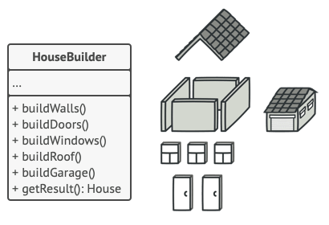
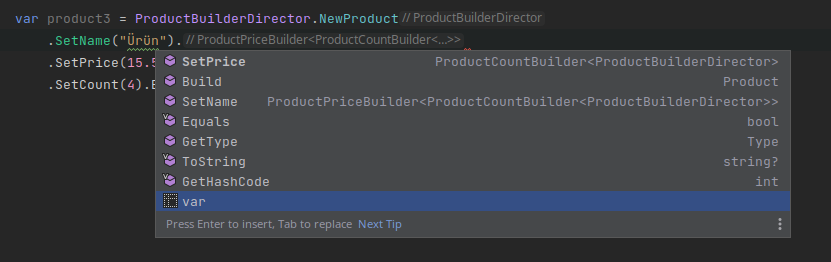

# Coding a Fluent Builder Using C# Recursive Generics

Hello friends

In this article, our goal is to write an extensible and reusable fluent builder using recursive generics.

To make it easy to understand, I defined the sub-objects to be created in the examples as simple types. Of course, there's no need to code such a complex builder just to assign a name or enter a price. But to be able to focus on the topic, I tried to reduce the details, and I deliberately didn't use abstractions unless they were really necessary.

Of course, it's possible to reach the same result with many other methods besides the solutions we find here. So my advice is to focus on the goal rather than producing alternatives to what's written here. Trying to take the topic further from where we leave it will make you learn more. 

As you know, one of the creational design patterns is the builder design pattern. It offers a more understandable and manageable structure by allowing complex objects to be created step by step. Sometimes, while creating an object, we may also have to create and manage many sub-objects. In cases like these, the builder design pattern reduces complexity by breaking the process into parts.


[Image Source](https://refactoring.guru/design-patterns/builder)

Trying to create very complex objects without using a creational design pattern requires overloading the constructor a lot, and we call constructors that contain dozens of parameters this way telescoping constructors. In objects created this way, many problematic situations arise, such as many unused parameters, classes that do different things based on options (options, types, flags), dozens of nested conditions, untestable functions, etc.

Anyway, while developing software, with even the slightest mistake against the SOLID principles, our code starts to smell (code smell). Creational design patterns are actually one of the most important tools that prevent mistakes like these from spreading. In cases where the related object has to be created with mistakes out of necessity, by abstracting the creation of the object's instance from the outside, the virus is, so to speak, prevented from spreading outward. 

Now that we've touched on the theory part a bit, we can start working.

In its simplest form, we can create the Product object step by step with code like the one below.

```c#

    public class Product
    {
        public string Name { get; set; }
        public double Price { get; set; }
        public int Count { get; set; }

        public override string ToString()
        {
            return $"Name:{Name}, Price:{Price}, Count:{Count}";
        }
    }

    public class ProductBuilder
    {
        private readonly Product _product;

        public ProductBuilder()
        {
            _product = new Product();
        }

        public ProductBuilder SetName(string name)
        {
            _product.Name = name;
            return this; ;
        }

        public ProductBuilder SetPrice(double price)
        {
            _product.Price = price;
            return this;
        }

        public ProductBuilder SetCount(int count)
        {
            _product.Count = count;
            return this;
        }

        public Product Build()
        {
            return _product;
        }
    }


    class Program
    {
        static void Main(string[] args)
        {

            var product = new ProductBuilder()
                                    .SetName("Product")
                                    .SetPrice(14.5)
                                    .SetCount(3)
                                    .Build();

            Console.WriteLine(product);
            //Name:Product, Price:14.5, Count:3
        }
    }

```

The SetName, SetPrice and SetCount functions always return the same object, that is, the ProductBuilder builder object. When creating more complex objects, returning the same object every time may not be enough. That said, sometimes the order of the builder objects or functions to be run may also matter. In our example, Name, Price and Count can be run in any order desired desired. But sometimes these objects may be related to each other, and one may not be creatable before the other is completed.

In creating the Product object, we don't have to follow a specific order when running the SetName, SetPrice and SetCount functions. For example, the code below will also give us the same product  object.

```c#

var product = new ProductBuilder()
                        .SetPrice(14.5)
                        .SetName("Product")
                        .SetCount(3)
                        .Build();
```


Let's improve our example a bit and and create separate builder objects for the sub-objects to be created. Let's also make sure the steps are completed in a specific order.

```c#
    public class Product
    {
        public string Name { get; set; }
        public double Price { get; set; }
        public int Count { get; set; }

        public override string ToString()
        {
            return $"Name:{Name}, Price:{Price}, Count:{Count}";
        }

    }

 public class ProductNameBuilder
    {
        private Product _product;
        public ProductNameBuilder()
        {
            _product = new Product();
        }
        public ProductPriceBuilder SetName(string name)
        {
            _product.Name = name;
            var productPriceBuilder = new ProductPriceBuilder(_product);
            return productPriceBuilder; ;
        }
    }

    public class ProductPriceBuilder
    {
        private Product _product;
        public ProductPriceBuilder(Product product)
        {
            _product = product;
        }

        public ProductCountBuilder SetPrice(double price)
        {
            _product.Price = price;
            var productCountBuilder = new ProductCountBuilder(_product);
            return productCountBuilder;
        }
    }

    public class ProductCountBuilder
    {
        private Product _product;
        public ProductCountBuilder (Product product)
        {
            _product = product;
        }

        public ProductCountBuilder SetCount(int count)
        {
            _product.Count = count;

            return this;
        }

        public Product Build()
        {
            return _product;
        }
    }


    class Program
    {
        static void Main(string[] args)
        {

            var product2 = new ProductNameBuilder()
                .SetName("Product")
                .SetPrice(15.5)
                .SetCount(4)
                .Build();

            Console.WriteLine(product2);
            //Name:Product, Price:15.5, Count:4

        }
    }


```

As you can see, we now create each sub-object with a different builder. Also, each step gives us the next step too. For example, since the SetName function in the ProductNameBuilder class returns the ProductPriceBuilder object, it forces us to follow the next step, and so we've removed the risk of making mistakes.

But this time we created the instances for each step ourselves, which isn't a good usage either. In other words, while trying to apply the builder pattern to benefit from the advantages of creational patterns, directly creating dozens of instances along the way didn't make much sense.


Then let's improve our example a bit more. This time let's do our example using recursive generics.


```c#
    public class Product2
    {
        public string Name { get; set; }
        public double Price { get; set; }
        public int Count { get; set; }

        public override string ToString()
        {
            return $"Name:{Name}, Price:{Price}, Count:{Count}";
        }


        public class Builder :  ProductCountBuilder<Builder>
        {
        }

        public static Builder New => new Builder();

    }

    public abstract class ProductBuilder2
    {
        protected readonly Product2 Product;
        public ProductBuilder2()
        {
            Product = new Product2();
        }

        public Product2 Build() => Product;
    }


    public class ProductNameBuilder<T> : ProductBuilder2 where T : ProductNameBuilder<T>
    {
        public T SetName(string name)
        {
            Product.Name = name;
            var productNameBuilder = (T)this;
            return productNameBuilder;
        }
    }


    public class ProductPriceBuilder<T> : ProductNameBuilder<ProductPriceBuilder<T>> where T : ProductPriceBuilder<T>
    {
        public T SetPrice(double price)
        {
            Product.Price = price;
            var productPriceBuilder = (T)this;
            return productPriceBuilder;
        }
    }


    public class ProductCountBuilder<T> : ProductPriceBuilder<ProductCountBuilder<T>> where T : ProductCountBuilder<T>
    {

        public T SetCount(int count)
        {
            Product.Count = count;
            var productCountBuilder = (T)this;
            return productCountBuilder;
        }
    }


    class Program
    {
        static void Main(string[] args)
        {
            var product3 = Product2.New
                                .SetName("Product")
                                .SetPrice(10.9)
                                .SetCount(1)
                                .Build();

            Console.WriteLine(product3);
            //Name:Product, Price:10.9 Count:1

        }
    }


```

This way, we benefited more from abstractions, and so our dependency on concrete objects decreased a bit more.

If we look at our Product class, a function named New creates our Builder object. If you notice, you can see that a new Product class has been written. The builder object created is also the last of the builders that build the Product2 object, that is, the ProductCountBuilder class. The reason is that this class contains all the inheritance before it. This way, we can access the functions offered by all the builders. If we start from the wrong place, we don't get an error, but the properties that weren't set come empty in the resulting Product2 object. For example, if we start from SetPrice instead of SetName and reach our object after doing SetCount, the Name property will return as empty.


```c#
    public class Product2
    {
        public string Name { get; set; }
        public double Price { get; set; }
        public int Count { get; set; }

        public override string ToString()
        {
            return $"Name:{Name}, Price:{Price}, Count:{Count}";
        }


        public class Builder :  ProductCountBuilder<Builder>
        {
        }

        public static Builder New => new Builder();

    }
```

The Builder object created in our Product class has inherited the ProductCountBuilder\<Builder\> object. If we examine this class below, it can be seen that it also inherits the ProductPriceBuilder\<ProductCountBuilder\<T>> class. In other words, in the final analysis, our generic T type ends up containing within itself, recursively, all the classes it passes through backward. Upward, that is, up to the ProductCountBuilder class, it carries all the classes and functions within itself.


```c#

    public class ProductCountBuilder<T> : ProductPriceBuilder<ProductCountBuilder<T>> where T : ProductCountBuilder<T>
    {

        public T SetCount(int count)
        {
            Product.Count = count;
            var productCountBuilder = (T)this;
            return productCountBuilder;
        }
    }


```

This way, through the Builder class we created in the Product class, we access all the builders and therefore the functions that will create our object. After the SetName function is called, the system will only offer the next step, that is, the SetPrice function.



```c#
var product3 = Product2.New
                    .SetName("Product")
                    .SetPrice(10.9)
                    .SetCount(1)
                    .Build();

```

But there's still a shortcoming in this system. For example, we can't build a computer object using this structure. Also, if we were to add a new builder after the last step, the ProductCountBuilder object, we'd have to change our Product object too. Because since the last step will change, our Builder class should inherit from the new step.

If we can handle these two negative situations too, we'll have a somewhat more flexible structure. 

Then let's keep improving our example.


We wrote a new Product class (Product3). But this time we did it using an interface, because we need to abstract the other objects we'll create. First, we set up a builder structure for the Product3 class. Then we develop a builder for the Computer object that will derive from this class. We add new builder classes to the builder structure we developed for Product3. Finally, by inheriting the Car object from the Computer object, we add the builder classes needed for Car to what we wrote, in addition to the ones we wrote for Computer. 

```
Product3
    |
    |___ Computer
            |
            |____ Car
```


By the way, we could have also derived the Car object not from Computer but from Product3 and, again by extending the builders written for Product3, developed a different builder setup independent of Computer.

```
Product3
    |
    |___ Computer
    |
    |____ Car
```


In this example, we have to create an interface that all objects will use. Because now we want to create more than one object.


```c#
public interface IProduct3
{
    public string Name { get; set; }
    public double Price { get; set; }
    public int Count { get; set; }
}

public class Product3 : IProduct3
{
    public string Name { get; set; }
    public double Price { get; set; }
    public int Count { get; set; }

    public override string ToString()
    {
        return $"Name:{Name}, Price:{Price}, Count:{Count}";
    }

    public class Builder :  GenericProductBuilder<Builder>
    {

    }

   public static Builder New => new Builder();

}

public class ProductNameBuilder3<T>  where T : ProductNameBuilder3<T>
{
    private IProduct3 _product3;

    public ProductNameBuilder3(IProduct3 product3)
    {
        _product3 = product3;
    }

    public T SetName(string name)
    {
        _product3.Name = name;
        return (T)this;

    }
}


public class ProductPriceBuilder3<T> : ProductNameBuilder3<ProductPriceBuilder3<T>> 
                                       where T : ProductPriceBuilder3<T>
{

    private IProduct3 _product3;

    public ProductPriceBuilder3(IProduct3 product3):base(product3)
    {
        _product3 = product3;
    }


    public T SetPrice(double price)
    {
        _product3.Price = price;
        return (T)this;
    }


}


public class ProductCountBuilder3<T> : ProductPriceBuilder3<ProductCountBuilder3<T>> 
                                       where T : ProductCountBuilder3<T>
{


    private readonly IProduct3 _product3;

    public ProductCountBuilder3(IProduct3 product3):base(product3)
    {
        _product3 = product3;
    }

    public T SetCount(int count)
    {
        _product3.Count = count;
        return (T)this;
    }
}


public class GenericProductBuilder<T> : ProductCountBuilder3<GenericProductBuilder<T>> 
                                        where T : GenericProductBuilder<T>
{
    private static readonly IProduct3 _product3=new Product3();
    public GenericProductBuilder():base(_product3)
    {
    }
    public IProduct3 Build() => _product3;
}

//----------------------------------------- we're developing the Product Builder object for our Computer object.
public class Computer : Product3
{
    public string Manufacturer { get; set; }

    public override string ToString()
    {
        return $"Name:{Name}, Price:{Price}, Count:{Count}, Manufacturer: {Manufacturer}";
    }

    public class Builder :  GenericComputerBuilder<Builder>
    {
    }

    public static Builder New => new Builder();

}


public class ComputerManufacturerBuilder<T> : ProductCountBuilder3<ComputerManufacturerBuilder<T>> 
                                              where T : ComputerManufacturerBuilder<T>
{


    private readonly Computer _computer;

    public ComputerManufacturerBuilder(IProduct3 product3):base(product3)
    {
        _computer = (Computer)product3;
    }

    public T SetManufacturer(string manufacturer)
    {
        _computer.Manufacturer = manufacturer;
        return (T)this;
    }
}


public class GenericComputerBuilder<T> : ComputerManufacturerBuilder<GenericComputerBuilder<T>> 
                                        where T : GenericComputerBuilder<T>
{
    private static readonly IProduct3 _computer=new Computer();
    public GenericComputerBuilder():base(_computer)
    {
    }
    public Computer Build() => (Computer)_computer;
}


//----------------- we're developing the Computer Builder object for our car object.


public class Car : Computer
{
    public string Model { get; set; }

    public override string ToString()
    {
        return $"Name:{Name}, Price:{Price}, Count:{Count}, Manufacturer: {Manufacturer}, Model: {Model}";
    }

    public class Builder :  GenericCarBuilder<Builder>
    {
    }

   public static Builder New => new Builder();

}


public class CarModelBuilder<T> : ComputerManufacturerBuilder<CarModelBuilder<T>> 
                                  where T : CarModelBuilder<T>
{
    private readonly Car _car;

    public CarModelBuilder(IProduct3 product3):base(product3)
    {
        _car = (Car)product3;
    }

    public T SetModel(string model)
    {
        _car.Model = model;
        return (T)this;
    }

}


public class GenericCarBuilder<T> : CarModelBuilder<GenericCarBuilder<T>> 
                                    where T : GenericCarBuilder<T>
{
    private static readonly Car _car=new Car();
    public GenericCarBuilder():base(_car)
    {
    }
   public Car Build() => _car;
}
//--------------------------------------------------------- We're testing our code.

    class Program
    {
        static void Main(string[] args)
        {

            var product5 = Product3.New
                .SetName("Product")
                .SetPrice(12.5)
                .SetCount(2).Build();

            Console.WriteLine(product5);
// Name:Product, Price:12.5, Count:2


            var computer = Computer.New
                .SetName("Computer")
                .SetPrice(12.5)
                .SetCount(2)
                .SetManufacturer("Dell")
                .Build();

            Console.WriteLine(computer);

// Name:Computer, Price:12.5, Count:2, Manufacturer: Dell

            var car = Car.New
                .SetName("Car")
                .SetPrice(12.5)
                .SetCount(2)
                .SetManufacturer("Fiat")
                .SetModel("Egea")
                .Build();

            Console.WriteLine(car);
      }
    }

// Name:Car, Price:12.5, Count:2, Manufacturer: Fiat, Model: Egea

```

We were able to create our Product, Computer and Car objects. We used the product builder structure we created first by improving it a bit more with each new object. 
In the final analysis, we were able to get to the point we wanted. Of course, setting up such a structure for such simple classes and primitive types doesn't make sense. Also, simpler different ways to write this could have been found. As I said at the beginning, our goal was to bring the topic slowly to recursive generics and give a simple example of what can be done. 

What can be done from here on.

- In our example, it's not possible to remove a step from the sequence. For example, let's say the Manufacturer property isn't needed for the Car object. In this system, we still have to write this step. A solution can be produced for this situation.
- In this system, we wrote our code using conrete objects without using interfaces. Instead, to increase our abstract dependency, interface implementation should be done.
- different examples can be made where the builder objects we created for the sub-objects also build more complex objects within themselves. 

Hope you found it useful.

# Resources
- https://refactoring.guru/design-patterns/builder
- https://methodpoet.com/builder-pattern/
- https://code-maze.com/fluent-builder-recursive-generics/
- https://medium.com/@hazraarka072/fluent-builder-and-powering-it-up-with-recursive-generics-in-java-483005a85fcd
