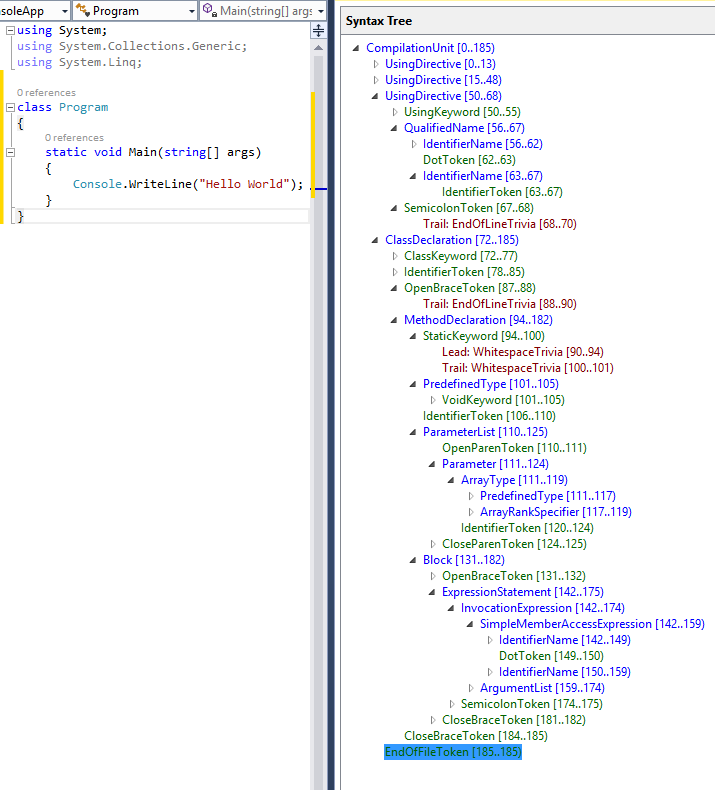

# Macros and Metaprogramming in the Rust Language

Although I haven't been able to set aside much time for a while, I try to get into Rust and Go whenever I find the time. Both are very popular among modern languages. Both do a very good job in different areas. If you're doing higher-level work like web programming or local app development, Go is definitely a very good language. If you're doing lower-level work that's a bit closer to the hardware, Rust is a good choice. Even though I don't get the chance to use them actively, I try to learn something about all languages at a surface level. In this article, I wanted to touch on metaprogramming in the Ruat language, one of the topics that challenged me in my learning process. But it turned out to be a veeeery long article. I hope you can read it patiently. I wish you happy reading in advance. 

In the Rust language, a macro is, in its simplest definition, defined as code that writes code. In general, we call this metaprogramming. The Rust macro concept and structure were largely inspired by the Lisp language. Besides that, it was also inspired by the C, C++ and Scheme languages. But macro usage in the Rust language is more useful and safer compared to these languages. Many developers in Turkey, including me, usually come from a Java, C#, JavaScript and Python background. Frankly, none of these languages has a technology that fully covers the macro concept in the Rust language as a standard. Of course, similar things can be done with different techniques or libraries, but when you examine it, you'll realize that it's a really powerful structure. Yes, enough marketing, let's examine the product a bit.


Before getting into metaprogramming, let's start with a simple introduction. If you've done some small coding with Rust, you've surely used macros. At least you've written println! :). At first glance, Println! looks like just a function. Frankly, the first question that came to my mind was "if I write it like a function, why is it called a macro and why is there an exclamation mark?"

Before diving deep, let's slowly get into the topic by looking for answers to questions like: what are the advantages of using macros? Why should or shouldn't we prefer macros over functions? 

## What Are the Advantages of Using Macros and the Differences from Functions?

- Functions are blocks of code that perform a specific task and are run when they're called. Functions   take a fixed number and type of parameters.

```rust
fn add(a: i32, b: i32) -> i32 {
    a + b
}

fn main() {
    let sum = add(5, 3);
    println!("Sum: {}", sum);
}
```

- Macros are structures that expand and generate code at compile time, and they can take a variable number and type of parameters. 
  Macros create other Rust code by writing Rust code.

```rust
macro_rules! multiply {
    ($num1:expr, $num2:expr) => {
        println!("{}", ($num1 as f64 * $num2 as f64));
    };

    ($num1:expr, $num2:expr, $num3:expr) => {
        println!("{}", ($num1 as f64 * $num2 as f64 * $num3 as f64));
    };
}

fn multiply(num1:f64, num2:f64) {
  println!("{}", (num1 * num2));
}

fn main() {
  multiply!(1.5, 2);
  multiply!(1.5, 1.5);
  multiply!((1.5 * 1.5), 2);
  multiply!((1.5 * 1.5), 2, -1);

  multiply(1.5, 2.0);
}
```
You may not understand the code right now; don't get hung up on it, we'll touch on the details later. 

This macro creates two functions with the create_function! macro: foo and bar. The macro creates the bodies of these functions using the given names. In other words, the system creates two functions for us. Imagine how much we can enrich this, how we can make many more extensions such as how these two functions will behave in which situation, their parameter counts, etc., and how much we can reduce code repetition. We haven't seen anything 
yet, but even this much information gives us the freedom to do a lot.

But in the explanation we mentioned that macros expand the code at compile time, that is, they generate code for us. How will we be sure of this? In other words, we defined the macro and ran it with the same name; it looks as if no code was generated.

To see whether code is really generated at the compile stage, we'll use a crate called [cargo-expand](https://crates.io/crates/cargo-expand). For this, we first install the crate with the `cargo install cargo-expand` command and run the `cargo expand` command in the terminal or powershell in the directory where our project is. We'll get an output similar to the one below.

```rust
fn multiply(num1: f64, num2: f64) {
    {
        ::std::io::_print(format_args!("{0}\n", (num1 * num2)));
    };
}
fn main() {
    {
        ::std::io::_print(format_args!("{0}\n", (1.5 as f64 * 2 as f64)));
    };
    {
        ::std::io::_print(format_args!("{0}\n", (1.5 as f64 * 1.5 as f64)));
    };
    {
        ::std::io::_print(format_args!("{0}\n", ((1.5 * 1.5) as f64 * 2 as f64)));
    };
    {
        ::std::io::_print(
            format_args!("{0}\n", ((1.5 * 1.5) as f64 * 2 as f64 * -1 as f64)),
        );
    };
    multiply(1.5, 2.0);
}
```
If you notice, while the function we defined stays as it is, we can see that as many functions were created as we used in the main function where we used the macro we wrote.

So now, by examining the example below, let's examine the technical differences between a macro and a function.

```rust

macro_rules! multiply {
    ($num1:expr, $num2:expr) => {
        println!("{}", ($num1 as f64 * $num2 as f64));
    };

    ($num1:expr, $num2:expr, $num3:expr) => {
        println!("{}", ($num1 as f64 * $num2 as f64 * $num3 as f64));
    };
}

fn multiply(num1:f64, num2:f64) {
  println!("{}", (num1 * num2));
}

fn get_num()->i32{
    return -1
}

fn main() {
  multiply!(1.5, 2);
  multiply!(1.5, 1.5);
  multiply!((1.5 * 1.5), 2);
  multiply!((1.5 * 1.5), 2, get_num());

  multiply(1.5, 2.0);
}

```

A function signature specifies the number and type of the parameters the function has. In other words, this structure is like its signature. The multiply function is defined once and used. Later, operations like changing it, extending it or overloading it at runtime can't be done.

On the other hand, if we examine the multiply! macro, the parameters it takes are each an expression, that is, we can pass any Rust code we want as a parameter to the macro, provided it returns a numerical value. 

Also, the macro can work with 2 or 3 parameters. This sort of resembles the overload concept.

As we mentioned above, macros expand the code at the compile stage. The macro controls how many different expansions it'll make using [pattern macthing](https://doc.rust-lang.org/book/ch18-01-all-the-places-for-patterns.html). As you can see here, we have a pattern with 2 and 3 parameters. So our code actually expands in 2 different ways. 

Of course, we could have done these two expansions by writing functions too. In that case, our code would compile faster. But of course, when we write code in real life, in a world without macros we'd have to write and maintain thousands of functions.

- Also, macros are expanded before the compiler interprets the meaning of the code, so a macro can, for example, implement a trait on a given type. A function can't do this, because it's called at runtime, and a trait needs to be implemented at compile time.

Let's try to understand what's meant through the example below.

We'll touch on the details later, but let's just give it here as an explanation: '#[derive(Debug)]' is actually a macro call. In Rust, the derive macro is used to automatically implement certain traits.

```rust
use std::fmt;

// macro definition for implementing the trait
macro_rules! impl_display {
    ($t:ty) => {
        impl fmt::Display for $t {
            fn fmt(&self, f: &mut fmt::Formatter) -> fmt::Result {
                write!(f, "{:?}", self)
            }
        }
    };
}

// using derive to add the Debug trait
#[derive(Debug)]
struct Point {
    x: i32,
    y: i32,
}

// implementing the Display trait for the Point struct
impl_display!(Point);

fn main() {
    let point = Point { x: 10, y: 20 };
    println!("{}", point); // Output: Point { x: 10, y: 20 }
}

```

Our goal is to implement the Display trait on the Point struct. For this, we wrote the impl_display macro. The Display trait lets the println! macro print the Point Struct. Let's examine it with the `cargo expand` command as we did above.

```rust
use std::fmt;
struct Point {
    x: i32,
    y: i32,
}
#[automatically_derived]
impl ::core::fmt::Debug for Point {
    #[inline]
    fn fmt(&self, f: &mut ::core::fmt::Formatter) -> ::core::fmt::Result {
        ::core::fmt::Formatter::debug_struct_field2_finish(
            f,
            "Point",
            "x",
            &self.x,
            "y",
            &&self.y,
        )
    }
}
impl fmt::Display for Point {
    fn fmt(&self, f: &mut fmt::Formatter) -> fmt::Result {
        f.write_fmt(format_args!("{0:?}", self))
    }
}
fn main() {
    let point = Point { x: 10, y: 20 };
    {
        ::std::io::_print(format_args!("{0}\n", point));
    };
}

```

If you notice, the Display trait appears to have been implemented on the Point struct. We don't need to focus much on the rest of the code. We can see how the other macros generate code too, but that's not our topic right now.

The trait is written before the code even starts to be interpreted. If this weren't the case, the println! function wouldn't work at all; in fact, our code wouldn't even compile. For example, I use RustRover, and when I comment out the line where I made the macro call, it gives a sytax error without even letting it compile.

- Another important difference between macros and functions is that we have to define macros or bring them into   scope before calling them in the file; functions, on the other hand, can be defined anywhere and called anywhere.

In the code block below, even though the function definition is defined after the main function where it's used, it will run without errors. 

```rust
fn main() {
    // The function is called here
    greet();
}

// The function can be defined anywhere
fn greet() {
    println!("Hello, world!");
}
```

The macro definition below, however, will give an error because it's defined after the main function.s


```rust
fn main() {
    // This call will give an error because the macro hasn't been defined yet
    greet!();
}

// You get an error when the macro is defined here
macro_rules! greet {
    () => {
        println!("Hello, world!");
    };
}
```

If the macro was defined outside the scope we're in, it won't work. In the example below, the macro in the my_macros.rs file is imported with `#[macro_use]`. At the same time, the macro is also exported on the macro with the `#[macro_export]` line. We can delete one of the two definitions. In other words, either macro_ue or macro_export has to stay.

```rust
// main.rs

#[macro_use]
mod my_macros;

fn main() {
    greet!();
}

// my_macros.rs

#[macro_export]
macro_rules! greet {
    () => {
        println!("Hello from macro!");
    };
}
```
What we need to know here is that we need to include the macro in scope before using it. In other words, the `mod my_macros;` 
line must have been imported before using the macro in the main function.

Of course, as nice as they are, there are situations where macros are disadvantageous too. The main purpose of macros isn't 
to replace functions anyway. The topics we mentioned above are just to understand how mokros work. But 
let's still look at their negative sides too.

- Debugging and Understandability: Macros usually generate code that's hard to debug. Errors may be in the macro's definition rather than in the code the macro expanded into, and tracking these errors can be hard.
Functions produce more distinct and understandable errors, which makes debugging easier.

- Type Checking: Functions work with specific types, and type checking is done at compile time. This helps catch type errors early.
Macros, on the other hand, don't do type checking, and type errors can occur when they're expanded. This can make compile errors harder to understand.

- Performance and Compile Time: Macros are expanded and recompiled every time they're called, which can lengthen compile time. Functions, on the other hand, are compiled once and optimize compile time.

- Code Reuse and Modularity: Functions provide a modular and reusable structure. This makes the code easier to read and maintain. Macros reuse code by expanding it, which can increase the complexity of the code.

- Error Messages: The error messages produced by macros can usually be more complex and hard to understand.
Functions produce more direct and understandable error messages, which helps developers solve errors faster.

- Scope Management: Macros can create problems related to scope. Especially when macros are used nested 
  within each other, scope management can get harder. Functions, on the other hand, have a specific scope, and scope management is simpler.

  
Now we can dive a bit deeper. 


## Abstract Syntax Tree (AST)


Before starting the topic, we need to understand the Abstract Syntax Tree concept.Abstract Syntax Tree (AST) is an abstract structure that turns a program's source code into a data structure representing the program's syntactic structure. AST makes it easier to understand and process the program's structure and hierarchy.

In an AST, each node represents a specific part of the program, and these nodes form a tree structure in relation to each other. Understanding and using the AST in the Rust language is quite important, especially in areas such as compiler writing, code analysis and tool development.

Let's go through an example.

```rust
fn add(a: i32, b: i32) -> i32 {
    a + b
}
```
The AST of the code above will be something like this.

```conf
Function
  ├─ Ident: "add"
  ├─ Inputs
  │   ├─ Argument
  │   │   ├─ Ident: "a"
  │   │   └─ Type: i32
  │   └─ Argument
  │       ├─ Ident: "b"
  │       └─ Type: i32
  ├─ Output: i32
  └─ Body
      └─ Expression
          └─ BinaryOperation: "+"
              ├─ Identifier: "a"
              └─ Identifier: "b"
```
This structure exists in most modern programming languages. For example, below you can see an example from the C# Roselyn compiler.


[image source](https://learn.microsoft.com/en-us/dotnet/csharp/roslyn-sdk/get-started/syntax-analysis)

Some benefits the AST provides us. 

- **Syntactic Analysis**:
  - Understanding the Code: AST represents the syntactic structure of the source code and allows the code to be analyzed in a structured way.
  - Error Detection: Compilers and analysis tools can detect and report syntax errors using the AST.
- **Code Transformation and Optimization**:
  - Code Transformations: AST allows the code to be transformed into different forms. For example, a compiler can turn the source code into machine code or intermediate code using the AST. 
  - Optimizations: Compilers can produce more efficient code by doing various optimizations on the AST.

- **Code Analysis and Tools**:
  - Static Code Analysis: AST lets static analysis tools examine the code in detail. These tools detect errors and potential issues to improve the quality of the code. 
  - Code Formatters and Refactoring Tools: AST allows the code to be formatted according to specific style rules or the code to be restructured.

Let's also take a look at the benefits the AST provides in the Rust Language
  
- **Safety and Error Management**:
    - Type Safety: Rust is known for its strong type system. The AST provides type checking, detecting type errors at compile time and making sure the code runs safely.
    - Memory Safety: Rust's ownership model provides memory safety. The AST applies this model and prevents memory-related errors and memory leaks.

- **Performance and Optimization**:
  - Optimizations: The Rust compiler produces high-performance code by doing various optimizations on the AST. These optimizations minimize memory and processor usage. 
  - Zero-Cost Abstractions: Rust allows abstractions to be used without a performance cost. The AST makes sure these abstractions are applied and optimized efficiently.

- **Macros and Metaprogramming**:
  - Macro System: Rust's powerful macro system allows code to be generated automatically and repetitive code to be reduced. The AST allows the code to be analyzed and transformed during macro operations. 
  - Derive Macros: With derive macros, Rust allows certain features to be applied automatically. The AST is used to process these macros and generate the appropriate code.
  
- **Advanced Compilation Process**:
  - Fast Compilation: The Rust compiler provides a fast and efficient compilation process using the AST. This keeps compile times short even in large projects. 
  - Detailed Error Messages: The AST allows detailed and understandable error messages to be produced during compilation. This helps developers quickly detect and fix errors.


Now we can continue with macros.


## Macro Types and Metaprogramming

In the Rust language, macros can be created in two ways.


1. **Declarative**: Done using the `macro-rules!` macro. It's the easiest way to define a macro.
2. **Procedural**: Lets you run, at compile time, code that works on Rust syntax and both consumes and produces Rust syntax. We can think of procedural macros as functions that go from one AST (abstract syntax tree) to another AST. 
   1. **Custom derive macro** - custom!(...)
   2. **Attribute-like macro** - #[derive(CustomDerive)]
   3. **Function-like macro** #[CustomAttribute]

Now let's examine them one by one.


## Declarative Macro

We had seen declarative macros superficially before, but there are many parts we haven't touched on.

It has a structure similar to match expressions. The code block in the matching pattern is run. It's written using the `macro-rules!` macro.


```rust

macro_rules! add{
    // a pattern that takes 2 parameters
    // while a and b are the parameter names, the word expr indicates that this parameter is an expression, that is, a rust expression
    ($a:expr,$b:expr)=>{
    // returns the result by adding the a and b parameters.
    // this way, this macro expands our code with the sum of the two expressions.
    // at the compile stage, code is added to our code for every place this macro is used.
            $a+$b
        }
    }
}

fn main(){
 // $a=1 and $b=2
    println!("{}", add!(1,2));
    
    println!("{}", add!((3*5), (2.0 + 4.0)));
}
```

If we examine this code with the `cargo expand` command, we'll see a result like the one below.

```rust
fn main() {
    {
        ::std::io::_print(format_args!("{0}\n", 1 + 2));
    };
    {
        ::std::io::_print(format_args!("{0}\n", (3 * 5) + (2.0 + 4.0)));
    };
}
```
As you can see, as much code was generated as the number of times the macro was run.


Of course, defining and using parameters isn't the only thing we can do. Besides `expr`, we have other token types too. 


- **item**: function, struct, module, etc.
- **block**: a block of code inside curly braces
- **stmt**: statement (let x = 5; is a statement)
- **pat**: pattern
- **expr**: expression (let x = 5 + 6; // 5 + 6 is an expression)
- **ty**: type
- **ident**: identifier (for example, like a function name)
- **path**: path (e.g., foo, ::std::mem::replace, transmute::<_, int>, …)
- **meta**: meta item, the expressions that go inside #[...] and #![...] attributes
- **tt**: a single token tree
- **vis**: pub (expresses whether it's public or not)

Now let's do some examples for these and more.


```rust
macro_rules! print{

    ($a:expr,$b:expr,$typ:ty)=>{
        println!("{}", ($a as $typ + $b as $typ));
    };

    ($a:expr)=>{
        println!("{}", ($a as &str));
    }

}

fn main(){
    print!(0,2,u16);
    print!("Hello");

}
```

We've defined and used two different  different patterns.

- **Repetition in Declarative Macros**

```rust
macro_rules! create_vector {

    // repeated expression: thanks to *, the expression can be repeated.
    ($($elem:expr),*) => {
        {
            let mut vec = Vec::new();
            $(vec.push($elem);)*
            vec
        }
    };
}

fn main() {

    // a closure that returns the sum of 2 numbers
    let num=|x| 3 + x;

    // we can send as many expressions as we want to the macro we defined.
    let v = create_vector![1, 2, (1+2), (2*2), num(2)];
    println!("{:?}", v);
}
```
As can be understood from the comment lines too, if we want to repeat our parameters, we can use *.

- **ident (Identifier)**: An identifier, that is, a variable, function or type name.

```rust
macro_rules! example {
    ($i:ident) => {
        let $i = 42;
    };
}

fn main() {

    example!(my_number);
    println!("{:?}", my_number);
}
```
Our macro named Example defines a variable named my_number. If we call it with the ` cargo expand` command, we'll see that code like the one below is generated.

```rust
fn main() {
    let my_number = 42;
    {
        ::std::io::_print(format_args!("{0:?}\n", my_number));
    };
}

```

- **ty (Type)**: A type. For example, i32, f64, String, etc.

The code below will also create 2 variables whose names and types we give it

```rust
macro_rules! create_variable {
    ($v:ident, $t:ty) => {
        let $v: $t = Default::default();
        println!("{}: {:?}", stringify!($v), $v);
    };
}

fn main() {
    create_variable!(x, i32);   // x: 0
    create_variable!(y, String); // y: ""
}
```

- **pat (Pattern)**: A pattern. For example, Some(x), None, Ok(v), etc.

```rust
macro_rules! match_pattern {

     // the pattern is taken as a parameter
    ($p:pat) => {
        match Some(42) {
            // if the pattern matches, it'll print pattern matched
            $p => println!("Pattern matched!"),
            _ => println!("Pattern did not match."),
        }
    };
}

fn main() {
    match_pattern!(Some(x) if x == 42); // matching pattern
}

```
- **path (Path)**: A path. For example, std::cmp::Ordering, self::module::Type, etc.

```rust
macro_rules! create_type {

    // the path is passed as a parameter and a variable of this type named _x is created
    ($p:path) => {
        let _x: $p = Default::default();
        println!("created type: {:?}", std::any::type_name::<$p>());
    };
}

fn main() {
    create_type!(std::collections::HashMap<String, i32>); // created type:
    // std::collections::HashMap<alloc::string::String, i32>
}
```

- **meta (Meta Item)**: An attribute meta item. For example, cfg(test), derive(Debug), etc.

```rust
macro_rules! apply_attribute {

    // the attribute passed as a parameter is applied to a struct created with the name Test
    ($m:meta) => {
        #[$m]
        struct Test;
    };
}

fn main() {
    apply_attribute!(derive(Debug));
    let t = Test;
    println!("{:?}", t); // Test
}
```

- **tt (Token Tree)**: A token tree. Any sequence of tokens.

The tt token type specifies a token tree. This can be any sequence of tokens and is usually used when macros need to be nested.

```rust
macro_rules! print_token_tree {
    // here we added the * character so that it can also take complex trees as parameters.
    ($($t:tt)*) => {
        println!("Token tree: {:?}", stringify!($($t)*));
    };
}

fn main() {
    print_token_tree!(foo(1, 2)); // Token tree: "foo ( 1 , 2 )"
    print_token_tree!({ let x = 42; x + 1 }); // Token tree: "{ let x = 42 ; x + 1 }"
}
```

Now let's do an example with what we've learned so far. Our goal is to create an SQL-like [DSL](https://en.wikipedia.org/wiki/Domain-specific_language) language using macros.


```rust

macro_rules! sql_query {
    // SELECT * FROM table
    (SELECT * FROM $table:ident) => {
        format!("SELECT * FROM {}", stringify!($table))
    };

    // SELECT columns FROM table WHERE condition
    (SELECT $($columns:ident),* FROM $table:ident WHERE $condition:expr) => {
        format!(
            "SELECT {} FROM {} WHERE {}",
            stringify!($($columns),*),
            stringify!($table),
            stringify!($condition)
        )
    };

    // SELECT columns FROM table
    (SELECT $($columns:ident),* FROM $table:ident) => {
        format!(
            "SELECT {} FROM {}",
            stringify!($($columns),*),
            stringify!($table)
        )
    };

    // INSERT INTO table (columns) VALUES (values)
    (INSERT INTO $table:ident ($($columns:ident),*) VALUES ($($values:expr),*)) => {
        format!(
            "INSERT INTO {} ({}) VALUES ({})",
            stringify!($table),
            stringify!($($columns),*),
            stringify!($($values),*)
        )
    };


}

fn main() {

    /*on these lines, when we write an sql statement that doesn't fit the patterns we defined above, we get an error. 
    for example, on the line below we get an error because we wrote Test after the SELECT statement. 
    The nice part is that, if you notice, the SQL statement we write here isn't a string expression.
    We write an SQL statement with our own plain keywords, and it's checked at the compile stage.
    
    let select_query = sql_query!(SELECT test name, age FROM users WHERE age > 30);*/
    
    let select_query = sql_query!(SELECT name, age FROM users WHERE age > 30);
    let insert_query = sql_query!(INSERT INTO users (name, age) VALUES ("Alice", 30));


    println!("{}", select_query);  // SELECT name, age FROM users WHERE age > 30
    println!("{}", insert_query);  // INSERT INTO users (name, age) VALUES ("Alice", 30)

}

```

- **item (Item)**: An item. For example, functions, modules, types, constants, etc.

Below, for example, we create a function.

```rust
macro_rules! create_function {
    ($i:item) => {
        $i
    };
}

create_function!(
    fn hello() {
        println!("Hello, world!");
    }
);

fn main() {
    hello(); // Hello, world!
}
```

If we check it with the `cargo expand` command, we can see that a new function has been created.

```rust
fn hello() {
    {
        ::std::io::_print(format_args!("Hello, world!\n"));
    };
}
fn main() {
    hello();
}

```
- **block (Block)**: A block. For example, { ... } blocks.

Below, a code block is passed to the macro as a parameter. Here it's possible to write not just a single item but many things. For example, in the example below we defined a nested macro.

```rust
macro_rules! exec_block {
    ($b:block) => {
        $b
    };
}
fn main() {
    exec_block!({
        macro_rules! nested_macro {
            ($e:expr) => {
                    println!("From nested macro : {}",$e);
            };
        }
        let x = 42;
        println!("Block executed, x = {}", x); // Block executed, x = 42
        nested_macro!(3);
    });
}
```

- **stmt (Statement)**: A statement. For example, a let declaration, an expression, etc.


```rust
macro_rules! exec_statement {
    ($s:stmt) => {
        $s
    };
}

fn main() {
    exec_statement!(let x = 42);
    // Statement executed, x = 42
    exec_statement!(println!("Statement executed, x = {}", x)); 

    exec_statement!(let y = "Hello");
    // Statement executed, y = Hello
    exec_statement!(println!("Statement executed, y = {}", y)); 
}
```

- **literal (Literal)**: A constant value. For example, numbers, characters, strings, etc.
The literal token type specifies a constant value. This can be numbers, characters, strings, etc.

if you notice, literal is a different type from expression. Here we're not giving code, just the constant value.

```rust
macro_rules! print_literal {
    ($l:literal) => {
        println!("Literal: {}", $l);
    };
}

fn main() {
    print_literal!(42); // Literal: 42
    print_literal!("Hello, world!"); // Literal: Hello, world!
}
```

- **vis (Visibility)**: A visibility specifier. For example, pub, pub(crate), etc.

The vis token type specifies a visibility specifier. This can be pub, pub(crate), etc.

```rust
macro_rules! define_struct {
    ($v:vis $name:ident) => {
        $v struct $name;
    };
}

define_struct!(pub MyStruct);

fn main() {
    let _ = MyStruct;
}

```

We've specified whether the created struct will be public or not. Here a public struct named MyStruct is created.


- **Example Application**

Now let's do a detailed example application. Our goal is to define getter and setter methods for the struct types we create. For this, we'll also use a crate called paste. 

Paste does exactly the job in the example below. In other words, it lets us concatenate idents.

```rust
use paste::paste;

paste! {
    // by concatenating each letter we give, it'll create a contant named QRST for us
    const [<Q R S T>]: &str = "success!";

}

fn main() {

        paste! { [<Q R S T>].len() };
        println!("{}", QRST); // "success!"
}
```

We write the example below using the Paste crate too. Don't forget to add the paste crate dependency to your Toml file.

```rust
// Cargo.toml
// [dependencies]
// paste = "1.0"

use paste::paste;

macro_rules! define_struct {
    (
        struct $name:ident {
            $(
                $field:ident : $ftype:ty
            ),* $(,)?
        }
    ) => {
        // Define the structure
        struct $name {
            $(
                $field: $ftype,
            )*
        }

        // Add the Getter and Setter methods
        impl $name {
            $(
                // Getter
                pub fn $field(&self) -> &$ftype {
                    &self.$field
                }

                // Setter
                paste! {
                    pub fn [<set_ $field>](&mut self, value: $ftype) {
                        self.$field = value;
                    }
                }
            )*
        }
    };
}

// Let's define a struct using the macro
// our define_scruect macro will write the setter and getter methods for us
// in fact, best of all, it'll have written our setters in the form set_field for all the filed.
// you can also see its usage below.
define_struct!(
    struct Person {
        name: String,
        age: u32,
        email: String,
    }
);

fn main() {

    println!("------------------- student ------------------");
    // Let's instantiate the structure and use the getter/setter methods
    let mut student = Person {
        name: String::from("Murat"),
        age: 18,
        email: String::from("murate@example.com"),
    };

    // Getter methods
    println!("Name: {}", student.name());
    println!("Age: {}", student.age());
    println!("Email: {}", student.email());

    // Setter methods
    // pay attention to the set_name and set_age matods.
    student.set_name(String::from("Murat Ali"));
    student.set_age(25);


    // Let's print the new values
    println!("Updated Name: {}", student.name());
    println!("Updated Age: {}", student.age());
    println!("Updated Email: {}", student.email());

    println!("------------------- teacher ------------------");

    let mut teacher = Person {
        name: String::from("Mehmet"),
        age: 18,
        email: String::from("mehmet@example.com"),
    };

    // Getter methods
    println!("Name: {}", teacher.name());
    println!("Age: {}", teacher.age());
    println!("Email: {}", teacher.email());

    // Setter methods

    teacher.set_age(48);


    // Let's print the new values
    println!("Updated Name: {}", teacher.name());
    println!("Updated Age: {}", teacher.age());
    println!("Updated Email: {}", teacher.email());

}

```

Yes, I think this will be enough for declarative macros. Now let's look at procedural macros a bit.


## Procedural Macros

Before diving into the topic, I'd like to mention some libraries that will be useful to us in the upcoming sections. These two crates are the most used libraries when writing macros, or rather, when writing metaprogramming.

- **syn**: Parses Rust source code into an abstract syntax tree (AST). This makes it easier to analyze and transform the code by breaking it into its parts.
- **quote**: Lets us create Rust code in a form specific to the Rust language instead of strings. This makes generating and transforming code more reliable and readable.

For syn, we create a project and edit the `main.rs` file as below.

```rust
use syn::{parse_str, ItemFn};

fn main() {
    // The function signature to be parsed
    let code = "fn my_function(param1: i32, param2: String) -> bool {}";

    // parse the function signature with the `syn` crate
    let ast: ItemFn = parse_str(code).expect("Failed to parse function");

    // Get the function name
    let fn_name = &ast.sig.ident;
    println!("Function name: {}", fn_name);

    // Get the parameters
    for input in &ast.sig.inputs {
        if let syn::FnArg::Typed(pat_type) = input {
            if let syn::Pat::Ident(pat_ident) = &*pat_type.pat {
                println!("Parameter: {}", pat_ident.ident);
            }
        }
    }
}
```

We edit our `Cargo.toml` file as below.


```toml
[package]
name = "my_app"
version = "0.1.0"
edition = "2021"

[dependencies]
syn = { version = "2.0", features = ["full"] }
```

When we run our code, we should see a result like the one below. If we pay attention to our code, we create an AST from a syring expression we know, and then, by analyzing it, we print the function and parameter names in the code to the screen.

```sh
Function name: my_function
Parameter: param1
Parameter: param2
```

Using the same project, let's also examine quote.


Let's change the `Cargo.toml` file as below.

```toml
[package]
name = "my_app"
version = "0.1.0"
edition = "2021"

[dependencies]
syn = { version = "2.0", features = ["full"] }
quote = { version = "1.0", features = ["full"] }
```

We also change the `main.rs` file as below.

```rust
use quote::quote;

fn main() {
    // Function name and parameters
    let fn_name = "my_function";
    let param1 = 42;
    let param2 = "Hello".to_string();

    // generating code with the `quote` crate
    let generated_code = quote! {
        #fn_name(#param1, #param2);
    };

    // Print the generated code
    println!("{}", generated_code);
}

```

When we run the code, we should see a result like the one below.

```
my_function(42, "Hello");
```

If our goal is to do metaprogramming, I think you've noticed how useful these two tools will be to us. Adding code into a piece of code at the compile stage actually means catching a code block, understanding its meta information such as its parameters, parameter types and the name of the related type, and making changes on it. In its simplest form, we need to parse it and, after parsing, understand what the words we get mean. On the other hand, we also need to add the code we add or change to the right place in the related AST (Abstract Syntax Tree). And these two crates help us throughout this whole process.


We'll also use these two libraries a lot in the procedural macro examples below.


### Derive Macro

It's used to implement a trait on a type. It's applied by writing it right above the related type in the form `#[derive(traid1, traid2)]`.

Some of the derive macros that are found in the standard libraries of the Rust language and are frequently used are as follows. I guess there's nobody who hasn't used the debuk and default macros.

- Debug
- Clone
- Copy
- PartialEq
- Eq
- PartialOrd
- Ord
- Hash
- Default

For example, in the example below, by applying the Debug derive macro, we made it possible for our User Struct to be printed directly itself with the `printrln!` makru.


```rust
#[derive(Debug)]
pub struct User {
    username: String,
    first_name: String,
    last_name: String,
}

fn main() {

    let my_user = User {
            username: String::from("muratcabuk"),
            first_name : String::from("Murat"),
            last_name: String::from("Cabuk")
    };

    println!("{:?}", my_user);
}
```

If this weren't the case, we'd have to write code similar to the one below for all the structs we write.

```rust
impl ::core::fmt::Debug for User {
    #[inline]
    fn fmt(&self, f: &mut ::core::fmt::Formatter) -> ::core::fmt::Result {
        ::core::fmt::Formatter::debug_struct_field3_finish(
            f,
            "User",
            "username",
            &self.username,
            "first_name",
            &self.first_name,
            "last_name",
            &&self.last_name,
        )
    }
}

```
And wasn't the job of macros to reduce code repetition anyway? In other words, now that the topic is understood, let's write our own derive macro.

In this project, our goal is to make sure the trait named HelloMacro is added when we add the `#[derive(HelloMacro)]` line on top of any struct.


Our project structure will be as below.

```
my_app
 |-- Cargo.toml
 |-- src
     |-- main.rs
 |--my_macro (under the my_app directory)
    |-- Cargo.toml
    |-- src
        |-- main.rs

```


We add a project named my_app, create a file named `main.rs` in the src folder and copy the code below into it.

Here we apply the derive macro named HelloMacro that we write right below. If you notice, HelloMacro is applied to the struct named MyStruct, and when the hello function is called, it's made to print `Hello, MyStruct!` to the screen.
`
```rust
use my_macro::HelloMacro;

pub trait HelloMacro {
    fn hello();
}

#[derive(HelloMacro)]
struct MyStruct;

fn main() {
    MyStruct::hello();
}
```


We edit the `Cargo.toml` file of the my_app project as below.

```toml
[package]
name = "my_app"
version = "0.1.0"
edition = "2021"

[dependencies]
my_macro = { path = "my_macro" }
```


We also create a project named my_macro under the my_app folder and add a `lib.rs` file to the src folder. We copy the code below into it.

While defining a derive macro, we add an attribute in the form `#[proc_macro_derive(YourMacroName)]` above the function we write. The TokenStream the function takes represents the token tree of the struct or enum we'll implement the trait on. The TokenStren we return represents its new version with the trait implemented.


```rust
extern crate proc_macro;

use proc_macro::TokenStream;
use quote::quote;
use syn;

#[proc_macro_derive(HelloMacro)]
pub fn hello_macro_derive(input: TokenStream) -> TokenStream {
    // Convert the incoming TokenStream into a Rust structure
    let ast = syn::parse(input).unwrap();
    
    // Create the new code
    impl_hello_macro(&ast)
}

fn impl_hello_macro(ast: &syn::DeriveInput) -> TokenStream {
    let name = &ast.ident;
    let gen = quote! {
        impl HelloMacro for #name {
            fn hello() {
                println!("Hello, {}!", stringify!(#name));
            }
        }
    };
    proc_macro::TokenStream::from(gen)
}
```
We edit the `Cargo.toml` file of the my_macro project as below. Note that we wrote it as a library and set the proc-macro property to true in the toml file.

```toml
[package]
name = "my_macro"
version = "0.1.0"
edition = "2021"

[lib]
proc-macro = true


[dependencies]
syn = "1.0"
quote = "1.0"
```


If we examine our my_app project with the `cargo expand` command, we can also see the code our macro actually generated.

```rust
use my_macro::HelloMacro;
pub trait HelloMacro {
    fn hello();
}
struct MyStruct;
impl HelloMacro for MyStruct {
    fn hello() {
        {
            ::std::io::_print(format_args!("Hello, {0}!\n", "MyStruct"));
        };
    }
}
fn main() {
    MyStruct::hello();
}

```


### Attribute Like Macro

Its usage is very similar to derive macros. While derive macros are used in the form  `#[derive(CustomDerive)]`, attribute-like macros are used in the form `#[CustomAttribute]`.

To get information about the attribute concept in the Rust language and to reach the list of attributes used as standard, you can look at [this link](https://doc.rust-lang.org/reference/attributes.html#built-in-attributes-index). 

- The biggest difference between them is that while derive macros can only be applied to stucts and enums, attribute-like macros can be applied to various items such as functions, modules, structures (structs) and enums. 
- Another important difference is that while derive macros are only used for trait implementation, attribute macros can be used for many operations; for example, you can manage [cross cutting concerns](https://en.wikipedia.org/wiki/Cross-cutting_concern), implement a trait, make additions or changes to the code, 

Well, if it's such a good thing, then we might ask, what's the need for derive macros?

- First of all, when applying derive macros, we can implement more than one trait at once.
- On the other hand, since there's a macro type in the system just for implementing traits, it's immediately understandable and readable for other Rust programmers. This syntax clearly states that the trait implementation is provided automatically.
- It increases the readability of the code and lets other developers quickly grasp the purpose and functionality of the code.
- the use of derive macros makes future maintenance of the code easier. Trait implementations are clearly stated, and future changes or extensions can be made more easily.
- 


Attribute macros are defined with a public function that has the proc_macro_attribute attribute and a function signature in the form `(TeokenStrem, TokenStream)->TokenStrem`, with two parameters, returning a TokenStream. The first TokenStream represents the attribute's own name and the token trees following it. The second parameter, the TokenStream, represents the piece of code the attribute was added to. The other attributes and the rest of the code are also found here.The returned TokenStrem is the modified new token tree. In other words, it's the new code that will replace the old code. 

```rust
#[proc_macro_attribute]
pub fn my_attribute_macro(_attr: TokenStream, item: TokenStream) -> TokenStream {
    item
}
```


If we use the my_attribute_macro attributu as below, the first TokenStream we wrote in the code above will contain these parameters.

```rust

#[my_attribute_macro(parametre1, parametre2="value2")]
fn my_function() {
    // some code
}

```
The second TokenStrem actually represents the item the macro is applied to, that is, its TokenStream. Inside our maktro, we can parse this code and make the changes we want. Here, the token tree of the my_function function forms the content of the second TokenStream. We'll understand it better with examples.

In the final analysis, with the first Token we get the parameters from where the macro is applied, with the second Token we get the tree the macro will be applied to, and we return the modified Token.

Now let's do an example or two.

In our first example, we'll start with a simple application to be able to understand how the attribute macro works.

Our goal is to print, where our macro is used, the parameters passed to the macro and the content of the function used.


Our project structure will be as below.

```
my_app
 |-- Cargo.toml
 |-- src
     |-- main.rs
 |--my_macro (under the my_app directory)
    |-- Cargo.toml
    |-- src
        |-- main.rs

```


We copy the code below into the `lib.rs` file under my_macro.

```rust

extern crate proc_macro;
use proc_macro::TokenStream;
#[proc_macro_attribute]
pub fn show_streams(attr: TokenStream, item: TokenStream) -> TokenStream {
    
    // we print the parameters coming to our macro.
    println!("attr: \"{attr}\"");

    // we print the code to be changed to the screen
    println!("item: \"{item}\"");

    // we return the TokenStrem without making any change in the related function.
    item
}

```

The `Cargo.toml` file of the my_macro project will be as below.

```toml
[package]
name = "my_macro"
version = "0.1.0"
edition = "2021"

[lib]
proc-macro = true


[dependencies]
syn = { version = "2.0", features = ["full"] }
quote = "1.0"
```


We also copy the code below into the `main.rs` file in the main directory.

```rust
use my_macro::show_streams;

#[show_streams]
fn invoke1() {
    println!("test");
    }
//  attr: ""
//  item: "fn invoke1() {}"

#[show_streams(bar)]
fn invoke2() {}
//  attr: "bar"
//  item: "fn invoke2() {}"


// relationships in the form a => b can also be sent
#[show_streams(a => b)]
fn invoke3() {}
//  attr: "multiple => tokens"
//  item: "fn invoke3() {}"


// a code block can also be sent as a parameter
#[show_streams { def a = 20; def b = "hello"; my_func();}]
fn invoke4() {}
//  "def a = 20; def b = "hello"; my_func();"
//  "fn invoke4() {}"

fn main() {
    invoke1();
    invoke2();
    invoke3();
    invoke4();

    println!("done")
}
```

The `Cargo.toml` file of the my_app project, that is, of the main directory, will be as below.

```toml
[package]
name = "my_app"
version = "0.1.0"
edition = "2021"

[dependencies]
my_macro = { path = "my_macro" }
syn = { version = "2.0", features = ["full"] }
quote = "1.0"
```

We'll use the syn and quote libraries later.


When we build our code, we'll see a result like the one below.

```
attr: ""
item: "fn invoke1() { println!("test"); }"
attr: "bar"
item: "fn invoke2() {}"
attr: "a => b"
item: "fn invoke3() {}"
attr: "def a = 20; def b = "hello"; my_func();"
item: "fn invoke4() {}"
```

As you can see, it's possible to pass very different parameters. Here we just tried to understand what each token was doing by also seeing it live.

so let's look at what we'll see if we run our code. We'll see exactly a result like the one below.

```
test
done
```

Because, if you remember, our macro returns the same function back as a TokenStream, meaning we don't make any change in the code. Because of this, since there's an operation only in the body part of the invoke1 function, the word test, which is its result, is printed. And we also saw that our main function prints done to the screen.

Now, for example, let's do something like this. When our code is run, when all the functions the makro is applied to are run, let the screen print a text saying "macro ran".

for this, we change our macro as below.


```rust
extern crate proc_macro;
use proc_macro::TokenStream;
use quote::quote;
use syn::{parse_macro_input, ItemFn};

#[proc_macro_attribute]
pub fn show_streams(attr: TokenStream, item: TokenStream) -> TokenStream {
    // We print the parameters coming to our macro.
    println!("attr: \"{attr}\"");

    // We print the code to be changed to the screen
    println!("item: \"{item}\"");

    // We convert the TokenStream to ItemFn
    let input = parse_macro_input!(item as ItemFn);

    // We get the function's name
    let func_name = &input.sig.ident;

    // We get the function's content
    let block = &input.block;

    // We create the function's new code
    let expanded = quote! {
        fn #func_name() {
            // We print the message before the function runs
            println!("{} hello from before running", stringify!(#func_name));

            // We call the original function code
            #block

            // We print the message after the function runs
            println!("{} hello from after running", stringify!(#func_name));
        }
    };

    // We return the new code as a TokenStream
    TokenStream::from(expanded)
}

```

When we run our code, we'll see a result like the one below.

```
invoke1 hello from before running
test
invoke1 hello from after running
invoke2 hello from before running
invoke2 hello from after running
invoke3 hello from before running
invoke3 hello from after running
invoke4 hello from before running
invoke4 hello from after running
done
```
As you'll see, without making any change in our functions, we were able to add texts at the beginning and end of our one to four functions.

Now let's improve our code a bit more and, if a parameter named age has been added and the value is less than 18, replace the value with 18 and change the fokiyon.

for this, we change our `main.rs` file as below.

```rust

    use my_macro::show_streams;

#[show_streams]
fn invoke1() {
    println!("test");
}

#[show_streams(bar)]
fn invoke2(age: i32) {
    println!("{}", age);
}

#[show_streams(a => b)]
fn invoke3(age: i32) {
    println!("{}", age);
}

#[show_streams { def a = 20; def b = "hello"; my_func();}]
fn invoke4() {}

fn main() {
    invoke1();
    invoke2(17);
    invoke3(25);
    invoke4();

    println!("done")
}


```

If you try to build and run the code in this form, you'll get errors saying the age parameters don't exist. The reason for this is hidden in the lines below in our macro. If you pay attention to the ` fn #func_name()` line, we return the function we received back without parameters. Since macros run at the compile stage, however many parameters we add, in the end we always get a parameterless function at runtime.

```rust
// shortened
 // We get the function's content
    let block = &input.block;

    // We create the function's new code
    let expanded = quote! {
        fn #func_name() {
            // We print the message before the function runs
            println!("{} hello from before running", stringify!(#func_name));

            // We call the original function code
            #block

            // We print the message after the function runs
            println!("{} hello from after running", stringify!(#func_name));
        }
    };

// shortened

```

That's why we change our macro as below. If you pay attention to the related line, `fn #func_name(#params) {`, we now take the function parameters and add them to the TokenStream of the function we newly created.

```rust
extern crate proc_macro;
use proc_macro::TokenStream;
use quote::quote;
use syn::{parse_macro_input, ItemFn};

#[proc_macro_attribute]
pub fn show_streams(attr: TokenStream, item: TokenStream) -> TokenStream {
    // We print the parameters coming to our macro.
    println!("attr: \"{attr}\"");

    // We print the code to be changed to the screen
    println!("item: \"{item}\"");

    // We convert the TokenStream to ItemFn
    let input = parse_macro_input!(item as ItemFn);

    // We get the function's name
    let func_name = &input.sig.ident;

    // We get the function's content
    let block = &input.block;


    // We get the function's parameters
    let params = &input.sig.inputs;

    // We create the function's new code
    let expanded = quote! {
        fn #func_name(#params) {
            // We print the message before the function runs
            println!("{} hello from before running", stringify!(#func_name));

            // We call the original function code
            #block

            // We print the message after the function runs
            println!("{} hello from after running", stringify!(#func_name));
        }
    };

    // We return the new code as a TokenStream
    TokenStream::from(expanded)
}

```

When we run the code, we'll get a result like the one below.

```
invoke1 hello from before running
test
invoke1 hello from after running
invoke2 hello from before running
17
invoke2 hello from after running
invoke3 hello from before running
25
invoke3 hello from after running
invoke4 hello from before running
invoke4 hello from after running
done

```

But this state isn't something we want; we wanted it to write 18 for values less than 18. And this is where it gets quite complicated. Because if more than one parameter is given, we need to change only the age barapamet without touching the other parameters at all.

Right here, let's think once more: is what we want to do sensible? If you remember, at the very beginning of our article we said that macros run at compile time. In other words, if, for example, we give a value we get from the database or from the user at runtime as the value of the age parameter, in that case the macro won't be able to evaluate that value. Then we should change our code by taking this situation into account too.

For this, we can follow a path like this. If there's a parameter named age among the parameters, we can add a function to the related function that will check this oaratre. We change the `lib.rs` file as below.

```rust
extern crate proc_macro;
use proc_macro::TokenStream;
use quote::quote;
use syn::{parse_macro_input, ItemFn, FnArg, PatType, Pat};

#[proc_macro_attribute]
pub fn show_streams(attr: TokenStream, item: TokenStream) -> TokenStream {
    // We print the parameters coming to our macro.
    println!("attr: \"{attr}\"");

    // We print the code to be changed to the screen
    println!("item: \"{item}\"");

    // We convert the TokenStream to ItemFn
    let input = parse_macro_input!(item as ItemFn);

    // We get the function's name
    let func_name = &input.sig.ident;

    // We get the function's content
    let block = &input.block;

    // We get the function's parameters
    let params = &input.sig.inputs;

    // add the code that checks the age parameter
    let mut age_check_call = quote! {};

    for param in params.iter() {
        if let FnArg::Typed(PatType { pat, .. }) = param {
            if let Pat::Ident(ident) = pat.as_ref() {
                if ident.ident == "age" {
                    age_check_call = quote! {
                        age = age_check(age);
                    };
                    break;
                }
            }
        }
    }

    // We create the code that supports the parameters and the flow
    let expanded = quote! {
        fn #func_name(#params) {
            // we check the age parameter and set it if necessary
            #age_check_call

            // We call the original function code
            #block

            // We print the message after the function runs
            println!("{} hello from after running", stringify!(#func_name));
        }
    };

    // We return the new code as a TokenStream
    TokenStream::from(expanded)
}

```

If you pay attention to the code, all parameters are scanned with a for loop, and if there's a parameter named age, the `age = age_check(age);` line is added for the expanded variable too, before the `#block` line, with the `#age_check_call` line.

But the age_check function needs to be defined within scope where it'll be used. In our example, its place is the `main.rs` file. Also, the age parameters need to be mutabel. You can see these changes below too.

```rust
use my_macro::show_streams;

// the age_check function checks the age parameter and sets it to 18 if necessary
fn age_check(mut age: i32) -> i32 {
    if age < 18 {
        age = 18;
    }
    age
}


#[show_streams]
fn invoke1() {
    println!("test");
}

#[show_streams(bar)]
fn invoke2(mut age: i32) {
    println!("{}", age);
}

#[show_streams(a => b)]
fn invoke3(mut age: i32) {
    println!("{}", age);
}

#[show_streams { def a = 20; def b = "hello"; my_func();}]
fn invoke4() {}

fn main() {
    invoke1();
    invoke2(17);
    invoke3(25);
    invoke4();

    println!("done")
}

```

When we run the code, we'll see a result like the one below.

```
test
invoke1 hello from after running
18
invoke2 hello from after running
25
invoke3 hello from after running
invoke4 hello from after running
done

Process finished with exit code 0

```
If you notice, we had given the parameter as 17 to the invode2 function, but it was printed to our screen as 18.

So let's examine what actually happened. For this, let's run the `cargo expand` command and look at the result.

Our `main.rs` file changed as below.

```rust
fn age_check(mut age: i32) -> i32 {
    if age < 18 {
        age = 18;
    }
    age
}
fn invoke1() {
    {
        {
            ::std::io::_print(format_args!("test\n"));
        };
    }
    {
        ::std::io::_print(
            format_args!("{0} hello from after running\n", "invoke1"),
        );
    };
}
fn invoke2(mut age: i32) {
    age = age_check(age);
    {
        {
            ::std::io::_print(format_args!("{0}\n", age));
        };
    }
    {
        ::std::io::_print(
            format_args!("{0} hello from after running\n", "invoke2"),
        );
    };
}
fn invoke3(mut age: i32) {
    age = age_check(age);
    {
        {
            ::std::io::_print(format_args!("{0}\n", age));
        };
    }
    {
        ::std::io::_print(
            format_args!("{0} hello from after running\n", "invoke3"),
        );
    };
}
fn invoke4() {
    {}
    {
        ::std::io::_print(
            format_args!("{0} hello from after running\n", "invoke4"),
        );
    };
}
fn main() {
    invoke1();
    invoke2(17);
    invoke3(25);
    invoke4();
    {
        ::std::io::_print(format_args!("done\n"));
    }
}

```

If you notice, the age_check function call was added only to the invoke2 and invoke3 functions. 

Actually, if you think about it, in real life you shouldn't write this kind of code that will change your workflow directly like this. For this kind of work, it makes more sense to do implementations like the validation or business specification pattern. Of course, macros will be used in these patterns too, but they'll be in a certain order.

But with the example I gave here, you can handle your cross cutting concern style operations such as cash, logging, security, etc. In fact, if you examine web frameworks, you can also see that attribute macros like these are frequently used for this kind of work. 

I think this will be enough to understand the attribute macro.


### Function-like Macro

At first glance, it resembles the declarative (makro_rules!) macro. But there are some differences.
- Declarative macros work with specific patterns. The rule matching the pattern is run. It's easy to use and is used to quickly manipulate specific items and expand the code.
- Procedural (here, of course, specifically function-like) macros, on the other hand, offer more advanced features, letting us analyze the code while allowing us to manipulate the code (syntax tree) directly. They can regenerate code, remove code or add new code.

Now let's do an example or two; the topic will be understood better.

Let's start with a simple example. The project structure is the same as the previous ones, so I won't write it again.

We replace the `lib.rs` file in the my_macro  project with the code below.


```rust
// lib.rs

use proc_macro::TokenStream;

#[proc_macro]
pub fn add_func(input: TokenStream) -> TokenStream {
    println!("Inputs: {}", input.to_string());
    "fn add(a:i32, b:i32) -> i32 { a + b }".parse().unwrap()
}
```
It takes a single TokenStream, which represents the tree to be changed. And it returns a TokenStream, which, as you can guess, represents the changed version of the code.

We also change our `main.rs` file under the my_app directory, that is, in the main directory, as below.

```rust
// main.rs

use my_macro::add_func;

add_func!();

fn main() {
    // we could have put the kmacro here too.
    // after all, we can write nested functions.
    // add_func!();

    println!("The sum is: {}", add(2, 3));
}
```

If we examine our code with the `cargo expand` command, we'll see that code like the one below is generated. Normally, we hadn't defined a function called add in `main.rs`. But we had called it in the main function as if it existed. This way, we compiled and were able to run our code without getting an error.

```rust
fn add(a: i32, b: i32) -> i32 {
    a + b
}
fn main() {
    fn add(a: i32, b: i32) -> i32 {
        a + b
    }
    {
        ::std::io::_print(format_args!("The sum is: {0}\n", add(2, 3)));
    };
}

```

Let's do an example that takes a String parameter and prints it to the screen. 

We change our `lib.rs` file under my_macro as below.

```rust
use proc_macro::TokenStream;
use quote::quote;
use syn::parse_macro_input;

#[proc_macro]
pub fn print_string(input: TokenStream) -> TokenStream {
    // Parse the input token stream
    let input = parse_macro_input!(input as syn::LitStr);

    // Get the String expression
    let string_value = input.value();

    // Generate Rust code using quote for code gen
    let expanded = quote! {
        println!("{}", #string_value);
    };

    // Return the generated code
    TokenStream::from(expanded)
}

```
We also change our `main.rs` file as below.

```rust
use my_macro::print_string;

fn main() {
    print_string!("Hello, world!");
    print_string!("I'm working with Rust procedural macros!");
}

```
when we run the code, we'll get an output like the one below.

```
Hello, world!
I'm working with Rust procedural macros!
```

Now let's do an example we did before with a function-like macro too. Let's write a function-like macro that will implemet a getter and setter trait on the struct passed to our macro as a parameter. 

For this, we change our `lib.rs` file as below.

```rust
use proc_macro::TokenStream;
use quote::quote;
use syn::spanned::Spanned;
use syn::{parse_macro_input, ItemStruct, Fields};


#[proc_macro]
pub fn create_accessors(input: TokenStream) -> TokenStream {
    // Parse the TokenStream given as the macro input into an ItemStruct
    let input = parse_macro_input!(input as ItemStruct);
    let struct_name = &input.ident;  // get the struct name

    // Create the struct definition
    let struct_definition = quote! {
        #input
    };

    // Iterate over the struct's fields
    let gen = match &input.fields {
        Fields::Named(fields) => {
            // Create the getter and setter methods
            let getters_setters = fields.named.iter().map(|f| {
                let field_name = &f.ident;  // Get the field name
                let field_type = &f.ty;  // Get the field type
                let setter_name = syn::Ident::new(&format!("set_{}", field_name.as_ref().unwrap()), field_name.span());  // Create the setter name

                // Getter method definition
                let getter = quote! {
                    pub fn #field_name(&self) -> &#field_type {
                        &self.#field_name
                    }
                };

                // Setter method definition
                let setter = quote! {
                    pub fn #setter_name(&mut self, value: #field_type) {
                        self.#field_name = value;
                    }
                };

                // Combine the getter and setter methods
                quote! {
                    #getter
                    #setter
                }
            });

            // Implement the getter and setter methods for the struct
            quote! {
                impl #struct_name {
                    #(#getters_setters)*
                }
            }
        }
        _ => panic!("create_accessors only supports named fields"),  // Only named fields are supported
    };

    // Combine the struct definition and the getter-setter implementations
    let output = quote! {
        #struct_definition
        #gen
    };

    TokenStream::from(output)  // Return a TokenStream as the result
}
```

We also change the `main.rs` file as below.

```rust
use my_macro::create_accessors;

create_accessors!(struct Person {
    name: String,
    age: u32,
});

fn main() {
    let mut person = Person {
        name: "Alice".to_string(),
        age: 30,
    };

    // Use the getters
    println!("Name: {}", person.name());
    println!("Age: {}", person.age());

    // Use the setters
    person.set_name("Bob".to_string());
    person.set_age(25);

    println!("Updated Name: {}", person.name());
    println!("Updated Age: {}", person.age());
}

```

I don't think there's any need to write the output of the code anymore. But I'd like to remind you of this: what we wrote here is just to understand the topic; otherwise, writing a macro like this just to add get and set methods may not make sense.


Before wrapping up the topic, I'd like to mention one more topic.

## Macro Hygiene

Macro Hygiene is a feature in Rust that makes sure macros work in a safe and predictable way. This concept aims to prevent unexpected variable name collisions and similar problems while macros generate code. Thanks to macro hygiene, the variables defined or used by macros are isolated independently of the context of the code they're called in.

Let's examine a simple example to understand macro hygiene:

```rust
macro_rules! create_var {
    () => {
        let x = 42;
        println!("x = {}", x);
    };
}

fn main() {
    let x = 0;
    create_var!();
    println!("Main scope x = {}", x);
}
``` 
In the code above, the create_var! macro is defined, and a variable named x is created inside the macro. When the macro is called, the x variable is defined and assigned 42 as its value. But a variable named x is also defined in the main function, and its value is 0. Thanks to macro hygiene, the x variable defined inside the macro doesn't collide with the x variable in the main function.

The output will be as follows:

```rust
x = 42
Main scope x = 0
```
This shows that the x variable defined inside the macro doesn't get mixed up with the x in the main function. Thanks to macro hygiene, the code inside the macro isn't affected by the local variables of the place it's called from and doesn't cause variables with the same name to get mixed up.

Let's examine the example below.

```rust
macro_rules! use_external_var {
    ($var:ident) => {
        println!("The value of {} is: {}", stringify!($var), $var);
    };
}

fn main() {
    let x = 100;
    use_external_var!(x); // "x" here is a variable name coming from outside
}

```

In the example above, the use_external_var! macro brings in a variable from outside using the x parameter of ident type given to it, and works with it. This bypasses macro hygiene and accesses the value of the x variable. If macro hygiene were preserved, the x variable would have to be defined inside the macro or be a variable defined by the macro.

The output will be as follows:

```rust
The value of x is: 100

```
Usages like this that bypass macro hygiene can lead to unexpected behavior and collisions, especially in large projects. For example, a collision can be seen in the scenario below:

```rust
macro_rules! use_external_var {
    ($var:ident) => {
        let $var = 200;
        println!("The value of {} is: {}", stringify!($var), $var);
    };
}

fn main() {
    let x = 100;
    use_external_var!(x); // Here "x" is a variable name coming from outside
    println!("Main scope x = {}", x);
}

```
The output will be like this.`

```
The value of x is: 200
Main scope x = 100

```

In this case, the let $var = 200; line inside the use_external_var! macro redefines the x variable and sets its value to 200. But this x isn't the same as the x in the main function, because macro hygiene prevents x from being redefined globally. This can cause confusion and make it harder to predict the behavior of the code.

In summary, when using macros, we need to be careful not to affect anything and not to be affected. In other words, **power is nothing without control**.


## Closing
Without going into detail, I'll make a recommendation or two and give a few resources I think will be useful.s

### Recommendations
- You should pay attention to the order when applying macros. In macros related to each other, the order will matter.
- Pay attention to the Macro Hygiene topic.
- If you intend to use the same code structure in many places, define this structure once with the declarative macro `macro_rules!` and use it everywhere.
- Use the derive macro to implement a trait.
- Use the attribue-like macro to analyze a specific structure and generate code accordingly.
- Use the function-like macro to transform or expand a specific code structure.
- Take care to write testable macros.
- Writing macros is complicated, and if they're not documented well, understanding how to use them can be complicated too. So document them very well.

### Recommended Resources


- On the [earthly.dev](https://earthly.dev/blog/rust-macros/)  page, there's nice information about real-life macro usage under the **Practical Examples of Macros** heading.
- Definitely examine the **Macro by Example** section in the Rust [official documentation](https://doc.rust-lang.org/reference/macros-by-example.html).
- It would also be good if you read [this Medium link](https://towardsdatascience.com/nine-rules-for-creating-procedural-macros-in-rust-595aa476a7ff), especially for more advanced, more detailed topics on the subject.
- On Jetbrains' official pages, there's a blog series where macros are explained at a simpler level with figures and diagrams; you can reach it from [this link](https://blog.jetbrains.com/rust/2022/03/18/procedural-macros-under-the-hood-part-i/).
- A `github.io` page prepared just for rust macros. You can reach it from [this link](https://danielkeep.github.io/tlborm/book/README.html). 
- On the soldev.app page, which has resources for Solona Development, a nice page has been prepared for macros. It explains all the macros in detail step by step. You can reach it from [this link](https://www.soldev.app/course/rust-macros). 
 

Yes, that's it for now for our first article about Rust; hope you found it useful. For a while more, whenever I find the time, I'll continue my articles about Ruat. 

Take care.


## Resources
- https://doc.rust-lang.org/book/ch19-06-macros.html#the-difference-between-macros-and-functions
- https://web.mit.edu/rust-lang_v1.25/arch/amd64_ubuntu1404/share/doc/rust/html/book/second-edition/appendix-04-macros.html
- https://doc.rust-lang.org/book/ch18-01-all-the-places-for-patterns.html
- https://doc.rust-lang.org/rust-by-example/index.html
- https://learn.microsoft.com/en-us/dotnet/csharp/roslyn-sdk/get-started/syntax-analysis
- https://blog.logrocket.com/macros-in-rust-a-tutorial-with-examples/
- https://earthly.dev/blog/rust-macros/
- https://www.rareskills.io/post/rust-function-like-macro
- https://developerlife.com/2022/03/30/rust-proc-macro/
- https://www.rareskills.io/post/rust-attribute-derive-macro
- https://doc.rust-lang.org/book/ch19-06-macros.html#function-like-macros
- https://www.freecodecamp.org/news/procedural-macros-in-rust/
- https://github.com/imbolc/rust-derive-macro-guide
- https://web.mit.edu/rust-lang_v1.25/arch/amd64_ubuntu1404/share/doc/rust/html/book/first-edition/procedural-macros.html
- https://cetra3.github.io/blog/creating-your-own-derive-macro/
- https://blog.devgenius.io/a-beginners-guide-to-rust-procedural-macros-creating-a-json-derive-macro-eb44279e7244
- https://github.com/dtolnay/proc-macro-workshop
- https://towardsdatascience.com/nine-rules-for-creating-procedural-macros-in-rust-595aa476a7ff
- https://doc.rust-lang.org/reference/macros-by-example.html#hygiene 

