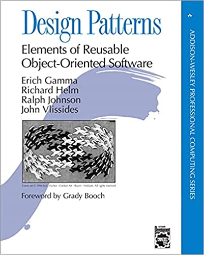
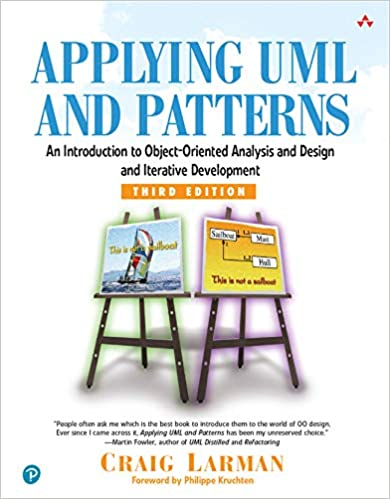
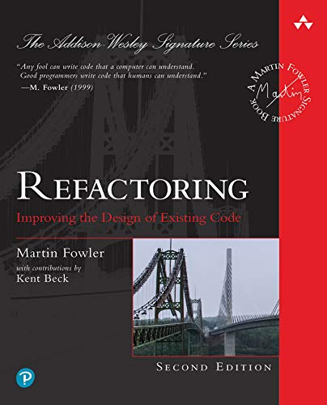

# Why Can't We Use Design Patterns?

Hello friends,

If you came here because of the title of the article, my guess is that you, like many developers, have studied design patterns over and over again and forgotten them before ever really using them properly.

The story begins like this: every time, a promise is made, "this time I'm going to use them", but they're never used. Because there's no need for them. While writing code, we think that a structure exactly like the example situation or the uml diagram we studied for the design pattern will come along. And we think that the moment this happens, we'll immediately make the connection or sense it :), say "ha, here's the moment I've been waiting for" and be able to use the related design pattern. Of course, since such a moment never comes, they're forgotten. And so the need never arises either.

Perhaps the first misconception is that, because design patterns are seen as a goal in themselves, people try to catch exactly the same situations. For example, plans like "one day I'll need to create an object so big that its constructor will need a ton of parameters, it'll be so complex, and that's why I'll use the builder design pattern for it. That day will be the golden day of my software life :)" are made.

But with such a point of view, it will be hard for design patterns to stick in our memory, or to apply them by trying to catch a pattern that fits exactly the same structure.

 

So first of all, we need to change the way we look at design patterns. The situations I mentioned above actually show that design patterns have been made into a goal. Whereas our real goal should be to follow/apply principles.

In the list below, you can find some of the most used principles.
 
- **SOLID** : Single Responsibility (SRP), Open/Closed (OCP), Liscov Substitution (LSP), Interface Segregation (ISP), Dependency Inversion (DIP)
- **GRASP**: General Responsibility Assignment Software Principles (controller, creator, indirection, information expert, low coupling, high cohesion, polymorphism, protected variations, and pure fabrication)
- **YAGNI** : You Aren't Gonna Need It Principle
- **DRY** : Don't repeat yourself
- **KISS** : Keep It Simple Stupid Principle

Of course there are many more principles. You can find many resources for these and others.

So the essence of it is that you should first get yourself used to writing clean code. This process can take much more time than digesting design patterns. For this, I'm adding a few of the most fundamental resources.

[Design Patterns: Elements of Reusable Object-Oriented Software](https://www.amazon.com.tr/Design-Patterns-Elements-Reusable-Object-Oriented/dp/0201633612)

[Clean Code: A Handbook of Agile Software Craftsmanship](https://www.amazon.com/Clean-Code-Handbook-Software-Craftsmanship/dp/0132350882)

[Applying UML and Patterns: An Introduction to Object-Oriented Analysis and Design and Iterative Development ](https://www.amazon.com/Applying-UML-Patterns-Introduction-Object-Oriented/dp/0131489062)

[Refactoring: Improving the Design of Existing Code](https://www.amazon.com/Refactoring-Improving-Existing-Addison-Wesley-Signature/dp/0134757599)

[Patterns of Enterprise Application Architecture](https://www.amazon.com/Patterns-Enterprise-Application-Architecture-Martin/dp/0321127420)

In a world without principles, we'd write everything however we wanted anyway. In that case, we'd have to memorize a separate principle for every situation, which would truly be pure memorization. Whereas what forces us to write design patterns should be our obligation to follow principles. As the same situations kept happening, [it occurred to someone](https://en.wikipedia.org/wiki/Design_Patterns) to write down the techniques developed for them.

Sometimes we may also have a direct goal or be looking for a solution to a problem. But still, the purpose of design patterns isn't directly just to produce a solution for your goal or problem; it's to produce a correct solution, that is, one that complies with principles. In other words, they try to keep us on the right path.

## Defining the Problem Is Harder Than Producing a Solution

Understanding whether there's a problem at all, or defining the problem, is harder than producing a solution for it. For example, we read the single responsibility principle, one of the SOLID principles, dozens of times. It doesn't seem very complex while reading it. Many developers think they write their functions to be single responsible. But we don't think about how we can write a namespace/package or a class to be single responsible. We think the job is done when we give a data-oriented file and class name in the related layer. As long as we don't constrain ourselves with principles, we can go for quite a long time without running into any problems. In this case, we can write code without feeling anything until it's too late.

Let's think about another SOLID principle, the open/closed principle. Although it usually looks like a topic related to classes, it actually covers all parts of the software. For example, the way to make a class closed to modification and open to extension also goes through writing functions with the same principle. One of the most important things to pay attention to when writing a function in line with the open/closed principle is writing the function in line with single responsibility. This way, a function tightly bound to its purpose will have fewer reasons to change.

Let's assume we have a very complex class that will be created as a result of several processes being completed. If there were no principles, we could create such a class with, for example, a constructor with 20 parameters. Most likely this class could be used without problems for quite a long time. But after a while, other classes that don't have all the parameters but need this class will start creating instances by passing null parameters to the constructor. In this case, the code will get more and more complex, because since the class has to respond to every request, we'll have to write a lot of if blocks inside it. Imagine we wrote other classes like this too. The end of this story is that a whole namespace or package goes off track, that is, we fail to achieve a single responsible structure.

If we had tried to write the same class in line with the SOLID principles, among the most fundamental principles, we'd first try to write a single responsible class. This might force us to write more than one class, because it seems hard for an object built with 20 parameters to focus on a single thing. So what will we do if the class really needs to be created with this many parameters, but not all the parameters are present in every object that will create an instance of this class? According to the Interface Segregation principle, we shouldn't make these classes depend on the same interface. We also said that our class depends on some processes. In other words, we have a class that needs to be created step by step. When we try to write code according to these constraints, we may find ourselves writing a builder design pattern. If you notice, even if we knew the builder design pattern, if we were writing code without pushing the principles, we wouldn't have a problem that required using a design pattern either. If we're aware of the basic design patterns, finding the pattern we need won't be very hard. Because we'll know very well what we want. We'll have handled the hard part of the job, that is, defining the problem.

As a result, thanks to principles, we prevent problems that might occur as our code grows. And to follow principles, we end up having to apply design patterns. We don't always need to try to solve problems by experiencing them. Since we can't always go back to the beginning, principles let us prevent problems before we even experience them.

## Memorizing Isn't a Bad Thing

So far, it's as if we've said that pure memorization is meaningless and won't last. Of course, this doesn't mean that memorizing is completely unnecessary. In the final analysis, we want to remember the related design pattern when we need it. By memorizing, of course, we don't mean memorizing like a poem, a song or a tongue twister, without settling the logical structure. But sometimes memorizing the main headings of a subject made up of big, interrelated topics, even with one sentence each, can speed up both the logic of the subject you're studying and our learning process.

As a matter of fact, one of the reasons why the relationships between design patterns are constantly mentioned in resources that explain them is to make them stick in your mind. When other design patterns are mentioned in a design pattern you're studying for the first time, it's perfectly normal that it doesn't mean anything on the first read. But knowing by heart, even if from memorization, in which situations design patterns are used and how they're structured in a few sentences will let us understand the relationships between them more easily and therefore make them last longer.

You can find some of the memorization techniques in the list below.

- **Method of Loci**: It's based on associating information with places
- **Acrostic (First Letter) Method**: It's built on producing meaningful words from the first letters of the information
- **Creating a Story**: Creating a memorable story with the information
- **Peg Method**: It's done by building a link between numbers and information. Since we already know the numbers, we try to remember the information we've built a meaningful relationship with.

Of course there are many more techniques. Developing your visual memory in particular will make it easier to keep UML diagrams in your mind. Memorizing all of them at first, even with one sentence each, and then starting to study will make it easier for you to understand the structural relationships between design patterns and the scenarios where they're used together.

## You Don't Have to Apply Design Patterns Using Exactly the Template You Learned

We don't have to apply the diagrams drawn in the resources that explain design patterns exactly, without changing them. In the first item we said "Design Patterns Are Not the Goal, They're the Result". Our goal is compliance with principles; we don't have to apply the patterns as they are. If you think about it, changing them according to our needs is actually a necessity. Because there may be differences between the situation in the resource we took it from and the situation we're experiencing, and applying it directly may produce results that go against some principles.

You can even work directly with concrete objects in the code you write as examples to make learning easier. I'm sure you've come across examples like this in resources too. This is a completely different teaching technique. The goal is to focus on the topic and increase retention. While learning, not dealing with the details and focusing directly on the purpose of the design pattern, and keeping a simpler diagram in mind, will increase both understanding and retention.

Especially if you have to apply more than one design pattern at the same time, you'll have to make some changes. That's exactly why hundreds of design patterns we haven't even heard of have emerged. But in the changes you make, we should pay attention to naming conventions. For example, we shouldn't use the word builder instead of the word factory. However differently we use the Factory method design pattern, in the end we'll have a factory method and it will create our object.

Now let's do some exercises that will make it easier to remember. Our goal will be to make them stick in our minds by expanding the contents a bit more and repeating them at each step. That's why I had to split the article in two; since there's a lot of repetition, the article naturally got a bit long. We'll be growing the subject little by little, and in the next step, in a way that includes the previous step as well,

## The Purposes of Design Patterns in a Single Sentence

Let's try to memorize them by repeating a few times, but it's not necessary for all of them to stick in our minds completely; our goal is to prepare for the next step.

### Creational Design Patterns

Creational design patterns are patterns that create objects instead of instantiating objects directly. This gives the program more flexibility in deciding which objects need to be created for a particular situation, and increases reusability.

- **Singleton**: Restricts object creation for a class to one instance. To put it a bit differently, it ensures that a single object is used by all the objects that need it.

- **Factory Method**: Used to create instances, with the help of a method, from different classes derived from the same interface.
  
- **Abstract Factory**: Lets us create a group of related but different objects with multiple factory methods inside a class. When necessary, it can be made up of more than one factory class.

- **Builder**: By separating the creation process/steps of a complex object from its representation, it allows different types of the same object to be created.

- **Prototype**: Allows cloning/copying objects that are very costly to create from similar instances created before.

### Structural Design Patterns

Structural design patterns are about the composition of classes and objects. They explain how objects and classes come together to form larger structures while keeping the structures flexible and efficient. Inheritance is usually used in compositions. In other words, the is-a relationship is preferred over the has-a relationship.

- **Adapter**: Allows two different interfaces to work together.

- **Bridge**: Used to separate an object's abstraction from its implementation. This way, the two can be extended independently of each other.

- **Composite**: If a parent-child (tree) relationship can be established between objects that have a common interface, it's used to abstract the client from the parts and let it deal with a single object.

- **Decorator**: Used to dynamically add new responsibilities to an object or change them.

- **Facade**: Used to provide a simpler interface for using very complex systems.

- **Flyweight**: Used in creating objects that are small on their own but would be very costly when created in the hundreds.

- **Proxy**: Used to stand in for the real object and do some work that the real object either can't do at all or does incompletely, without requiring any change on the client side.

### Behavioral Design Patterns

Behavioral design patterns deal with communication between objects and with assigning algorithms and responsibilities with the right communication methods.

- **Chain of Responsibility**: Allows a series of operations that need to be done on an object to be completed by the client, at its own decision, passing the object to the objects that can carry out the related responsibility.

- **Command**: The client's request (action, function and parameters) is delivered to the receiver as an object through an intermediary object. The goal is to abstract the client's request and the receiver's response from each other.

- **Interpreter**: Used in situations where texts in a certain format need to be processed.

- **Iterator**: Used to traverse the elements of a collection independently of their types.

- **Mediator**: Used to remove complex dependencies between objects doing similar work with loose coupling. Its meaning is a mediator anyway.

- **Memento**: Used to make it possible to go back to an object's previous state while hiding its internal structure and implementation details.

- **Observer**: Used to announce the changes that occur in an object to the objects that want to be informed about them.

- **State**: Used to make an object's behavior change when its internal state changes.

- **Strategy**: Used to be able to choose, at runtime, one of a group of algorithms that do the same job.

- **Template Method**: Used both to determine the order/arrangement of a series of tasks that need to be done in a certain order/arrangement, and to allow some of these tasks to be done by subclasses.

- **Visitor**: It's the design pattern that lets us run new operations on an object without changing the object

## Design Patterns with Real-Life Examples

Now let's try to reinforce these definitions by giving real-life examples. With each new heading, we'll continue by repeating what we learned in the previous heading. In the examples, our goal is to give examples we're likely to experience in real life rather than examples likely to be written in an application. In a way, by turning them into stories and building relationships with different objects, we'll make them stick in our memory more permanently.
### Creational Design Patterns

They're patterns that create objects instead of instantiating objects directly. This gives the program more flexibility in deciding which objects need to be created for a particular situation.

- **Singleton**:

**Purpose:** Restricts object creation for a class to one instance. To put it a bit differently, it ensures that a single object is used by all the objects that need it.
  
**Example:** For example, like everyone in the house using the fridge at home, or a group of neighbors on the street sharing a garbage container. When we need this kind of object while coding, the design pattern that will guarantee it is singleton.

- **Factory Method**: 

**Purpose:** Used to create instances from different classes derived from the same interface. It's a single method.
  
**Example:** For example, let's think of a factory that produces different models of the same car brand.

- **Abstract Factory**: 

**Purpose:** Creates a group of related but different objects. It's a class, made up of multiple factory methods. It can even sometimes be made up of more than one factory class.

**Example:** For example, let's think of a factory where different models of different car brands are produced. You could even add a third dimension, for example, using different factories to produce different models of different brands for different countries.

- **Builder**: 

**Purpose:** By separating the creation process/steps of a complex object from its representation, it allows different types of the same object to be created.

**Example:** When we want to buy a car, we go to the dealership. We say which features we want, and after a certain time the car we want is produced at the factory and delivered. Naturally, the production process is complex; many tasks are completed in order, following certain processes. While the building of the car and its processes are done at the factory, its presentation and sale are done by the dealership.

- **Prototype**: 
  
**Purpose:** Allows cloning/copying objects that are very costly to create from similar instances created before.

**Example:** When we go to a locksmith to copy a key, let's imagine for a moment that the locksmith asks for the lock cylinder of the door the key will be copied for, opens it up, measures the lengths millimeter by millimeter, calculates the angles of the key's teeth and produces the key for us according to this calculation. Since we now know about copying, this sounds so unnecessary, doesn't it?

If we think about how much cpu, memory and network the system uses to produce some objects we easily create with a single line of code, we can understand how often we make this mistake. Since we're not the ones writing that code, it may feel as if there isn't that much work involved. But in a multi-user application where performance is important, an object being created by using the system and the network heavily can cause serious problems.

### Structural Design Patterns

- **Adapter**: 

**Purpose:** Allows two different interfaces to work together.

**Example:** The adapters we use in real life do exactly the same job. The adapters we use to make the plug of an electronic device we bought from America fit the sockets in Turkey are an example of this.

- **Bridge**:

**Purpose:** Used to separate an object's abstraction from its implementation. This way, the two can be extended independently of each other.

**Example:** It's a bit hard to give a real-life example, but again, let's say no analogy is perfect and try to give an example. For example, let's say we're producing cars. It would be impossible for us to produce the cars in a way that meets the wishes of all customers. Instead, it would be less costly to produce the cars according to the technical documents we have (abstraction) with all the parts they basically need to have, and to get the features that vary from customer to customer from our customers during the purchase and complete the production. For example, the color, whether it has a sunroof or not.

- **Composite**: 

**Purpose:** If a parent-child (tree) relationship can be established between objects that have a common interface, it's used to abstract the client from the parts and let it deal with a single object.

**Example:** The goal is to create objects in a tree structure as a single composite object. Of course, libraries like this now exist in languages, but if we think about the dates the book was written, trying to explain it as a pattern seems to make sense. For example, you went to a dealership, asked the price of a car, and the salesperson started calculating the prices of all the parts one by one for you. Naturally, this would be very pointless. Of course, to calculate the price of a car, the prices of all the parts have to be known one by one, but as the buyer, this doesn't concern us.

- **Decorator**: 

**Purpose:** Used to dynamically add new responsibilities to an object or change them.

**Example:** It may not be a perfect example, but I think it will be memorable. For example, having LPG installed in our gasoline car could be an example of this.

- **Facade**:

**Purpose:** Used to provide a simpler interface in order to be able to use very complex systems.

**Example:**For example, while driving a car, we don't know what's going on behind the steering wheel. Or while using a computer, all we know is the keyboard, mouse and monitor; we don't need to know the rest of the details.

- **Flyweight**: 

**Purpose:** Used in creating objects that are small on their own but would be very costly when created in the hundreds.

**Example:** The solution is produced with the logic of "maybe there's no need to create that many objects, isn't there another way to do this?". For example, a car rental company can't buy a thousand cars for a thousand possible different customers. Instead, it rents a hundred cars to them at different times. In other words, the needs of a thousand customers are met, but this is done with a hundred cars. A property like which date the car will belong to whom isn't one of the car's intrinsic properties; it's just a state, and the same service is provided by changing it.

- **Proxy**: 
  
**Purpose:** Used to stand in for the real object and do some work that the real object either can't do at all or does incompletely, without requiring any change on the client side.

**Example:** It can be used for things like logging, caching, security and performance. The best real-life example might be lawyers. They can carry out the defense on our behalf in a case that we can't handle or couldn't handle very well ourselves. Or when we give a power of attorney at a notary, we can have someone else do a job we can't do for some reason. Or, for example, just as we can withdraw money from the bank with our bank card, we can also withdraw money from an ATM.

### Behavioral Design Patterns

- **Chain of Responsibility**: 

**Purpose:** Allows a series of operations that need to be done on an object to be completed by the client, at its own decision, passing the object to the objects that can carry out the related responsibility.

**Example:** When we go to government offices, we need to get some things done in order. A document we have will have some tasks that need to be done in order, and according to these, some offices are visited, the tasks that office needs to do are done, and then we move on to the next office. In the final analysis, when all the tasks are done, our business is finished with each office's approval signature. For example, you want to withdraw money from a bank, or you're going to apply for a loan. When you start this application or the withdrawal, a series of operations is done one after another in a certain order.

- **Command**: 

**Purpose:** The client's request (action, function and parameters) is delivered to the receiver as an object through an intermediary object. The goal is to abstract the client's request and the receiver's response from each other.

**Example:** For example, let's say we have an Android TV. We can control this TV both from our Android-based mobile phone and from the TV remote control. For example, whether we press the button on the remote control or on the phone to turn up the volume, the same command, that is, the volume up command, runs on the TV side. It'll be a strange description, but let's imagine for a moment that this volume up hardware on the TV was made specifically for each person. In that case, there would be a strong dependency between turning up the volume and the people who would control it. With the remote control or the phone, the dependency is reduced, and the implementation is made easier with the volume up command offered by the television. Not every remote control has to mount the television's volume up technical infrastructure on itself. It's enough for it to just send the signal the television requests from the device to turn up the volume.

- **Interpreter**: 

**Purpose:** Used in situations where texts in a certain format need to be processed.

**Example:** It can be used in situations we also deal with in real life, like decoding roman numerals or decrypting an encrypted text.

- **Iterator**: 

**Purpose:** Used to traverse the elements of a collection independently of their types.

**Example:** For example, a mail carrier or a courier visiting all the addresses on the list one by one and dropping off the packages could be an example. Who lives in the house, the shape of the house, etc. don't concern the mail carrier.

- **Mediator**: 

**Purpose:** Used to remove complex dependencies between objects doing similar work with loose coupling. Its meaning is a mediator anyway.

**Example:** For example, planes that want to land at an airport communicate with the tower, not with each other. Or people who want to buy or rent a house go to a real estate agent or a website instead of dealing with each other or with the sellers directly.

- **Memento**: 
**Purpose:** Used to make it possible to go back to an object's previous state while hiding its internal structure and implementation details.

**Example:** There's no need to give a direct real-life example. All situations where an object is taken back to its old state are examples of this design pattern.

- **Observer**: 
  
**Purpose:** Used to announce the changes that occur in an object to the objects that want to be informed about them.

**Example:** For example, you subscribed to a magazine, and your goal is to make sure the magazine reaches you when it comes out. Or wanting the website or application to send you an sms when there's a discount on a certain product could be given as an example.

- **State**:
- 
**Purpose:** Used to make an object's behavior change when its internal state changes.

**Example:** For example, in real life, when there's an abnormal expense on our credit card, if the bank puts our card into a locked state, our card no longer lets us make purchases. When the same card's state switches to safe, the credit card becomes usable again.

- **Strategy**: 
- 
**Purpose:** Used to be able to choose, at runtime, one of a group of algorithms that do the same job.

**Example:** To make it memorable, rather than giving a direct example for this, I'd like to say this: think of the moments in your life when, although there was more than one way to do something, you chose one of them. In some cases, you may have even chosen a different way for the same job at different times.

- **Template Method**: 

**Purpose:** Used both to determine the order/arrangement of a series of tasks that need to be done in a certain order/arrangement, and to allow some of these tasks to be done by subclasses.

**Example:** For a construction project to be done, all the tasks need to be completed in order. Contractors have to do the job they took on in accordance with certain procedures and their order. But they can also do some tasks their own way, to the extent the procedures allow. So different contractors can do the same job in different ways. Even if the basic procedures are the same, there will be many things they'll do differently.

- **Visitor**: 

**Purpose:** It's the design pattern that lets us run new operations on an object without changing the object.

**Example:** For example, let's imagine a doctor coming to a school to give vaccinations. Normally, the school doesn't have a service like vaccinating its students, meaning it's not one of its core jobs. The doctor who will give the vaccines comes to the school as a guest and vaccinates the students at the school. There's no need to make any change in the school's structure (for example, changing its organization chart) or in the students (for example, having them wear different clothes because they'll be vaccinated).

Hope you found it useful.

In the next article, we'll examine how to write design patterns with code examples.
# Resources
- https://egitimbilimlerinotlari.com/bilgi-isleme-kuraminin-temel-kavramlari/
- https://tr.wikipedia.org/wiki/Loci_Metodu
- https://ogrencikariyeri.com/haber/verimli-ders-calismanin-en-etkili-yontemleri
- https://hackernoon.com/how-to-remember-design-patterns-ap1z35sl
- https://www.codeproject.com/tips/57578/the-best-way-to-remember-design-patterns
- https://en.wikipedia.org/wiki/Design_Patterns
- https://dotnettutorials.net/course/dot-net-design-patterns/
- https://refactoring.guru/design-patterns
- https://www.dofactory.com/
- 
