# How Are Design Patterns Used Together? (Design Patterns 3)

Hello friends,

In our previous articles, we talked about the kinds of mistakes we make while trying to learn design patterns and and the techniques that can be applied to make them stick better. In this article, we'll touch on some structurally fundamental topics and then examine the structural similarities of design patterns with each other and how they're used together.

As we also mentioned in our first article, our goal is to make design patterns stay in our minds longer. Apart from that, we'll often have to use design patterns nested within each other too. Depending on our needs, we can use two or more design patterns together. But knowing the structural similarities or differences while using them will make integration easier for us. That's exactly why structural similarities are also touched on in many resources.

In general, the most fundamental similarities across all of them come from applying principles.

- We can say that abstraction is the heart of design patterns. It's one of the principles that should never be compromised. For example, so that upper classes don't depend on lower classes, instances of lower classes aren't created directly in upper classes. If you notice, in all of them, the interface (that is, the abstraction) of the related object is passed as a parameter, either through the constructor or by passing a parameter through another function. In other words, an object instance isn't created directly.
- Another similarity is that, as much as possible, the main object isn't changed, or rather, it's coded so that it won't change. For this, either the main object is passed as a parameter to another object, or the other object is passed as a parameter to the main object.

The texts where I talk about the relationships between design patterns are quoted from the [refactoring guru](https://refactoring.guru/) website. I especially recommend that you visit the two resources below.

- refactoring guru](https://refactoring.guru)
- [do factory](https://www.dofactory.com)

### Creational Design Patterns

They're patterns that create objects instead of instantiating objects directly. This gives the program more flexibility in deciding which objects need to be created for a particular situation.

- **Singleton**: 
  
**Purpose:** Restricts object creation for a class to one instance. To put it a bit differently, it ensures that a single object is used by all the objects that need it. 
  
**How It's Done**: in the first condition, for all requests that need the object, it's checked whether the object has been created. If there's no instance of the object yet, a lock statement is written on an object, and a second condition is placed inside this statement against the possibility of more than one request getting in, and if the instance still hasn't been created, it's created. As the requests that finish their work inside the lock exit the lock statement, every incoming request will see that the object has been created, so the object won't be created again.

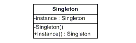

Since a single facade object is sufficient in most cases, a Facade class can often be turned into a Singleton.

Fly_weight would resemble Singleton if you somehow managed to reduce all the shared states of the objects to just one flyweight object. But there are two fundamental differences between these patterns:

There should be only one Singleton instance, whereas a Flyweight class can have multiple instances with different intrinsic states.
The Singleton object can be mutable. Flyweight objects are immutable.

- **Factory Method**: 
  
**Purpose:** Used to create instances from different classes derived from the same interface. It's a single method. 

**How Is It Done?:** All the objects to be created are derived from the same interface. Then the related object is created with a method inside a factory object that is also derived from an interface.

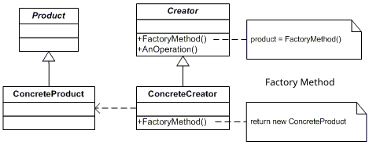

Many designs start by using Factory Method and evolve toward Abstract Factory, Prototype or Builder.

Abstract Factory classes are often based on a set of Factory Methods, but you can also use Prototype to compose the methods in these classes.

We can use Factory Method together with the iterator to let collection subclasses return different types of iterators that are compatible with the collections.

Factory Method is a specialization of Template Method. In other words, a Factory Method can serve as a step inside a large Template Method.

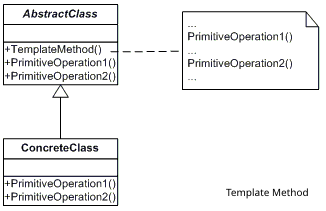

- **Abstract Factory**: 

**Purpose:** Creates a group of related but different objects. It's a class, made up of multiple factory methods. It can even sometimes be made up of more than one factory class.

**How Is It Done?:** All the objects to be created are derived from the same interface. Then the related objects are created with multiple methods inside a factory object that is also derived from an interface. If you want to produce more than one factory, more factory objects can be produced too.

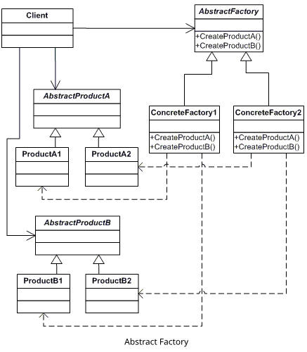

Many designs start by using Factory Method and evolve toward Abstract Factory, Prototype or Builder.

Builder focuses on constructing complex objects step by step. Abstract Factory specializes in creating the members of related objects. While Abstract Factory returns the product immediately, Builder lets us run some additional steps before fetching the product.

Abstract Factory classes are often based on a set of Factory Methods, but we can also use Prototype to compose the methods in these classes.

Abstract Factory can serve as an alternative to Facade when you only want to hide the way subsystem objects are created from the client code.

Abstract Factory, Builder and Prototype can be written as singletons.

- **Builder**: 

**Purpose:** By separating the creation process/steps of a complex object from its representation, it allows different types of the same object to be created. 

**How Is It Done?:** In its simplest form, with one or more builder objects, the parts of the related objects are written so that they're created in different functions. Then, with a director object, one or more builder objects are passed as parameters to the function that will create the related object.

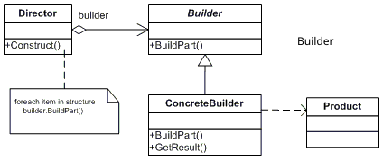

Many designs start by using Factory Method and evolve toward Abstract Factory, Prototype or Builder.

Builder focuses on constructing complex objects step by step. Abstract Factory specializes in creating the members of related objects. While Abstract Factory returns the product immediately, Builder lets us run some additional steps before fetching the product.

We can use Builder when creating a complex Composite tree, because we can program its constructor steps to work recursively.

- **Prototype**: 

**Purpose:** Allows cloning/copying objects that are very costly to create from similar instances created before.

If we think about how much cpu,memory and network the system uses to produce some objects we easily create with a single line of code, we can understand how often we make this mistake. Since we're not the ones writing that code, it may feel as if there isn't that much work involved. But in a multi-user application where performance is important, an object being created by using the system and the network heavily can cause serious problems.

**How Is It Done?:** A copy function is defined inside the object to be copied, and a copy of the object is returned.

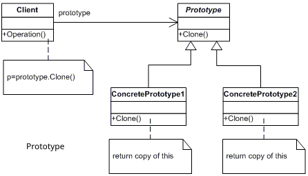

Many designs start by using Factory Method and evolve toward Abstract Factory, Prototype or Builder.

Builder focuses on constructing complex objects step by step. Abstract Factory specializes in creating the members of related objects.

Prototype can help when we need to save copies of Commands to the history.

Designs that make heavy use of Composite and Decorator can often benefit from using Prototype. Applying the pattern lets us clone complex structures instead of re-creating them from scratch.

### Structural Design Patterns

- **Adapter**: 

**Purpose:** Allows two different interfaces to work together. 

**How Is It Done?:** Like the adapters we use in real life, an intermediate object is created, and the source object is passed to the adapter object as a parameter. The data the client expects is presented by transforming it from the received source object. 

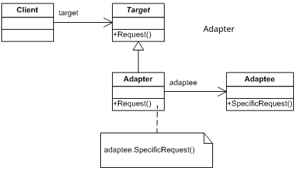

Bridge is usually designed up front and lets you develop the parts of an application independently of each other. Adapter, on the other hand, exists to make incompatible classes work together. 

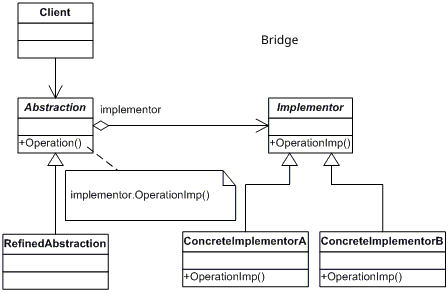

While Adapter changes the interface of an existing object, Decorator enhances an object without changing its interface. Also, Decorator supports recursive composition, which isn't possible when you use Adapter.

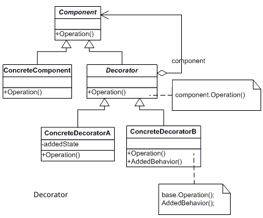

Adapter provides a different interface to the wrapped object; while Proxy does different work using the same interface as the object, Decorator provides an enhanced interface to the same class.

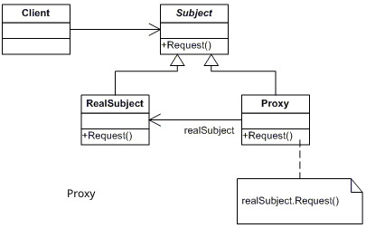

While Facade defines a new interface for existing objects, Adapter tries to make the existing interface usable. Adapter usually wraps just one object, while Facade works with a subsystem of multiple objects.

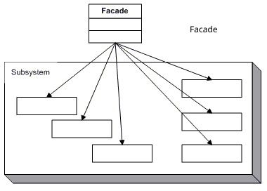
Bridge, State, Strategy (and to some degree Adapter) have very similar structures. However, they all solve different problems. 

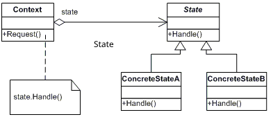

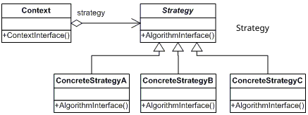

- **Bridge**: 

**Purpose:** Used to separate an object's abstraction from its implementation. This way, the two can be extended independently of each other.

**How Is It Done?:** It consists of two parts, abstraction and implementation. Part of the value the client requests is the part that doesn't change (abstraction), and the other part is the part that can be changed, that is, chosen on request (implementation). For example, we can write code that draws a shape, but we may need to let the client choose the color. For this, the abstraction part is written first, and the changing part is passed to the abstraction object as a parameter. 

Bridge is usually designed up front and lets you develop the parts of an application independently of each other. Adapter, on the other hand, exists to make incompatible classes work together.  

If Bridge is used for a very specific implementation, it can be used together with Abstract Factory. In this case, Abstract Factory can hide the relationships and hide the complexity from the client code. 

We can combine Builder with Bridge: the director class plays the role of the abstraction, while the different builders act as the implementation.

- **Composite**: 

**Purpose:** If a parent-child (tree) relationship can be established between objects that have a common interface, it's used to abstract the client from the parts and let it deal with a single object.

**How Is It Done?:** The same interface is applied to all the elements in the hierarchical structure. Each element keeps the list of its child elements or the information of a single child element.

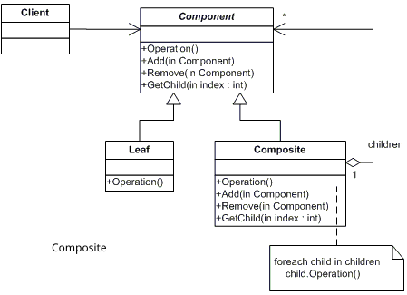

We can use Builder when creating a complex Composite tree, because we can program its construction steps to work recursively.

Chain of Resonsibility is often used together with Composite. In this case, when a node/leaf component of a tree receives a request, it can pass it through the chain of all parent components up to the root of the object tree.

You can use Iterator to traverse Composite trees.

We can use Visitor to execute an operation over a Composite tree.

To save some RAM, we can implement the shared leaf nodes of the Composite tree as Flyweights.

Composite and Decorator have similar structure diagrams, since both rely on recursive composition to organize an open-ended number of objects. Decorator is like Composite in structure, but it has only one child component. Another important difference is that Decorator adds additional responsibilities to the wrapped object, while Composite only "sums up" the results of its children. However, the design patterns can also cooperate: we can use Decorator to extend the behavior of a specific object in the Composite tree.

Designs that make heavy use of Composite and Decorator can often benefit from using Prototype. Applying the pattern lets us clone complex structures instead of re-creating them from scratch.

- **Decorator**: 

**Purpose:** Used to dynamically add new responsibilities to an object or change them.

**How Is It Done?:**  The object itself is passed as a parameter to the decorator class, which implements the same interface as the object to be decorated.

While Adapter changes the interface of an existing object, Decorator enhances an object without changing its interface. Also, Decorator supports recursive composition, which isn't possible when you use Adapter.

Adapter provides a different interface to the wrapped object; while Proxy implements the same interface without forcing the client to change,  Decorator provides an enhanced interface to it.

Chain of Responsibility and Decorator have very similar class structures. Chain of Responsibility handlers can execute arbitrary operations independently of each other. They can also stop passing the request further at any point. On the other hand, various Decorators can extend the object's behavior while keeping it consistent with the base interface. Also, decorators aren't allowed to break the flow of the request the way the chain can.

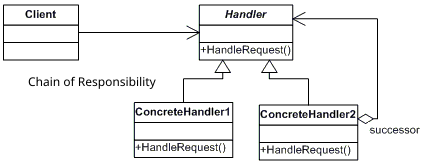

Composite and Decorator have similar structure diagrams, since both rely on recursive composition to organize an open-ended number of objects. Decorator is like Composite in structure, but it has only one child component. Another important difference is that Decorator adds additional responsibilities to the wrapped object, while Composite only "sums up" the results of its children. However, the design patterns can also cooperate: we can use Decorator to extend the behavior of a specific object in the Composite tree.

Designs that make heavy use of Composite and Decorator can often benefit from using Prototype. Applying the pattern lets us clone complex structures instead of re-creating them from scratch.

Decorator and Proxy have similar structures but very different purposes. Both patterns are built on the composition principle, where one object should delegate part of the work to another. The difference is that a Proxy usually manages the life cycle of its service object on its own, whereas the composition of Decorators is always controlled by the client.

- **Facade**: 

**Purpose:** Used to provide a simpler interface in order to be able to use very complex systems.

**How Is It Done?:**  With the help of a function inside the class, the functions in other objects are called in order.

While Facade defines a new interface for existing objects, Adapter tries to make the existing interface usable. Adapter usually wraps just one object, while Facade works with an entire subsystem of objects.

Abstract Factory can serve as an alternative to Facade when you only want to hide the way subsystem objects are created from the client code.

While Flyweight shows how to create lots of small objects, Facade shows how to create a single object that represents an entire subsystem.

Facade and Mediator have similar jobs: they try to organize collaboration between lots of tightly coupled classes. Facade defines a simplified interface to a subsystem of objects, but it doesn't introduce any new functionality. The subsystem itself is unaware of the facade. Objects within the subsystem can communicate directly. Mediator centralizes communication between the components of the system. The components only know about the mediator object and don't communicate directly.

Since a single facade object is sufficient in most cases, a Facade class can often be turned into a Singleton.

Facade is similar to Proxy in that it both buffers a complex entity and initializes it on its own. Unlike Facade, Proxy has the same interface as its service object, which makes them interchangeable.

- **Flyweight**: 

**Purpose:** Used in creating objects that are small on their own but would be very costly when created in the hundreds.

**How Is It Done?:**  First, to create the object, an interface or abstract class representing the related object is written. This interface offers functions for the parts that can be changed on the client side. These objects are usually created with the help of a factory and stored in a certain number (in list, array, dictionary, etc. objects). When the object is needed, it's read from the list and made available for use. The object that has finished its job is added back to the list. As long as all instances of the same object in the list aren't needed at the same time, there won't be a problem.

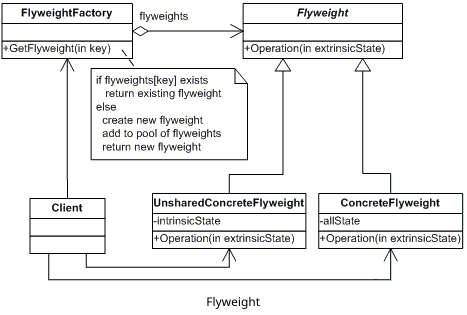

To save some RAM, we can implement the shared leaf nodes of the Composite tree as Flyweights.

While Flyweight shows how to create lots of small objects, Facade shows how to create a single object that represents an entire subsystem.

Flyweight would resemble Singleton if we somehow managed to reduce all the shared states of the objects to a single flyweight object. But there are two fundamental differences between these patterns: There should be only one Singleton instance, whereas a Flyweight class can have multiple instances with different intrinsic states. Second, the Singleton object can be mutable. Flyweight objects are immutable.

- **Proxy**: 

**Purpose:** Used to stand in for the real object and do some work that the real object either can't do at all or does incompletely, without requiring any change on the client side.

**How Is It Done?:**  A proxy object is written that implements the same interface as the object to be created. Depending on the need, additions and adjustments are made in the proxy class in a way that requires no change on the client side. 

Adapter provides a different interface to the wrapped object; while Proxy implements the same interface without forcing the client to change,  Decorator provides an enhanced interface to it.

Facade is similar to Proxy in that it both buffers a complex entity and initializes it on its own. Unlike Facade, Proxy has the same interface as the main object, which makes them interchangeable.

Decorator and Proxy have similar structures but very different purposes. A Proxy usually can manage the life cycle of the main object on its own, whereas a Decorator is always controlled by the client.

### Behavioral Design Patterns

- **Chain of Responsibility**:
 
**Purpose:** Allows a series of operations that need to be done on an object to be completed by the client, at its own decision, passing the object to the objects that can carry out the related responsibility.

**How Is It Done?:**  Although it looks very similar to Builder, the most fundamental difference is that there the only goal is creating an object, while here the goal is completing some piece of work. A series of objects implementing the same interface is created. Each object is like a link in the chain. On the implemented interface there's a function that takes the next step as a parameter. The next step also has to implement the same interface, so the interface itself is given as the parameter. Also, on this interface there's another function that takes the object to be operated on or whose data will be used as a parameter and does the necessary operations. After doing the job, this function passes the object it received as a parameter to the function with the same name on the object representing the next step. As in the example below, it's also possible to use an abstract class instead of an interface.

Chain of Responsibility, Command, Mediator and Observer address various ways of connecting senders and receivers of requests:

Chain of Responsibility passes a request sequentially along a dynamic chain of potential receivers until one of them handles it.

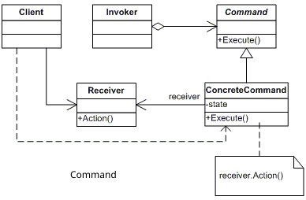

Command establishes unidirectional connections between senders and receivers.

Mediator eliminates direct connections between senders and receivers, forcing them to communicate indirectly via a mediator object.

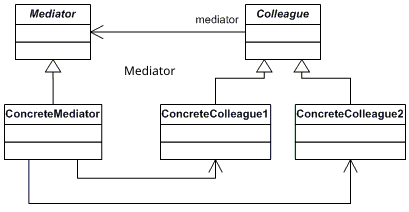

Observer lets receivers dynamically subscribe to and unsubscribe from receiving requests.

Chain of Responsibility is often used together with Composite. In this case, when a node/leaf component receives a request, it can pass it through the chain of all parent components up to the root of the object tree.

Handlers in Chain of Responsibility can be implemented as Commands. In this case, we can execute many different operations over the same context object, represented by a request. However, there's another approach, where the request itself is a Command object. In this case, you can execute the same operation in a series of different contexts linked into a chain.

Chain of Responsibility and Decorator have very similar class structures. However, there are a few important differences. Chain of Responsibility can execute arbitrary operations independently of each other. They can also stop passing the request further at any point. Decorators can extend the object's behavior while keeping it consistent with the base interface. Also, decorators aren't allowed to break the flow of the request.

- **Command**:

**Purpose:** The client's request (action, function and parameters) is delivered to the receiver as an object through an intermediary object. The goal is to abstract the client's request and the receiver's response from each other. 

**How Is It Done?:** A command object is created that will take the object to be operated on as a parameter through its constructor. The command object also offers a function for the operation to be done on the related object. 

Chain of Responsibility, Command, Mediator and Observer address various ways of connecting senders and receivers of requests:

Chain of Responsibility passes a request sequentially along a dynamic chain of potential receivers until one of them handles it.

Command establishes unidirectional connections between senders and receivers.

Mediator eliminates direct connections between senders and receivers, forcing them to communicate indirectly via a mediator object.

Observer lets receivers dynamically subscribe to and unsubscribe from receiving requests.

Handlers in Chain of Responsibility can be implemented as Commands. In this case, we can execute many different operations over the same context object, represented by a request.

We can use Command and Memento together when implementing "undo". In this case, commands are responsible for performing various operations over a target object, while mementos save the state of that object just before a command gets executed.

Command and Strategy may look structurally similar, because we can use both to parameterize an object with some action. However, their purposes are very different. We can use Command to convert any operation into an object. The operation's parameters become fields of that object. The conversion lets you defer the execution of the operation, queue it, store the history of commands, send commands to remote services, etc.Strategy usually describes different ways of doing the same thing, letting you swap these algorithms within a single class.

Prototype can help when we need to save copies of Commands to the history.

We can treat Visitor as a more powerful version of Command. Visitor can run operations over different objects of different classes.

- **Iterator**: 

**Purpose:** Used to traverse the elements of a collection independently of their types.

**How Is It Done?:**  Programming languages now come with many ready-made libraries for this. In many languages there are many iterable objects such as list, collection, enumerable, dictionary, array, etc. The design pattern is set up using these objects. First, the collection/array object is created. Then an iterator object is written that takes this object as a parameter and lets us traverse its elements. 

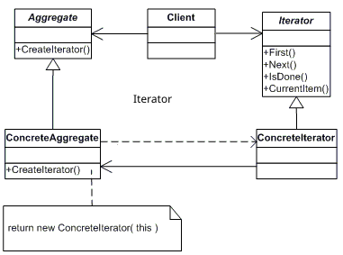

We can use Iterator to traverse Composite trees.

We can use Factory Method together with Iterator to let collection subclasses return different types of iterators that are compatible with the collections.

We can use Memento together with Iterator to capture the current state of the Iterator and roll it back if necessary.

We can use Visitor together with Iterator to traverse a complex data structure and execute some operation over its elements, even if they all have different classes.

- **Mediator**:

**Purpose:** Used to remove complex dependencies between objects doing similar work with loose coupling. Its meaning is a mediator anyway.

**How Is It Done?:**  First, the objects that will communicate with each other are defined. A mediator object is created that contains the list of these objects, or, even if there's no list, the definition of each object. The mediator object is passed as a parameter to the constructor of the objects that will communicate with each other. On the mediator object there's a function for communicating with the other objects. Since all objects take the mediator object as a parameter, they can communicate with each other. In the example below, the message sent goes to everyone.

Chain of Responsibility, Command, Mediator and Observer address various ways of connecting senders and receivers of requests:

Chain of Responsibility passes a request sequentially along a dynamic chain of potential receivers until one of them handles it.

Command establishes unidirectional connections between senders and receivers.

Mediator eliminates direct connections between senders and receivers, forcing them to communicate indirectly via a mediator object.

Observer lets receivers dynamically subscribe to and unsubscribe from receiving requests.

Facade and Mediator have similar jobs: they try to organize collaboration between lots of tightly coupled classes. Facade defines a simplified interface to a subsystem of objects, but it doesn't introduce any new functionality. The subsystem itself is unaware of the facade. Objects within the subsystem can communicate directly. Mediator centralizes communication between the components of the system. The components only know about the mediator object and don't communicate directly.

- **Memento**: 
**Purpose:** Used to make it possible to go back to an object's previous state while hiding its internal structure and implementation details.
 
**How Is It Done?:** A memento object is written to store the state of our main object (originator). In the memento object, the state of our real object is taken as a parameter through the constructor.

We can use Command and Memento together when implementing "undo". In this case, commands are responsible for performing various operations over a target object, while mementos save the state of that object just before a command gets executed.

We can use Memento together with Iterator to capture the current iteration state and roll it back if necessary.

Sometimes Prototype can be a simpler alternative to Memento. This works if the object whose state you want to store in the history is fairly simple and doesn't have links to external resources, or the links are easy to re-establish.

- **Observer**: 

**Purpose:** Used to announce the changes that occur in an object to the objects that want to be informed.

**How Is It Done?:**  First, the object that will be watched by the other objects is created. On this object there's a list of the objects that will watch it, that is, the observers, and a function to add elements to this list. Observer objects implement the same interface and offer a function for the change that occurs in the watched object to be passed on.  

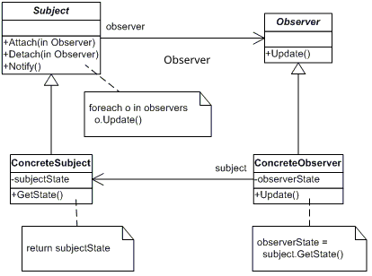

Chain of Responsibility, Command, Mediator and Observer address various ways of connecting senders and receivers of requests:

Chain of Responsibility passes a request sequentially along a dynamic chain of potential receivers until one of them handles it.

Command establishes unidirectional connections between senders and receivers.

Mediator eliminates direct connections between senders and receivers, forcing them to communicate indirectly via a mediator object.

Observer lets receivers dynamically subscribe to and unsubscribe from receiving requests.

Observier and mediator are structurally very similar, but of course very different in purpose. While Mediator's primary goal is to eliminate mutual dependencies among a set of system components, the goal of observer is to deliver information one-way to its subscribers about events that occur in the source.

- **State**:
  
**Purpose:** Used to make an object's behavior change when its internal state changes.

**How Is It Done?:**  An object is designed for each state. In these state objects, functions are defined for all the work to be done while in the related state. In other words, the work to be done while in state A and the work to be done in state B are exactly the same, but, that is, the work to be done in each state has a counterpart, and as a result they all implement the same interface. Then we define our real object, that is, the object we'll work on, with a constructor that will take the state interface as a parameter, or with a public variable.

Bridge, State, Strategy (and to some degree Adapter) have very similar structures. In fact, all of these patterns are based on composition, which delegates work to other objects. However, they all solve different problems. State can be considered an extension of Strategy.Strategy makes these objects completely independent and unaware of each other. State, however, doesn't restrict dependencies between concrete states, letting them change the state of the contex at will.

- **Strategy**: 

**Purpose:** Used to be able to choose, at runtime, one of a group of algorithms that do the same job.

**How Is It Done?:**  Strategy objects that do the same job in different ways are created so that they all implement the same interface. Then we create our object that will use these objects. This object takes the interface we implemented the strategy objects with as a parameter through its constructor.

Bridge, State, Strategy (and to some degree Adapter) have very similar structures. In fact, all of these patterns are based on composition, which delegates work to other objects. However, they all solve different problems.

Command and Strategy may look similar, because we can use both to parameterize an object with some action. However, their purposes are very different. We can use Command to convert any operation into an object. The operation's parameters become fields of that object. The conversion lets us defer the execution of the operation, queue it, store the history of commands, send commands to remote services, etc. Strategy, however, usually describes different ways of doing the same thing, letting you swap these algorithms within a single context class.

Decorator lets us change the skin of an object, while Strategy lets us change how the work is done.

Template Method is based on inheritance: it lets us extend subclasses by letting us change parts of the algorithm. Strategy is based on composition; it lets us choose one of the different strategies at runtime. 

State can be considered an extension of Strategy.Strategy makes these objects completely independent and unaware of each other. State, however, doesn't restrict dependencies between concrete states, letting them change the state of the contex at will.

- **Template Method**: 

**Purpose:** Used both to determine the order/arrangement of a series of tasks that need to be done in a certain order/arrangement, and to allow some of these tasks to be done by subclasses.

**How Is It Done?:**  Usually an abstract class is defined for the basic work. Not all functions inside this class have to do work. Some work is allowed to be done (overridden) by subclasses. Subclasses inherit this abstract class and override the methods they want.

Template Method is based on inheritance: it lets us extend subclasses by letting us change parts of the algorithm. Strategy is based on composition; it lets us choose one of the different strategies at runtime. 

Factory Method is a specialization of Template Method. In other words, a Factory Method can serve as a step inside a large Template Method.

- **Visitor**: 

**Purpose:** It's the design pattern that lets us run new operations on an object without changing the object.

**How Is It Done?:**  One or more visitor objects implementing the same interface are created. Methods are added to these visitor objects for the work to be done. Then we define our object/objects that we'll actually operate on so that they take our visitor interface as a parameter through the constructor.

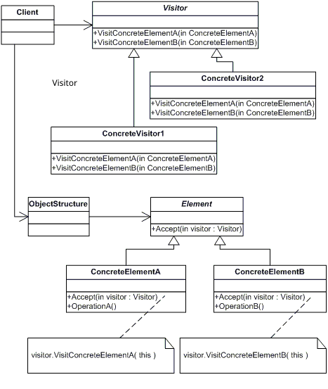

We can use Visitor to execute an operation over an entire Composite tree.

We can use Visitor together with Iterator to traverse a complex data structure and execute some operation over its elements, even if they all have different classes.

# Resources
- https://egitimbilimlerinotlari.com/bilgi-isleme-kuraminin-temel-kavramlari/
- https://tr.wikipedia.org/wiki/Loci_Metodu
- https://ogrencikariyeri.com/haber/verimli-ders-calismanin-en-etkili-yontemleri
- https://hackernoon.com/how-to-remember-design-patterns-ap1z35sl
- https://www.codeproject.com/tips/57578/the-best-way-to-remember-design-patterns
- https://en.wikipedia.org/wiki/Design_Patterns
- https://dotnettutorials.net/course/dot-net-design-patterns/
- https://refactoring.guru/design-patterns
- https://www.dofactory.com/
- 
