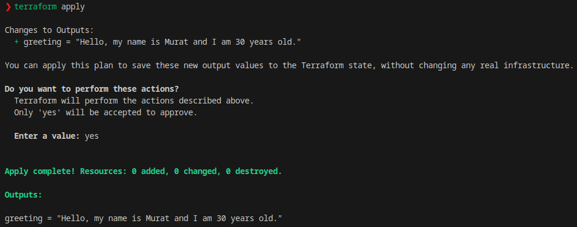
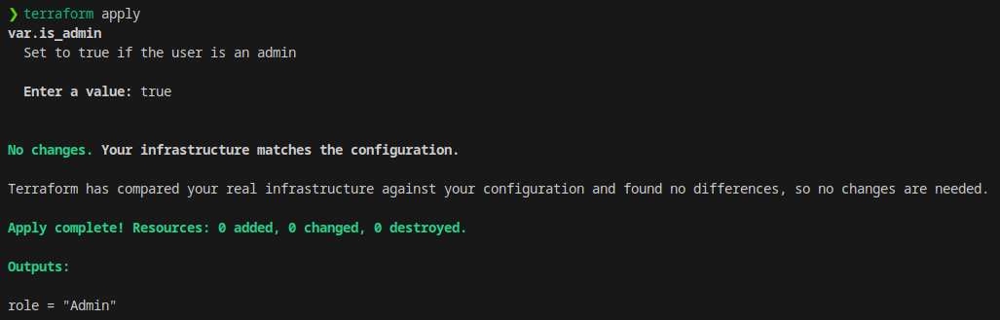
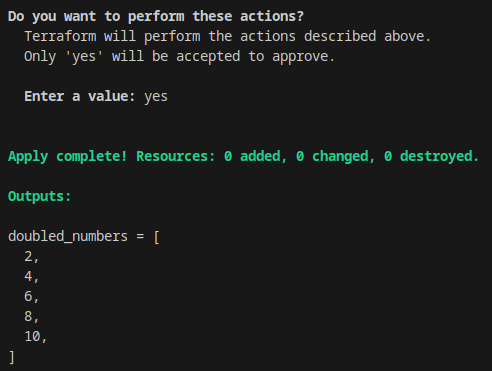
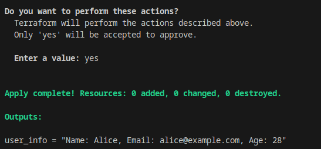
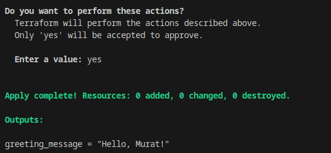

## What Is the HashiCorp Configuration Language (HCL)? How Is It Used?

In this article, we'll try to learn something about HCL, a declarative configuration language that HashiCrop uses in its products.

Our goal will be to try to understand HCL purely as a language. In other words, as much as possible, we'll try to understand it independently of the tools. Since we're not specifically working on a product like Terraform, Packer, etc., the examples we write will be on one or more of HashiCorp's products. But we won't be able to run all the code.

At the very end, we'll be doing runnable code examples. If I can continue, in the second article of this piece we'll also try to examine and learn Terraform on Azure.


Happy reading.


## What Is HCL?

HCL is a declarative configuration language developed by HashiCrop.

Literally, the word declarative means "stating" or "declaring". To open it up a bit, we call declarative the languages where we just say what we want without worrying about how the code will work, and the language itself prepares the result for us. Declarative also has an exact opposite, which we call imperative. In these languages, by writing how the work will be done, we specify how the language will achieve our actual goal.

I think it'll be better understood if we open it up a bit more.

- **Declarative:**
    - The declarative approach defines a system or operation by what is wanted to be achieved rather than how it will be achieved. In other words, it's a description of a goal.
    - The user specifies a state, and the system automatically performs the steps needed to reach that state. Instead of focusing on the details of the operation, the user defines the final state.
    - There are declarative examples such as SQL, HTML and NixOS configuration files. In SQL, you specify not how a data set will be retrieved, but what the retrieved data set should be.
    - It's easier to understand and maintain.
    - Configuration files and system configurations can usually be shorter and clearer.


- **Imperative:**
    - The imperative approach specifies how we'll carry out a system or operation step by step. In other words, it describes an operation step by step and executes each step in a specific order.
    - The user specifies each step of the operation and explains in detail how each step will be carried out.
    - The general programming logic in many programming languages is imperative. For example, you need to specify step by step how an operation will be carried out inside a loop.
    - It provides more control, especially in situations that require a specific order or condition.
    - The Main Difference Between Declarative and Imperative: Declarative specifies what needs to be done, while imperative specifies how it needs to be done.
    - Usage Context: Declarative is usually used in descriptive contexts such as configuration files, query languages and system configurations, while imperative is usually used in general programming and situations that require step-by-step control.


So we've also understood better why HCL is a declarative language.

As far as I know, it's currently only used by HashiCorp. This language is used in the configuration of Packer, Terraform and others. File extensions may vary depending on the tool used. For example, for Terraform it's `.tf`, while for Packer it's used as `.pkr.hcl`.

Since it's a configuration language, that is, not a general-purpose programming language, it doesn't have a runtime of its own. So it's interpreted and run by the tool it's used in (Terraform, Packer, Nomad, Vault, etc.).

- Nomad: https://developer.hashicorp.com/nomad/docs/configuration
- Vault: https://developer.hashicorp.com/vault/docs/configuration
- Terraform: https://developer.hashicorp.com/terraform/language
- Packer: https://developer.hashicorp.com/packer/docs/templates/hcl_templates

In its simplest form, a Terraform HCL document looks like the one below.

```hcl
# Comments are written here

variable "example_variable" {
  type = string
  default = "Hello, HCL!"
}

resource "aws_instance" "example" {
  ami           = "ami-123456"
  instance_type = "t2.micro"
}
```

In this example:

- the variable block defines a variable.
- the resource block defines a resource (for example, an AWS instance).
- lines starting with the \# symbol are comment lines.

If you notice, it's quite similar to the json format, but there are some differences.

- In HCL it's structured as key-value pairs and blocks, while in Json it's written as key-value pairs, but the syntax rules are stricter.
- In JSON, every key must be written in double quotes and there must be commas between the items.
- HCL allows spaces between parameters and offers a more flexible syntax.
- HCL supports comments (JSON has no comments).

HCL version:

```hcl
variable "region" {
  type    = string
  default = "us-west-2"
}
```

Json Version:

```json
{
  "region": "us-west-2"
}

```
- Complex data structures (lists, maps, blocks) and nested structures can be written in a more flexible and organized way. Data structures like lists and maps can also be defined easily. The same data structures can be used in JSON too, but we shouldn't forget that the JSON syntax is stricter and less readable.


HCL Version:

```hcl
regions = ["us-west-1", "us-west-2", "us-east-1"]

```

Json Version:

```json
{
  "regions": ["us-west-1", "us-west-2", "us-east-1"]
}
```
- It's possible to add comments, and these comments increase the readability of the file. Comments can be used to explain the code or to temporarily disable it. Single-line comments start with # or //, and for multi-line comments you can use \<\<EOF. Comments can't be added to JSON files. Since the purpose of JSON is data transfer, comments are generally forbidden.
- 
To get more information about the syntax, you can follow [this page](https://github.com/hashicorp/hcl/blob/main/hclsyntax/spec.md).


## Data Types


Let's examine the data types in HCL in two groups: basically **simple data types** and **complex data structures**

### **Simple Data Types**

1. **String**:
   - The **String** data type is used to store text or string data.
   - In HCL, strings are written inside double quotes (`"`). If they contain special characters or spaces, you can write them correctly too.
   - **Example**:
     ```hcl
     name = "Murat"
     greeting = "Hello, HCL!"
     ```

   - Strings can also be **multi-line**. For multi-line strings, you can use more than one line, and each one can be opened with a notation like `<<EOF`:
     ```hcl
     description = <<EOF
     This is a string
     that spans multiple lines.
     EOF
     ```

2. **Number**:
   - The **Number** data type represents numbers (integers and decimal numbers).
   - In HCL, numbers can be in **integer** or **decimal** format.
   - **Example**:
     ```hcl
     age = 30
     price = 99.99
     ```

3. **Bool (Boolean)**:
   - The **Bool** data type can take two values: `true` or `false`. It's usually used for logical comparisons, conditional expressions or status checks.
   - **Example**:
     ```hcl
     is_active = true
     is_deleted = false
     ```

### **Complex Data Structures**

HCL also supports more complex data structures. These data types let you build larger configurations.

1. **List**:
   - A **List** holds ordered data and can contain multiple items, each with a specific position.
   - Lists are defined inside square brackets (`[]`).
   - HCL can also include different data types in lists (for example, string, number, etc.).
   - **Example**:
     ```hcl
     fruits = ["apple", "banana", "cherry"]
     numbers = [1, 2, 3, 4, 5]
     ```

2. **Map**:
   - A **Map** is a data structure made up of key-value pairs. Keys are usually strings, and each key is bound to a value.
   - Maps are defined with `{}` (curly braces).
   - **Example**:
     ```hcl
     user_info = {
       name = "John"
       age = 25
       city = "New York"
     }
     ```

   - Within a map, keys must be unique and each key corresponds to a value.

3. **Set**:
   - A **Set** is a collection that contains items unique from each other. A set doesn't allow duplicate items.
   - Sets are usually defined like lists, but even though there's no clear syntax for the `set` type in HCL, you can see that structures of this type are mostly used in the form of lists in HCL.
   - **Example**:
     ```hcl
     unique_numbers = [1, 2, 3, 4, 5]
     ```

4. **Object**:
   - An **Object** is a data structure made up of nested key-value pairs. This is used to define more complex data structures.
   - **Example**:
     ```hcl
     person = {
       name = "Alice"
       address = {
         street = "123 Main St"
         city = "Wonderland"
       }
     }
     ```

   - Here, there's an `address` object inside the `person` object. Objects like this make it possible to define larger and more complex data structures.

#### c. **Variables and Specifying Data Types**

In HCL, data types are usually determined automatically. However, to add data type validation or constraints, you can make **variable definitions**. In HCL, when defining a variable, you may want to specify the data type.

- **Example**:
  ```hcl
  variable "example_string" {
    type = string
    default = "Hello"
  }

  variable "example_number" {
    type = number
    default = 42
  }

  variable "example_bool" {
    type = bool
    default = true
  }
  ```

In these examples:
- `"example_string"` is defined as a string type.
- `"example_number"` is defined as a number type.
- `"example_bool"` is defined as a bool type.

#### d. **Data Type Conversions**
HCL can convert one data type to another using some data type conversions and functions. For example, operations like converting a number to a string can be done.

- **Example**:
  ```hcl
  number_value = 123
  string_value = tostring(number_value)  # converts the number to a string
  ```

---

## Configuration Blocks

The content of the block concept will also vary from tool to tool. Our goal is to grasp the topic in terms of syntax. But in the end, we need to understand the topic through a tool, and here we've taken Terraform as the basis. For Packer, for example, you can look at [this page](https://developer.hashicorp.com/packer/docs/templates/hcl_templates/blocks).

After examining blocks through Terraform, we'll also take a brief look at the block concept for Packer, Nomad and Vault.


In the HCL language, **Configuration Blocks** are the basic components of the configuration file and let us define structures or resources that perform a specific function. Blocks in HCL usually include the definition of structures such as **resources**, **variables**, **modules** and **outputs**. Configuration blocks are used for many different purposes in the HCL language. These blocks are parts that perform a specific function and are usually structured with headers and key-value pairs. In the HCL language, a configuration block starts with a **block type**, and under it there are configuration properties and parameters.

### **General Structure of Blocks**

Each block has a structure like this:
1. **Block Type**: Determines the configuration type (for example, `resource`, `variable`, `output`).
2. **Block Name**: The configuration block can have a specific name (for example, `aws_instance`, `database`).
3. **Content**: Parameters and settings made up of key-value pairs.

Example:
```hcl
resource "aws_instance" "example" {
  ami           = "ami-123456"
  instance_type = "t2.micro"
} 
```
Here:
- `resource` is the block type.
- `"aws_instance"` is the block name and `"example"` is the resource label.
- The `ami` and `instance_type` key-value pairs in the content are the resource properties.

### **Resource Blocks**

**Resource blocks** are used to define infrastructure elements (for example, servers, databases, networks). `resource` blocks in the HCL language represent a specific infrastructure element and define its properties.

- **Example**:
  ```hcl
  resource "aws_instance" "example" {
    ami           = "ami-123456"
    instance_type = "t2.micro"
  }
  ```
  Here, the `aws_instance` resource has been defined, and properties such as `ami` and `instance_type` have been specified for this resource.

Resource blocks:
- Are used for creating infrastructure or managing existing infrastructure.
- Each resource is defined with a **block name** and a **resource type**.
  
### **Variable Blocks**

Variable blocks are used to provide dynamic values in configuration files. These blocks especially make it possible for the configuration to be reused with different environments or parameters.

- **Example**:
  ```hcl
  variable "region" {
    type    = string
    default = "us-west-2"
  }
  ```
  Here, a variable named `"region"` has been defined and its default value has been set to `"us-west-2"`.

Variable blocks:
- Make the values in the configuration file reusable by parameterizing them.
- The type and default value of variables can be defined.

### **Output Blocks**

**Output blocks** are used to expose the values obtained as a result of a configuration. For example, the `output` block can be used to extract information about a resource you created.

- **Example**:
  ```hcl
  output "instance_ip" {
    value = aws_instance.example.public_ip
  }
  ```
  Here, we're exposing the `aws_instance.example.public_ip` value as an output.

Output blocks:
- Are used to expose the values obtained from resources.
- Are usually used to extract information such as the IP address or other parameters of the created resources.

###  **Module Blocks**

**Modules** are configuration units that contain one or more resources, variables or outputs. Modules make larger and more complex configurations reusable. `module` blocks in the HCL language include another configuration file and integrate it into the current configuration.

- **Example**:
  ```hcl
  module "vpc" {
    source = "./modules/vpc"
    cidr_block = "10.0.0.0/16"
  }
  ```
  Here, the `vpc` module takes a configuration from the external `./modules/vpc` directory and uses it within the configuration. We'll see this later later in more detail.

Module blocks:
- Make infrastructure code reusable.
- Make repeated configurations more manageable through modules.

### **Provider Blocks**

**Provider blocks** are used to specify the external service providers used in the HCL configuration. For example, if you're going to create an AWS resource, you need to define the AWS provider with the `provider` block.

- **Example**:
  ```hcl
  provider "aws" {
    region = "us-west-2"
  }
  ```
  Here, the `aws` provider has been configured to connect to the AWS infrastructure.

Provider blocks:
- Connect to cloud service providers (AWS, Azure, Google Cloud, etc.).
- The provider's parameters are defined here (for example, API keys, region, etc.).

### **Comments and Descriptions**

You can also add **comments** inside configuration blocks. Comments are used to explain what the code does and don't affect any function in the configuration file. Comments are usually written with `#` or `//` at the beginning of the line.

- **Example**:
  ```hcl
  # we're configuring the AWS region settings
  provider "aws" {
    region = "us-west-2"
  }
  ```

### **Combining Blocks and Advanced Configurations**

More complex configurations can be created by combining multiple blocks. HCL can effectively combine these blocks to determine the dependencies between blocks.

- **Example**:


```hcl
resource "aws_security_group" "example" {
    name = "example-security-group"
    description = "Allow SSH access"
    ingress {
      from_port   = 22
      to_port     = 22
      protocol    = "tcp"
      cidr_blocks = ["0.0.0.0/0"]
    }
  }

resource "aws_instance" "example" {
    ami           = "ami-123456"
    instance_type = "t2.micro"
    security_groups = [aws_security_group.example.name]
  }
```

Here, the security group created with an `aws_security_group` resource has been integrated into an `aws_instance` resource.


For more details, you can look at the official Terraform page from [this link](https://developer.hashicorp.com/terraform/language/resources/syntax).


## The Block Concept for Packer, Nomad and Vault

Let's touch on them briefly and try to understand each with an example.


### The Block Concept for Packer

acker is a tool used to create images (machine images) for virtual machines, containers and other environments. HCL is also used in Packer configurations, but Packer's configuration blocks are more about the image creation process.


- source Blocks: Define the sources used to create images in Packer. A source forms the basis of a template.  Sources can be, for example, an AWS AMI or a Docker image.

```hcl
source "amazon-ebs" "example" {
  ami_name      = "my-ami"
  instance_type = "t2.micro"
  region        = "us-west-2"
  source_ami    = "ami-123456"
  ssh_username  = "ubuntu"
}

```
- build Blocks: build blocks enable images to be created using specific sources.


```hcl
build {
  sources = ["source.amazon-ebs.example"]
}

```

- provisioner Blocks: Provisioner blocks are used to apply configurations on top of the created image. These blocks usually do operations like copying files or installing software.

```hcl
provisioner "shell" {
  inline = ["echo Hello, World!"]
}

```


### The Block Concept for Nomad

Nomad is HashiCorp's workload scheduling and management tool. Nomad is used to run applications and jobs on containers or virtual machines. HCL is used in Nomad configuration files to make job definitions.

- job Blocks:

In Nomad, a job definition is made with the job block. Each job represents a specific workload (for example, a web server or a batch process).

```hcl
job "example" {
  datacenters = ["dc1"]
  type = "batch"

  task "web" {
    driver = "docker"
    config {
      image = "nginx:latest"
    }
  }
}

```

- task Blocks:

A task is the smaller unit of a job in Nomad, and each task can be a container or a job process. Each task usually runs a specific application or service.


```hcl
task "web" {
  driver = "docker"
  config {
    image = "nginx:latest"
  }
}

```

- group Blocks:

Group blocks are used to organize a specific workload by grouping multiple tasks.

```hcl
group "web-group" {
  task "web" {
    driver = "docker"
    config {
      image = "nginx:latest"
    }
  }
}

```


### The Block Concept for Vault

Vault is a HashiCorp tool used for managing secrets. Vault is especially concerned with authentication, authorization and secure data storage. Vault configuration files are also written using HCL.

- backend Blocks:

Defines Vault's storage backend. Which type of data storage will be used (for example, file or consul) is determined.

```hcl
backend "file" {
  path = "/vault/data"
}

```

- seal Blocks:

Configures Vault's encryption system. Encryption (seal/unseal) operations are used to ensure Vault's security.

```hcl
seal "awskms" {
  region = "us-east-1"
  kms_key_id = "arn:aws:kms:us-east-1:123456789012:key/abcdefg-1234-5678-abcd-efghijklmnop"
}

```

- listener Blocks:

Configures access to Vault over the network. Information such as which port Vault can be accessed through is defined here.

```hcl
listener "tcp" {
  address = "0.0.0.0:8200"
  tls_disable = 1
}

```
- audit Blocks:

Configures the audit operations within Vault. Which audit systems should be used is specified.

```hcl
audit "file" {
  path = "/var/log/vault_audit.log"
}

```


## Control Structures and Loops

Control Structures are important features in HCL that make configurations dynamic and offer the ability to make logical decisions and operate on data. Although HCL is generally a declarative language, it provides flexibility with certain conditions and loops.

### Control Structures

- **Conditions (If-Else)**

**Conditional structures** in HCL are used to check the truth of a value or a specific state. This makes it possible to perform a specific operation only when a specific condition is met.

 Instead of traditional `if-else` statements, HCL shortens conditional expressions by using the **ternary operator**.

**Using the Ternary Operator**:
The ternary operator follows this structure:
```hcl
condition ? true_value : false_value
```

This is an expression that returns `true_value` if the **condition** is true, and `false_value` if it's false.

**For example**:
```hcl
variable "environment" {
  default = "development"
}

output "instance_count" {
  value = var.environment == "production" ? 5 : 1
}
```

If the `environment` variable is `"production"`, the `instance_count` output will be `5`. If it's `"development"` or any other value, the `instance_count` output will be `1`.


- **Loops (For)**

HCL also provides flexibility to process data structures and operate on them with loops. The **`for`** loop is widely used, especially for operating on lists. This loop makes it possible to iterate over a data set (list, map, etc.) and operate on each item.

**Using Loops on Lists**:
The `for` loop is used like this to operate on a list:

**Example**:
```hcl
variable "regions" {
  type    = list(string)
  default = ["us-west-1", "us-west-2", "us-east-1"]
}

output "doubled_regions" {
  value = [for region in var.regions : region]
}
```
In this example, there's a `for` loop that operates on each item in the `regions` list and returns each item. This will reprocess each item in the list and give it as output.

**List Transformation Example**:
We can also use the `for` loop to process and transform a list. For example, to double the value of each item, code like the one below can be written.

**Example**:
```hcl
variable "numbers" {
  type    = list(number)
  default = [1, 2, 3, 4, 5]
}

output "doubled_numbers" {
  value = [for num in var.numbers : num * 2]
}
```
A `for` loop runs over the `numbers` list, and each item (`num`) is multiplied by 2 and returned as a new list.

**Using Loops on Maps**:
In HCL, the `for` loop can also be used on maps.

**Example**:
```hcl
variable "tags" {
  type = map(string)
  default = {
    "env" = "production"
    "owner" = "admin"
  }
}

output "tag_values" {
  value = [for key, value in var.tags : value]
}
```
In this example, the loop runs over each key-value pair in the `tags` map, and only the values (`value`) are returned.

**`for` Loop with a Conditional Expression**:
In HCL, you can do more dynamic processing by adding **conditional expressions** to the `for` loop. This lets you decide which items will be processed based on a condition.

**Example**:
```hcl
variable "numbers" {
  type    = list(number)
  default = [1, 2, 3, 4, 5]
}

output "even_numbers" {
  value = [for num in var.numbers : num if num % 2 == 0]
}
```
In this example, only the even numbers (`num % 2 == 0`) in the `numbers` list are filtered and returned.

**Loops and Complex Structures**

In HCL, loops can also be used to process more complex data structures. You can make use of loops especially when working with **nested lists** or **maps**.

**Example**:
```hcl
variable "users" {
  type = list(object({
    name  = string
    email = string
  }))
  default = [
    { name = "Alice", email = "alice@example.com" },
    { name = "Bob", email = "bob@example.com" }
  ]
}

output "user_emails" {
  value = [for user in var.users : user.email]
}
```
Here, each item in the `users` list is an object, and the `email` field of each object is processed with a `for` loop.

**Using Loops with `count`**

In HCL, the `count` property can also be used for loops. This is especially useful for creating multiple instances of the same resource. With `count`, you can specify how many times a resource will be created.

**Example**:
```hcl
resource "aws_instance" "example" {
  count = 3
  ami   = "ami-123456"
  instance_type = "t2.micro"
}
```
In this example, the `aws_instance` resource will be created 3 times. You can make more flexible configurations by changing the `count` value dynamically.


## Modules

They play a very important role in HCL (especially Terraform) configurations and make infrastructure code **reusable**, **modular** and **more manageable**. Modules can consist of one or more resources, variables or outputs, and these modules can easily be used in another configuration file. Modules provide great benefits, especially in large and complex infrastructure management.


**Module Definition (Example)**:
A module can contain a resource or a group of resources. For example, let's define a module that will create an AWS EC2 instance.

```hcl
# ./modules/ec2_instance/main.tf
resource "aws_instance" "example" {
  ami           = "ami-123456"
  instance_type = "t2.micro"
}
```

Here, a module named `ec2_instance` has been defined, and this module contains the resource needed to create an EC2 instance.

**Using a Module**

You can call the modules you've defined in another HCL file with the **`module`** block. The `source` parameter specifies where the module is located.


For example, to call the module, a configuration like this can be made in another file:

```hcl
# main.tf (main file)
module "ec2_instance" {
  source = "./modules/ec2_instance"
}
```

- With the `module` block, you're calling the `ec2_instance` module you defined earlier.
- The `source` parameter specifies the location of the module in the file system.

**Module Parameters (Variables)**

Modules can use **variables** to receive values from outside. By parameterizing modules, you can use the same module with different values in different environments.

**Module Variables (Example)**:
First, let's define the variable that will be used in the module.

```hcl
# ./modules/ec2_instance/variables.tf
variable "ami_id" {
  type = string
}
variable "instance_type" {
  type = string
}
```

This module will receive the `ami_id` and `instance_type` values from outside.

**Using a Module and Passing Parameters (Example)**:
In the main file where the module is used, we can assign values to these variables.

```hcl
# main.tf (main file)
module "ec2_instance" {
  source        = "./modules/ec2_instance"
  ami_id        = "ami-123456"
  instance_type = "t2.micro"
}
```

Here:
- Values are assigned to the `ami_id` and `instance_type` variables.
- These values match the variables defined in the module, and these values are passed to the resources inside the module.

**Module Outputs**

Modules can expose specific **outputs**. The outputs inside a module can be used in another configuration.

**Defining a Module Output (Example)**:
Let's define an output inside the module:

```hcl
# ./modules/ec2_instance/outputs.tf
output "instance_id" {
  value = aws_instance.example.id
}
```

Here, the `aws_instance.example.id` value has been set as an output. This is accessible by the configuration using the module.

**Using the Module Output (Example)**:
We can use the module output in the main file:

```hcl
# main.tf (main file)
module "ec2_instance" {
  source        = "./modules/ec2_instance"
  ami_id        = "ami-123456"
  instance_type = "t2.micro"
}

output "instance_id" {
  value = module.ec2_instance.instance_id
}
```
- The `instance_id` output defined in the module can be used in the main file.
- This output returns the ID of the EC2 instance.

**Reusing Modules and Modular Infrastructure**

Modules make infrastructure code **reusable**. You can reuse the same module in different files or projects. This increases the **maintainability** of the code and makes infrastructure management more efficient.

For example, when you create a `VPC` module, you can use it not only on **AWS** but also on **GCP** or another provider. Instead of setting up the same infrastructure every time, it's enough to just use the module with the necessary parameters.

**VPC Module Example (Reuse)**:
```hcl
# ./modules/vpc/main.tf
resource "aws_vpc" "example" {
  cidr_block = var.cidr_block
}

# main.tf (main file)
module "vpc" {
  source     = "./modules/vpc"
  cidr_block = "10.0.0.0/16"
}
```

Here, the `vpc` module is reusable and can be adapted for different environments with different parameters.

To get more information about modules, you can follow the official documentation from [this page](https://developer.hashicorp.com/terraform/language/modules).

## Data Structures and Advanced Topics


In addition to the basic data structures (string, number, bool), HCL also lets you use more complex data structures. This makes large infrastructure code more modular, reusable and flexible.

- **Objects**

**object** data structures in HCL refer to **complex data structures** that contain multiple key-value pairs. Objects are especially used to create nested data structures.

**Defining an Object**:
  Objects contain multiple **key-value pairs** and are usually used to define more complex configuration data.

  **Example:**
  ```hcl
  variable "server" {
    type = object({
      name    = string
      ip      = string
      enabled = bool
    })
    default = {
      name    = "server1"
      ip      = "192.168.1.1"
      enabled = true
    }
  }
  ```

The `server` variable has been defined as an object, and this object contains the `name`, `ip`, and `enabled` key-value pairs.  Each property of the object can be of a different data type.

**Accessing an Object**:
  To access the object's properties, you can write it like this:
  ```hcl
  output "server_name" {
    value = var.server.name
  }
  ```

This outputs the `name` property of the `server` object.

- **Nested Structures**

In HCL, data structures can be nested. This allows other objects or lists to be placed inside an object. Nested configurations are used to represent more complex and hierarchical data structures.

**Nested Objects**:
  In HCL, other objects can be defined inside an object.

  **Example**:
  ```hcl
  variable "server" {
    type = object({
      name    = string
      address = object({
        ip   = string
        port = number
      })
    })
    default = {
      name    = "webserver"
      address = {
        ip   = "192.168.1.1"
        port = 80
      }
    }
  }

  output "server_ip" {
    value = var.server.address.ip
  }
  ```

Inside the `server` object there's another object named **`address`**. This object contains the IP address and the port number. In the `output` block, the nested data is accessed in the form `server.address.ip`.

**Objects Inside Lists (Nested Lists)**:
  In HCL, objects can also be defined inside lists.

  **Example**:
  ```hcl
  variable "servers" {
    type = list(object({
      name    = string
      ip      = string
      enabled = bool
    }))
    default = [
      {
        name    = "server1"
        ip      = "192.168.1.1"
        enabled = true
      },
      {
        name    = "server2"
        ip      = "192.168.1.2"
        enabled = false
      }
    ]
  }

  output "server1_ip" {
    value = var.servers[0].ip
  }
  ```
The list named `servers` contains multiple objects. Each object holds the information of a server. To get the IP address of the first server, `var.servers[0].ip` is used.

- **Map Data Structures**

In HCL, the **map** data structure is used to store key-value pairs. Maps are collections where each key is bound to a value. HCL supports string keys and various value types (string, number, bool, etc.).

**Defining a Map**:
  In HCL, a map is usually used to store a set of key-value pairs.

  **Example**:
  ```hcl
  variable "tags" {
    type = map(string)
    default = {
      "env"   = "production"
      "owner" = "admin"
      "team"  = "devops"
    }
  }

  output "env_tag" {
    value = var.tags["env"]
  }
  ```

`tags` is a variable of map type and contains the values corresponding to the `env`, `owner` and `team` keys. In the `output` block, the value of the `env` key is output with the `tags["env"]` expression.

- **Data Manipulation with Iteration and Conditions**

HCL doesn't limit data manipulation to data types alone; data can also be filtered and transformed with **`for` loops** and **conditional expressions**.

**Filtering and Transforming Lists**:
  The `for` loop is especially used for transforming or filtering list elements.

**Example**:
  ```hcl
  variable "numbers" {
    type    = list(number)
    default = [1, 2, 3, 4, 5]
  }

  output "even_numbers" {
    value = [for num in var.numbers : num if num % 2 == 0]
  }
  ```

The `for` loop runs for each item in the `numbers` list and returns only the even numbers (`num % 2 == 0`).

**Nested List Filtering**:
  Filtering can be done within a list, and operations can even be done on nested lists.

**Example**:
  ```hcl
  variable "users" {
    type = list(object({
      name  = string
      email = string
      active = bool
    }))
    default = [
      { name = "Alice", email = "alice@example.com", active = true },
      { name = "Bob", email = "bob@example.com", active = false },
      { name = "Charlie", email = "charlie@example.com", active = true }
    ]
  }

  output "active_users" {
    value = [for user in var.users : user.email if user.active]
  }
  ```

The `users` list consists of objects containing user information. The `for` loop returns only the `email` values of the active users (active = true).

- **Data Manipulation and Advanced Functions**

HCL lets you operate on data with some **built-in functions**. These functions include operations such as string manipulation, list operations and numerical calculations.

**Example - The `join` Function**:
  You can join lists:
  ```hcl
  variable "regions" {
    type    = list(string)
    default = ["us-west-1", "us-west-2", "us-east-1"]
  }

  output "regions_string" {
    value = join(", ", var.regions)
  }
  ```

  In this example, the `join` function joins the items in the list and separates them with commas.


##  Outputs and Results

They play an important role in infrastructure management and in evaluating configurations in the HCL language. Outputs expose the result of a configuration and can be used in other configuration files, in modules, or with other operations as output. The use of outputs is common especially in tools like **Terraform**, because these outputs make it possible to communicate the state of the infrastructure changes or resources that were made.

- **Defining an Output**

In HCL, an **output** block is used to expose a specific value. An output usually shows the result of a resource, a variable or a calculated value.

**Basic Output Definition (Example)**:
```hcl
output "instance_id" {
  value = aws_instance.example.id
}
```

In this example:
- An output named `instance_id` has been defined.
- This output exposes the `aws_instance.example.id` value. In other words, the ID of the AWS EC2 instance will be returned as this output.

**Using the Output**

Using an output is usually done to use the exposed data in another operation or file. Outputs can also be passed to other configurations through modules.

**Using an Output (Example)**:
```hcl
module "web_server" {
  source = "./modules/web_server"
}

output "web_server_ip" {
  value = module.web_server.instance_ip
}
```

`module.web_server.instance_ip` exposes the IP address by using an output defined in the `web_server` module. This makes it possible for the IP address, which is a result of the module, to be used in another configuration.

- **Calculations and Manipulations in Outputs**

Outputs don't just expose values taken directly from resources; they can also do **calculations** or **manipulations**. This makes it possible to pass the obtained values outward in a more meaningful way.

**Output with a Calculation (Example)**:
```hcl
output "instance_count" {
  value = length(aws_instance.example)
}
```

In this example: the `length(aws_instance.example)` function returns the number of `aws_instance.example` resources that were created.


- **Encrypted and Sensitive Outputs**

For security reasons, outputs may contain encrypted or secret information. The **`sensitive`** parameter is used to hide an output. This is especially important for passwords, API keys or other sensitive data.

**Sensitive Output Definition (Example)**:
```hcl
output "db_password" {
  value     = aws_secretsmanager_secret.example.secret_string
  sensitive = true
}
```

Here:
- The `db_password` output contains encrypted data, and so it has been marked as `sensitive = true`.
- This indicates that the output is **secret**, and it's usually kept hidden in the terminal or in the output file.

- **Module Outputs**

Modules can expose the outputs they define within themselves. A module's output can be used by another configuration or module.

**Defining a Module Output (Example)**:
```hcl
# ./modules/web_server/outputs.tf
output "instance_ip" {
  value = aws_instance.example.public_ip
}
```

This defines an output of the `web_server` module and exposes it.

**Using the Module Output (Example)**:
```hcl
module "web_server" {
  source = "./modules/web_server"
}

output "web_server_ip" {
  value = module.web_server.instance_ip
}
```

The `instance_ip` output in the `web_server` module has been passed to the main configuration.

- **Specifying the Type of Outputs**

It's possible to specify the type of an output's value. This lets you control the **data type** of the output.

**Specifying the Output Type (Example)**:
```hcl
output "instance_ip" {
  value = aws_instance.example.public_ip
  type  = string
}
```

The type of the `instance_ip` output has been specified as **string**. This indicates that the value of the output is text.

- **Use Cases for Outputs**

**Returning Resource Identity Information**:
   Outputs are usually used to output identity information about a resource. For example, when you create an EC2 instance, you can output information such as its **IP address**, **ID** or **DNS name**.

   **Example**:
   ```hcl
   output "instance_ip" {
     value = aws_instance.example.public_ip
   }
   ```

**Providing Information to Dependent Modules**:
   Outputs are used to manage the **dependencies** between modules. One module's output can be used as another module's **input parameters**.

   **Example**:
   ```hcl
   module "network" {
     source = "./modules/network"
   }

   module "server" {
     source = "./modules/server"
     network_id = module.network.network_id
   }
   ```

**Monitoring Infrastructure Using Outputs**:
   Outputs can also be used to monitor and audit the state of the infrastructure. For example, getting information about when a resource was created or configured.


## Building an Application with HCL

Since we'll run our examples through Terraform, it needs to be installed on our computer. By the way, let me give one more piece of extra information. Since Terraform is now licensed, there's an open source project that's an alternative to it, even continuing as a one-to-one copy. From what I last read, it even supports Terraform state files one to one. The tool is called OpenTofu, and you can follow it on its [official page](https://opentofu.org/). When I looked just now, it had reached almost 24 thousand stars.

You can access the installation documents for all operating systems on its [official page](https://developer.hashicorp.com/terraform/install).

But for our examples, you don't need to have a cloud account. In other words, we won't really be creating components on cloud systems using Terraform.

- Printing the output to the console

For our first example, we create a folder named example1, create a file named `main.tf` inside it and copy the code below.

```hcl
variable "name" {
  type    = string
  default = "Murat"
}

variable "age" {
  type    = number
  default = 30
}

output "greeting" {
  value = "Hello, my name is ${var.name} and I am ${var.age} years old."
}

```

Then, using the terminal or powershell, we go to the example1 folder and run the commands below in order.

```shell
terraform init

terraform plan

terraform apply
```

When we run the last command, it will ask us to type `yes` to apply. When we type `Yes` and hit enter, we'll see a result like the one below.




- Checking the input taken from the user and printing the result to the console

In our second example, we'll take a value from the user, check it, and then return a result to the console based on the value taken.


For our example, we create a folder named example2, create a file named `main.tf` inside it and copy the code below.


```hcl
variable "is_admin" {
  type    = bool
  description = "Set to true if the user is an admin"
}

output "role" {
  value = var.is_admin ? "Admin" : "User"
}
```


Then, using the terminal or powershell, we go to the example1 folder and run the commands below in order.

```shell
terraform init

terraform plan

terraform apply

```

In the last command, we're asked whether the user is an admin or not. We need to enter the value true or false for this question. If we enter true, we'll see a result like the one below.





- Using loops and printing to the console

We create a folder named Example3, put a file named `main.tf` inside it and copy the code below.  

```hcl
variable "numbers" {
  type    = list(number)
  default = [1, 2, 3, 4, 5]
}

output "doubled_numbers" {
  value = [for num in var.numbers : num * 2]
}

```

We can run the code as in examples 1 and 2.




- Using Objects and Nested Structures and printing the results to the console 


We create a folder named example4 and run our code as in examples 1 and 2.


```hcl
variable "user" {
  type = object({
    name  = string
    email = string
    age   = number
  })
  default = {
    name  = "Alice"
    email = "alice@example.com"
    age   = 28
  }
}

output "user_info" {
  value = "Name: ${var.user.name}, Email: ${var.user.email}, Age: ${var.user.age}"
}

```
The result will be as below.




- Sensitive Outputs


The db_password output has been marked as sensitive. This makes sure the output of the data doesn't appear in the console.
Output: Since it's sensitive data, it will be invisible.

```hcl
output "db_password" {
  value     = "supersecretpassword"
  sensitive = true
}

```

- Using modules

For this example, we open a folder named example5 and set up a folder and file structure like the one below.

```
modules
      |
       greet_user
                |
                 main.tf
main.tf
```
We set the content of the `main.tf` file under the greet_user directory as below.

```hcl
variable "name" {
  type    = string
  default = "Ahmet"
}

output "greeting" {
  value = "Hello, ${var.name}!"
}

```

We set the content of the `main.tf` file in the root directory as below.

```hcl
module "greet_user" {
  # ./modules/greet_user/main.tf
  source = "./modules/greet_user"
  name = "Murat"
}

output "greeting_message" {
  value = module.greet_user.greeting
}
```
When we run the commands below in order in the terminal while in the example5 directory

```shell
terraform init

terraform plan

terraform apply
```

The greet_user module returns a greeting message based on the name parameter. In the main file, this module is called and its output is printed to the console.

We should see a result like the one below.




## Using Functions

There are many functions we can use in HCL. Among them are numeric, string, collection, encoding, file system, date-time, ip network, hash and crypto, and type conversion functions.

You can find their usage with detailed examples on the [official page](https://developer.hashicorp.com/terraform/language/functions).

Yes, we've come to the end of this article too. Hope you found it useful. In the next article, we'll examine Terraform and do examples on Azure.
