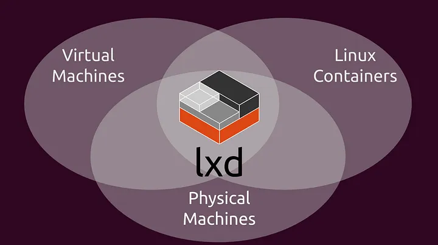
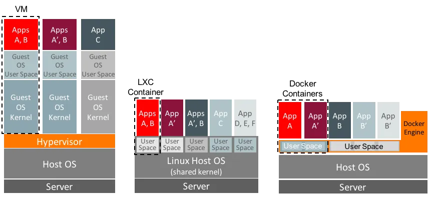
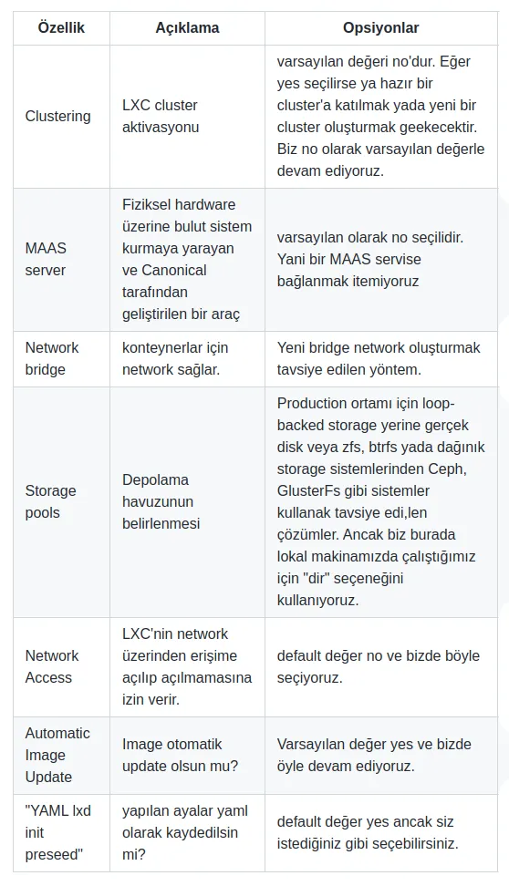

# Using LXC, Automation with the Terraform LXD Provider, and Creating a Kubernetes Cluster Using LXC with Terraform

Hello everyone,

In this article, we'll try to set up a Kubernetes cluster with kubeadm on LXC using Terraform. For this, first 

- What is LXC/LCD? 
- What exactly is the difference between it and Docker containers? 

we'll find answers to these questions, and then we'll see how to create our machines in the topology below for an HA Kubernetes cluster with the terraform-lxd provider on Terraform.

In the article, we don't touch on what terraform is. But if you'd like to get information about the HashiCorp Configuration Language, which Hashicorp also uses in its other products like Terraform, you can check out the article I wrote earlier titled [What Is the HashiCorp Configuration Language (HCL)? How Is It Used?](https://medium.com/p/ed413c291f2d). You can get information both about the language itself and about how this language is used through Terraform.

Let's get into the topic with LXC.

Although Docker is the first thing that comes to mind today when containers are mentioned, the roots of this technology actually go back much further, to the LXC (Linux Containers) system developed in 2008.

LXC emerged with the aim of creating isolated process spaces by using features offered by the Linux kernel, such as cgroups and namespaces. This made a structure similar to the isolation provided by virtual machines possible in a lighter way, directly at the kernel level. The system container approach introduced by LXC aims to run not just an application but practically an entire operating system in an isolated environment.

Over time, the need arose to make this infrastructure more user friendly, and in this context the LXD project, developed by Canonical in 2015, came into play. LXD is a container manager built on top of LXC, and it makes LXC more accessible with high-level tools such as a REST API and network and disk management.

On the other hand, when Docker was developed in 2013, it initially used LXC as its container engine, but later switched to its own container runtime component called runc, offering a simpler and faster solution focused on application containers. While Docker's approach is based on the principle "every container is an application", LXC's philosophy can be summarized as "every container is a system".

In this context, a fundamental distinction emerges between LXC and Docker: while LXC produces system containers, Docker focuses only on isolating a single application. This difference directly affects the purposes of use, performance criteria and isolation levels of containers.



[image source](https://8grams.medium.com/lxd-lxc-linux-container-to-rule-them-all-5f488322d667)


Also, compared with classic virtual machines (VMs), LXC containers can be started much faster, consume fewer resources, and provide native Linux performance by directly sharing the host system's kernel. However, since VMs offer full hardware emulation, they're still preferred in scenarios where you want to run different operating systems or kernel versions. 



[image source](https://8grams.medium.com/lxd-lxc-linux-container-to-rule-them-all-5f488322d667)

As you can see in the figure, LXC sits right in the middle between Docker containers and virtual machines. Of course, this gains more speed compared to virtual machines, but on the other hand it's also a fact that it doesn't bring as much abstraction as virtual machines. But here we should also mention the following. LXD also brought the ability to create virtual machines 3-4 years ago. At first, I used it for small jobs and for setting up lab environments. You could even create a Windows VM. [This official blog post](https://ubuntu.com/blog/lxd-virtual-machines-an-overview), written about a year ago, gives information about how it works. It actually uses QEMU in the background. You may say, then what's the point, but the point here is the convenience of being able to create and manage both containers and virtual machines with just LXC commands. If you get used to it, you'll really love both its speed and the convenience of creating test and lab environments in particular with a command or two.

By the way, you can also use LXC by setting up an LXC cluster on physical servers. If you answer `yes` to the cluster parameter that will be asked shortly below while installing LXD and also provide the information of the other nodes, you'll have set up an LXC cluster. You can also follow the [official LXD documentation](https://documentation.ubuntu.com/lxd/stable-4.0/clustering/). Also, [this official page](https://ubuntu.com/tutorials/how-to-setup-a-basic-lxd-cluster#2-initializing-clustering-on-the-first-server) explains the installation of a complete LXD cluster.

We'll install LXD on a single machine, see a command or two, and then learn to do automation with Terraform for a Kubernetes cluster.

## Installing LXD

I probably don't need to say that LXD only works on Linux systems. The installation is very simple. Since LXD is a system developed by Ubuntu, it's installed via snap. 

Snap is a cross platform package manager that Ubuntu developed for Linux systems. You can install it from [this link](https://snapcraft.io/snapcraft). After installing it, LXD is installed with the command below.

```bash
sudo snap install lxd

# we check whether the lxd group has been created?
getent group lxd | grep "$USER"

# We add the user to the lxd group
sudo usermod -aG lxd "$USER"
newgrp lxd

```

Then we run the `lxd init` command and give the answers below to the questions.


There's also a web-based UI for managing the system. It's actually installed already when LXD is installed. We just need to activate it.

```bash
lxc config set core.https_address :8443
```
Then, if you go to `https://localhost:8443` from a browser, you can access the interface.

We won't continue with the UI topic, but I can say it's a very useful tool. You can create containers and manage their resources through the UI. Everything is explained step by step on [this page](https://documentation.ubuntu.com/lxd/latest/tutorial/ui/#access-the-ui).

## Basic LXD Usage

- List of image sources

```bash
lxc remote list

```

- Listing images on the remote server

```bash

lxc image list images: ubuntu
lxc image list images: alpine

```
- Running an Ubuntu container

```bash
lxc launch ubuntu:24.04 ubuntu-container
```

- Listing running containers

```bash
lxc image list

```

- Running a command

```bash
lxc exec  ubuntu-container -- echo merhaba
```


- Logging into a running container

Unlike Docker containers, we use `--` instead of the `--it` parameter.

```bash
lxc exec  ubuntu-container -- bash
```

Whatever we can do on a Linux machine, we can do the same here.

- Stopping, restarting and deleting a running container

```bash
lxc stop ubuntu-container

lxc start ubuntu-container

# don't delete the container for the examples below
# lxd delete ubuntu-container


```
- Changing the properties of a container

When we initialized Lxd, a configuration with default settings was created. When we create a container, the instance is created according to these settings. But of course it's possible to change these settings.


```bash
# the template below is used to set properties
# lxc config set <instance_name> <option_key>=<option_value> <option_key>=<option_value> ...

# for example

lxc config set ubuntu-container limits.memory=2GiB
```

For the full list of options and properties: https://documentation.ubuntu.com/lxd/latest/reference/instance_options/#


- Viewing and editing the properties of a container

```bash
lxc config show ubuntu-container
lxc config edit ubuntu-container # it can be edited after it's stopped.
```


- Device and Network Management for Containers

Settings can also be made to add a machine's different devices, such as network devices, disks, usb, pci, etc., and to configure them.

For the full list of devices: https://documentation.ubuntu.com/lxd/latest/reference/devices/

As an example for this topic, let's first create a network and create two containers connected to this network. Let these containers only be able to talk to each other, and not be able to talk to the container we created earlier.

Let's also attach the disk device ourselves.

As you can see below, we added both a network and a disk device.

```bash
# We created a network

lxc network create isolated-br0 \
  ipv4.address=10.200.200.1/24 \
  ipv4.nat=false \  # we disabled nat
  ipv6.address=none

# init the first machine
lxc init ubuntu:24.04 ubuntu-a

# attach the root disk
lxc config device add ubuntu-a root disk path=/ pool=default

# attach the isolated network
lxc config device add ubuntu-a eth0 nic name=eth0 network=isolated-br0 type=nic

# start the first machine
lxc start ubuntu-a


# configure and run the second machine

lxc init ubuntu:24.04 ubuntu-b

lxc config device add ubuntu-b root disk path=/ pool=default

lxc config device add ubuntu-b eth0 nic name=eth0 network=isolated-br0 type=nic

lxc start ubuntu-b


# get the container list

lxc list

# check the network

lxc exec ubuntu-a -- ping 10.200.200.11

# the command below should fail
lxc exec ubuntu-a -- ping 8.8.8.8

```

- Container file and directory operations

To copy a file from the container

```bash
lxc file pull ubuntu-container/etc/hosts $HOME/
```

To send a file to the container

```bash
lxc file push /etc/hosts ubuntu-container/etc/hosts2
```

If an entire folder is to be copied, the `-r` parameter is added. 


## About Proceed and Profile Files

- **The Proceed file** is a configuration file in YAML format used to configure an LXD server completely automatically. With this file, we can automate the lxd init process and predefine storage, network, profiles and even containers.

If you remember, after the LXD installation we had run the `LXD init` command and answered some questions. This file is used exactly to automate the init command.  It has a format like the one below.


```yaml
config:
  core.https_address: "[::]:8443"              # the externally exposed listening address of the LXD API
  images.auto_update_interval: "24"            # Let images be updated automatically every 24 hours

networks:
- name: lxdbr0
  type: bridge
  config:
    ipv4.address: 10.0.3.1/24
    ipv4.nat: "true"
    ipv6.address: none

storage_pools:
- name: default
  driver: zfs
  config:
    size: 10GB                                 # ZFS pool size
  # Note: If zfs isn't available, 'dir' or 'btrfs' can be used.

profiles:
- name: default
  description: "Default profile for LXD containers"
  devices:
    eth0:
      name: eth0
      network: lxdbr0
      type: nic
    root:
      path: /
      pool: default
      type: disk

cluster:                                       # (Optional) If you're setting up a cluster
  server_name: node1
  enabled: false                               # false if it'll be used on a single node

# (Optional) To create a container at startup:
instances:
- name: test-container
  type: container
  source:
    type: image
    alias: ubuntu/22.04
    server: https://images.linuxcontainers.org
  profiles:
    - default
  config:
    limits.cpu: "2"
    limits.memory: 1GB

```

We can run this file with the `cat lxd-preseed.yaml | lxd init --preseed` command and initialize our LXD server. 

Also, if we want, we can get the `Proceed.yml` file from our current environment with the `lxd init --dump` command.


- The Profile File, on the other hand, defines default configuration templates for containers and VMs. This structure acts as a template that can be automatically assigned every time an instance is created.

In LXC, there's no Dockerfile-like file as there is in Docker. Because here our goal isn't to build an application and release it. Our main goal is, so to speak, to create something virtual-machine-ish :). What we need here is for the container or VM to be created according to a declaration. A profile file is used for this.

A profile in LXD is used to centrally define the following to be applied to instances:

  - Network settings (network devices),
  - Disk settings (storage volumes),
  - Limits (CPU, memory),
  - Environment variables (config),
  - and other settings.

An example profile file is as below.

```yml
config:
  limits.cpu: "2"                  # The container can use a maximum of 2 CPU cores
  limits.memory: "2GB"             # Maximum 2GB RAM
  environment.HTTP_PROXY: ""       # Environment variable definition (can also be empty)

description: "Base profile for web applications"

devices:
  eth0:
    name: eth0                     # Name of the network interface inside the container
    network: lxdbr0                # The existing bridge network on LXD
    type: nic                      # Device type: NIC (network card)

  root:
    path: /                        # Root directory mount point
    pool: default                  # Name of the storage pool it will connect to
    type: disk                     # Device type: disk (a mount will be done)

  webport:
    type: proxy                    # Proxy device: provides port forwarding
    listen: tcp:0.0.0.0:8080       # The address to listen on in the host system
    connect: tcp:127.0.0.1:80      # The target port to forward to inside the container

```

For example, a profile is created using this file with the commands below.

```bash
lxc profile create web
lxc profile edit web < web-profile.yml
```

Then a container is created using this profile with the command below.

```bash
lxc launch ubuntu:22.04 my-container --profile web
```
## Cloud-init

With the rise of cloud computing technologies, starting, configuring and managing virtual machines dynamically and automatically has become a critical need. Developed in response to this need, cloud-init was first introduced by Ubuntu in 2009 and quickly became an indispensable component of the cloud ecosystem.

When a virtual machine or container is started for the first time, cloud-init allows the system to automatically carry out operations such as creating user accounts, setting up network configurations, installing packages and running scripts. Originally developed only for Ubuntu, this tool is now also supported by many distributions such as Debian, CentOS, RHEL, Fedora and openSUSE.

Offering a practical and powerful solution to the need for "first boot provisioning" in modern infrastructures, cloud-init has become one of the cornerstones of infrastructure automation by working integrated with cloud service providers (AWS, Azure, OpenStack), virtualization platforms and container systems like LXD.

We'll also do the installations and settings we need with cloud-init while bringing up our machines for the first time on the LXC side.

You can find more detailed information on its [official page](https://cloudinit.readthedocs.io/en/latest/explanation/introduction.html). 


For now, we'll do a simple example here. Let's prepare a cloud-init config file that does the items below.


- Let a user named Admin be added and added to the sudoers group
- Let Nginx be installed, hello be written to the index file, and it be published
- Let a few kernel modules be added for testing purposes
- Let the firewall be turned off


Let's run the command below in the terminal.

```bash

lxc launch ubuntu:24.04 myweb \
  -c user.user-data="$(cat <<EOF
#cloud-config
hostname: lxc-web
timezone: Europe/Istanbul

users:
  - name: admin
    gecos: Admin Kullanıcısı
    sudo: ALL=(ALL) NOPASSWD:ALL
    shell: /bin/bash
    groups: sudo


package_update: true
package_upgrade: true
packages:
  - nginx

runcmd:
  - echo '<h1>Merhaba Dünya</h1>' > /var/www/html/index.html
  - systemctl enable nginx
  - systemctl start nginx
  - systemctl stop ufw || true
  - systemctl disable ufw || true
  - modprobe loop
  - modprobe dm_mod
  - modprobe ip_tables
EOF
)"

```

Or we can write it to a file and run it like below too.

```bash
lxc launch ubuntu:24.04 myweb -c user.user-data="$(cat user-data.yaml)"

```

Let's test what we've done.

```bash
# let's look at the nginx service
lxc exec  myweb  -- systemctl status nginx

# let's test port 80, but first let's find out the ip address
lxc exec  myweb  -- ip a

curl 10.44.213.22 # this is the ip that showed up for me in the command above
# <h1>Merhaba Dünya</h1>

```
We can also see the result when we call the `10.44.213.22` ip address in the browser.


## Tracking Metrics with Prometheus and Grafana

We won't get into this topic, but I wanted to mention that it supports the most used duo, Prometheus and Grafana. 

Its installation and configuration are very easy; you can follow them from the link below. The installation is explained together with screenshots. 


- https://documentation.ubuntu.com/lxd/latest/howto/grafana/


## LXC Automation Using Terraform

There's an LXD provider for LXC in the Terraform registry. You can reach the provider documentation from [this link](https://registry.terraform.io/providers/terraform-lxd/lxd/latest/docs/resources/instance).

Let's save the document below inside a folder with the name `main.tf`. When we look at the comment lines, we can see what the code was written for.

```hcl

terraform {
  required_providers {
    lxd = {
      source = "terraform-lxd/lxd"
    }
  }
}

provider "lxd" {
  generate_client_certificates = true
  accept_remote_certificate   = true
  # By default, it connects via the local Unix socket (/var/snap/lxd/common/lxd/unix.socket)
}


# Create the LXC container
resource "lxd_instance" "example-container" {
  name  = "example-container"
  image     = "ubuntu:24.04"

  # CPU and RAM limits
  limits = {
    cpu    = "1"
    memory = "2GB"
  }


  # Define the root disk
  device {
    name = "root"
    type = "disk"

    properties = {
      pool = "default"
      path = "/"
    }
  }

  # Define the network interface (via the lxdbr0 bridge)
  device {
    name = "eth0"
    type = "nic"

    properties = {
      network = "lxdbr0"
      type    = "nic"
    }
  }

}


```
Then let's bring up our container with the commands below.
 


```bash
terraform init
terraform plan
terraform apply
```


When we look at the container list, we can see the container named example-container in the list.


```bash
lxc list
# result
+-------------------+---------+----------------------+------+-----------+-----------+
|       NAME        |  STATE  |         IPV4         | IPV6 |   TYPE    | SNAPSHOTS |
+-------------------+---------+----------------------+------+-----------+-----------+
| example-container | RUNNING | 10.44.213.178 (eth0) |      | CONTAINER | 0         |
+-------------------+---------+----------------------+------+-----------+-----------+
| myweb             | RUNNING | 10.44.213.22 (eth0)  |      | CONTAINER | 0         |
+-------------------+---------+----------------------+------+-----------+-----------+
| ubuntu-container  | RUNNING | 10.44.213.153 (eth0) |      | CONTAINER | 0         |
+-------------------+---------+----------------------+------+-----------+-----------+

```

Let's create a file named `user-data.yml` in the same directory as this `main.yml` file and copy the cloud-init content below into this file. This is the same file we wrote above while covering the cloud-init topic. 

```yml
#cloud-config
hostname: lxc-web
timezone: Europe/Istanbul

users:
  - name: admin
    gecos: Admin Kullanıcısı
    sudo: ALL=(ALL) NOPASSWD:ALL
    shell: /bin/bash
    groups: sudo


package_update: true
package_upgrade: true
packages:
  - nginx

runcmd:
  - echo '<h1>Merhaba Dünya</h1>' > /var/www/html/index.html
  - systemctl enable nginx
  - systemctl start nginx
  - systemctl stop ufw || true
  - systemctl disable ufw || true
  - modprobe loop
  - modprobe dm_mod
  - modprobe ip_tables
```

We change our Terraform file as below. 
- We defined a section called config inside the instance definition and added our cloud-init file to it.
- We also created a new network and added the `parent  = "${lxd_network.new_default.name}"` parameter to the network device of our LXC instance.


```hcl

terraform {
  required_providers {
    lxd = {
      source = "terraform-lxd/lxd"
    }
  }
}

provider "lxd" {
  generate_client_certificates = true
  accept_remote_certificate   = true
  # By default, it connects via the local Unix socket (/var/snap/lxd/common/lxd/unix.socket)
}


resource "lxd_network" "new_default" {
  name = "new_default"

  config = {
    "ipv4.address" = "10.150.19.1/24"
    "ipv4.nat"     = "true"
  }
}


# Create the LXC container
resource "lxd_instance" "example-container" {
  name  = "example-container"
  image     = "ubuntu:24.04"


  # we define our cloud-init configuration
  config = {
  "user.user-data" = file("user-data.yml")
  }

  # CPU and RAM limits
  limits = {
    cpu    = "1"
    memory = "2GB"
  }


  # Define the root disk
  device {
    name = "root"
    type = "disk"

    properties = {
      pool = "default"
      path = "/"
    }
  }

  # Define the network interface (via the lxdbr0 bridge)
  device {
    name = "eth0"
    type = "nic"

    properties = {
      nictype = "bridged"
      parent  = "${lxd_network.new_default.name}"
    }
  }

}

```

We create our instance again with the commands below. 

```bash
terraform init
terraform plan
terraform apply
```

Then let's get the container list.

```bash
lxc list
+-------------------+---------+----------------------+-----------------------------------------------+-----------+-----------+
|       NAME        |  STATE  |         IPV4         |                     IPV6                      |   TYPE    | SNAPSHOTS |
+-------------------+---------+----------------------+-----------------------------------------------+-----------+-----------+
| example-container | RUNNING | 10.150.19.10 (eth0)  | fd42:9a0d:a982:1c8d:216:3eff:fe82:d166 (eth0) | CONTAINER | 0         |
+-------------------+---------+----------------------+-----------------------------------------------+-----------+-----------+
| myweb             | RUNNING | 10.44.213.22 (eth0)  |                                               | CONTAINER | 0         |
+-------------------+---------+----------------------+-----------------------------------------------+-----------+-----------+
| ubuntu-container  | RUNNING | 10.44.213.153 (eth0) |                                               | CONTAINER | 0         |
+-------------------+---------+----------------------+-----------------------------------------------+-----------+-----------+
```

The ip address of our `example-container` container is the same as the ip address we specified while creating the network. 

Let's also look at the network list.

```bash
lxc network ls

```

We can see that the `new_default` network has been created. Finally, let's also test whether nginx is running.

```bash

curl 10.150.19.10 # this is the ip that showed up for me in the command above
# <h1>Merhaba Dünya</h1>
```
This way, we can see that it works.

## Preparing the Servers with Terraform Lxd for an HA Kubernetes Cluster Installation

So far, we've tried to understand the provider with a simple example. Now we'll try to do a bigger example.

We'll have a structure like the one below.


To set up an HA Kubernetes cluster consisting of a Load Balancer, 3 Masters and 3 Worker nodes, we need an infrastructure. Taking the constraints below into account, we aim to build a 7-machine structure.

The items below specify the constraints for terraform

- For the load balancer, master and worker nodes, the profiles will be defined separately as lxc profiles in a terraform file (`profiles.tf`)
- A separate network and subnet will be created for this cluster, and this will also be defined in a separate terraform file (`network.tf`)
- Also, a storage pool definition will be made in a separate terraform file (`storage.tf`)
- These storage and netowrk definitions will be used in the profiles
- Also, an `instances.tf` file will be created, and the resources belonging to the instances will be defined here
- For the load balancer, master and worker nodes, cpu, ram and disk settings can be made for each group. For this, a separate file named `vars.tf` will be defined where the variables will be collected.
- So that all machines can reach each other by hostname, ip and hostname information will be written to their hosts files

The items below specify the constraints for Kubernetes. Our goal isn't to install kubernetes; doing that with Terraform wouldn't make much sense anyway. We just want to do the installations and settings that will make the master and worker nodes ready for Kubernetes.

- The settings needed for Kubernetes will be made on all master and worker nodes
- Only kubeadm will be installed on each of them
- Docker as the Container runtime and, naturally, cri-dockerd as the CRI will be installed on the master and worker nodes. After the installation, the installation will be checked with the `docker info` command


Let's set up our system step by step. I won't explain the code in much detail, because from what I explained above and in the first article, what the code does will already be clearly understood. The HCL language and structure that Terraform uses are also very easy to understand anyway.

- First, we create a folder and create another folder named script inside it. I we'll have a structure like the one below

I created a folder named lxd-k8s. With the files we'll create later, we'll have set up a structure like the one below.

```
├── main.tf          # Terraform provider configuration
├── vars.tf          # Variables (CPU, RAM, disk, etc.)
├── network.tf       # Network and subnet definitions
├── storage.tf       # Storage pool definitions
├── profiles.tf      # LXD profiles (load balancer, master, worker)
├── instances.tf     # LXD instances
├── README.md        # Readme file
└── scripts
    ├── install-haproxy.sh   # HaProxy installation
    └── install-k8s-node.sh  # Making the settings required for the Kubernetes installation
```

- Then, for the configuration of our HaProxy container, we create a script file named `install-haproxy.sh` and copy its content from below.

We install HaProxy and configure it in a very simple and plain way.


```shell
#!/bin/bash

# HAProxy Load Balancer Installation Script

echo "Installing HAProxy on Load Balancer..."

# Update system
apt-get update
apt-get install -y haproxy

# Configure HAProxy
cat > /etc/haproxy/haproxy.cfg << EOL
global
    daemon
    maxconn 4096

defaults
    mode tcp
    timeout connect 5000ms
    timeout client 50000ms
    timeout server 50000ms

frontend kubernetes-api
    bind *:6443
    default_backend kubernetes-api-backend

backend kubernetes-api-backend
    balance roundrobin
    server k8s-master1 10.100.0.11:6443 check
    server k8s-master2 10.100.0.12:6443 check
    server k8s-master3 10.100.0.13:6443 check
EOL

# Update hosts file
cat >> /etc/hosts << EOL
10.100.0.10 k8s-lb
10.100.0.11 k8s-master1
10.100.0.12 k8s-master2
10.100.0.13 k8s-master3
10.100.0.14 k8s-worker1
10.100.0.15 k8s-worker2
10.100.0.16 k8s-worker3
EOL

# Enable and start HAProxy
systemctl enable haproxy
systemctl start haproxy

echo "HAProxy installation and configuration completed"


```
- We create a file named `install-k8s-node.sh` in the Script folder and copy its content from below.
Here too, simply, our goal is to do the basic settings and installations needed for Kubernetes. As an example, we install Docker as the Container Runtime and cri-dockerd as the CRI. You can change this as you wish.

```shell

#!/bin/bash

# Kubernetes Node Installation Script
# This script installs Docker, cri-dockerd, and kubeadm on master and worker nodes

KUBERNETES_VERSION="1.29.0"

echo "Installing Kubernetes components..."

# Update system
apt-get update
apt-get install -y apt-transport-https ca-certificates curl gpg

# Add Docker GPG key and repository
curl -fsSL https://download.docker.com/linux/ubuntu/gpg | gpg --dearmor -o /usr/share/keyrings/docker-archive-keyring.gpg
echo "deb [arch=amd64 signed-by=/usr/share/keyrings/docker-archive-keyring.gpg] https://download.docker.com/linux/ubuntu $(lsb_release -cs) stable" | tee /etc/apt/sources.list.d/docker.list > /dev/null

# Install Docker
apt-get update
apt-get install -y docker-ce docker-ce-cli containerd.io

# Install cri-dockerd
wget https://github.com/Mirantis/cri-dockerd/releases/download/v0.3.8/cri-dockerd_0.3.8.3-0.ubuntu-jammy_amd64.deb
dpkg -i cri-dockerd_0.3.8.3-0.ubuntu-jammy_amd64.deb

# Configure cri-dockerd
systemctl enable cri-docker.service
systemctl enable cri-docker.socket
systemctl start cri-docker.service
systemctl start cri-docker.socket

# Add Kubernetes GPG key and repository
curl -fsSL https://pkgs.k8s.io/core:/stable:/v1.29/deb/Release.key | gpg --dearmor -o /etc/apt/keyrings/kubernetes-apt-keyring.gpg
echo "deb [signed-by=/etc/apt/keyrings/kubernetes-apt-keyring.gpg] https://pkgs.k8s.io/core:/stable:/v1.29/deb/ /" | tee /etc/apt/sources.list.d/kubernetes.list

# Install kubeadm
apt-get update
apt-get install -y kubeadm=${KUBERNETES_VERSION}-1.1
apt-mark hold kubeadm

# Configure system for Kubernetes
modprobe br_netfilter
modprobe overlay
echo "br_netfilter" >> /etc/modules-load.d/k8s.conf
echo "overlay" >> /etc/modules-load.d/k8s.conf

# Configure sysctl for Kubernetes
cat > /etc/sysctl.d/k8s.conf << EOL
net.bridge.bridge-nf-call-iptables = 1
net.bridge.bridge-nf-call-ip6tables = 1
net.ipv4.ip_forward = 1
EOL
sysctl --system

# Disable swap
swapoff -a
sed -i "/swap/d" /etc/fstab

# Update hosts file
cat >> /etc/hosts << EOL
10.100.0.10 k8s-lb
10.100.0.11 k8s-master1
10.100.0.12 k8s-master2
10.100.0.13 k8s-master3
10.100.0.14 k8s-worker1
10.100.0.15 k8s-worker2
10.100.0.16 k8s-worker3
EOL

# Verify Docker installation
docker info

echo "Kubernetes components installation completed"

```

- Now, to be able to manage the resources that will be needed while setting up the cluster as we wish, we create a file named `vars.tf` made up of variables in the root directory, that is, in the lxd-k8s folder, and copy its content from below.
There doesn't seem to be anything that needs explaining. In other words, what they are is understood even from the variable names.

```json
# Kubernetes Cluster Variables

# Kubernetes version
variable "kubernetes_version" {
  description = "Kubernetes version to install"
  type        = string
  default     = "1.33.0"
}

# Load Balancer configuration
variable "lb_config" {
  description = "Load balancer configuration"
  type = object({
    cpu_cores = number
    memory_gb = number
    disk_gb   = number
  })
  default = {
    cpu_cores = 1
    memory_gb = 2
    disk_gb   = 2
  }
}

# Master nodes configuration
variable "master_config" {
  description = "Master nodes configuration"
  type = object({
    count     = number
    cpu_cores = number
    memory_gb = number
    disk_gb   = number
  })
  default = {
    count     = 3
    cpu_cores = 1
    memory_gb = 2
    disk_gb   = 2 
  }
}

# Worker nodes configuration
variable "worker_config" {
  description = "Worker nodes configuration"
  type = object({
    count     = number
    cpu_cores = number
    memory_gb = number
    disk_gb   = number
  })
  default = {
    count     = 3
    cpu_cores = 1
    memory_gb = 2
    disk_gb   = 2
  }
}

# Network configuration
variable "network_config" {
  description = "Network configuration"
  type = object({
    name   = string
    subnet = string
    gateway = string
  })
  default = {
    name    = "k8s-network"
    subnet  = "10.100.0.0/24"
    gateway = "10.100.0.1/24"
  }
}

# Storage pool configuration
variable "storage_pool" {
  description = "Storage pool name"
  type        = string
  default     = "k8s-storage"
}

# Base image
variable "base_image" {
  description = "Base LXD image"
  type        = string
  default     = "ubuntu:24.04"
}

```


- We create the network needed for our system. For this, we create a file named `network.tf` in the root directory and copy the contents below.


```json
# Network Configuration

resource "lxd_network" "k8s_network" {
  name = var.network_config.name
  
  config = {
    "ipv4.address" = var.network_config.gateway
    "ipv4.nat"     = "true"
    "ipv6.address" = "none"
  }
}

# Output network information
output "network_name" {
  value = lxd_network.k8s_network.name
}

output "network_gateway" {
  value = var.network_config.gateway
}

output "network_subnet" {
  value = var.network_config.subnet
}

```
- For storage, we create a `storage.tf` file and copy the contents below. 

```json
# Storage Pool Configuration

resource "lxd_storage_pool" "k8s_storage" {
  name   = var.storage_pool
  driver = "dir"
  
}

```


- And we create our profile file that will use these resources. For this, we create a file named `profiles.tf` and copy its content from below.

```json
# LXD Profiles for Kubernetes Cluster

# Base profile for all nodes
resource "lxd_profile" "k8s_base" {
  name = "k8s-base"
  
  config = {
    "security.nesting"       = "true"
    "security.privileged"    = "true"
    "linux.kernel_modules"   = "ip_tables,ip6_tables,netlink_diag,nf_nat,overlay,br_netfilter"
    "raw.lxc"               = "lxc.apparmor.profile=unconfined\nlxc.mount.auto=proc:rw sys:rw cgroup:rw\nlxc.cgroup.devices.allow=a\nlxc.cap.drop="
  }

  device {
    name = "eth0"
    type = "nic"
    properties = {
      network = lxd_network.k8s_network.name
    }
  }

  device {
    name = "root"
    type = "disk"
    properties = {
      path = "/"
      pool = lxd_storage_pool.k8s_storage.name
    }
  }
}

# Load Balancer Profile
resource "lxd_profile" "lb_profile" {
  name = "k8s-lb"
  
  config = {
    "limits.cpu"    = var.lb_config.cpu_cores
    "limits.memory" = "${var.lb_config.memory_gb}GB"
  }

  device {
    name = "root"
    type = "disk"
    properties = {
      path = "/"
      pool = lxd_storage_pool.k8s_storage.name
      size = "${var.lb_config.disk_gb}GB"
    }
  }

  device {
    name = "eth0"
    type = "nic"
    properties = {
      network = lxd_network.k8s_network.name
    }
  }
}

# Master Node Profile
resource "lxd_profile" "master_profile" {
  name = "k8s-master"
  
  config = {
    "limits.cpu"             = var.master_config.cpu_cores
    "limits.memory"          = "${var.master_config.memory_gb}GB"
    "security.nesting"       = "true"
    "security.privileged"    = "true"
    "linux.kernel_modules"   = "ip_tables,ip6_tables,netlink_diag,nf_nat,overlay,br_netfilter"
    "raw.lxc"               = "lxc.apparmor.profile=unconfined\nlxc.mount.auto=proc:rw sys:rw cgroup:rw\nlxc.cgroup.devices.allow=a\nlxc.cap.drop="
  }

  device {
    name = "root"
    type = "disk"
    properties = {
      path = "/"
      pool = lxd_storage_pool.k8s_storage.name
      size = "${var.master_config.disk_gb}GB"
    }
  }

  device {
    name = "eth0"
    type = "nic"
    properties = {
      network = lxd_network.k8s_network.name
    }
  }
}

# Worker Node Profile
resource "lxd_profile" "worker_profile" {
  name = "k8s-worker"
  
  config = {
    "limits.cpu"             = var.worker_config.cpu_cores
    "limits.memory"          = "${var.worker_config.memory_gb}GB"
    "security.nesting"       = "true"
    "security.privileged"    = "true"
    "linux.kernel_modules"   = "ip_tables,ip6_tables,netlink_diag,nf_nat,overlay,br_netfilter"
    "raw.lxc"               = "lxc.apparmor.profile=unconfined\nlxc.mount.auto=proc:rw sys:rw cgroup:rw\nlxc.cgroup.devices.allow=a\nlxc.cap.drop="
  }

  device {
    name = "root"
    type = "disk"
    properties = {
      path = "/"
      pool = lxd_storage_pool.k8s_storage.name
      size = "${var.worker_config.disk_gb}GB"
    }
  }

  device {
    name = "eth0"
    type = "nic"
    properties = {
      network = lxd_network.k8s_network.name
    }
  }
}

```

- We create the `instances.tf` file, which will create the instances using the Variables and the Profile information.

There's a topic here I haven't mentioned above before. While running the script we prepared with the local-exec provisioner, pay attention to the fact that the container has been created and is up and running. In other words, we're not running it like cloud-init.

If you remember, cloud-init was used when the container or VM was created for the first time.

```json
# LXD Instances for Kubernetes Cluster

# Load Balancer Instance
resource "lxd_instance" "k8s_lb" {
  name  = "k8s-lb"
  image = var.base_image
  type  = "container"
  
  profiles = [lxd_profile.lb_profile.name]
  
  config = {
    "boot.autostart" = "true"
  }

  # Load Balancer configuration
  provisioner "local-exec" {
    command = <<-EOF
      sleep 30
      lxc file push ${path.module}/scripts/install-haproxy.sh k8s-lb/tmp/install-haproxy.sh
      lxc exec k8s-lb -- chmod +x /tmp/install-haproxy.sh
      lxc exec k8s-lb -- /tmp/install-haproxy.sh
    EOF
  }

  depends_on = [lxd_profile.lb_profile, lxd_network.k8s_network]
}

# Master Nodes, with the count parameter we also specify how many master nodes will be created.
resource "lxd_instance" "k8s_masters" {
  count = var.master_config.count
  name  = "k8s-master${count.index + 1}"
  image = var.base_image
  type  = "container"
  
  profiles = [lxd_profile.master_profile.name]
  
  config = {
    "boot.autostart" = "true"
  }

  # Master node configuration
  provisioner "local-exec" {
    command = <<-EOF
      sleep 30
      lxc file push ${path.module}/scripts/install-k8s-node.sh k8s-master${count.index + 1}/tmp/install-k8s-node.sh
      lxc exec k8s-master${count.index + 1} -- chmod +x /tmp/install-k8s-node.sh
      lxc exec k8s-master${count.index + 1} -- /tmp/install-k8s-node.sh
    EOF
  }
  # the resources below need to be completed first
  depends_on = [lxd_profile.master_profile, lxd_network.k8s_network]
}

# Worker Nodes
resource "lxd_instance" "k8s_workers" {
  count = var.worker_config.count
  name  = "k8s-worker${count.index + 1}"
  image = var.base_image
  type  = "container"
  
  profiles = [lxd_profile.worker_profile.name]
  
  config = {
    "boot.autostart" = "true"
  }

  # Worker node configuration
  provisioner "local-exec" {
    command = <<-EOF
      sleep 30
      lxc file push ${path.module}/scripts/install-k8s-node.sh k8s-worker${count.index + 1}/tmp/install-k8s-node.sh
      lxc exec k8s-worker${count.index + 1} -- chmod +x /tmp/install-k8s-node.sh
      lxc exec k8s-worker${count.index + 1} -- /tmp/install-k8s-node.sh
    EOF
  }

  # the resources below need to be completed first
  depends_on = [lxd_profile.worker_profile, lxd_network.k8s_network]
}

# Outputs
output "load_balancer_ip" {
  value = "10.100.0.10"
}

output "master_ips" {
  value = [for i in range(var.master_config.count) : "10.100.0.${11 + i}"]
}

output "worker_ips" {
  value = [for i in range(var.worker_config.count) : "10.100.0.${14 + i}"]
}

```

- And finally, we create our `main.tf` file. In this file, we make the definitions and settings of the module and provider to be used.

```json
# Main Terraform configuration

terraform {
  required_providers {
    lxd = {
      source  = "terraform-lxd/lxd"
      version = "~> 2.0"
    }
  }
  required_version = ">= 1.0"
}

# LXD provider configuration
provider "lxd" {
  # Configure LXD provider
  generate_client_certificates = true
  accept_remote_certificate    = true
}
```

Yes, our structure is now complete.


```
├── main.tf          # Terraform provider configuration
├── vars.tf          # Variables (CPU, RAM, disk, etc.)
├── network.tf       # Network and subnet definitions
├── storage.tf       # Storage pool definitions
├── profiles.tf      # LXD profiles (load balancer, master, worker)
├── instances.tf     # LXD instances
├── README.md        # Readme file
└── scripts
    ├── install-haproxy.sh   # HaProxy installation
    └── install-k8s-node.sh  # Making the settings required for the Kubernetes installation

```

Now, by running the commands below, we'll have brought up our environment. 


```shell

terraform init

terraform plan

teraform apply

```


## About Incus


Finally, let's also talk about the Incus project.

In 2023, Canonical took the LXD project under its own control, removing it from being an independent open source community project. This change limited community participation and caused LXD to move to a more closed development model. Some of the original developers who were uncomfortable with this situation started a forked project called Incus in order to keep LXD's original open source spirit alive. Incus was born as a community-open alternative to LXD and quickly began to be adopted.

Technically, Incus is largely compatible with LXD; in fact, many commands and configurations can be carried over directly. But in the long run, Incus aims to follow a path that is more transparent, community-focused and faithful to free software principles. Unlike LXD, which is under Canonical's control, Incus is managed by the Linux Containers (LXC) community, and thanks to this, outside contributions are accepted more freely. This distinction lays the groundwork for LXD and Incus to evolve in different directions in the future.

Almost everything we mentioned above is the same in Incus too. Even all the commands are the same. There's also a provider for Incus in Terraform. 

- Terraform Incus provider page: https://registry.terraform.io/providers/lxc/incus/latest/docs
- Incus Official Page: https://linuxcontainers.org/incus/ 


That's it for this article, hope you found it useful.

See you in our other articles, take care.

## Resources

- https://dev.to/amabe_dev/how-to-run-gui-apps-in-lxd-containers-882
- https://medium.com/@cristi.posoiu/learn-and-use-lxd-system-containers-especially-for-development-and-testing-f340af676ba6
- https://registry.terraform.io/providers/lxc/incus/latest/docs/resources/network
- https://github.com/terraform-lxd/terraform-provider-lxd
- https://www.adaltas.com/en/2023/06/01/dev-environment-terraform-lxd/
- https://www.adaltas.com/en/2023/06/01/dev-environment-terraform-lxd/
