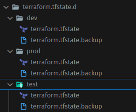

# Environment Management with Terraform Workspace: An Application with the LXD Provider

In this article, we'll examine the Terraform Workspace concept. We'll completely follow the [Workspace section](https://developer.hashicorp.com/terraform/cli/workspaces) on its official page.


For the other articles in the series, you can visit the titles below.

- [What Is the HashiCorp Configuration Language (HCL)? How Is It Used?](HCL.md)
- [Using LXC, Automation with the Terraform LXD Provider, and Creating a Kubernetes Cluster Using LXC with Terraform](terraform-lxd.md)

In the Terraform CLI, a "workspace" is a logical structure that lets us keep multiple independent state files within the same configuration directory.

In its simplest form, the recommended usage is when the same resources need to be managed with different variables. To put it a bit more concretely, let's imagine we need to manage test, pre-prod (staging) and prod environments on a cloud provider, for example. In this case, from environment to environment, the individual number of our resources, network settings, cpu, memory, etc. will change, but most of our resources will stay the same. In this case, rather than defining all the resources again, we can reuse the same resources with different properties. Of course, there are other ways to do this in Terraform, but today we'll focus on the Workspace concept.

On the other hand, its use isn't recommended in the situations below.

- Resource management for different user  accounts: It's not suitable for setting up the same environment with different identities. In other words, for example, Workspace isn't suitable for managing different accounts on AWS. There are easier ways to manage that anyway.
- Naturally, workspace isn't suitable for managing different provider blocks either.
- Using Workspace isn't suitable for versioning either.

We'll also do our examples on LXC with the LXD provider. For your questions such as what LXD is and how it works, you can look at the second article of the series.

- [On-prem environment management with the Terraform LXD provider](terraform-lxd.md)


## How Does Workspace Work?

Yes, now let's start with small examples. 

Our goal is to make how many of an LXC instance will run, its storage pool, its network and its profile different depending on the environment.

For this example, we only create a `main.tf` file and copy its content as below. We'll continue with the details below the code.

```javascript
terraform {
    required_version = ">= 1.6.0"
    required_providers {
        lxd = {
            source  = "terraform-lxd/lxd"
            version = ">= 1.10.1"
        }
    }
}

provider "lxd" {}


// the locals block is used in Terraform to define "constant-like" variables that are valid only within that module.
# let the test workspace be used in the default case too
locals {
    env = terraform.workspace == "default" ? "test" : terraform.workspace
}

// Variable that can be changed from outside
variable "instance-count" {
    type = map(number)
    default = {
        dev  = 1
        test = 2
        prod = 3
    }
}

// Variable that can be changed from outside
variable "gateway" {
    type = map(string)
    default = {
        dev  = "10.100.10.1/24"
        test = "10.100.20.1/24"
        prod = "10.100.30.1/24"
    }
}

// network
resource "lxd_network" "br-network" {
    name = "br-${local.env}"
    type = "bridge"
        config = {
    "ipv4.address" = "${var.gateway[local.env]}"
    "ipv4.nat"     = "true"
    "ipv6.address" = "none"
    }
}

// storage
resource "lxd_storage_pool" "storage-pool" {
    name   = "storage-${local.env}"
    driver = "dir"
}


// profile
resource "lxd_profile" "profile-env" {
    name = "profile-${local.env}"
    device {
        name = "eth0"
        type = "nic"
        properties = {
        network = lxd_network.br-network.name
    }
}

    device {
        name = "root"
        type = "disk"
        properties = {
            path = "/"
            pool = lxd_storage_pool.storage-pool.name
        }
    }
}

// Instance
resource "lxd_instance" "app" {
    count  = var.instance-count[local.env]
    // use ONLY count.index; there's no .index on a number
    name   = "app-${count.index + 1}-${local.env}"
    profiles = [lxd_profile.profile-env.name]
    type  = "container"
    image  = "ubuntu:24.04"

}


// Output
output "environment" {
    value = lxd_network.br-network.name
}

output "instance_names" {
    value = [for instance in lxd_instance.app : instance.name]
}

```

With the `locals` block, we get the name of the active workspace and assign it to a variable named env. We also specify that if we're in the default workspace, the test environment will be used. Even if we don't make any workspace definition, that is, even if we never use the workspace concept in Terraform, the system has already created a workspace named defarul for us.

We have two variables named `instance-count` and `gateway`. If you pay attention to them, they're defined as maps. The map data type works as key-value pairs. In other words, when a key is given, the value is returned. Our goal here is to get the data corresponding to the environment information when we give it. For example, when we give the dev or test key, to get the value that exists for it.

If you pay attention, everywhere we use / call these variables, we read the data according to the value of the environment variable. In other words, the variables provide data according to whichever environment is active.

We also added our output data so that we can get information about the created instances.


Now let's create our workspaces.

```bash
terraform workspace new dev
terraform workspace new test
terraform workspace new prod
```

let's look at the list

```bash
terraform workspace list

#* default
#  dev
#  prod
#  test

```

Now let's switch to the test workspace.

```bash
terraform workspace select test
```
Now we can create our resources.

```bash
terraform init
terraform plan
terraform apply

# As a result, we'll see the following.
# environment = "br-test"
# instance_names = [
#   "app-1-test",
#   "app-2-test",
# ]

```

As you can see, our resources for the test environment have been created. Now let's switch to the dev environment and create the resources again.

```bash
terraform workspace select dev

terraform init
terraform plan
terraform apply

# As a result, we'll see the following.
# environment = "br-dev"
# instance_names = [
#   "app-1-dev",
# ]

```

When we use multiple workspaces this way, we can see that a folder named `terraform.tfstate.d` is created in the root directory. If you check it, you can see that a separate tfstate file has been created for each environment.




- **Example Application**

Let's do a more comprehensive example.

Let's imagine that for an application we need an api, a database and also a Web UI server.

For example, we want to set up a structure like the one below.

- in the prod environment, api, web ui and database servers
- in the test environment, the api and web ui on a single server, and a db server
- in the dev environment, a single server for all of them 

While the database is a resource used for the same purpose in the prod and test environments, the other resources are completely different from each other.

Of course there are many ways to set up this system, but we'll focus on workspace.

## Example Application: First Version

Our first version will have a structure like the one below. We'll write a second version too.

```
.
├── backend.tf  # sets where we'll keep our state files
├── versions.tf # sets the terraform and provider versions we'll use
├── main.tf
├── outputs.tf  # determines the outputs of this root module
└── env-module/
      └── main.tf
      ├── network.tf # network settings
      ├── storage.tf # lxc storace pool setting
      ├── profile.tf # lxc profile settings
      ├── outputs.tf
      └── instances.tf  # lxc instance settings
```

Looking at the structure, let's interpret the result we want to reach.

- If we look at the Modules folder, we can see that the network and storage definitions are common for each environment.
- the main in the root directory imports the related environment based on the workspace selection.
  
Now let's write our file contents.


**Root Directory**


- backend.tf

```javascript
// even if we don't specify it, it manages it itself; we're just showing that it can also be done this way
terraform {
  backend "local" {
    path = "terraform.tfstate"          # it has to be a constant value, that is, it can't be a variable. we assigned the default value.
  }
}


```

- versions.tf

```javascript
terraform {
  required_version = ">= 1.6.0"
  required_providers {
    lxd = {
      source  = "terraform-lxd/lxd"
    }
  }
}

provider "lxd" {
  generate_client_certificates = true
  accept_remote_certificate   = true
}
```

- main.tf

```javascript
locals {
  env = terraform.workspace == "default" ? "dev" : terraform.workspace
}

// The module will create the necessary resources for the selected environment
module "env-module" {
  source = "./env-module"
  env    = local.env
}

```

- outputs.tf

```javascript
// Output
output "root-module-environment" {
    value = local.env
}


```

**env-module directory**


- network.tf

```javascript

locals  {
  network_gateways = {
    dev = "10.100.10.1/24"
    test = "10.100.20.1/24" 
    prod = "10.100.30.1/24" 
  }
}

resource "lxd_network" "bridge" {
  name = "br-${var.env}"
  type = "bridge"

  config = {
    "ipv4.address" = local.network_gateways[var.env]
    "ipv4.nat"     = "true"
    "ipv6.address" = "none"
  }
}

```

- storage.tf

```javascript

resource "lxd_storage_pool" "pool" {
  name   = "pool-${var.env}"
  driver = "dir"                     // Common driver, the size isn't limited in the pool
}
```

- profile.tf

```javascript
resource "lxd_profile" "base" {
  name = "profile-${var.env}"

  // NIC → the environment's network
  device {
    name = "eth0"
    type = "nic"
    properties = { network = lxd_network.bridge.name }
  }

  // Root disk → the environment's pool (no size, it'll be overridden in the instance)
  device {
    name = "root"
    type = "disk"
    properties = {
      path = "/"
      pool = lxd_storage_pool.pool.name
    }
  }
}
```

- instances.tf

```javascript

// the number of instances and their properties can be set from the list below.
locals {

  instances_matrix = {
    dev = [
      { name = "apiwebdb-${var.env}", image = "ubuntu:22.04", size = "2GB", cpu = 1, memory = "2GB" }
    ]


    test = [
      { name = "apiweb-${var.env}", image = "ubuntu:22.04", size = "2GB", cpu = 1, memory = "2GB" },
      { name = "db-${var.env}",  image = "ubuntu:22.04", size = "4GB", cpu = 1, memory = "2GB" }
    ]

    prod = [
      { name = "api-${var.env}", image = "ubuntu:22.04", size = "2GB", cpu = 1, memory = "2GB" },
      { name = "web-${var.env}", image = "ubuntu:22.04", size = "3GB", cpu = 1, memory = "2GB" },
      { name = "db-${var.env}",  image = "ubuntu:22.04", size = "4GB", cpu = 1, memory = "2GB" }
    ]
  }
}

resource "lxd_instance" "node" {
  for_each = { 
    for inst in local.instances_matrix[var.env] : 
        "${inst.name}-${var.env}" => inst // We create a unique key for each instance
  } 

  name     = each.value.name
  image    = each.value.image
  limits = {
    cpu = each.value.cpu,
    memory = each.value.memory
  }

  profiles = [lxd_profile.base.name]

  device {
    name = "root"
    type = "disk"
    properties = {
      path = "/"
      pool = lxd_storage_pool.pool.name
      size = each.value.size          
    }
  }  
}

```

- output.tf
```javascript
// Output
output "root-module-environment" {
    value = var.env
}
```


After creating all the files, we can do our test with the commands below.


```bash
terraform init                      

terraform workspace new dev
terraform workspace select dev
terraform apply

terraform workspace new test
terraform workspace select test
terraform apply                     

terraform workspace new prod
terraform workspace select prod
terraform apply


# to destroy


terraform workspace select dev
terraform destroy


terraform workspace select test
terraform destroy                     


terraform workspace select prod
terraform destroy

```

## Example Application: Second Version

Let's both try to follow best practices a bit more in our example above and fix our mistakes.

We'll have a structure like the one below.


```
.
├── backend.tf  # sets where we'll keep our state files
├── main.tf 
└── env-module/
      └── main.tf
      ├── network.tf # network settings
      ├── storage.tf # lxc storace pool setting
      ├── profile.tf # lxc profile settings
      ├── outputs.tf # writes information to the terminal about all the instances the module produces
      ├── variables.tf # definition of the variables and their default values
      └── instances.tf  # lxc instance settings
```

- The unnecessary files in the Root module were removed, and the ones needed at the module level were kept. For example, `version.tf` was removed from the root directory. The lcd provider is already used by the env-module module anyway.
- We also collected the variables in a separate file (`variables.tf`) in the env-module module. This way, we resolved the confusion of what's where inside the module and are now managing all the variables from a single place.
- From the `main.tf` file in the root directory, we used the variables in the env-module module we use by overriding them as we wished. This way, we separated the module and the root module that uses it better. In other words, there was no need to go into the module to use it (as it should be).

Now let's write the file contents.

*****Root Directory**


- backend.tf

```javascript
terraform {
  backend "local" {
    path = "./terraform.tfstate"
  }
}
```

- main.tf

```javascript
locals {
  # we get the worspace information for the environment definition
  env = terraform.workspace == "default" ? "dev" : terraform.workspace
}

# we call the module based on the environment information
module "env-module" {
  source = "./env-module"


  env = local.env


  # instance configuration for each environment
  # we defined it as an example of overriding the instance definitions defined in the module
  instances_config = {
    dev = [
      { name = "apiwebdb", image = "ubuntu:22.04", size = "2GB", cpu = 1, memory = "2GB" }
    ]
    test = [
      { name = "apiweb", image = "ubuntu:22.04", size = "2GB", cpu = 1, memory = "2GB" },
      { name = "db", image = "ubuntu:22.04", size = "4GB", cpu = 1, memory = "2GB" }
    ]
    prod = [
      { name = "api", image = "ubuntu:22.04", size = "2GB", cpu = 1, memory = "2GB" },
      { name = "web", image = "ubuntu:22.04", size = "3GB", cpu = 1, memory = "2GB" },
      { name = "db", image = "ubuntu:22.04", size = "4GB", cpu = 1, memory = "2GB" }
    ]
  }

  # Network configuration for each environment
  # we defined it as an example of overriding the default network settings defined in the module
  network_config = {
    dev  = "10.100.10.1/24"
    test = "10.100.20.1/24"
    prod = "10.100.30.1/24"
  }

}
```

**env-module directory**

- instances.tf

```javascript

resource "lxd_instance" "node" {
  for_each = {
    for inst in var.instances_config[var.env] :
    "${inst.name}-${var.env}" => inst
  }

  name  = "${each.value.name}-${var.env}"
  image = each.value.image

  limits = {
    cpu    = each.value.cpu
    memory = each.value.memory
  }

  profiles = [lxd_profile.base.name]

  device {
    name = "root"
    type = "disk"
    properties = {
      path = "/"
      pool = lxd_storage_pool.pool.name
      size = each.value.size
    }
  }
}
```
- main.tf

```javascript


terraform {
  required_version = ">= 1.6.0"
  required_providers {
    lxd = {
      source  = "terraform-lxd/lxd"
      version = "~> 2.0"
    }
  }
}

provider "lxd" {
  generate_client_certificates = true
  accept_remote_certificate    = true
}
```

- network.tf

```javascript

resource "lxd_network" "bridge" {
  name = "br-${var.env}"
  type = "bridge"

  config = {
    "ipv4.address" = var.network_config[var.env]
    "ipv4.nat"     = "true"
    "ipv6.address" = "none"
  }
}
```

- outputs.tf

```javascript
output "environment" {
  description = "Active Environment"
  value       = var.env
}

output "instances" {
  description = "Details of the created instances"
  value = {
    for k, v in lxd_instance.node : k => {
      name         = v.name
      status       = v.status
      ip_address   = v.ipv4_address
      ipv6_address = v.ipv6_address
      image        = v.image
      cpu_limit    = v.limits.cpu
      memory_limit = v.limits.memory
      type         = v.type
    }
  }
}

output "network_info" {
  description = "Network configuration"
  value = {
    bridge_name = lxd_network.bridge.name
    gateway     = var.network_config[var.env]
    type        = lxd_network.bridge.type
  }
}

output "storage_info" {
  description = "Storage pool information"
  value = {
    pool_name = lxd_storage_pool.pool.name
    driver    = lxd_storage_pool.pool.driver
  }
}

# formatted output for detailed instance information
output "instance_summary" {
  description = "instance details"
  value = join("\n", concat([
    "=== ${upper(var.env)} ENVIRONMENT INSTANCES ==="
  ], [
    for k, v in lxd_instance.node :
    "  ${v.name}: ${v.ipv4_address != "" ? v.ipv4_address : "No IP"} | Type: ${v.type} | Status: ${v.status}"
  ]))
}

```

- profile.tf

```javascript

resource "lxd_profile" "base" {
  name = "profile-${var.env}"

  # Network interface
  device {
    name = "eth0"
    type = "nic"
    properties = {
      network = lxd_network.bridge.name
    }
  }

  # Root disk
  device {
    name = "root"
    type = "disk"
    properties = {
      path = "/"
      pool = lxd_storage_pool.pool.name
    }
  }
}

```

- storage.tf

```javascript

resource "lxd_storage_pool" "pool" {
  name   = "pool-${var.env}"
  driver = "dir" # Directory-based storage driver
}
```

- variables.tf

```javascript


variable "env" {
  description = "Environment Name (dev, test, prod)"
  type        = string

  validation {
    condition     = contains(["dev", "test", "prod"], var.env)
    error_message = "The environment must be one of these: dev, test, prod."
  }
}

variable "instances_config" {
  description = "Variable for the Instance configuration per environment"
  type = map(list(object({
    name   = string
    image  = string
    size   = string
    cpu    = number
    memory = string
  })))

  default = {
    dev = [
      { name = "apiwebdb", image = "ubuntu:22.04", size = "2GB", cpu = 1, memory = "2GB" }
    ]
    test = [
      { name = "apiweb", image = "ubuntu:22.04", size = "2GB", cpu = 1, memory = "2GB" },
      { name = "db", image = "ubuntu:22.04", size = "4GB", cpu = 1, memory = "2GB" }
    ]
    prod = [
      { name = "api", image = "ubuntu:22.04", size = "2GB", cpu = 1, memory = "2GB" },
      { name = "web", image = "ubuntu:22.04", size = "3GB", cpu = 1, memory = "2GB" },
      { name = "db", image = "ubuntu:22.04", size = "4GB", cpu = 1, memory = "2GB" }
    ]
  }
}

variable "network_config" {
  description = "variable for the network configuration for each environment"
  type        = map(string)

  default = {
    dev  = "10.100.10.1/24"
    test = "10.100.20.1/24"
    prod = "10.100.30.1/24"
  }
}

```


After creating all the files, we can do our test with the commands below.


```bash
terraform init                      

terraform workspace new dev
terraform workspace select dev
terraform apply

terraform workspace new test
terraform workspace select test
terraform apply                     

terraform workspace new prod
terraform workspace select prod
terraform apply


# to destroy


terraform workspace select dev
terraform destroy


terraform workspace select test
terraform destroy                     


terraform workspace select prod
terraform destroy

```


Yes, we've come to the end of an article about Terraform. Hope you found it useful. 
