# Everything About WebAssembly

In this article, we'll talk about WebAssembly, which has been making a name for itself frequently in recent years. 

We'll be examining the topics below.

- What is WebAssembly? What is it used for, what is its purpose?
- Where is it already being used?
- What are the areas where it can be used, and what is its roadmap?
- How does it work?
- Is it secure?
- Will it end JavaScript? Is it the future of the Web?
- Will it affect mobile application development? 
- What does it offer for decentralized structures, blockchain and web 3? 


So, in short, we'll try to find answers to the questions that many of us have in mind about WebAssembly. First, let's start with what WebAssembly is and what it isn't.

The support that the biggest companies of the technology and software world (Mozilla, Microsoft, Google, Apple, Fastly, Intel, and Red Hat) give to this technology has a very big share in it developing this fast. But of course that alone isn't enough. When we look at the past five years, even if we haven't noticed, we can say that WebAssembly is maybe one of the fastest developing technologies. The main reason it hasn't caught our attention is that it hasn't become a necessity yet, since the previous structures/technologies can still be used.


If we look at the definition on its [official page](https://webassembly.org/), it's defined as follows.

_"WebAssembly (Wasm) is a binary format designed for a stack-based virtual machine. It's designed as a portable compilation target for almost all programming languages. It makes it possible to develop both client-side and server-side web applications."_


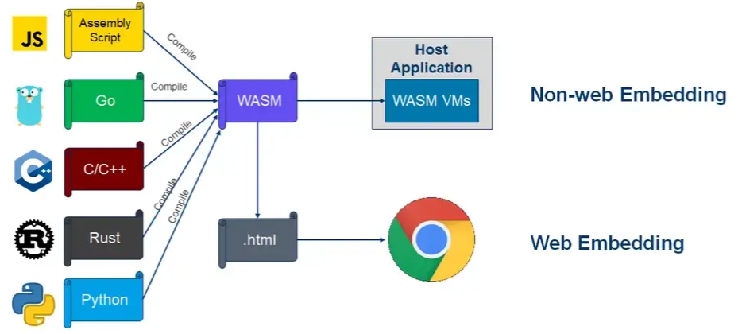
[source](https://hacks.mozilla.org/2019/03/standardizing-wasi-a-webassembly-system-interface/)


In other words, we'll be able to write code with almost all programming languages (currently close to forty languages), and if there's a runtime for the platform we want to run the resulting product (WASM) on, we'll be able to run it. As you know, Java can also run on many platforms. However, **unlike Java, WebAssembly abstracts the platform from the programming language**. Thanks to this, we can develop with whichever programming language we want.

A thought may come to mind like, we could already run a piece of code on different platforms. For example, we can compile code written in the C language for different platforms.
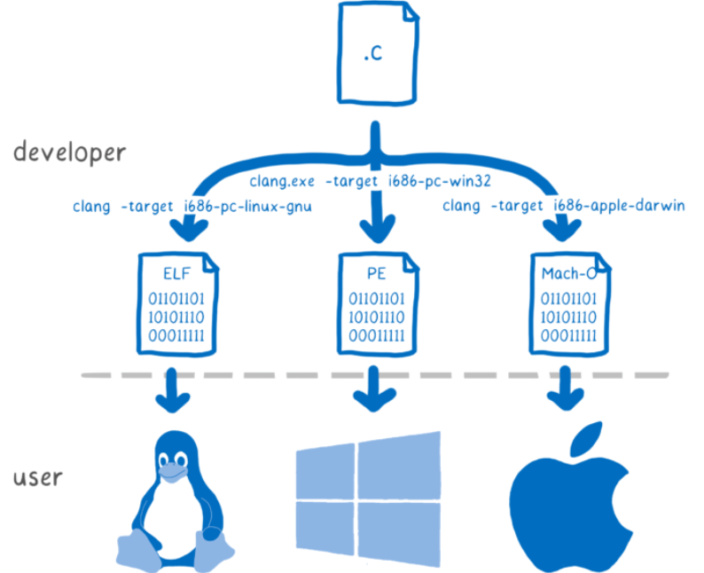

But here, we have to write code for every platform difference and take a separate build for each of them. WebAssembly, on the other hand, lets us run our application by taking a single build. Of course, that's not its only benefit. We'll be examining its other benefits in the rest of the article.

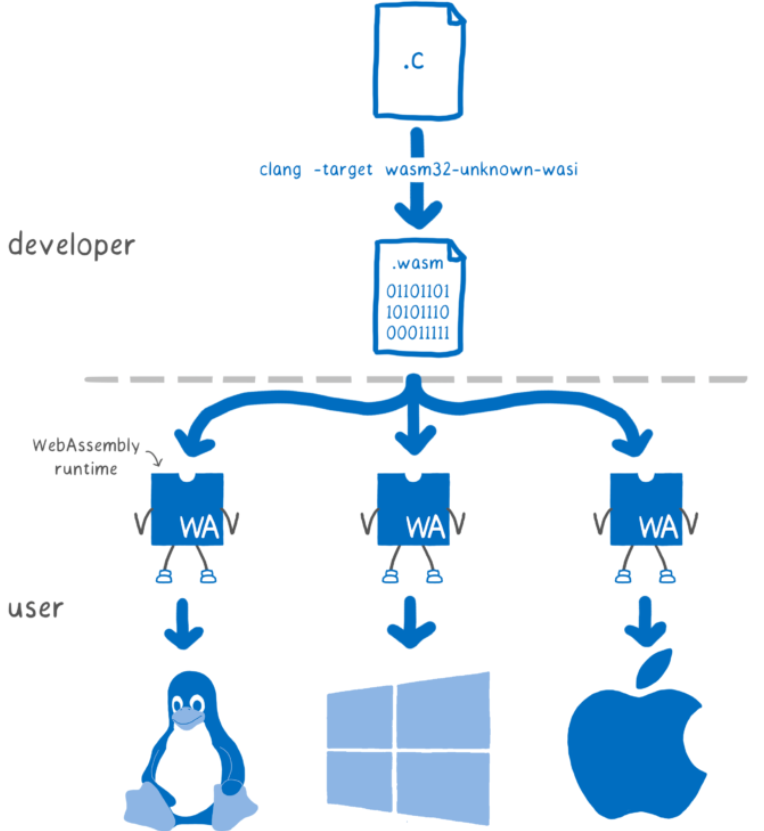
[source](https://hacks.mozilla.org/2019/03/standardizing-wasi-a-webassembly-system-interface/)


Let's ask one of the questions that's always asked too. So, if WebAssembly first came out for web browsers, is this the end of JavaScript? The short answer to this question is **no**. Then you might say, why do we need both of them? Now let's open up the subject a bit. Actually, the [original purpose](https://webassembly.github.io/spec/core/intro/introduction.html) of WebAssembly really was to offer a structure that could run almost as fast as native in places where speed matters and intensive computation is needed. But they must have thought, why should we squeeze a system that can run this fast and is portable, embedded, modular, language independent, etc. into just the web world, because over time they started to expand its scope by adding new features. Even though its first version came out in March 2017, and even though the first version is still in use, we can say it has become maybe one of the most talked about and fastest developing technologies of recent times.

This development not only took WebAssembly out of its ecosystem, it also pushed it on the path to becoming an **alternative** to JavaScript **in the future**. We can understand this, again, from the message below on its [official page](https://developer.mozilla.org/en-US/docs/WebAssembly/Concepts). Of course, it wouldn't be reasonable to expect this to happen in a short time.

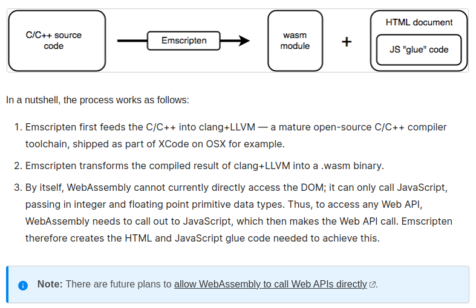
[source](https://developer.mozilla.org/en-US/docs/WebAssembly/Concepts)

For the Web API list, you can visit the [Mozilla Developer Network](https://developer.mozilla.org/en-US/docs/Web/API) page. I'm sure that for many developers, the Web API concept isn't as broad as in the list.

If we go back to our question, WebAssembly doesn't have a goal like eliminating JavaScript. And why would they even think of eliminating it anyway? It's a language that has proven itself with the development it has shown for many years, and it's very easy to learn and use. What WebAssembly does or will do is actually just open the door to new players too. In other words, if we look at the browser side, WebAssembly is trying to offer an environment where not only JavaScript but other programming languages along with it can be used.

Actually, if we also look at the technological developments, in a world where

- web 3.0 is being talked about,
- blockchain technologies are developing rapidly,
- artificial intelligence has entered our lives in every area,
- modular and portable structures/technologies have gained importance,
- agility is talked about in every industry,

and where everything ends up touching web technologies, it doesn't seem very reasonable for JavaScript to be, or to remain, the only tool we have. When you think of it this way, it's not hard at all to predict that if WebAssembly fails at this, some other technology will definitely show this expected development.


**Let's take a look at what the past 5-6 years of history of this technology tell us about its future.**


When we look at its original purpose, WebAssembly, which was planned for web applications, and even only to run inside the browser on the client side, seems to have long surpassed itself at the point it has reached.


Again, if we look at the use cases on its [official page](https://webassembly.org/docs/use-cases/), we get to the long list below.

## Use Cases Inside the Browser

- Better execution for languages and toolkits that are currently cross-compiled to the Web (C/C++, GWT, …).
- Image / video editing.
- Games: (Casual games that need to start quickly, AAA games that have heavy assets, Game portals (mixed-party/origin content).
- Peer-to-peer applications (games, collaborative editing, decentralized and centralized).
- Music applications (streaming, caching).
- Image recognition.
- Live video augmentation (e.g. putting hats on people’s heads).
- VR and augmented reality (very low latency).
- CAD applications.
- Scientific visualization and simulation.
- Interactive educational software, and news articles.
- Platform simulation / emulation (ARC, DOSBox, QEMU, MAME, …).
- Language interpreters and virtual machines.
- POSIX user-space environment, allowing porting of existing POSIX applications.
- Developer tooling (editors, compilers, debuggers, …).
- Remote desktop.
- VPN.
- Encryption.
- Local web server.
- Common NPAPI users, within the web’s security model and APIs.
- Fat client for enterprise applications (e.g. databases).

## Use Cases Outside the Browser

- Game distribution service (portable and secure).
- Server-side compute of untrusted code.
- Server-side application.
- Hybrid native apps on mobile devices.
- Symmetric computations across multiple nodes

I'm sharing the links of some projects related to the areas mentioned.

- In [this project](https://make.wordpress.org/core/2022/09/23/client-side-webassembly-wordpress-with-no-server/), they managed to run WordPress without PHP and completely inside the browser. You can reach the Git project from [this link](https://github.com/WordPress/wordpress-wasm).
- You can play the [Doom 3](https://wasm.continuation-labs.com/d3demo/) game through the browser.
- They managed to run the PstgreSQL database inside WebAssembly. Visit [this link](https://github.com/snaplet/postgres-wasm) for the GitHub project.
- You can look into Adobe's new project, the work it did to run Photoshop through the browser, from [this link](https://web.dev/ps-on-the-web/).
- If you're interested in container technologies, you can look at [this link](https://www.docker.com/blog/docker-wasm-technical-preview/) to examine Docker's work on WebAssembly type containers. We'll be examining this topic in more detail later in the article.
- The [web page](https://bellard.org/jslinux/index.html) of the project where the Linux, FreeBSD and Windows operating systems are run inside the browser with WebAssembly.
- [A project](https://github.com/copy/v86) that emulates x86 compatible CPUs and hardware and translates machine code to WebAssembly at runtime. In its [examples](https://copy.sh/v86/), you can see different versions of operating systems being run from inside the browser.   
- You can run [FFmpeg](https://github.com/ffmpegwasm/ffmpeg.wasm) in the browser over WASM.
- You can use [AutoCAD](https://blogs.autodesk.com/autocad/autocad-web-app-google-io-2018/) through the web browser.
- With [Uno Platform](https://platform.uno/blog/a-piece-of-windows-10-is-now-running-on-webassembly-natively-on-ios-and-android/), you can develop cross platform applications over WebAssembly. What I mean by cross is that the code we write runs not only on Android and IOS but also on Windows, Linux and Mac.
- [Google Earth](https://earth.google.com/web/) uses WebAssembly for 3D graphics.
- You can read an example of a microservice written with WebAssembly on [this page](https://blog.logrocket.com/rust-microservices-server-side-webassembly/).

It's possible to find many more examples on the internet. You can also follow projects from the [made with webassembly page](https://madewithwebassembly.com/).

The web browsers that run WebAssembly are actually runtimes. There are many runtime projects for running WebAssembly outside the browser. For their list, you can look at this [Github page](https://github.com/appcypher/awesome-wasm-runtimes).

## The Most Preferred Runtimes on Github

- **WasmEdge**

One of the fastest runtimes in the ecosystem. It's a project currently supported by the CNCF.

It supports the C/C++, Rust, Go, Swift, Kotlin, AssemblyScript, Grain, JavaScript and Python languages.

This runtime is also used in the Docker&Wasm duo that we'll touch on later.

For managing and orchestrating the Wasm runtime, Kubernetes, blockhain, 

GitHub Page: https://github.com/WasmEdge/WasmEdge

- **Wasm3**

It supports the Python3, Rust, C/C++, GoLang, Zig, Perl, Swift, .Net, Nim, Arduino, PlatformIO, Particle, QuickJS languages.

It's a project focused on running WebAssembly on embedded devices.

GitHub Page: https://github.com/wasm3/wasm3

- **Wasmer**

It supports more languages than I could write here. 

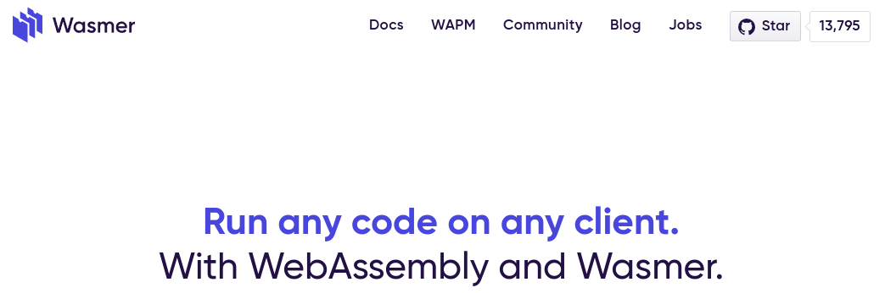

The same community also manages the WebAssembly Package Manager (WAPM) project. Since I'll touch on it later, we're not going into its details here.

GitHub Page: https://github.com/wasmerio/wasmer

- **Wasmtime**

It supports the C/C++, Rust, Go, Python, :net and Go languages.

GitHub Page: https://github.com/bytecodealliance/wasmtime


## Other Tools

- **WASI (WebAssembly System Interface)**

[WASI](https://github.com/WebAssembly/WASI) is a middleware developed by the WebAssembly team that provides WebAssembly modules with access to system resources. If the WebAssembly we write is coded and run with a wasi compatible runtime, it can also use system resources, for example the file system, the clock, sockets, etc. We can say that WASI is a technology that extends WebAssembly especially in terms of security and portability.

When we write our code by adding the WASI library, we both make it run in different environments without taking different builds and increase security. Since we'll examine the topic in more detail later, we're wrapping it up here. 

- **WAPM (WebAssembly Package Manager)**

A package manager tool developed by the team that develops the Wasmer runtime. First you need to install the Wasmer runtime on your system and then [Wapm](https://wapm.io/).

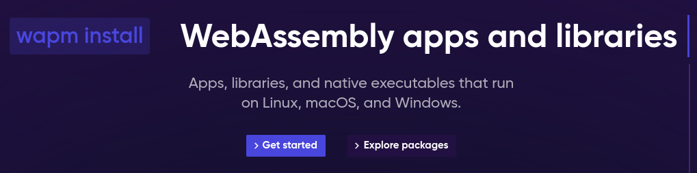

It runs on all operating systems and it's very easy to install too. 

- For Windows, we run the command below on PowerShell.

```powershell
iwr https://win.wasmer.io -useb | iex
```

- For Linux and Mac, we run the command below

```shell
curl https://get.wasmer.io -sSfL | sh
```

From here on, things work the same way on all operating systems.

For example, to run Sqlite, we first download the related package and then run it.

```shell
wapm install sqlite/sqlite

wapm run sqlite
```

Now we can run our sqlite commands.

Actually, what WAPM does with the run command is run the sqlite.wasm file through the Wasmer cli.

On my own machine, the WASM file is under the home directory.

```shell

wasmer ~/wapm_packages/sqlite/sqlite@0.2.2/build/sqlite.wasm
```

So what will being able to run sqlite, or another application or module, this way gain us?

- One of the most important conveniences is platform independence. In other words, once we've been able to export our application as WASM, we'll be able to run it on every platform without making any other adjustment.
- Thanks to the support of web browsers, we'll be able to run much bigger applications on the client side.
- We'll be able to use packages written in any language on the same platform. For example, it will be possible to develop one module with JavaScript, another module with C#, and another with Python, and use them on the same platform.

Just think how big things WebAssembly can do these days, when decentralized application work has gained speed especially along with blockchain. We'll also touch on this topic later in the article.

Also, with its ability to run outside the browser, it's possible for it to run on mobile and iot devices too. It's not very hard to predict that WebAssembly will be very effective in the mobile world as well.

# WebAssembly Technical Details

There's a text format for writing WASM, and it's also possible to convert it to wasm. This can be done with the commands below. But of course, since developing this way would be very hard, there are different implementations for each programming language.

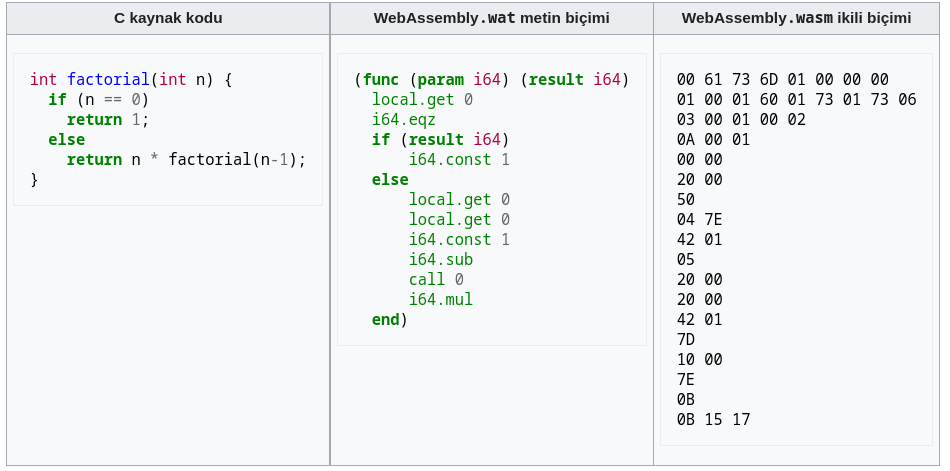

The extension of the text format is used as wat, and the extension of the binary format as wasm. To get binary from the text format, you can use the command below. For details, you can visit [this page](https://webassembly.org/getting-started/advanced-tools/).

```shell
wat2wasm simple.wat -o simple.wasm
```

It's also possible to do the reverse.

```shell
wasm2wat simple.wasm -o simple.wat
```


Using the runtimes we mentioned above, you can take a build by installing the necessary packages for the language you want to write in. Or there are infrastructures similar to Microsoft's [Blazor](https://dotnet.microsoft.com/en-us/apps/aspnet/web-apps/blazor) technology with which you can develop, especially web components, in every language. Since WebAssembly can't access the DOM yet, there's a JavaScript dependency, but this will also be overcome over time.

Microsoft is maybe one of the companies that uses WebAssembly most effectively. They must trust this technology a lot, because they offered their technology called [Blazor](https://dotnet.microsoft.com/en-us/apps/aspnet/web-apps/blazor) to developers much earlier than many companies. 


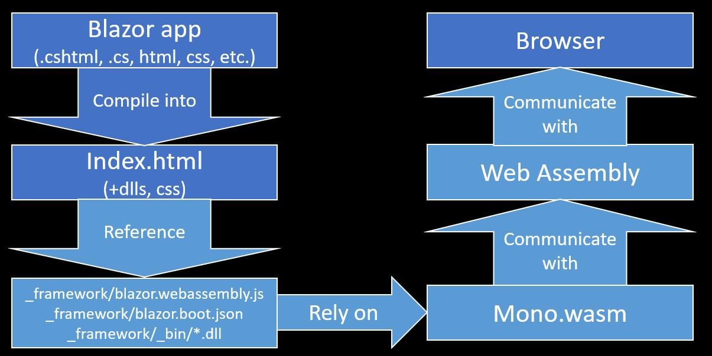
[source](https://www.vivienfabing.com/blazor/2019/10/10/blazor-what-is-blazor.html)

In its current state, [Blozor](https://dotnet.microsoft.com/en-us/apps/aspnet/web-apps/blazor) seems to target web browser runtimes. But with websocket support, it's also possible to develop server-side applications. In this case, it's also possible for all the code to run on the server and interact with the client side with the help of websocket. Also, it's possible to run the applications you develop with Blazor not only on the web but also on mobile devices and desktop environments.

There are also plans to run Blazor applications using runtimes outside the browser. With .Net 7, improvements were made on the [AOT](https://learn.microsoft.com/en-us/dotnet/core/deploying/native-aot/) (ahead-of-time) side, and these improvements are still continuing. The goal here is to be able to run the application on systems without installing the dotnet runtime. Thanks to this, we'll be able to run our Blazor applications outside the browser with less cost and a less complex structure. For this, there's already an experimental [SDK](https://github.com/SteveSandersonMS/dotnet-wasi-sdk) available. With the sample work, a Blazor application is made able to run outside the browser too, using WASI. It can also be published using the Wasmtime or Wasmer runtimes we mentioned above. You can reach the details of this project from [this link](https://dev.to/azure/exploring-net-webassembly-with-wasi-and-wasmtime-41l5).

Also, we mentioned above that it's possible to use WebAssembly modules developed in different languages in the same environment. For example, we can use a WASM package developed with the C language inside dotnet with the help of a runtime. For a sample work, visit [this link](https://www.thinktecture.com/en/webassembly/webassembly-with-dotnet/).  

Apart from this, of course, thanks to WASI our application can communicate with the network and can also publish a web page using the http protocol. A small web server was written using the WasmEdge runtime. You can visit the sample project from [this link](https://wasmedge.org/book/en/write_wasm/rust/networking.html).


## The WebAssembly Security Topic

WebAssembly has solid security isolation. Modules run in their own closed (sandboxed) environment, isolated from the host runtime. While on the browser runtime it runs fully in accordance with the browser's security policies, outside the browser it runs with capability-based-security. In its simplest form, in this system the caller of the module itself decides how much permission to give to each of the WASM modules.

Capability-based security actually isn't a new technique, but we've started to hear its name more recently with the development of decentralized applications (especially blockchain). The most used security models

- Access control list (ACL)
- Attribute-based access control (ABAC)
- Context-based access control (CBAC)
- Capability-based security
- Role-based access control (RBAC)

The goal with capability-based security is to provide security in a system that isn't centralized. For example, with identity based systems like Access control list or role-based security, the security of the person and the system is provided with a central structure and an authentication process is required. The person's information is sent to a center and that place verifies the person. But there's no particular center for verifying a WebAssembly or verifying a bitcoin. In its simplest form, in this system the caller of the module itself decides how much permission to give to each of the WASM modules. 

Let's open up the subject a bit more. In a classic system, the command or application that will run runs with the permissions of the users who run it. For example, to create a file in a folder, first we as a user need to have write permission in that folder.  Then we run the application that will create the file with our own user. That way, the application creates the file in the related folder. This kind of approach doesn't pose a problem for the system, or for applications we trust in terms of security. But if the related application comes from a source we don't know or whose reliability we're not sure of, when we open this application with our own permissions, we're sort of giving power of attorney to that application. If the application is doing something we don't know about in the background, it's doing it with our permissions. 

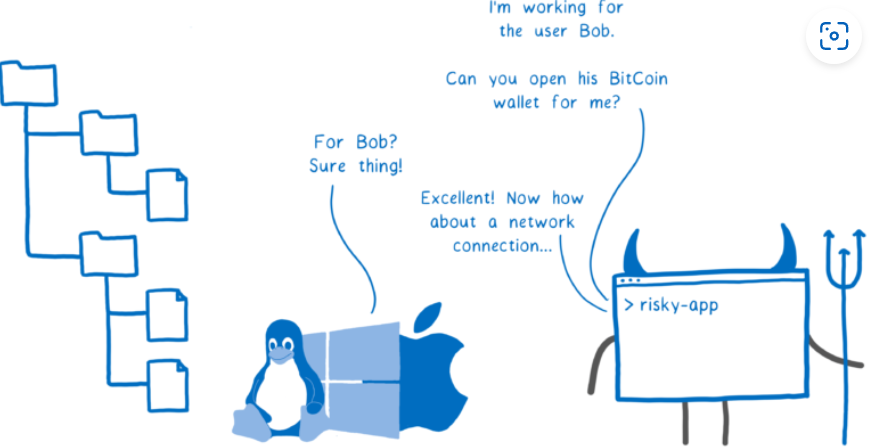
[source](https://hacks.mozilla.org/2019/03/standardizing-wasi-a-webassembly-system-interface/)

Another danger in this setup is that this application deals directly with the system. In other words, there's an ecosystem that makes possible the things it can do in the background without our knowledge.  After we give permission, there's no system that controls the application's actions.

Now let's try to understand the capability-based-security setup that WebAssembly uses. First of all, the tool that provides this system to us is WASI. As we mentioned before, WASI's job is to provide the communication and interaction between the WebAssembly module and the system.

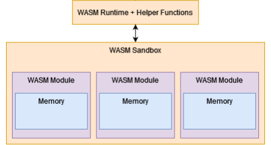

WASI core offers us a structure similar to POSIX. If we want to access a folder or a network on the system, we need to do this through WASI. In other words, our module can't communicate with the system directly. After importing the WASI library in the language we'll code in, we give the permissions we want to give (file access, network, socket, etc.), load our WASM file into the sandbox environment and run it with these permissions. Of course, it's also possible to call the same module with a WASI supported runtime. 


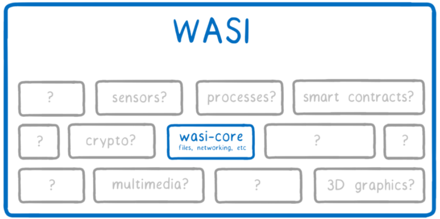
[source](https://hacks.mozilla.org/2019/03/standardizing-wasi-a-webassembly-system-interface/)

The request we make for the related resource is granted only for that resource, and if wanted, this can be restricted. Also, this granted permission is given only to the module that requests it, meaning it isn't given to all of WebAssembly wholesale. 

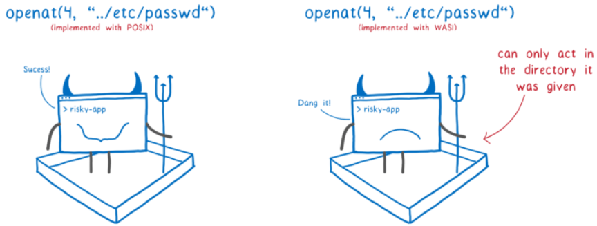
[source](https://hacks.mozilla.org/2019/03/standardizing-wasi-a-webassembly-system-interface/)


That way, the portability of the system also increases. Just like with containers, we can shape our WebAssembly module according to the environment. It may be possible to set up environments specific to each run. Because of these capabilities, WASI has greatly increased its popularity and development over the last two years. 

Let's examine a few examples. The rust code below takes two file names as arguments, for input and output. It writes the text in the input file to the output file.

```rust
use std::env;
use std::fs;
use std::io::{Read, Write};

fn process(input_fname: &str, output_fname: &str) -> Result<(), String> {
    let mut input_file =
        fs::File::open(input_fname).map_err(|err| format!("error opening input {}: {}", input_fname, err))?;
    let mut contents = Vec::new();
    input_file
        .read_to_end(&mut contents)
        .map_err(|err| format!("read error: {}", err))?;

    let mut output_file = fs::File::create(output_fname)
        .map_err(|err| format!("error opening output {}: {}", output_fname, err))?;
    output_file
        .write_all(&contents)
        .map_err(|err| format!("write error: {}", err))
}

fn main() {
    let args: Vec<String> = env::args().collect();
    let program = args[0].clone();

    if args.len() < 3 {
        eprintln!("usage: {} <from> <to>", program);
        return;
    }

    if let Err(err) = process(&args[1], &args[2]) {
        eprintln!("{}", err)
    }
}

```
[source](https://github.com/bytecodealliance/wasmtime/blob/main/docs/WASI-tutorial.md)


We take a build of our code. The first line installs our dependency (package), the second line takes the build.

```shell
rustup target add wasm32-wasi
$ cargo build --target wasm32-wasi
```
Let's try running our code with the wasmtime runtime. We got stuck at the if block inside the main function in our Rust code. In other words, it's saying give me the file names. 

```shell
wasmtime demo.wasm
usage: demo.wasm <from> <to>
```

Let's create our input file and pass it to our application as an argument. After writing hello world to the test.txt file and saving it, we use it as the input file. As output, we use the /tmp/somewhere.txt file.

But this time we got an error.  This time it says the capability is insufficient. In other words, to put it more clearly, it says that even if we as a user have read and write permission on the test.txt file, WebAssembly can't write to this file. 

```shell
echo hello world > test.txt
wasmtime demo.wasm test.txt /tmp/somewhere.txt
error opening input test.txt: Capabilities insufficient
```

This time, using wasmtime's dir and mapdir flags, we'll give the directories the module can operate on.

```shell
wasmtime --dir=. --mapdir=/tmp::/var/tmp demo.wasm test.txt /tmp/somewhere.txt
cat /var/tmp/somewhere.txt
hello world
```
The directory we give as a dot (.) is the folder we're currently working in on the host, and in the mapdir flag, the /var/tmp folder on the host is mapped to the /tmp folder in our WebAssembly application. The application actually can't see inside /var/tmp on the host, but it can write the "somewhere.txt" file there. If you're interested in container technologies, what we specify with dir is similar to the context directory you give while building a dockerfile, and mapdir lets us attach a directory like in a bind mount.

Now let's also try to do a similar application with NodeJS. Since version 12, NodeJS supports WASI.

We mentioned above that, just as we can make use of programming languages to write WASM, we can also make use of the human readable text format that WebAssembly offers. For example, in the wat code below, we write hello to standard output.

In the first line, the fd_write module is used to create a file descriptor.

```wat
(module
  (import "wasi_unstable" "fd_write"
    (func $fd_write (param i32 i32 i32 i32)
                    (result i32)))

  (memory 1)
  (export "memory" (memory 0))
  (data (i32.const 8) "hello\n")

  (func $main (export "_start")

    ;; io vector within memory
    (i32.store (i32.const 0) (i32.const 8))
    (i32.store (i32.const 4) (i32.const 6))

    (call $fd_write
        (i32.const 1)  ;; file_descriptor
        (i32.const 0)  ;; *iovs
        (i32.const 1)  ;; iovs_len
        (i32.const 14) ;; nwritten
    )
    drop ;; drop the result from the stack
  )
)
```
Now let's run this code using the NodeJS WASI library. To take a build, we can use the wat2wasm program (we could also call it a compiler).


```javascript
const fs = require('fs');
const { WASI } = require('wasi');

const wasi = new WASI({
  args: process.argv,
  env: process.env,
  preopens: {
    '/sandbox': '.'
  }
});

const importObject = {
  wasi_unstable: wasi.wasiImport
};

(async () => {
  const wasm = await WebAssembly
    .compile(fs.readFileSync('hello.wasm'));

  const instance = await WebAssembly
    .instantiate(wasm, importObject);

  wasi.start(instance);
})();

```

Let's run our code.

```javascript
node --experimental-wasi-unstable-preview1 wasi-node.js
hello
```

We can see that hello appears on the screen. 

Here NodeJs has direct WASI support. But in languages that don't have WASI support, it's also possible to write similar code with the support of runtimes. 


For example, the Wasmer runtime has javascript support. In the code below, you can see how the helloworld.wasm application is run inside the browser.

In the example, you can see that Wasmer's file system module is used for the sandbox file system.

```javascript

import { WASI } from '@wasmer/wasi'
import browserBindings from '@wasmer/wasi/lib/bindings/browser'
import { WasmFs } from '@wasmer/wasmfs'

const wasmFilePath = '/helloworld.wasm'  // Path to our WASI module
const echoStr      = 'Hello World!'    // Text string to echo

const wasmFs = new WasmFs()

let wasi = new WASI({
  args: [wasmFilePath, echoStr],

  // Environment variables that are accesible to the WASI module
  env: {},

  // Bindings that are used by the WASI Instance (fs, path, etc...)
  bindings: {
    ...browserBindings,
    fs: wasmFs.fs
  }
})

// - - - - - - - - - - - - - - - - - - - - - - - - - - - - - - - - - - - - - - -
// Async function to run our WASI module/instance
const startWasiTask =
  async pathToWasmFile => {
    // Fetch our Wasm File
    let response  = await fetch(pathToWasmFile)
    let wasmBytes = new Uint8Array(await response.arrayBuffer())


    // Instantiate the WebAssembly file
    let wasmModule = await WebAssembly.compile(wasmBytes);
    let instance = await WebAssembly.instantiate(wasmModule, {
       ...wasi.getImports(wasmModule)
    });

    wasi.start(instance)                      // Start the WASI instance
    let stdout = await wasmFs.getStdOut()     // Get the contents of stdout
    document.write(`Standard Output: ${stdout}`) // Write stdout data to the DOM
  }

// - - - - - - - - - - - - - - - - - - - - - - - - - - - - - - - - - - - - - - -
// Everything starts here
startWasiTask(wasmFilePath)
```
[source](https://docs.wasmer.io/integrations/js/wasi/browser/examples/hello-world)


I think the examples have been enough for the topic to be understood.


## WebAssembly in the Container World

Let's start the topic with the [tweet](https://twitter.com/solomonstre/status/1111004913222324225)s of Solomon Hykes, who is also the founder of Docker.

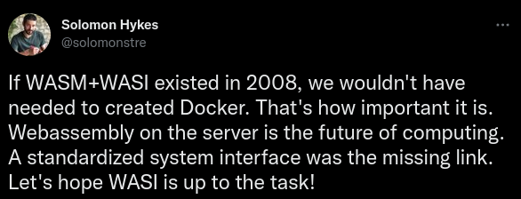
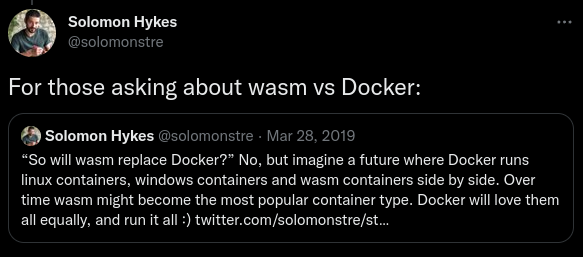
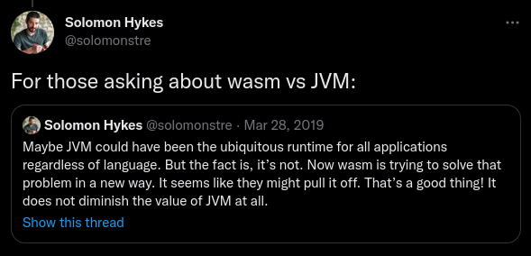


In short, Solomon says "If WASM and WASI had existed in 2008, we might not have needed to invent Docker. WebAssembly is the future of server-side Computation." Then he went on to say that for now WebAssembly won't replace Docker, but that it can work together with Linux and Windows containers, and that maybe in the future WASM type containers could even become the most demanded container type.

As you know, containers can only run on the operating system they were created for. For example, if the image was created using a Windows base image, it can only be run on Windows. But WebAssembly has no such limit. Also, WebAssembly has solid security isolation. WebAssembly modules run in their own closed (sandboxed) environment, isolated from the host runtime. While on the browser runtime it runs fully in accordance with the browser's security policies, outside the browser it runs with capability-based-security. In its simplest form, in this system the caller of the module itself decides how much permission to give to each of the WASM modules.


However, unlike containers, a WebAssembly module doesn't come with a pre-packaged file system. Instead, files, directories, environment variables, the clock and other system resources can be added directly to the WebAssembly module during startup. And this is a fundamental feature of the WebAssembly System Interface (WASI), which is one of the WebAssembly standards. It's not part of a larger orchestration system (Docker, Kubernetes, etc.), it's part of a runtime. In other words, by its nature it runs isolated.


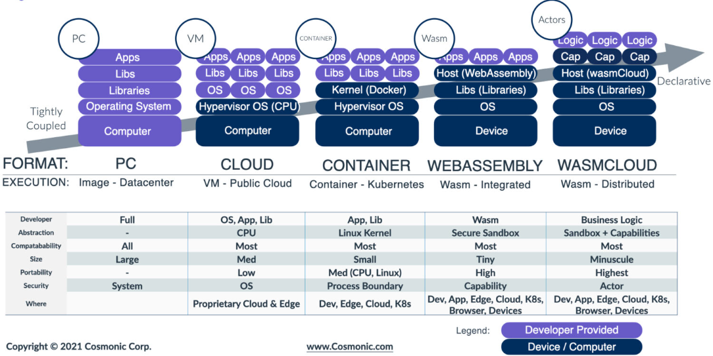
[Image Source](https://cosmonic.com/product/)

We can see that WebAssembly offers a much more light weight structure. We can say that the isolation being provided by a sandbox on the runtime makes for a structure that's lighter, faster and also controllable. Even though Solomon said that WebAssembly can't replace Docker, and therefore containers, we may see many changes in container technologies too in the future with the development of WebAssembly. 

In the image below, in the bottom right box, we can see how the wasm container is run. If you've read the whole article up to here, you've probably guessed that wasmedge here is the runtime. 

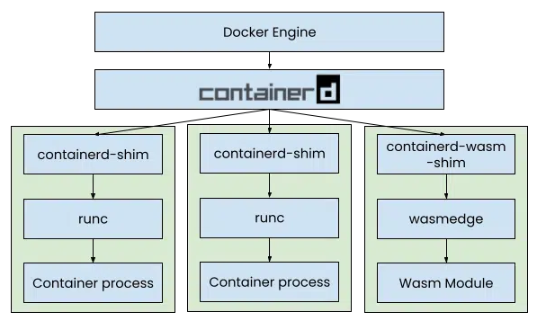

If you're using docker desktop, you can run the example below.

```shell

docker run -dp 8080:8080 \
  --name=wasm-example \
  --runtime=io.containerd.wasmedge.v1 \
  --platform=wasi/wasm32 \
  michaelirwin244/wasm-example

```
A dockerfile example for creating an image

```Dockerfile

FROM scratch
COPY ./target/wasm32-wasi/release/wasm-docker.wasm /wasm-docker.wasm
ENTRYPOINT [ "wasm-docker.wasm" ]
```
Then we can take a build and run it.

```shell
# build
docker buildx build --platform wasi/wasm -t wasm-docker:0.1 .
# run
docker container run --rm --runtime=io.containerd.wasmedge.v1 --platform=wasi/wasm32 wasm-docker:0.1

```


The only work on the container side isn't limited to Docker. For example, Istio, which is a service mesh solution for Kubernetes, also has WebAssembly based work on its side that it has taken to production. To be able to extend the Envoy proxy, using WebAssembly, it replaced Mixer, its previous primary extension mechanism, with Proxy-Wasm. You can follow the details on the topic from its r[official page](https://istio.io/latest/docs/concepts/wasm/).

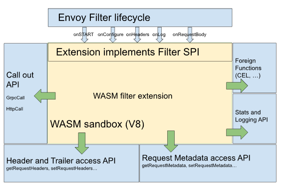
[source](https://istio.io/v1.13/docs/concepts/wasm/)


On the other hand, various work is also being done directly on the Kubernetes side. Of these, the one that seemed the most ambitious and creative to me was [Kruslet](https://github.com/krustlet/krustlet/). Kruslet is a tool developed with Rust for running WebAssembly, developed to do exactly the job of [Kubelet](https://kubernetes.io/docs/reference/command-line-tools-reference/kubelet/). Instead of a container runtime, it manages WebAssembly pods using the wasmtime runtime we mentioned earlier.

There are installation documents for EKS, GKE, AKS, DigitalOcean, onprem and other platforms. If you want to test it, you can follow the links below.

- [Installation with Minikube](https://docs.krustlet.dev/howto/krustlet-on-minikube/)
- [Installation with MicroK8s](https://docs.krustlet.dev/howto/krustlet-on-microk8s/)


## The Mobile World

The [Blazor Framwork](https://dotnet.microsoft.com/en-us/apps/aspnet/web-apps/blazor) and [Uno Platform](https://platform.uno/) we mentioned earlier are two very good examples showing how cross platform applications can be developed with WebAssembly. You can find many more WebAssembly frameworks and applications similar to these.

But what really matters is that WebAssembly has the potential to change the app store culture, provided that it gets enough support. The code written running on every platform, and the ability to use security and system resources with the help of WASI and runtimes, can make it possible to write richer applications and games once suitable structures are provided on devices. What's more, it may be possible to do this with all programming languages. 

- A mobile game developed with Rust, [Panda Doodle](https://lucamoller.com/posts/2021-07/rewritting-my-mobile-game-in-rust-targeting-wasm): Since it's WebAssebly, of course it can also be played from the browser. You can play the game from [this link](https://lucamoller.com/posts/2021-07/rewritting-my-mobile-game-in-rust-targeting-wasm).
- Another game with mobile support developed with WebAssembly on Paltform Uno. You can examine it together with its source code from [this link](https://platform.uno/blog/a-space-shooter-game-on-the-web-with-c-wasm-and-uno-platform/).
- The [AngryBots](https://beta.unity3d.com/jonas/AngryBots/) game, developed using Unity with WebGL and WebAssembly.

We had already mentioned that cross platform applications can be developed; we can say these example games are actually proof that something can be done in this world too.
 

## Blockchain, Web3 and Other Other Technologies

Another project related to WebAssembly is the microservice framework developed by the company deFermyon. To get detailed information about the framework (spin), you can visit the [quickstart page](https://developer.fermyon.com/spin/quickstart/).


Before moving on to blockchain, let's also talk a bit about what WebAssembly means for the mobile world. You've probably heard that in the years when the IPhone first came out, Steve Jobs was in favor of development with structures like SPA/PWA, that is, with HTML, CSS and JavaScript, instead of the app store. If you haven't heard it, you can find it with a small search you do on [Google](https://www.google.com/search?q=steve+jobs+hates+app+store). [Forbes](https://www.forbes.com/sites/markrogowsky/2014/07/11/app-store-at-6-how-steve-jobs-biggest-blunder-became-one-of-apples-greatest-strengths/?sh=194313694652) magazine discussed the topic in one of its headlines. But the point of view there is that Steve Jobes was thinking wrong, because thanks to the app store Apple made a lot of money. But if we look at the matter from the perspective of technological development, we can understand how right Steve Jobs was thinking. Maybe he also changed his mind later, I don't know that. If we look at the web and mobile world today, we're stuck with the Apple and Google app stores. In this whole big world, just two companies set the standards and limits. In its simplest form, when we want to send a push notificaiton, we can't do it independently of the markets. Whereas this ecosystem could have been made store independent by developing SPA/WPA or something alternative. Now I'm guessing those who are against this idea will say "but but". But if technology had progressed in this direction, a solution could have been found for everything. Dozens, hundreds of trustworthy markets could have been set up. The capabilities of browsers could have been developed in this direction. But the money tasted sweet, and they turned out to be right too. If we look at the last 10 years, the money earned just from the stores already reaches billions of dollars. 

But despite all of this, the ecosystem is trying to chart its own course. Because of many events that have happened, people and countries becoming more aware about personal data, etc., decentralized structures are developing rapidly. Just with the events that unfolded after Elon Musk bought Twitter, the usage rates of decentralized social media platforms increased seriously. You can find some examples in the list below.


- [Mastadon](https://joinmastodon.org/servers): A structure where every user can, if they want, open an account on one of the existing servers, or set up their own server and communicate with the other servers. Imagine, for example, you could set up a Twitter just about art. Or imagine being able to open a Twitter just for your school friends. All the information is with you, everyone can speak freely, nobody gets banned. If you want, you can make it interact with [other servers](https://joinmastodon.org/servers), or you can just hang out on your own.
- [Pixelfed](https://pixelfed.org/): An alternative to Instagram.
- [Lemmy](https://join-lemmy.org/): A Reddit alternative.
- [Diaspora](https://diasporafoundation.org/): A Facebook alternative.
- [PeerTube](https://joinpeertube.org/):  A YouTube alternative.

List Source

Also, all these applications can share information not only within themselves; for example, Mastadon can share not only within itself but also among the others. In other words, you can share or follow your Mastadon account through Fixefed too.

What makes this possible is the [ActivityPub](https://www.w3.org/TR/activitypub/) protocol, whose standards were set by the W3C. The ActivityPub protocol is a decentralized social networking protocol based on the ActivityStreams 2.0 data format. It provides a client-to-server API for creating, updating and deleting content, as well as a federated server-to-server API for delivering notifications and content. 

The matter isn't limited to just social media. If I may put it that way, the whole web ecosystem is trying to break out of its shell and become independent along with web3. Of course, we're not claiming here that web3 has arrived. It's true that it has a longer road ahead, but on the road there the ecosystem is going through a change. On this road, many technologies will come out; some will disappear, some will survive.

Of course, the applications here weren't developed with WebAssembly. But it gives an idea about the future of decentralized structures. In such a world, it can be seen that WebAssembly will be an important component in solving topics like the distribution of applications, the distribution of suitable workloads to remote machines, and fast and secure execution.

Yes, after this introduction, let's examine what WebAssembly can offer to this world.


### The Blockchain World

On the blockchain side, one of the most interesting applications related to WebAssembly is the browser extension called Coinhive, used to create the cryptocurrency called Monero. This extension, which created cryptocurrency on the user's computer using WebAssembly after getting approval from careless users, was shut down in 2019, but [different versions](https://www.google.com/search?q=Cryptojacking) of it still exist for different cryptocurrencies. Of course, these are applications developed with bad intentions, but they give an idea about where the matter can go. 

Reducing server load by loading an application onto the client side may not be the only benefit. In other words, it's also possible to design the application we'll write to run in a distributed architecture, to collect data from clients (IOT), to do part of very big computations by distributing them (distributed computing), to develop decentralized applications, and to set up similar systems. They've already even made a library called [wasp-peer](https://github.com/wasm-peers/wasm-peers), written for developing peer-to-peer applications that work with the WebRTC protocol.

Blockchain actually isn't a world I know very well, but when I thought about the structures I mentioned above, the first thing that came to my mind was the blockchain world. Because WebAssembly looks as if it was written exactly for there.


A structure similar to the Ethereum Virtual Machine seen in the image below exists in all blockchain systems. This is exactly the place where developers write code to develop dApps (decentralized applications).


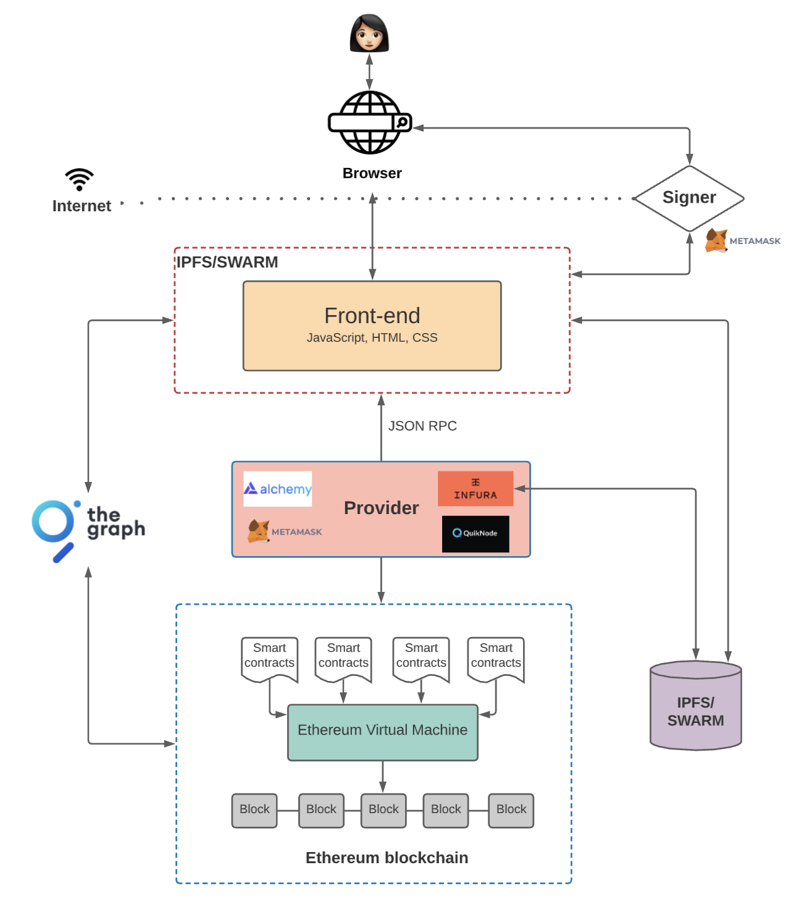
[source](https://www.preethikasireddy.com/post/the-architecture-of-a-web-3-0-application)


- With [this sample application](https://www.codementor.io/@beber89/webassembly-to-run-blockchain-using-go-yuw6f9u7m), a coin exchange between two people was done using blockchain.

- I recommend you read the article "[WebAssembly & The Future of Blockchain Computing](https://medium.com/@rauljordan/webassembly-the-future-of-blockchain-computing-1a0ae28f7e40)" by Raul Jordan, one of Ethereum's core developers. In it, he talks about the EVM (Ethereum Virtual Machine) being rewritten with WebAssembly. 

As you know, one of the most preferred structures for developing dApps is Ethereum. And the EVM is one of the core components of ethereum. I'm adding the answer to the question of what the EVM is by quoting directly from the koinsaati.com address.

>Smart contracts are used for many purposes, including the use of decentralized applications (DApps). Smart contracts are algorithms that run on the Ethereum blockchain. A contract is a collection of data and code stored at an Ethereum address. Smart contracts are used to apply predetermined rules. To create a smart contract on the Ethereum network (EVM), the Ethereum Virtual Machine expression needs to be used. The Virtual Machine basically creates an abstraction layer between the executing code and the executing machine. This layer is necessary for applications to be separated from each other and from their host computers.

The sentence "It creates an abstraction between the executed code and the executing machine" is very meaningful :) It looks as if WebAssembly was written for this place. 

- One of the Ethereum alternatives for dApp development is [Polkadot](https://polkadot.network/cross-chain-communication/?utm_source=mads&utm_medium=search&utm_campaign=xcm%202022&utm_content=brand): It's more concerned with communication between blockchains. It has a fremwork called [Substrate](https://substrate.io/), and applications can be developed using it. The applications developed here are also compiled as WebAssembly and run. But right now they only have a framework that supports the Rust language.

- Another blockchain platform for dApp development is [Cosmos](https://cosmos.network/): Like Polkadot, this one is also mostly concerned with communication between blockchains. In fact, its motto is "The Internet of Blockchains". Just like in the others, here the development ecosystem is built on WebAssembly; they have an infrastructure called [CosmoWasm](https://docs.cosmwasm.com/docs/1.0/) for developing smart contrsacts, but this one also only supports Rust for now.


Of course there are other systems too, but knowing how WebAssembly is used in the best known blockchain application development systems has probably given us enough of an idea about its future. 

Yes, that's it from me. Hope you found it useful.

See you in the next articles.
# Resources
- https://www.fermyon.com/blog/webassembly-vs-containers
- https://webassembly.org/docs/security/
- https://www.vivienfabing.com/blazor/2019/10/10/blazor-what-is-blazor.html
- https://dev.to/ahmad_butt_faa7e5cc876ea7/webassembly-docker-killer-1egd
- https://blog.scooletz.com/2020/06/08/capability-based-security
- https://www.storj.io/blog/secure-access-control-in-the-decentralized-cloud
- https://hacks.mozilla.org/2019/03/standardizing-wasi-a-webassembly-system-interface/
- https://webassembly.org/docs/security/
- https://webassembly.org/
- https://blog.ttulka.com/learning-webassembly-7-introducing-wasi/
- https://rsms.me/wasm-intro
- https://medium.com/@rauljordan/webassembly-the-future-of-blockchain-computing-1a0ae28f7e40
- https://github.com/bytecodealliance/wasmtime/blob/main/docs/WASI-tutorial.md
- https://www.infoworld.com/article/3678208/why-wasm-is-the-future-of-cloud-computing.html
- https://medium.com/hackernoon/games-build-on-webassembly-3679b3962a19
- https://platform.uno/blog/a-space-shooter-game-on-the-web-with-c-wasm-and-uno-platform/
- https://www.windley.com/archives/2012/03/protocols_and_metaprotocols_what_is_a_personal_event_network.shtml
- https://blog.devgenius.io/webassembly-wasm-in-blockchain-f651a8ac767b
- https://www.preethikasireddy.com/post/the-architecture-of-a-web-3-0-application


